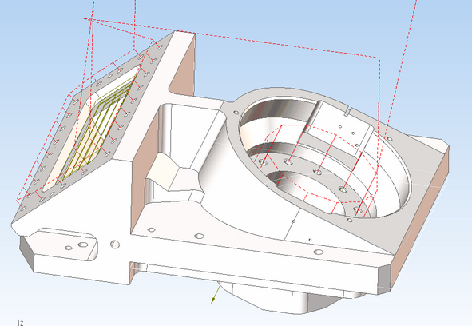

# Fresamento indexado de 5 eixos

Todas as operações 2D e 3D podem ser usadas para a usinagem indexada nos centros de usinagem de 4 e 5 eixos. É necessário definir as [posições dos eixos rotativos](260.md) ou o [sistema de coordenadas local](726.md).

O recurso de controle avançado dos limites dos eixos está disponível para operações multieixos.
