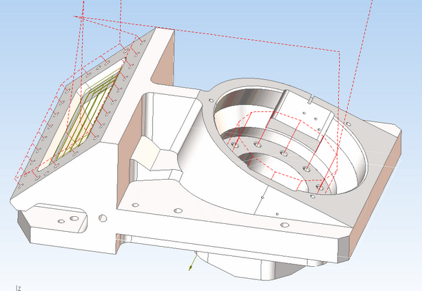

# 割出5軸加工

すべての2Dおよび3Dオペレーションは、4軸および5軸マシニングセンタでの割出加工に使用できます。[回転軸の位置](260.md)、または[ローカル座標系](726.md)を定義する必要があります。

[高度な軸制限制御](https://confluence.encycam.com/display/SC1/.Advanced+axes+limits+control+v20)は、多軸加工オペレーションで利用可能です。
