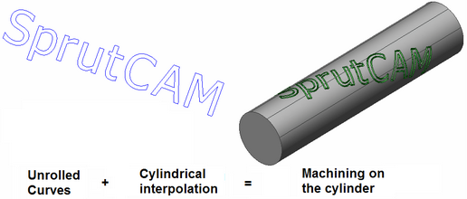
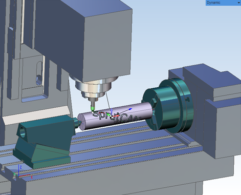

# Lavorazione rotativa con interpolazione cilindrica

Le operazioni `2D contouring`, `2.5D walls machining` e `2.5D pocketing` possono generare il percorso utensile per la fresatura continua a 4 assi. In questo caso è necessario utilizzare l'[interpolazione cilindrica](10082.md).

