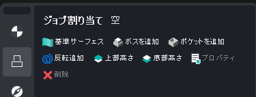
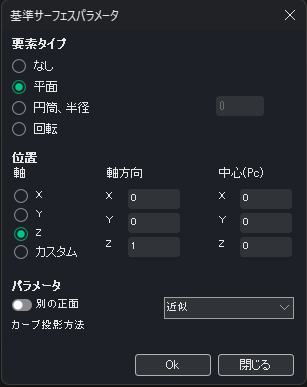

# 彫刻とポケット加工を伴う4軸ミーリング

[彫刻](810.md)と[ポケット加工](256.md)では、ジョブ割り当てを閉じた輪郭の集合として定義することができます。各輪郭は、それぞれがモデルの `ポケット`または `ボス`を定義します。

さらに、現在のオペレーションでは、定義した輪郭のいずれかを投影するための `基準サーフェス` を設定できます。基準サーフェスには、平面、円筒、または回転体を指定できます。

ジョブ割り当ての輪郭は、基準サーフェス上に直接ボスやポケットを定義することも、基準サーフェスを展開したカーブとして定義することもできます。[円筒補間](10082.md) とは異なり、この加工では、ワークを回転させる回転軸を工作機械が備えている必要はありません。
