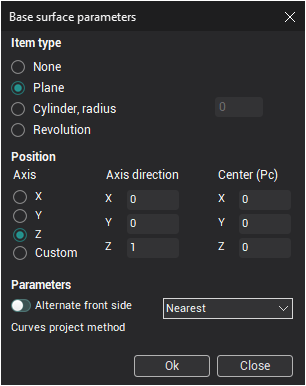

# Fresamento de 4 eixos com operações de gravação e cavidades

As operações de [gravação](810.md) e de [usinagem de bolsões](256.md) permitem definir a definição da tarefa como um conjunto de contornos fechados. Cada um deles define um **Pocket** (bolsão) ou um **Boss** (ressalto) do modelo.

Além disso, nessas operações é possível definir a **Base surface**, na qual os contornos definidos são projetados. A superfície base é um plano, um cilindro ou um sólido de revolução.

Os contornos da definição da tarefa podem definir ressaltos e bolsões diretamente sobre a superfície base ou ser curvas desenvolvidas (planificadas) dessa superfície. Ao contrário da [interpolação cilíndrica](10082.md), a máquina não precisa ter um eixo rotativo que gire o bruto.
