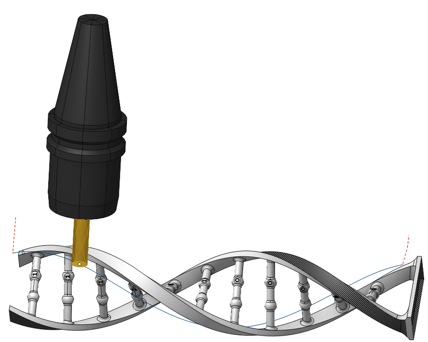
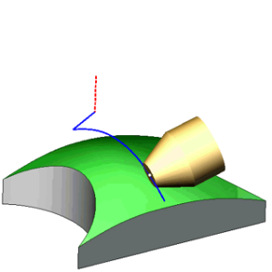
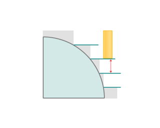
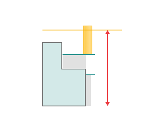
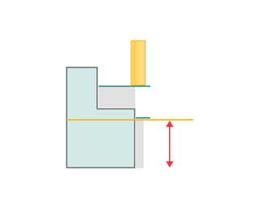
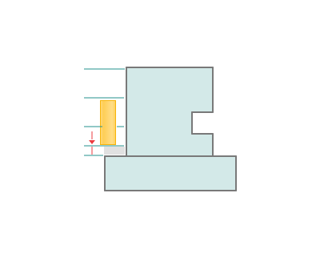

# 5D輪郭と6D輪郭操作

## 適用分野：

このオペレーションは、 任意の空間曲線に対する 同時5軸ツールパス を生成します。 選択した曲線に沿った 単一のツールパスの作成だけでなく、 選択したサーフェスのさまざまな等パラメトリックラインに沿った複数のパス生成や、選択した曲線に沿った多段加工にも対応しています。また、工具方向設定を幅広く選択でき、曲線上の各点におけるベクトルを編集することで、自動または手動で調整が可能です。

<strong>ジョブ割り当て</strong>で指定された曲線について、各点における工具方向ベクトルを変更できます。また、曲線に沿った工具の移動方向の変更、加工する側の変更、工具半径補正の設定、点ごとの工具方向ベクトルの補間方法の選択、およびストックを設定することができます。

## ジョブ割り当て：

<strong>サーフェス上のエッジ/カーブ ジョブ割り当て</strong>は、パーツのエッジまたは任意の曲線によって作成されます 。曲線上の各点におけるベクトルは、現在の工具方向によって決定されます。工具接触点は、曲線のプロパティおよび選択された工具方向設定に基づき、指定した曲線に沿って移動します。 [詳細を見る](https://confluence.encycam.com/display/SC1/.5-axis+milling+of+the+profile+on+the+surface+v19)

<strong>5Dカーブ</strong> システムは、任意の曲線をパーツ表面へ投影した形状として、5軸ツールパスを生成します。この場合、工具接触点は常にサーフェスに接した状態で移動します。加工パスは、ストックまたは高さ設定によって曲線からオフセットできます。工具軸はサーフェスに対して垂直に配置されます<strong>。</strong> [詳細を見る](https://confluence.encycam.com/display/SC1/.5-axis+milling+of+the+profile+on+the+surface+v19)

<strong>ドライブフェイス</strong> 等パラメトリック線に沿った加工パスを生成するために使用できます。サーフェスの等パラメトリック曲線は、その作成方法に依存しており、サーフェスのトポロジーを反映します。この方法は、さまざまなフィレット加工に非常に適しています。[詳細を見る](https://confluence.encycam.com/display/SC1/.5-axis+milling+along+the+isoparametric+curves+v19)

<strong>プロパティ</strong> 要素のプロパティを表示します。ストックを追加することも可能です。リスト内の項目をダブルクリックすることでも、このメニューを表示できます。

<strong>削除</strong> リストから項目を削除します。

<strong>制限</strong> 加工してはならない領域を制限することができます。[詳細を見る](101231.md)

## 加工設定：

### 工具接触点

工具接触点 (TCP) は、加工中に工具とワークのサーフェス、または幾何要素との主な接触位置を定義する、切削工具上の特定の位置です。

このグループのパラメータは、 <strong>5Dサーフェシングオペレーション</strong> と同様です。 [詳細を見る](https://confluence.encycam.com/display/SC1/.5d+surfacing+operation+v19.1)

### 工具の向き

加工中の工具軸の向きを制御します。工具方向の主要なパラメータは、 <strong>5Dサーフェシング</strong>オペレーションと同様です。[詳細を見る](https://confluence.encycam.com/display/SC1/.5d+surfacing+operation+v19.1)

拡大

<strong>傾斜形状工具</strong> ツールパスの移動中に、工具の加工側が加工面に接触するよう工具を傾けます。

### 回転角度制限：

このオプションは、軸に対する工具の角度位置の制限値を指定します。<strong>回転角度の制限</strong>のパラメータは、 <strong>5Dサーフェシングオペレーションオペレーション</strong>と同様です。[詳細を見る](https://confluence.encycam.com/display/SC1/.5d+surfacing+operation+v19.1)

### パス

指定した曲線に対して、追加の加工パスを作成できます。パスはサーフェスの法線方向にシフトします。 工具向きとして<strong>側面</strong>が選択されている場合は、シフトの方向を選択できます。

拡大

<strong>ステップ</strong> <strong>上部高さ</strong>、<strong>底部高さ</strong>の間で、1回のパスで除去される材料量を設定します。 <strong>ステップ</strong> は、長さ単位による厚さ、工具直径に対する割合（%）、またはパス数で指定できます。

<strong>上部高さ</strong> 指定したカーブを基準として、 荒加工パスで除去する 最大残材量を定義します。

<strong>底部高さ</strong> 加工サーフェスから最終パスまでの距離を定義します。 値が正の場合、工具は ワーク素材の外側を 指定距離だけ離れた パスをたどります。 値が負の場合、工具は指定された深さまで ワーク素材を切削します 。

<strong>Z仕上げ</strong> <strong>底部高さ</strong>からパラメータで指定した距離だけ離れた位置に、新しいパスを追加します。

<strong>方向</strong> 工具方向設定が有効な場合、 荒加工パスの配置方向を選択できます。

<strong>サーフェスに垂直</strong> 加工パスを、 サーフェスの法線方向に配置します。

<strong>工具軸に沿って</strong> 加工パスを、工具軸のベクトル方向に配置します。

### コーナーの円滑化：

工具方向が急変する場合、フライス制御は回転開始前に減速し、その後再び加速します。この動作により、振動が発生しやすくなり、工具およびフライス盤の摩耗が増大する可能性があります。ツールパスの途切れを極力減らすことで、この問題は解決できます。このため、システムにはモデルの内側や外側のコーナーを加工する際に、指定された半径を用いてツールパスを滑らかにする機能があります。 基本的なパラメータは、<strong>2D輪郭</strong>オペレーションと同様です。[詳細を見る](https://confluence.encycam.com/display/SC1/.2D+contouring+v19)

### 連続的な軸移動：

工具向きとして <strong>側面</strong> を使用している場合 、指定した曲線を基準として、パスに沿って工具の軸方向変位を滑らかに変化させたツールパスを作成できます。

拡大

<strong>開始シフト値</strong> ツールパスの開始位置での工具の軸方向シフト量です。

<strong>終了ドシフト値</strong> ツールパスの終了位置での工具の軸方向シフト量です。

### 内側から加工

このパラメータにより、部品の内部サーフェスを加工できます（ツールパスを部品の内部サーフェスに投影します）。このパラメーターグループは <strong>5Dサーフェシングオペレーションと同様に機能します。ジョブゾーンのセクションを参照してください。</strong>[詳細を見る](https://confluence.encycam.com/display/SC1/.5d+surfacing+operation+v19.1)

### 並べ替え

面加工中のツールパス順序を制御します 。

拡大

<strong>ツールパス結合モード</strong> 部品上の異なる輪郭を多段加工する際の 、加工パス実行順序を設定 します。この機能の主要パラメータは、<strong>2D輪郭</strong>オペレーションと同様です。[詳細を見る](https://confluence.encycam.com/display/SC1/.2D+contouring+v19)

<strong>空送り最小化</strong> 空送り動作を最小化するように加工順序を並べ替えます。この機能の主要 パラメータは、 <strong>2D輪郭</strong> オペレーションと同様です。 [詳細を見る](https://confluence.encycam.com/display/SC1/.2D+contouring+v19)

<strong>ミーリングタイプ</strong> 曲線加工オペレーションを除き、ほぼすべてのオペレーションで設定可能です。これにより、ユーザーはツールパスの計算プロセス中に、必要なフライス加工方法（ダウンカットまたはアップカット）を制御できます。ミーリングタイプのパラメータは、<strong>ウォータライン荒加工オペレーション</strong>と同様 です。 [詳細を見る](https://confluence.encycam.com/display/SC1/.Waterline+roughing+operation+v19)

### オフセット投影：

パーツのサーフェスを基準としたツールパスの生成方法を設定します。この機能のパラメータは、<strong>2D輪郭</strong>の<strong>加工設定</strong>タブ内にある<strong>変換</strong>項目と同様です。[詳細を見る](https://confluence.encycam.com/display/SC1/.2D+contouring+v19)

### トリミング

加工対象外の面をスキップすることを 可能にし、 またツールパスの延長も可能にします。 トリム のパラメータは、<strong>ウォータライン荒加工オペレーション</strong>と同様です。 [詳細を見る](https://confluence.encycam.com/display/SC1/.Waterline+roughing+operation+v19)

## リンク／リード

リンク／リードタブでは、早送り動作のパラメータを設定します。これらの移動には、工具交換位置からのアプローチ、切削パス開始点までの位置決め、最終切削後の退避動作、各パス間の移行移動、および工具交換位置への復帰が含まれます。座標軸ごとの動作順序、各移動の軌跡、および移動量を設定できます。

拡大

<strong>次の項目で構成されます。</strong>

<strong>アプローチ／リターン</strong> このパラメータグループは、工具交換位置から切込み開始パスへの工具の移動、および戻りの動作を管理します。[詳細を見る](https://confluence.encycam.com/pages/viewpage.action?pageId=131904799)

<strong>リンク</strong> 進入／退出リンクおよび加工パス間のリンクに関するルールを設定します。[詳細を見る](https://confluence.encycam.com/pages/viewpage.action?pageId=137006979)

<strong>リード</strong> 移動動作に対して、送り速度を使用して追加の突き込みおよび退避を追加できます。 [詳細を見る](https://confluence.encycam.com/display/SC1/.Leads+for+5-axis+operation+v19.1)

<strong>安全動作</strong> <strong>安全サーフェス</strong>のタイプとワークから安全サーフェスまでの距離を設定します。加工サーフェスまたはツールパス間の移行を円滑にし、アプローチまたはリターンの最初の段階は、この面に向かって行われます。[詳細を見る](100117.md)

<strong>高度なリンク設定</strong> このパラメータグループは、主に5軸加工において、回転軸の最適な動きを考慮した軌道形成の特徴を指定します。[詳細を見る](100118.md)

<strong>距離</strong> リンクのルールで使用される距離です。 [詳細を見る](https://confluence.encycam.com/pages/viewpage.action?pageId=137012802)

## 送り速度設定

このダイアログを使用して、主軸回転速度、早送り値、ツールパスの異なる領域の送り値を設定できます。主軸回転速度は、毎分回転数または切削速度のいずれかで設定できます。設定値には下線が表示されます。もう一方の値は、工具径を考慮し、設定値に基づいて再計算されます。[詳細を見る](https://confluence.encycam.com/pages/viewpage.action?pageId=155781547)

## 変換：

オペレーション内で計算された工具の軌跡に対して座標変換を行うための工程のパラメータグループです。 [詳細を見る](10168.md)

## パーツ：

パーツは、干渉をチェックする空間を定義する幾何要素のグループです。[詳細を見る](330.md)

## ワーク：

加工のワークモデルは、加工する素材を定義します。[詳細を見る](738.md)

## 治具：

治具には通常、チャック、グリップ、クランプなどの固定補助具と、その他の種類の制限領域を指定します。[詳細を見る](10283.md)
