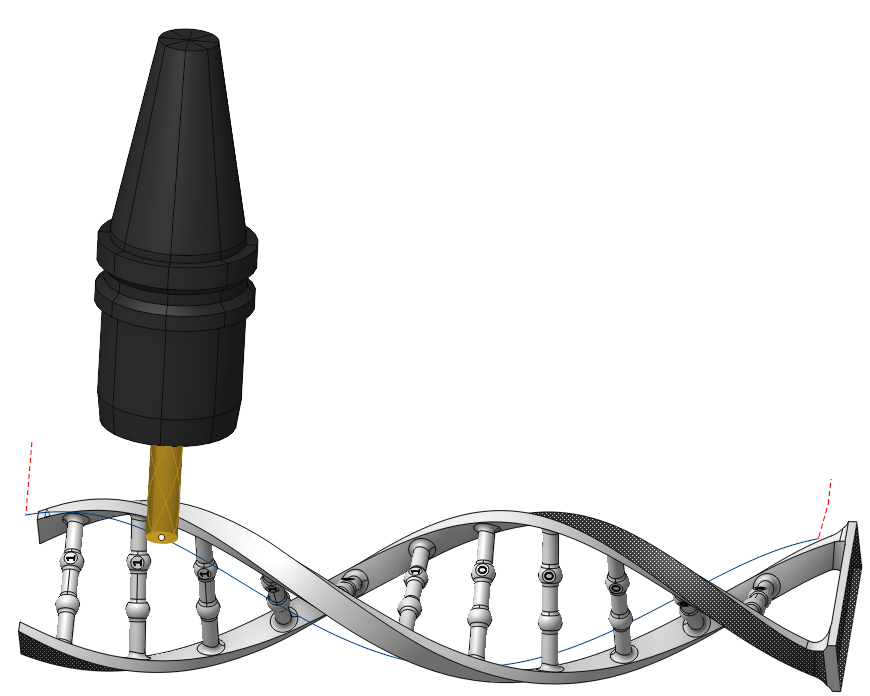
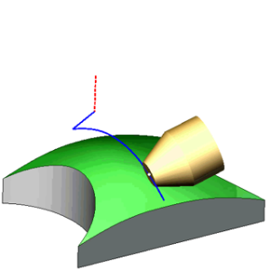
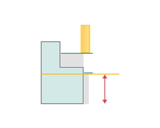
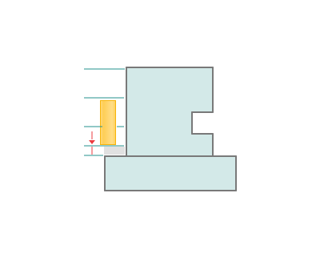

# Contorno 5D e contorno 6D

## Ambito di applicazione:

Questa operazione genera un percorso utensile continuo a 5 assi per qualsiasi curva spaziale. Consente sia la costruzione di un singolo percorso utensile lungo una curva scelta, sia passate lungo più linee isoparametriche di una superficie selezionata, nonché la lavorazione multilivello lungo una curva specificata. Offre un'ampia scelta di strategie di orientamento dell'utensile, regolabili automaticamente oppure manualmente modificando i vettori in ogni punto della curva.

Per le curve specificate nella scheda <strong>Job Assignment</strong> (assegnazione del lavoro), l'utente può modificare i vettori di orientamento dell'utensile in ogni punto, cambiare la direzione di movimento dell'utensile lungo la curva, modificare il lato di lavorazione, compensare il raggio dell'utensile, selezionare il metodo di interpolazione per la variazione del vettore di orientamento dell'utensile da un punto all'altro e impostare il sovrametallo.

### Assegnazione del lavoro:

<strong>Edge/Curve on Surface. L'assegnazione del lavoro</strong> è formata dagli spigoli del pezzo o da curve qualsiasi. L'orientamento corrente dell'utensile determina i vettori nei punti della curva. Il punto di contatto dell'utensile si muove lungo la curva specificata in base alle proprietà della curva e alla strategia di orientamento dell'utensile scelta. [Dettagli](10131.md)

<strong>5D Curve.</strong> (curva 5D) Il sistema genera il percorso utensile a 5 assi come proiezione di curve arbitrarie sulla superficie del pezzo. In questo caso il punto di contatto dell'utensile si muove a contatto con la superficie. Le passate possono essere spostate rispetto alla curva in base al sovrametallo o ai livelli. L'asse dell'utensile è disposto perpendicolarmente alla superficie. [Dettagli](10131.md)

<strong>Drive Faces</strong>. (facce guida) Possono essere utilizzate per creare passate di lavoro lungo le linee isoparametriche. Le curve isoparametriche delle superfici dipendono dal modo in cui queste sono state create e riflettono la topologia della superficie. In questo modo si possono lavorare molto bene raccordi di vario tipo. [Dettagli](10130.md)

<strong>Recognize elements.</strong> (riconosci elementi) Consente di riconoscere i seguenti elementi costruttivi: cerchio, rettangolo, rettangolo arrotondato, asola, esagono e asola a buco di serratura (Keyhole). [Dettagli](100152.md)

<strong>Properties.</strong> (proprietà) Visualizza le proprietà di un elemento. È possibile aggiungere il sovrametallo. Questo menu può essere richiamato anche facendo doppio clic su una voce dell'elenco.

<strong>Delete.</strong> (elimina) Rimuove una voce dall'elenco.

<strong>Restrictions.</strong> (restrizioni) Consente di delimitare le zone che non devono essere lavorate. [Dettagli](101231.md)

### Strategia:

#### Tool contact point (punto di contatto dell'utensile).

Il punto di contatto dell'utensile (Tool Contact Point, TCP) è una posizione specifica sull'utensile da taglio che definisce il punto principale di interazione tra l'utensile e la superficie del grezzo o le entità geometriche durante le operazioni di lavorazione.

I parametri di questo gruppo sono gli stessi dell'<strong>operazione 5D Surfacing</strong>. [Dettagli.](10135.md)

#### Tool Orientation (orientamento dell'utensile):

Controlla l'orientamento dell'asse dell'utensile. I parametri principali di questa funzione sono gli stessi dell'<strong>operazione 5D Surfacing</strong>. [Dettagli.](10135.md)

Fare clic qui per espandere..

<strong>Incline Shape Tool.</strong> (inclina l'utensile sagomato) Inclina l'utensile in modo che il suo lato di lavoro tocchi la superficie lavorata durante la percorrenza del percorso utensile.

#### Limit Rotation Angles (limitazione degli angoli di rotazione):

Questa opzione specifica i valori limite della posizione angolare dell'utensile rispetto agli assi. I parametri di <strong>Limit Rotation Angles</strong> sono gli stessi dell'<strong>operazione 5D Surfacing.</strong> [Dettagli](10135.md).

#### Passes (passate):

È possibile creare passate di lavoro aggiuntive rispetto alle curve specificate. Le passate vengono spostate in direzione normale alla superficie. Se è selezionato l'orientamento dell'utensile <strong>Flank</strong> (di fianco), è possibile scegliere la direzione degli spostamenti.

Fare clic qui per espandere..

<strong>Step</strong>. (passo) Materiale asportato in una passata tra i livelli <strong>Top</strong> e <strong>Bottom Levels</strong> (livello superiore e inferiore). Il parametro <strong>Step</strong> può essere specificato sia come spessore in unità di lunghezza o in percentuale del diametro dell'utensile, sia come numero di passate.

Top Level. (livello superiore) Definisce il sovrametallo massimo, misurato dalla curva specificata, che deve essere asportato dalle passate di sgrossatura.

Bottom Level. (livello inferiore) Definisce la distanza dalla superficie lavorata all'ultima passata. Se il valore è positivo, l'utensile segue un percorso all'esterno del materiale del grezzo alla distanza specificata. Se il valore è negativo, l'utensile taglia il materiale del pezzo alla profondità specificata.

<strong>Z Cleanup.</strong> (passata di ripulitura in Z) La funzione aggiunge una nuova passata alla distanza, specificata nel parametro, dal livello <strong>Bottom Level</strong>.

<strong>Direction.</strong> (direzione) Con la strategia di orientamento dell'utensile <strong>Flank</strong> attiva, è possibile selezionare la direzione in cui disporre le passate di sgrossatura.

<strong>Along Surface Normal.</strong> (lungo la normale alla superficie) Le passate vengono disposte in direzione normale alla superficie.

<strong>Along Tool Axis.</strong> (lungo l'asse dell'utensile) Le passate vengono disposte lungo il vettore dell'asse dell'utensile.

#### Corners smoothing (raccordo degli angoli):

Quando la direzione dell'utensile cambia bruscamente, il controllo della fresatrice decelera prima di iniziare la svolta e poi accelera di nuovo. Ciò può causare vibrazioni e una forte usura dell'utensile e della fresatrice. Il problema può essere risolto se il percorso utensile presenta pochissimi spigoli vivi o nessuno. Per questo motivo il sistema dispone della funzione di raccordo del percorso utensile con un raggio definito per la lavorazione degli angoli interni o esterni del modello. I parametri principali di questa funzione sono gli stessi dell'<strong>operazione 2D Contouring</strong>. [Dettagli.](404.md)

#### Continous axial shifting (spostamento assiale continuo):

Quando è in uso la strategia di orientamento dell'utensile <strong>Flank</strong>, è possibile creare un percorso utensile con variazioni graduali dello spostamento assiale dell'utensile lungo il percorso rispetto alla curva specificata.

Fare clic qui per espandere..

<strong>Start Shift Value.</strong> (valore di spostamento iniziale) Lo spostamento assiale dell'utensile all'inizio del percorso utensile.

<strong>End Shift Value.</strong> (valore di spostamento finale) Lo spostamento assiale dell'utensile alla fine del percorso utensile.

#### Machining from inside (lavorazione dall'interno).

Il parametro consente di lavorare le superfici interne del pezzo (proiettare il percorso utensile sulle superfici interne del pezzo). Questo gruppo di parametri funziona in modo analogo all'<strong>operazione 5D Surfacing, nella sezione Job zone.</strong> [Dettagli](10135.md)

#### Sorting (ordinamento):

Controlla la sequenza delle passate del percorso utensile durante la lavorazione delle superfici.

Fare clic qui per espandere..

<strong>Toolpath uniting mode.</strong> (modalità di unione dei percorsi utensile) Controlla l'ordine di esecuzione delle passate nella lavorazione a più passate di profili diversi del pezzo. I parametri di questa funzione sono gli stessi dell'<strong>operazione 2D Contouring</strong>. [Dettagli.](404.md)

<strong>Idling minimization.</strong> (minimizzazione dei movimenti a vuoto) L'ordine di lavorazione dei profili viene ordinato in modo da ridurre al minimo i movimenti a vuoto. I parametri di questa funzione sono gli stessi dell'<strong>operazione 2D Contouring</strong>. [Dettagli.](404.md)

<strong>Milling type.</strong> (tipo di fresatura) Può essere assegnato in quasi tutte le operazioni, tranne quelle di lavorazione di curve. Consente all'utente di controllare il tipo di fresatura richiesto (concorde o discorde) durante il calcolo del percorso utensile. I parametri di <strong>Milling Type</strong> sono gli stessi dell'<strong>operazione</strong> <strong>Waterline Roughing</strong>. [Dettagli.](736.md)

#### Project toolpath onto the part with offset (proiezione del percorso utensile sul pezzo con offset):

Determina il metodo di creazione del percorso utensile rispetto alla superficie del pezzo. I parametri di questa funzione sono gli stessi della scheda <strong>Startegy</strong>, alla voce <strong>Transformations</strong> dell'<strong>operazione 2D Contouring</strong>. [Dettagli.](404.md)

#### Trimming (rifilatura):

Consente di escludere le superfici che non devono essere lavorate e di estendere il percorso utensile. I parametri di <strong>Trimming</strong> sono gli stessi dell'<strong>operazione Waterline Roughing</strong>. [Dettagli.](736.md)

### Parametri:

Questa scheda contiene i parametri principali per il controllo del pezzo, del grezzo, delle attrezzature di bloccaggio e di altri elementi, che consentono di modificare il percorso utensile. [Dettagli](100112.md)

### Collegamenti/Attacchi:

Nella scheda Links/Leads si definiscono i parametri dei movimenti rapidi. Questi movimenti comprendono l'avvicinamento dell'utensile dalla posizione di cambio utensile, l'attacco all'inizio della corsa di lavoro, la retrazione dopo l'ultimo movimento di taglio, i collegamenti tra le passate di lavoro e il ritorno al punto di cambio utensile. È possibile configurare la sequenza dei movimenti lungo le coordinate, il percorso di questi movimenti e l'entità degli spostamenti.

Fare clic qui per espandere..

<strong>Comprende:</strong>

<strong>Approach/Return.</strong> (avvicinamento/ritorno) Questo gruppo di parametri gestisce i movimenti dell'utensile dalla posizione di cambio utensile all'inizio dei percorsi di attacco e viceversa. [Dettagli](100116.md).

<strong>Links.</strong> (collegamenti) Definisce le regole che governano i collegamenti di entrata/uscita e i collegamenti tra i movimenti di lavoro. [Dettagli](100130.md).

<strong>Leads.</strong> (attacchi) Consente di aggiungere ai movimenti di lavoro ulteriori attacchi e retrazioni eseguiti con il relativo avanzamento. [Dettagli](100136.md).

<strong>Safe motions.</strong> (movimenti di sicurezza) Definisce il tipo di <strong>Safety Surface</strong> (superficie di sicurezza) e la sua distanza dal grezzo. Questa superficie agevola i collegamenti tra le superfici lavorate o tra i percorsi utensile, e la prima fase dell'avvicinamento o del ritorno avviene verso di essa. [Dettagli](100117.md).

<strong>Advanced links settings.</strong> (impostazioni avanzate dei collegamenti) Questo gruppo di parametri specifica le caratteristiche della formazione del percorso utensile soprattutto per le operazioni a cinque assi, tenendo conto dei movimenti ottimali degli assi rotativi. [Dettagli](100118.md).

<strong>Distances.</strong> (distanze) Distanze utilizzate nelle regole dei collegamenti (Links) [Dettagli](100140.md).

### Avanzamenti/Velocità:

In questa finestra di dialogo l'utente può definire la velocità di rotazione del mandrino, la velocità del movimento rapido e i valori di avanzamento per le diverse parti del percorso utensile. La velocità di rotazione del mandrino può essere definita come numero di giri al minuto oppure come velocità di taglio. Il valore determinante viene sottolineato. Il secondo valore viene ricalcolato in base al valore determinante, tenendo conto del diametro dell'utensile. [Dettagli](100142.md)

### Trasformazioni:

Insieme di parametri dell'operazione che consentono di eseguire trasformazioni di coordinate sul percorso utensile calcolato nell'ambito dell'operazione. [Dettagli](10168.md)

### Pezzo:

Il pezzo (Part) è un gruppo di elementi geometrici che definisce lo spazio in cui controllare le intaccature. [Dettagli](330.md)

### Grezzo:

Il modello del grezzo (Workpiece) di un'operazione definisce il materiale da lavorare. [Dettagli](738.md)

### Attrezzature:

Come attrezzature (Fixtures) si specificano di solito i dispositivi di bloccaggio, come autocentranti, morse, staffe, ecc., e le aree di esclusione di qualsiasi altra natura. [Dettagli](10283.md)
