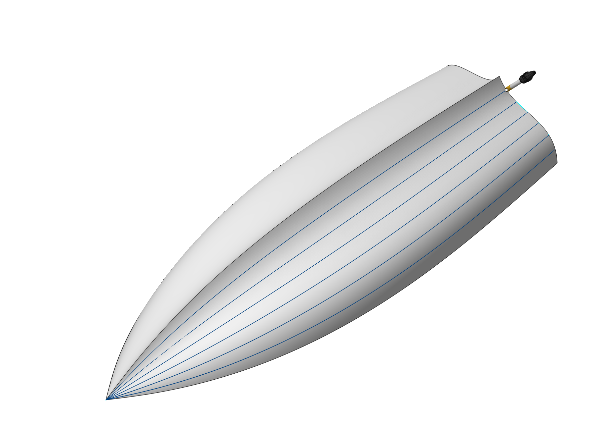
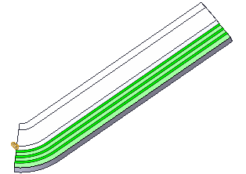
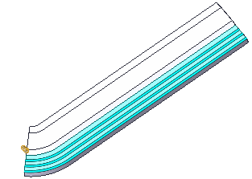
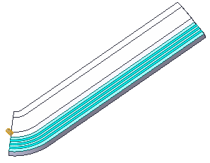

# ドライブフェイスのパラメータ

## 適用分野：

<strong>ドライブフェイス</strong>を使用すると、等パラメトリック線に沿った加工パスを作成できます。サーフェスの等パラメトリック曲線は、その作成方法に依存します。多くの場合、サーフェスのトポロジーを反映するため、加工パスとして非常に有効であり、さまざまなフィレット加工に適しています。等パラメトリック線を使用するには、<strong>6D輪郭加工</strong>オペレーションの<strong>ジョブ割り当て</strong>にサーフェスを追加します。対象のサーフェスを選択し、Drive facesボタンをクリックしてください。同様のパラメータ構成を持つ複数のフェイスを選択して、Drive facesボタンを1回クリックしてリストに追加すると、それらはまとめて加工されます。

## 項目のプロパティ：

### 基本情報：

<strong>Name</strong>。<strong>ジョブ割り当て</strong>リストに表示する項目名を指定します。

<strong>Stock</strong>。指定値だけ、荒加工パスと仕上げパスの両方を加工面からオフセットします。値が正の場合、工具はワーク素材の外側を指定距離だけ離れて移動します。値が負の場合、工具は指定した深さまでパーツ素材に切り込みます。

<strong>Selected Count。</strong> 選択した項目の数です。

### ドライブフェイスのパラメータ：

<strong>Alternate Streamline。</strong> パス方向を直交する方向に切り替えます。

<strong>Alternate Front Side。</strong> 加工するサーフェスの側を裏側に切り替えます。

<strong>Step Method。</strong> 等パラメトリック曲線間の距離を設定する方法を選択します。

<strong>Number</strong>。テキストフィールドに、<strong>ドライブフェイス</strong>内の等パラメトリック線の本数を入力します。

<strong>Distance</strong>。テキストフィールドに、等パラメトリック線間の距離を入力します。

<strong>Scallop</strong>。テキストフィールドに、必要なスキャロップ値を入力します。

<strong>Curve Distribution</strong>。CAMシステムが<strong>ドライブフェイス</strong>上に等パラメトリック曲線を配置する方法を制御します。

詳細を表示

From Start。最初の曲線をサーフェスの左端に配置し、残りの曲線をその右側に配置します。

From End。最初の曲線をサーフェスの右端に配置し、残りの曲線をその左側に配置します。

From Center。最初の曲線をサーフェスの中央に配置し、残りの曲線をその左右に配置します。

Auto。加工方法と工具軸方向に基づいて、CAMシステムが曲線の配置方法を決定します。

### 項目の構成要素。

項目に含まれるモデル構成要素の一覧です。

<strong>Delete。</strong> 選択した構成要素を項目から削除します。

<strong>Clear</strong>。項目からすべての構成要素を削除します。
