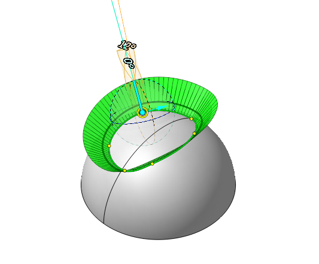
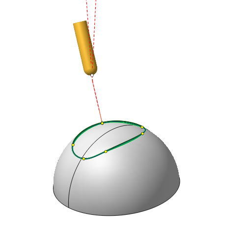
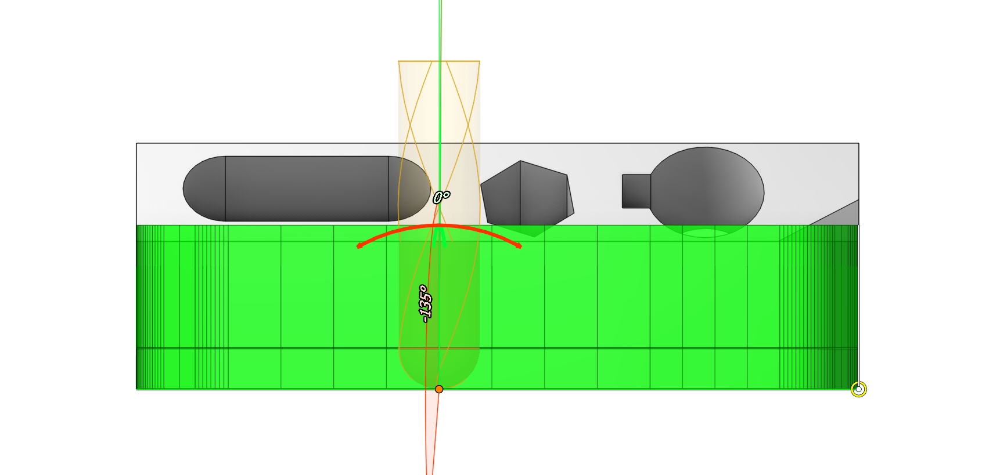
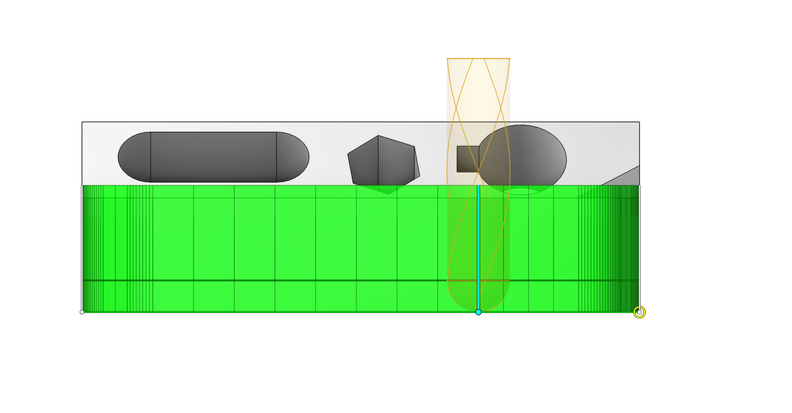
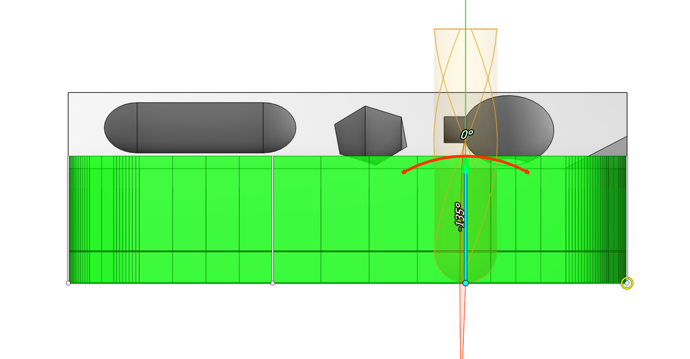
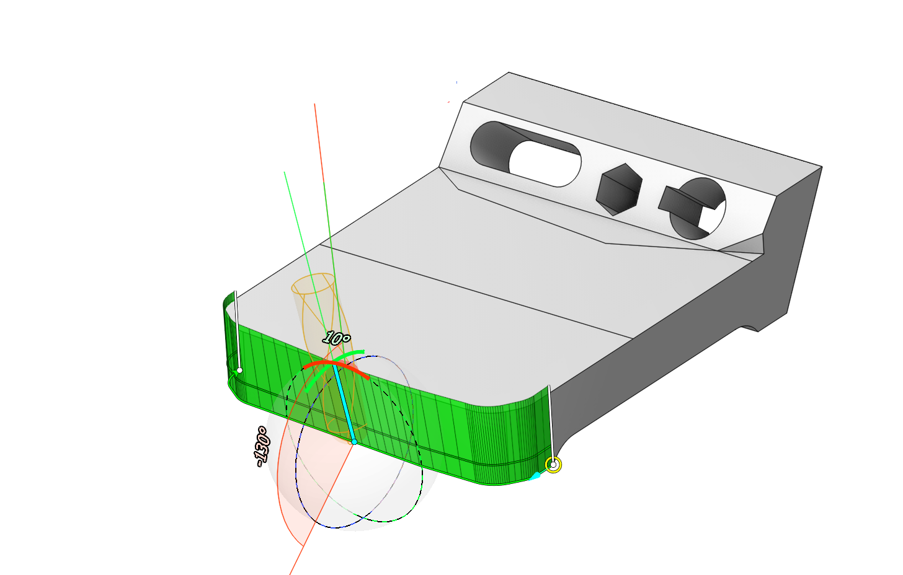
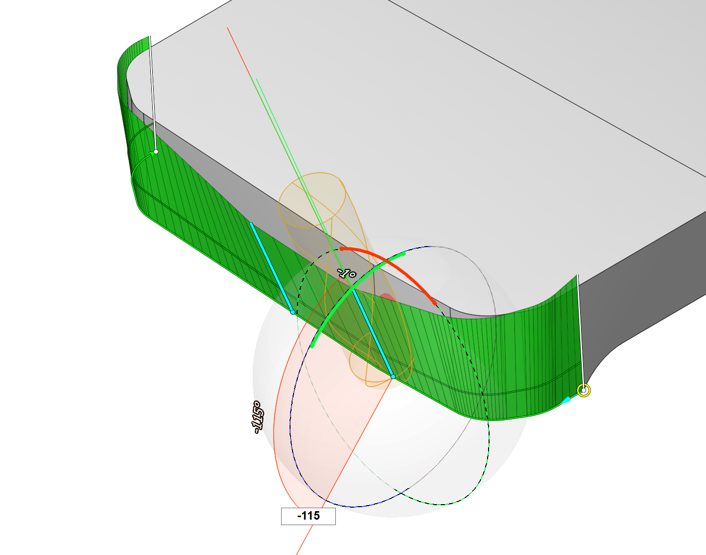
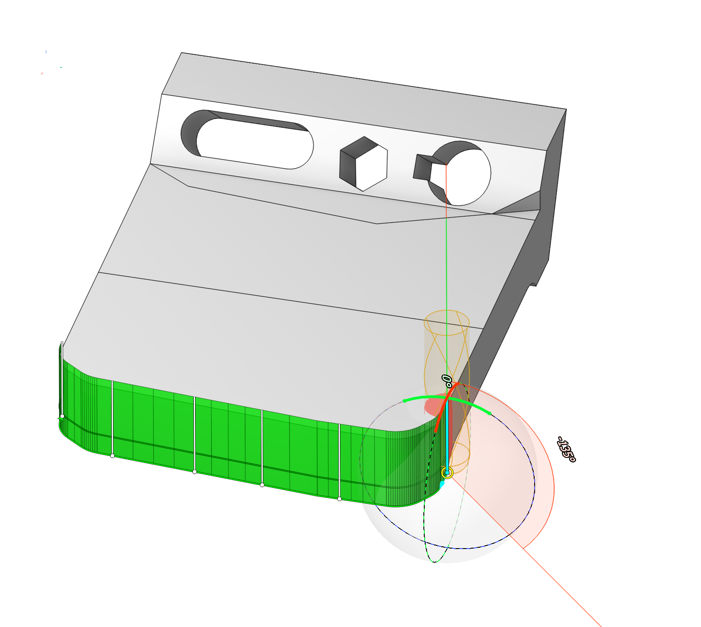
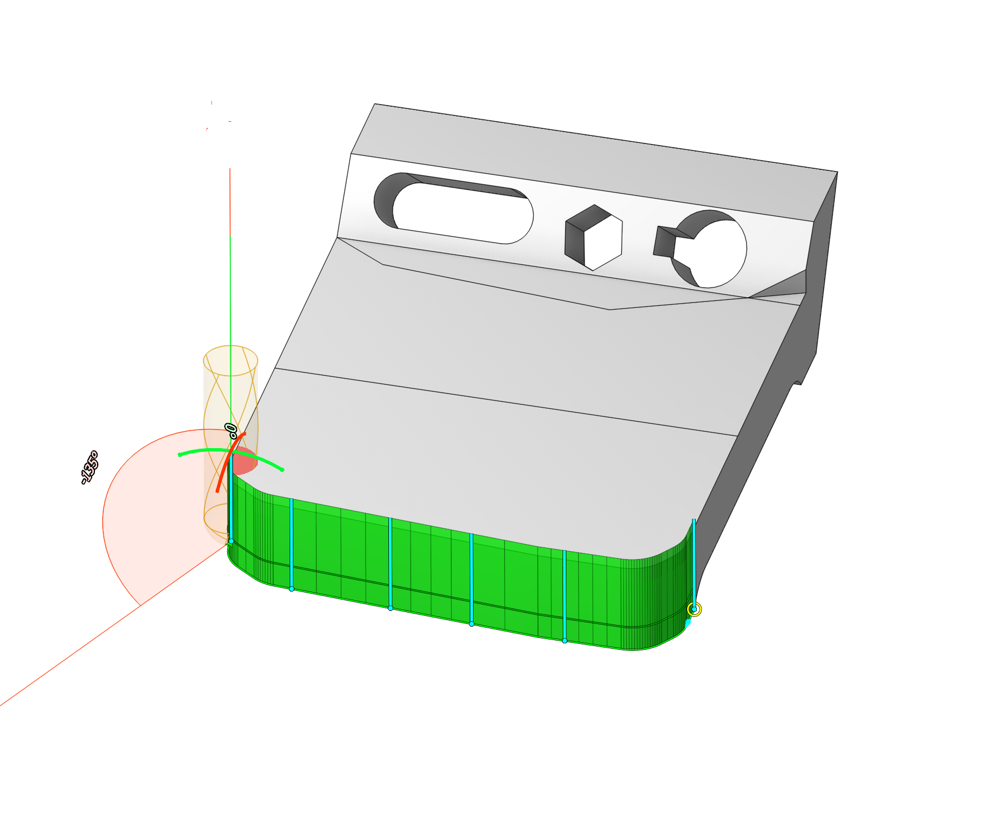
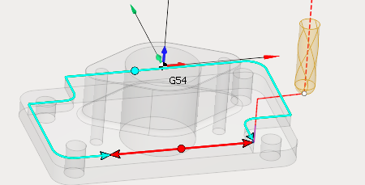

# Parametri delle curve

<strong>Ambito di applicazione:</strong>

L'operazione 6D Contouring (contornatura 6D) consente di creare il percorso utilizzando due varianti di linee di <strong>Job Assignment</strong> (assegnazione del lavoro):

<strong>5D Curve.</strong> Il sistema genera il percorso utensile a 5 assi come proiezione di curve arbitrarie sulla superficie del pezzo. In questo caso la punta dell'utensile si muoverà a contatto con la superficie. Specificare come parte dell'operazione le superfici o il corpo su cui eseguire la proiezione.

Fare clic qui per espandere..

<strong>Edge/Curve on Surface. Job assignment</strong> viene formata con gli spigoli del pezzo o con curve qualsiasi. Se gli spigoli non vengono evidenziati quando il puntatore del mouse passa su di essi, verificare il pulsante di selezione degli spigoli sul pannello dei filtri (lo stesso vale per le curve). Deve essere premuto.

Se il pulsante del filtro di selezione degli spigoli è premuto ma gli spigoli non vengono ancora evidenziati, [cucire](1000.md) le facce. Se un insieme di spigoli collegati deve essere lavorato in una sola passata, deve essere selezionato insieme dallo schermo e aggiunto all'elenco <strong>Job Assignment</strong> con un solo clic sul pulsante Edge\Curve on surface. In questo caso gli spigoli vengono uniti in un'unica voce e lavorati come un tutto. Se gli spigoli vengono aggiunti all'elenco separatamente, vengono lavorati separatamente anche se sono collegati. Tenere premuto Ctrl per selezionare più oggetti contemporaneamente dallo schermo. Questa opzione è utilizzata più comunemente quando è necessario fresare superfici con la parte laterale della fresa. In questo caso è possibile selezionare come <strong>Job Assignment</strong> gli spigoli inferiori della superficie da lavorare.

Fare clic qui per espandere..

<strong>Proprietà della voce:</strong>

## Informazioni di base:

<strong>Name</strong> (nome). Specificare un nome con cui la voce comparirà nell'elenco <strong>Job Assignment</strong>.

<strong>Stock</strong> (sovrametallo). Questa funzione consente di spostare le passate di sgrossatura e di finitura rispetto alla superficie lavorata del valore specificato. Se il valore è positivo, l'utensile seguirà un percorso all'esterno del materiale del grezzo alla distanza specificata. Se il valore è negativo, l'utensile taglierà il materiale del pezzo alla profondità specificata.

<strong>Selected Count.</strong> Numero di elementi selezionati.

## Parametri di proiezione delle curve:

<strong>Alternate Direction.</strong> Questa funzione inverte la direzione del percorso utensile lungo la curva.

<strong>Alternate Front Side.</strong> Uno spigolo/una curva può appartenere a due superfici diverse. Premendo questo pulsante è possibile passare da una all'altra delle due superfici.

## Proprietà:

Un importante vantaggio dell'operazione 6D Contouring del sistema CAM è la sua serie completa di funzioni per regolare i parametri del movimento dell'utensile lungo la curva. Questi parametri possono essere modificati in modo interattivo nella finestra grafica oppure nella finestra di dialogo.

Fare clic qui per espandere..

Nella finestra grafica è possibile regolare i vettori che determinano l'orientamento dell'utensile nei punti lungo la curva selezionata. Ciò può essere fatto nei modi seguenti:

- facendo clic su un punto della curva e tenendo premuto il tasto sinistro del mouse, è possibile spostare il vettore lungo il contorno.  
- eseguendo la stessa operazione con il tasto Ctrl premuto, si sposterà il vettore copiato, mentre quello principale rimarrà al suo posto.

 

- facendo clic sul vettore, è possibile modificarne la direzione tramite la sfera interattiva, che ha due circonferenze lungo e attraverso la superficie originale (oppure modificando il valore di due angoli).

- tenendo premuto Maiusc, il tasto sinistro del mouse consente di inclinare il vettore rigorosamente verso il punto sulla superficie del pezzo.
- eliminare il vettore con il tasto Canc della tastiera.

- Funzionalità di selezione multipla estesa: la modifica dell'angolo di un vettore tramite la regolazione della dimensione o la rotazione della semicirconferenza ora propaga la variazione dell'angolo a tutti i vettori selezionati. (utilizzando <strong>Ctrl/Maiusc</strong>)

- Per selezionare un gruppo di vettori, fare clic sul primo vettore tenendo premuto Maiusc, quindi fare clic sull'ultimo vettore tenendo premuto Maiusc. Tutti i vettori compresi tra di essi verranno selezionati.

 

Trascinando il punto circolare è possibile modificare l'inizio del percorso utensile. Facendo clic sulla freccia blu è possibile cambiare la direzione del percorso dell'utensile lungo la curva.

Quando si fa clic su una curva, compare una finestra a comparsa che consente di specificare i seguenti parametri:

<strong>Lead in.</strong> Configura la direzione dell'asse utensile e la lunghezza dell'attacco. All'attivazione di questa funzione diventano visibili una freccia gialla e un segmento di linea che parte da un punto giallo. Trascinando questo segmento si regolano sia la lunghezza sia la direzione dell'attacco. Ruotando la freccia gialla, l'utente può modificare l'orientamento dell'utensile in fase di avvicinamento.

<strong>Lead out.</strong> Configura la direzione dell'asse utensile e la lunghezza dell'uscita. All'attivazione di questa funzione diventano visibili una freccia gialla e un segmento di linea che parte da un punto giallo. Trascinando questo segmento si regolano sia la lunghezza sia la direzione dell'uscita. Ruotando la freccia gialla, l'utente può modificare l'orientamento dell'utensile in fase di ritorno.

<strong>Compensated.</strong> Regola la compensazione del punto di contatto commutando la direzione del vettore da lungo l'asse utensile a lungo la normale alla superficie dell'utensile nel punto di contatto.

<strong>Normal Interpolation Mode.</strong> Definisce la regola di variazione della direzione del vettore tra i punti.

<strong>Relative to Curve.</strong> La variazione del vettore si basa sulla considerazione della tangente alla curva.

<strong>Linear.</strong> La modifica del vettore segue una regola lineare.

<strong>Smoothed.</strong> Modifica il vettore secondo un principio sferico.

<strong>Normal Blend Distance.</strong> Distanza tra due punti lungo il percorso utensile in cui l'angolo dell'asse utensile rimane costante.

<strong>Set Tool Vectors Automatically</strong>. Questa funzione compare quando si opera con <strong>5D Curve</strong>: il sistema CAM tenterà di impostare automaticamente i vettori normali alla superficie.

<strong>Use custom vectors.</strong> Questa funzione compare quando si opera con <strong><strong>Edge/Curve on Surface.</strong></strong> Per impostazione predefinita, il sistema posiziona i vettori in modo che seguano la superficie designata. Per abilitare la modifica dei vettori nella finestra grafica, selezionare la curva e fare clic sul pulsante <strong>Use Custom Vectors</strong>.

<strong>Alternate Front Side</strong>. Questa funzione compare quando si opera con <strong>Edge/Curve on Surface.</strong> Uno spigolo può appartenere a due superfici diverse. Premendo questo pulsante è possibile passare da una all'altra delle due superfici.

<strong>Convert to Spline.</strong> Se la curva non è una spline, premendo il pulsante corrispondente è possibile trasformarla in una spline.

<strong>Feed Control Mode.</strong> Questa funzione consente di creare un segmento di contorno con valori di avanzamento specifici. Per utilizzarla, premere il pulsante pertinente e quindi fare clic sul segmento di curva in cui si desidera impostare la modalità di avanzamento desiderata. Nella finestra a comparsa selezionare il comando <strong>Add New Feed</strong>. È possibile spostare il segmento di lavorazione in qualsiasi punto della curva trascinando il punto. Estendere questo segmento lungo la curva trascinando le frecce. Un doppio clic sul segmento di lavorazione fa comparire di nuovo una finestra a comparsa in cui è possibile inserire i parametri di controllo dell'avanzamento necessari:

 

<strong>Range.</strong> Specifica la lunghezza del segmento di contorno in cui avviene la regolazione del valore di avanzamento.

<strong>Feed Type.</strong> Determina il tipo di movimento: <strong>Work feed</strong> (avanzamento di lavoro) o <strong>Rapid feed</strong> (avanzamento rapido).

<strong>Feed (%).</strong> È possibile impostare il valore di avanzamento sul contorno modificabile come percentuale del valore di <strong>Feed Type</strong> determinato nella scheda <strong>Speeds</strong>.

<strong>Make Smooth.</strong> Consente variazioni graduali della velocità di avanzamento.

<strong>Not Used.</strong> Non esegue alcun livellamento della velocità di avanzamento.

<strong>By (%) of Range.</strong> Modifica l'avanzamento su una distanza pari a metà della lunghezza dello <strong>Step</strong>, calcolata come percentuale del <strong>Range</strong>, per raggiungere il valore di <strong>Feed (%)</strong> nel punto medio del <strong>Range</strong>.

<strong>By Feed Step</strong>. Modifica l'avanzamento a gradini utilizzando il valore di <strong>Step</strong> per raggiungere il <strong>Feed (%)</strong> specificato nel punto medio del <strong>Range</strong>.

Premendo il pulsante <strong>Delete</strong> è possibile rimuovere il segmento attualmente in modifica nella configurazione della modalità di avanzamento. Premere ancora una volta il pulsante <strong>Feed Control Mode</strong> per uscire dalla modalità di modifica delle impostazioni di avanzamento.

Quando si fa clic sulla curva, compare una quota che consente di regolare l'<strong>Height</strong> (altezza) del vettore. Ciò influisce soltanto sulla comodità di lavoro con i vettori.

