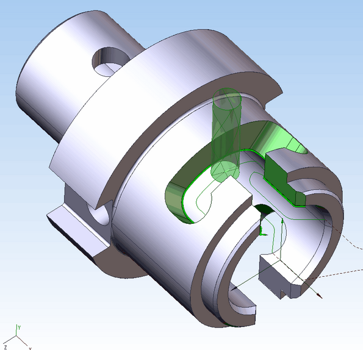
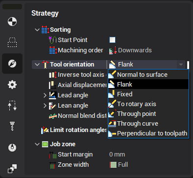
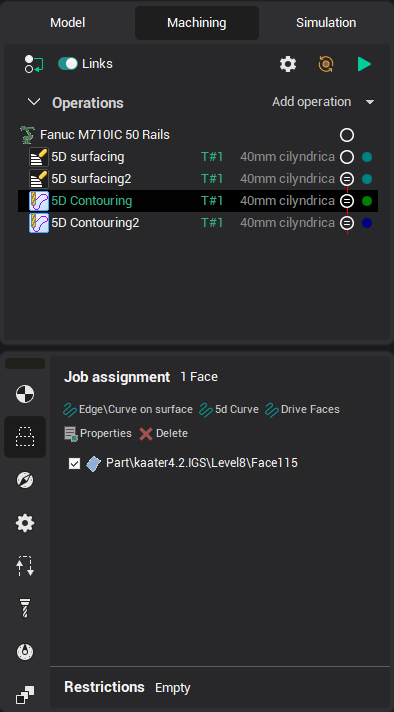
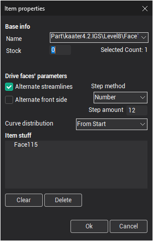

# 工具側面による線織面の5軸ミーリング

線織面を工具側面で加工するには、**Contact tool type**パラメータを**Flank**に設定します。**Inverse tool axis direction**をオンにすると、工具軸の向きが反転します。**Axial displacement**は、工具軸に沿った追加のオフセットを定義します。

ジョブ割り当ては、パーツのエッジまたは任意の曲線から作成します。エッジにマウスポインタを合わせてもハイライト表示されない場合は、フィルタパネルのエッジ選択ボタンが押された状態になっているか確認してください（曲線も同様です）。

エッジ選択フィルタボタンが押された状態でもエッジがハイライト表示されない場合は、フェイスを[縫合](1000.md)してください。

接続された複数のエッジを1回のパスで加工するには、画面上でそれらをまとめて選択し、`Edge\Curve on surface`ボタンを1回クリックしてジョブ割り当てリストに追加します。この場合、エッジは1つの項目に結合され、一体として加工されます。個別にリストへ追加した場合は、接続されていても個別に加工されます。画面上で複数のオブジェクトを選択するには、Ctrlキーを押したまま操作します。

加工の方向と側は、項目のプロパティウィンドウで変更できます。項目を選択し、プロパティボタンをクリックして開きます。

