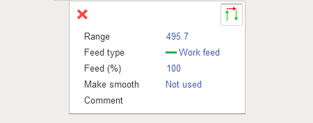

# Funzione di controllo degli avanzamenti

Questa funzione consente di creare il profilo dei valori di avanzamento. Per poter modificare il valore di avanzamento, fare clic su <strong>Feed control mode</strong> (modalità di controllo dell'avanzamento).

Nel pannello a comparsa è possibile controllare l'intervallo, il tipo di avanzamento, la velocità e il tipo di interpolazione.

