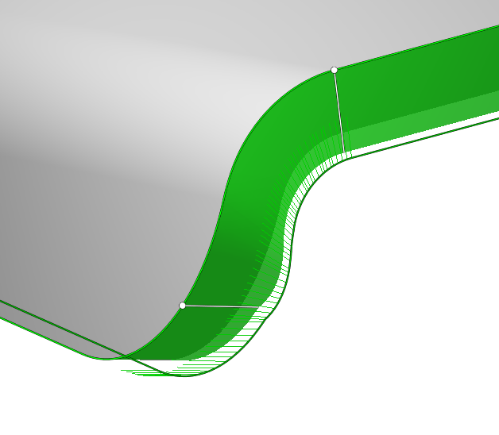
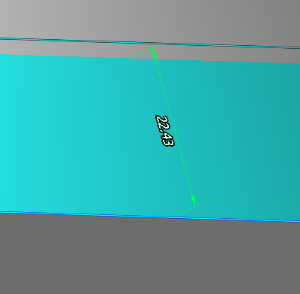

# Uso de vetores personalizados

Os vetores permitem definir a orientação da ferramenta em qualquer ponto do contorno. Para poder editar os vetores, clique em <strong>Use custom tool vectors</strong>.

Se uma curva 5D tiver sido adicionada à definição da tarefa em vez de arestas, por padrão haverá apenas um vetor fixo disponível. Ao pressionar o mesmo botão, o sistema CAM tentará definir os vetores automaticamente.

O uso de <strong>Custom vectors</strong> permite editar a superfície original a ser usinada. Métodos de edição:

- mantendo pressionado o botão esquerdo do mouse, é possível mover o vetor ao longo do contorno;
- ao fazer o mesmo com a tecla Ctrl pressionada, a cópia do vetor é movida, e o vetor principal permanece no lugar;
- ao clicar no vetor, é possível editar sua direção por meio da esfera interativa, que tem dois círculos, ao longo e transversalmente à superfície original (ou alterando o valor de dois ângulos);
- mantendo Shift pressionado, o botão esquerdo do mouse permite inclinar o vetor exatamente na direção de um ponto da superfície da peça;
- exclua o vetor com a tecla Del do teclado.

Ao clicar no contorno, aparece uma cota com a qual é possível editar a altura dos vetores. Isso afeta apenas a comodidade de trabalhar com eles.
