# Lavorazione di superfici

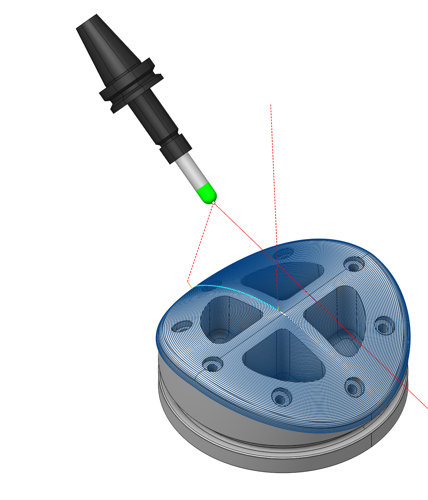

## Ambito di applicazione:

L'operazione Surfacing appartiene al gruppo delle operazioni di finitura e consente di lavorare le superfici del modello con diverse strategie (parallela a piani, parallela a una curva, morphing, ecc.) e diverse modalità di orientamento dell'asse utensile (fisso, normale alle superfici, verso l'asse di rotazione, passante per un punto, passante per una curva, ecc.).

### Assegnazione del lavoro:

<strong>Machining Surfaces.</strong> Selezionare come assegnazione del lavoro le superfici del pezzo da lavorare. Il sistema calcola il percorso utensile in base alle superfici scelte.

<strong>First Curve.</strong> Per la strategia <strong>Parallel to Curve</strong> questo elemento specifica le curve per il calcolo delle passate parallele. Inoltre, nella strategia <strong>Morphing Between Two Curves</strong> specifica la <strong>First Curve</strong> <strong>.</strong> (prima curva). È possibile selezionare una o più curve o spigoli, non necessariamente collegati tra loro.

<strong>Second Curve.</strong> Il sistema la utilizza nella strategia <strong>Morphing Between Two Curves</strong>. Specifica la <strong>Second Curve</strong> <strong>.</strong> (seconda curva). È possibile selezionare una o più curve o spigoli, non necessariamente collegati tra loro.

<strong>Tilt Curve.</strong> È la curva verso cui è diretto il vettore dell'asse utensile quando per <strong>Tool Orientation</strong> (orientamento dell'utensile) si imposta <strong>Through Curve.</strong>

<strong>First Surface.</strong> Questo elemento funge da <strong>First Surface</strong> (prima superficie) nella strategia <strong>Morph Between Two Surfaces</strong> e consente il processo di morphing per creare le linee del percorso utensile.

<strong>Second Surface.</strong> Questo elemento funge da <strong>Second Surface</strong> (seconda superficie) nella strategia <strong>Morph Between Two Surfaces</strong> e consente il processo di morphing per creare le linee del percorso utensile.

<strong>Surfaces for projection.</strong> Sono le superfici da lavorare sulle quali viene trasferito il percorso utensile quando si abilita l'opzione <strong>Project Toolpath onto the Part</strong> nella scheda <strong>Strategy</strong>.

<strong>Job Zone.</strong> Utilizzare la zona di lavoro per rifilare le passate al di fuori delle aree di contenimento 2D specificate. Il piano dell'area di contenimento è definito dall'orientamento iniziale dell'utensile. [Dettagli](10151.md).

<strong>Restrict Zone.</strong> Oltre alle <strong>Job Zones</strong> (zone di lavoro), nel sistema è possibile utilizzare la geometria delle <strong>Restrict Zones</strong> (zone di esclusione), costituita da curve e spigoli, per specificare le aree del grezzo che non devono essere lavorate nell'operazione corrente. [Dettagli](10152.md)

<strong>Properties.</strong> Visualizza le proprietà di un elemento. È possibile aggiungere il sovrametallo. Questo menu può essere richiamato anche facendo doppio clic su un elemento dell'elenco.

<strong>Delete.</strong> Rimuove un elemento dall'elenco.

<strong>Restrictions.</strong> Consente di delimitare le aree che non devono essere lavorate. [Dettagli](101231.md)

### Strategia:

#### Strategia:

Questo parametro consente di ottenere il percorso utensile desiderato:

Fare clic qui per espandere..

<strong>Type of Strategy:</strong>

Fare clic qui per espandere..

<strong>Parallel to Horizontal Plane.</strong> Il sistema genera le passate dell'utensile come linee di sezione della <strong>Machining Surface</strong> (superficie da lavorare) con piani orizzontali (piani perpendicolari all'asse utensile), in modo analogo alla strategia dell'operazione Finishing Waterline. [Dettagli.](841.md)

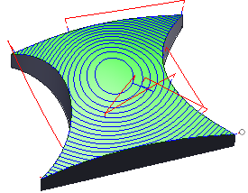

<strong>Parallel to Vertical Plane.</strong> Il sistema genera le passate dell'utensile come linee di sezione della <strong>Machining Surface</strong> con piani verticali (piani paralleli all'asse utensile), in modo analogo alla strategia dell'operazione Finishing Plane. È possibile modificare l'angolo del piano attorno all'asse utensile. [Dettagli.](713.md)

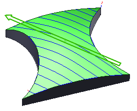

<strong>Parallel to 3d Plane.</strong> Il sistema genera le passate dell'utensile come linee di sezione della <strong>Machining Surface</strong> con piani orientati nello spazio secondo angoli regolabili.

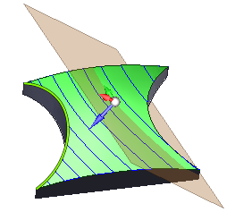

<strong>Parallel to Curve.</strong> Il sistema genera le passate dell'utensile sulla <strong>Machining Surface</strong> con lo <strong>Step</strong> (passo) specificato, parallelamente alla <strong>First Curve</strong> definita nella <strong>Job Assignment.</strong>

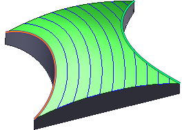

<strong>Morph Between Two Curves.</strong> Il sistema genera le passate dell'utensile come serie di punti geometrici sulla <strong>Machining Surface</strong>, mantenendo per ciascuna passata un rapporto costante tra la distanza del punto dalla <strong>First Curve</strong> e la distanza dalla <strong>Second Curve</strong>.

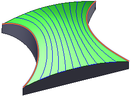

<strong>Around Rotary Axis.</strong> Il sistema genera le passate dell'utensile come sezioni della <strong>Machining Surface</strong> con lo <strong>Step</strong> specificato, utilizzando cilindri il cui asse è quello indicato come <strong>Rotary Axis</strong> (asse di rotazione).

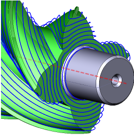

<strong>Across Curve.</strong> Il sistema genera le passate dell'utensile come linee di sezione della <strong>Machining Surface</strong> con piani perpendicolari alla <strong>First Curve</strong> specificata nella <strong>Job Assignment</strong>.

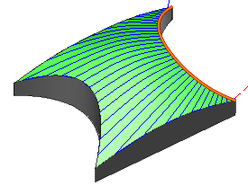

<strong>Morph Between two surfaces.</strong> Il sistema genera le passate dell'utensile come linee di sezione della <strong>Machining Surface</strong> con superfici ottenute mediante una transizione graduale dalla <strong>First Surface</strong> alla <strong>Second Surface</strong>, a intervalli pari allo <strong>Step</strong>.

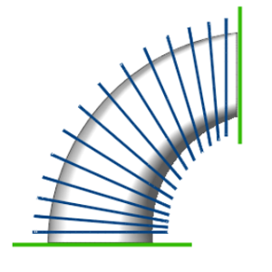

<strong>Step.</strong> Larghezza di taglio massima consentita.

.png)

<strong>Adaptive Step.</strong> <strong>Se abilitato:</strong> questo parametro adatta le distanze tra le passate dell'utensile in funzione dei raggi di curvatura della superficie e dell'utensile, per mantenere un'altezza della cresta uniforme dopo la lavorazione della superficie. [Dettagli](113.md).

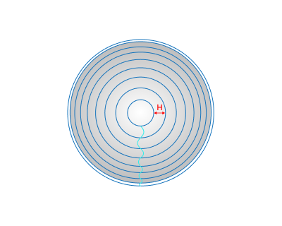

<strong>Se disabilitato:</strong> è la distanza verticale fissa tra passate consecutive dell'utensile.

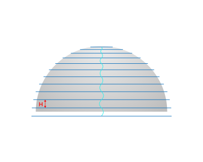

<strong>Calculate Based on Tool Center.</strong> L'attivazione della casella seleziona la modalità in cui le superfici da lavorare vengono prima offsettate del profilo dell'utensile per la lavorazione a 3 assi, oppure, lungo la normale alla superficie, del raggio dell'utensile per la lavorazione a 5 assi, e successivamente le curve del percorso utensile vengono calcolate su queste superfici offsettate. Nell'altra modalità il sistema genera prima il percorso utensile come curve sulle superfici lavorate. Quindi posiziona e orienta l'utensile rispetto alle curve calcolate in modo da mantenere costante il punto di contatto dell'utensile con la superficie lavorata.

<strong><strong>Confronto tra il percorso utensile basato sul centro e quello basato sul punto di contatto dell'utensile:</strong></strong>

<strong>Calcolo basato sul punto di contatto dell'utensile:</strong>

In questa modalità le passate di lavoro vengono generate calcolando, come primo passo, le curve sulle superfici da lavorare e quindi posizionando e orientando l'utensile rispetto alle curve calcolate in modo che il punto di contatto dell'utensile con la superficie da lavorare rimanga lo stesso. È preferibile, ad esempio, quando si lavorano superfici lisce o si esegue la fresatura di fianco.

<strong>Calcolo basato sul centro dell'utensile:</strong>

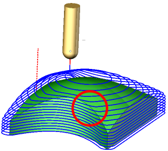

In questa modalità le passate di lavoro vengono generate in modo che prima le superfici da lavorare vengano offsettate della forma stessa dell'utensile per la lavorazione a 3 assi, oppure del raggio dell'utensile lungo la normale alla superficie per la lavorazione a 5 assi, e solo dopo vengano calcolate le sezioni delle superfici offsettate. Ad esempio, per le strategie parallele a un piano ciò significa che tutte le passate di lavoro generate giacciono su piani paralleli. Un ulteriore vantaggio di questa modalità è che vengono considerate non solo le superfici stesse, ma anche gli spigoli tra le superfici da lavorare.

<strong>XY Angle.</strong> È l'angolo di rotazione dei piani di sezione attorno all'asse utensile.

<strong>Z Angle.</strong> È l'angolo tra l'asse Z e la normale al piano di sezione.

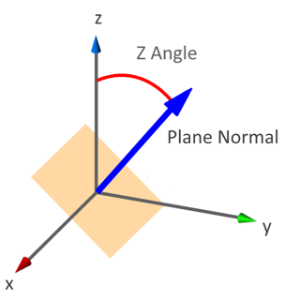

<strong>Use 2d Curves.</strong> Se la casella è attivata, nelle strategie <strong>Parallel to Curve</strong> e <strong>Morphing between Two Curve</strong> s il sistema genera i percorsi utensile rispetto alle curve proiettate sul piano XY.

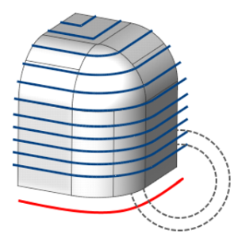

<strong>One Side Machining.</strong> Nelle strategie <strong>Parallel to Curve</strong> e <strong>Morph between Two Curve</strong> s controlla la posizione del percorso utensile rispetto alle curve specificate nella <strong>Job Assignment</strong>. Senza la casella attivata, il sistema genera il percorso utensile su entrambi i lati della curva.

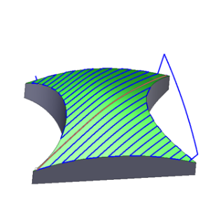

<strong>Left.</strong> Il sistema genera le passate sul lato sinistro della curva specificata nella <strong>Job Assignment.</strong>

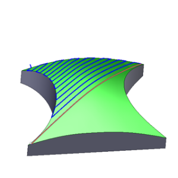

<strong>Right.</strong> Il sistema genera le passate sul lato destro della curva specificata nella <strong>Job Assignment.</strong>

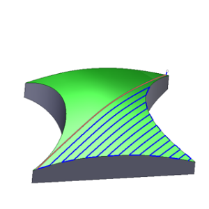

<strong>Extend Curves to Infinity.</strong> L'attivazione della casella consente al sistema di prolungare le passate parallele alle linee selezionate fino ai bordi della <strong>Machining Surface</strong> quando le curve sono più piccole della <strong>Machining Surface</strong>.

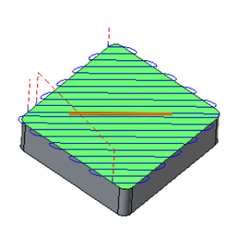

<strong>Rotary Axis.</strong> È l'asse dei cilindri di sezione nella strategia <strong>Around Rotation Axis</strong>.

#### Milling Type (tipo di fresatura):

Può essere assegnato in quasi tutte le operazioni, ad eccezione delle operazioni di lavorazione di curve. Consente di controllare il tipo di fresatura richiesto (concorde o discorde) durante il calcolo del percorso utensile.

I parametri di <strong>Milling Type</strong> sono gli stessi dell'<strong>operazione</strong> <strong>Waterline Roughing</strong>. [Dettagli.](736.md)

#### Sorting (ordinamento):

Controlla la sequenza delle passate del percorso utensile durante la lavorazione delle superfici.

Fare clic qui per espandere..

<strong>By regions.</strong> Determina se le passate di lavoro vengono raggruppate per regione o per strato.

<strong>ON.</strong> Tutti gli strati di una regione (cavità) vengono lavorati prima di passare alla regione successiva.

<strong>OFF.</strong> Uno strato viene lavorato in tutte le regioni prima di passare allo strato successivo.

<strong><strong>Start Point.</strong></strong> L'attivazione della casella consente di inserire le coordinate del punto iniziale delle passate di lavoro nella lavorazione delle superfici.

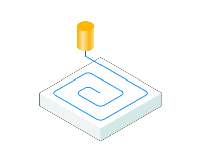 

<strong>Machining Order</strong>. Controlla l'ordine di esecuzione delle passate di lavoro dell'utensile.

Fare clic qui per espandere..

<strong>Downwards</strong>. Le passate di lavoro procedono dall'alto verso il basso, dalla passata più vicina a quella più lontana.

<strong>Upwards</strong>. Le passate di lavoro procedono dal basso verso l'alto, dalla passata più lontana a quella più vicina.

<strong>From First to Second</strong>. L'operazione esegue le passate dalla <strong>First</strong> verso la <strong>Second Curve</strong> o <strong>Surface</strong> (dalla prima verso la seconda curva o superficie).

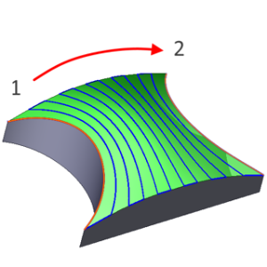

<strong>From Second to First</strong>. L'operazione esegue le passate dalla <strong>Second</strong> verso la <strong>First Curve</strong> o <strong>Surface</strong> (dalla seconda verso la prima curva o superficie).

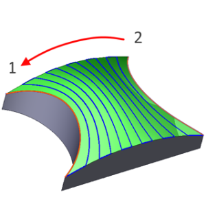

<strong>From Outside in</strong>. Le passate di lavoro procedono dalla periferia verso il centro della <strong>Machining Surface.</strong>

<strong>From Inside Out</strong>. Le passate di lavoro procedono dal centro verso la periferia della <strong>Machining Surface.</strong>

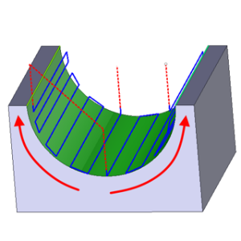

#### Tool contact point (punto di contatto dell'utensile).

Il punto di contatto dell'utensile (Tool Contact Point, TCP) è una posizione specifica sull'utensile da taglio che definisce il punto principale di interazione tra l'utensile e la superficie del pezzo o le entità geometriche durante le operazioni di lavorazione.

Fare clic qui per espandere..

<strong>Auto.</strong> Il punto di contatto dell'utensile si sposta lungo il tagliente dell'utensile senza modificare il vettore dell'asse utensile.

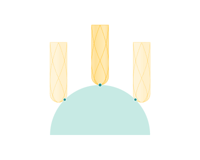

<strong>End.</strong> Il punto di contatto dell'utensile si trova all'estremità del tagliente dell'utensile.

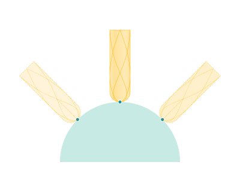

<strong>Center.</strong> La lavorazione viene eseguita sul raggio esterno del cilindro, situato a una determinata distanza dall'estremità del tagliente.

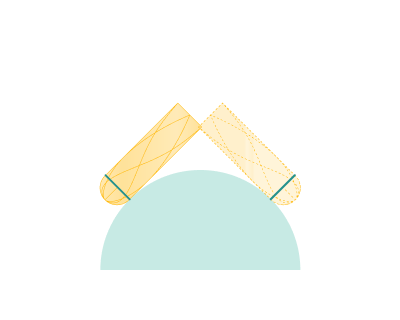

<strong>Height.</strong> La lavorazione viene eseguita sul raggio esterno del cilindro, situato a una determinata distanza dall'estremità del tagliente. La distanza può essere regolata tramite il parametro subordinato <strong>Value</strong>.

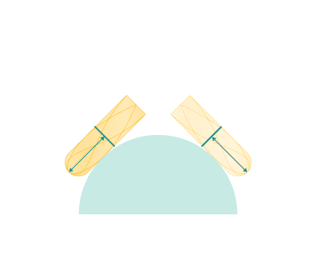

<strong>Parameter.</strong> La lavorazione viene eseguita con la parte piana dell'utensile da taglio, situata a una determinata distanza dall'estremità del tagliente. La distanza può essere regolata tramite il parametro subordinato <strong>Value</strong>.

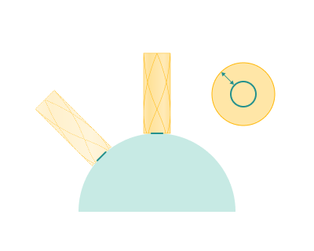

<strong>Value.</strong> Parametro che determina le distanze.

#### Tool Orientation (orientamento dell'utensile):

Controlla l'orientamento dell'asse utensile.

Fare clic qui per espandere..

<strong>Fixed</strong>. Lungo tutto il percorso utensile l'utensile mantiene un orientamento fisso, definito dalle posizioni iniziali degli assi rotativi della macchina configurate nella scheda <strong>Setup</strong>.

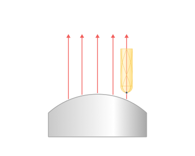

<strong>Normal to Surface.</strong> Il sistema orienta l'asse utensile perpendicolarmente alla <strong>Machining Surface.</strong>

<strong>Flank</strong>. Le superfici vengono lavorate con la parte laterale dell'utensile.

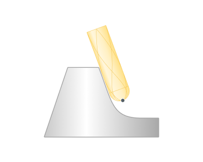

<strong>To Rotary Axis.</strong> Il sistema orienta il vettore dell'asse utensile a partire dal <strong>Rotary Axis</strong> designato.

<strong>Through Point.</strong> Il sistema orienta il vettore dell'asse utensile verso il punto designato (polo).

<strong>Through Curve.</strong> Il vettore dell'asse utensile è diretto verso il punto più vicino della <strong>Tilt Curve</strong> specificata nella <strong>Job Assignment.</strong>

<strong>Perpendiculat to Toolpath.</strong> L'asse utensile è perpendicolare alla tangente al percorso utensile e allo stesso tempo parallelo al <strong>Rotary Axis.</strong>

<strong>Vertical Clearance Angle.</strong> Se la casella è attivata, il sistema inclina automaticamente l'utensile dell'angolo specificato nelle zone in cui la <strong>Machining Surface</strong> presenta una pendenza ripida o negativa (con la normale alla superficie rivolta verso il basso rispetto all'asse utensile), consentendo di lavorare zone semplici con sottosquadri.

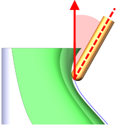

<strong>Rotary Axis.</strong> L'attivazione della casella blocca una delle componenti del vettore di orientamento dell'utensile, mantenendo un <strong>Side Angle</strong> (angolo laterale) costante tra l'asse utensile e la perpendicolare all'asse specificato (oppure l'asse stesso se per <strong>Tool Orientation</strong> è impostato <strong>Perpendicular to Toolpath)</strong>.

<strong>Side Angle.</strong> Specifica il valore dell'angolo di inclinazione dell'asse utensile rispetto all'asse designato come <strong>Rotary Axis.</strong>

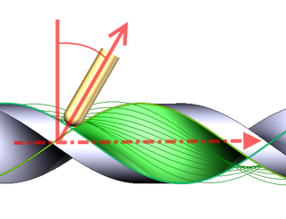

<strong><strong>End Side Angle.</strong></strong> Specifica il valore dell'angolo di inclinazione dell'asse utensile rispetto all'asse designato come <strong>Rotary Axis</strong> alla fine del percorso utensile.

<strong>Inverse Tool Axis Direction.</strong> Inverte la direzione del vettore dell'asse utensile. Utilizzare questo parametro se il sistema CAM tenta erroneamente di lavorare le superfici dal lato opposto a quello desiderato oppure se non riesce a generare un percorso utensile.

 

<strong>Lead Angle.</strong> È un angolo di inclinazione aggiuntivo dell'utensile nel piano della direzione di movimento.

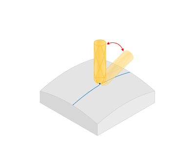

<strong>End Lead Angle.</strong> È un angolo di inclinazione aggiuntivo dell'utensile nel piano della direzione di movimento alla fine del percorso utensile.

<strong>Lean Angle.</strong> È un angolo di inclinazione aggiuntivo dell'utensile nel piano ortogonale alla direzione di movimento.

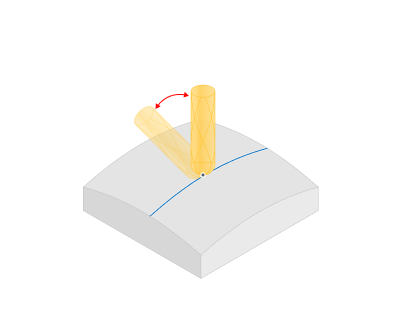

<strong><strong>End Lean Angle.</strong></strong> È un angolo di inclinazione aggiuntivo dell'utensile nel piano ortogonale alla direzione di movimento alla fine del percorso utensile.

<strong>Inverse Lead Angle.</strong> Se la casella è attivata, il segno dell'angolo di anticipo si inverte quando cambia la direzione di movimento dell'utensile.

<strong>Normal Blend Distance.</strong> Distanza lungo il percorso utensile entro la quale l'angolo di inclinazione dell'utensile rimane costante.

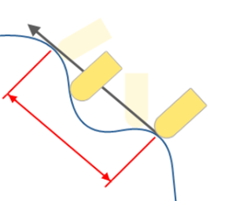

<strong>Axial Displacement.</strong> Sposta lungo l'asse utensile il punto di contatto tra l'utensile e la <strong>Machining Surface</strong>.

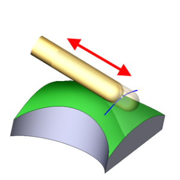

<strong>Contact Points.</strong> Modifica il punto di contatto dell'utensile dalla linea iniziale alla linea finale.

.png) .png)

<strong>Start param.</strong> Punto di contatto iniziale

.png)

<strong>End param.</strong> Punto di contatto finale

.png)

<strong>Lean Angle 1.</strong> Se per <strong>Tool Orientation</strong> è impostato <strong>To Rotary Axis</strong>, è l'angolo di cui l'utensile devia in direzione positiva dal vettore iniziale in un piano perpendicolare al <strong>Rotary Axis.</strong>

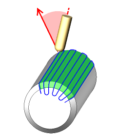

<strong>Lean Angle 2.</strong> Se per <strong>Tool Orientation</strong> è impostato <strong>To Rotary Axis</strong>, è l'angolo di cui l'utensile devia in direzione negativa dal vettore iniziale in un piano perpendicolare al <strong>Rotary Axis</strong>.

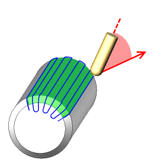

<strong>Origin</strong>. Specifica le coordinate del polo se per <strong>Tool Orientation</strong> è impostato <strong>Through Point.</strong>

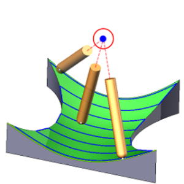

#### Limit Rotation Angles (limitazione degli angoli di rotazione):

Se la casella è attivata, specifica i valori limite della posizione angolare dell'utensile rispetto all'asse specificato.

Fare clic qui per espandere..

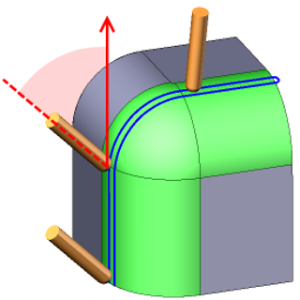

Fare clic qui per espandere..

<strong>Around X (YZ).</strong> L'attivazione della casella definisce i valori limite dell'inclinazione dell'utensile rispetto all'asse X nel piano YZ.

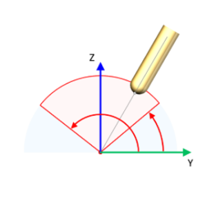

<strong><strong>Around Y (XZ).</strong></strong> L'attivazione della casella definisce i valori limite dell'inclinazione dell'utensile rispetto all'asse Y nel piano XZ.

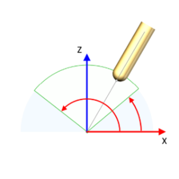

<strong><strong>Around Z (XY).</strong></strong> L'attivazione della casella definisce i valori limite dell'inclinazione dell'utensile rispetto all'asse Z nel piano XY.

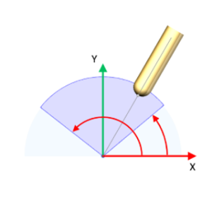

<strong>Conical limit.</strong> L'attivazione della casella stabilisce gli angoli di inclinazione massimo e minimo dell'utensile rispetto all'asse designato, delimitati da due coni con angoli specificati.

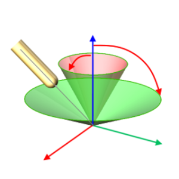

#### Job zone (zona di lavoro).

Consente un'ulteriore modifica dell'area di lavoro selezionata inizialmente nella scheda <strong>Job assignment</strong>.

Fare clic qui per espandere..

<strong>Margins.</strong> Per le strategie parallele a piani sono previsti vincoli sul posizionamento dei piani di sezione.

<strong>Full</strong>. Non vi sono vincoli sulla generazione dei piani di sezione.

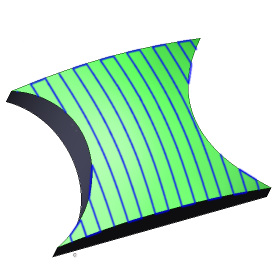

<strong>Points</strong>. Dispone i piani di sezione tra due punti rossi designati. Trascinare con il mouse questi punti nelle posizioni appropriate nella finestra grafica.

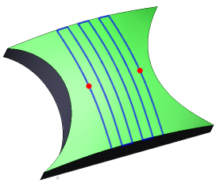

<strong>Start Margin.</strong> Nelle strategie basate su curve o superfici, il parametro determina l'offset dalla prima curva o superficie, ossia il punto in cui inizia la generazione del percorso utensile.

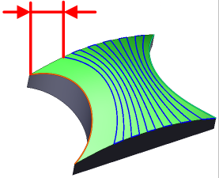

<strong>Zone Width.</strong> Nelle strategie basate su curve o superfici, il parametro determina la distanza dallo <strong>Start Margin</strong> all'ultima passata di lavorazione.

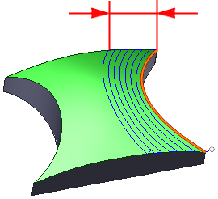

<strong>End Margin.</strong> Il parametro definisce l'offset dalla <strong>Second Curve</strong> o <strong>Surface</strong> fino al quale viene generato il percorso utensile.

<strong>Limit Job Zone.</strong> Nella strategia <strong>Across Curve</strong> consente di utilizzare per il percorso utensile solo la sezione della <strong>Machined Surface</strong> più vicina al punto corrente sulla curva.

<strong>Machining from inside.</strong> Il parametro consente di lavorare le superfici interne del pezzo (proiettare il percorso utensile sulle superfici interne del pezzo)

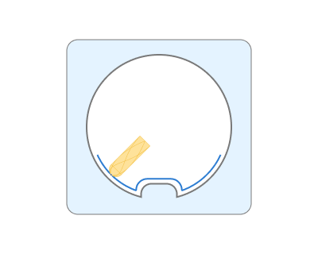

<strong>Max retract height.</strong> Definisce la zona di proiezione. La proiezione non viene eseguita sulle superfici situate al di sotto di questo livello. Le collisioni tra utensile e pezzo vengono controllate solo al di sotto dell'altezza specificata

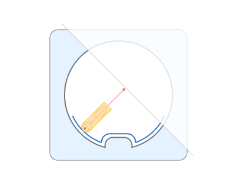

Alcuni gruppi di parametri funzionano in modo analogo all'<strong>operazione Plane finishing.</strong> [Dettagli](713.md)

#### Corners smoothing (raccordo degli angoli).

In caso di brusco cambio di direzione dell'utensile, il controllo della fresatrice decelera prima di iniziare la svolta e poi accelera di nuovo. Ciò può causare vibrazioni e un'elevata usura dell'utensile e della fresatrice. Il problema può essere risolto se il percorso utensile presenta pochissime discontinuità o nessuna. Per questo motivo il sistema dispone della funzione di raccordo del percorso utensile con il raggio definito, per la lavorazione degli angoli interni o esterni del modello.

Fare clic qui per espandere..

<strong>Blend Distance.</strong> Il raccordo avviene entro questa distanza all'interno dell'angolo vivo.

.png) .png)

#### Roughing Passes (passate di sgrossatura).

Il percorso utensile viene offsettato nel piano dello spessore indicato in <strong>Roughing passes</strong>. Al contorno vengono aggiunte passate supplementari secondo il valore specificato nei parametri e con il numero di passi specificato.

Fare clic qui per espandere..

<strong>Orientamento delle passate di sgrossatura:</strong>

Fare clic qui per espandere..

<strong>By Surface Normal.</strong> Il calcolo dei percorsi di sgrossatura consiste nell'offsettare i percorsi di finitura lungo la direzione della normale alla superficie.

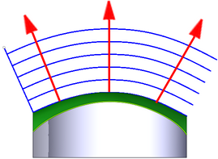

<strong>Along Tool Axis.</strong> Il calcolo dei percorsi di sgrossatura consiste nell'offsettare i percorsi di finitura lungo l'asse utensile.

 Orientamento dell'utensile

<strong>In Tool Plane.</strong> Il calcolo dei percorsi di sgrossatura consiste nell'offsettare i percorsi di finitura nel piano di movimento dell'utensile. Questo approccio è efficace per la strategia <strong>Parallel to Vertical Plane</strong> e quando le superfici vengono lavorate con la parte frontale dell'utensile.

<strong>Perpendicular to Tool Axis.</strong> Il calcolo dei percorsi di sgrossatura consiste nell'offsettare i percorsi di finitura nel piano perpendicolare all'asse utensile. Questo approccio è efficace per la strategia <strong>Parallel to Horizontal Plane</strong>.

<strong>By Default.</strong> Visualizza il metodo di calcolo predefinito adottato nel sistema.

<strong>Count.</strong> Numero di passate di sgrossatura.

<strong>Step</strong>. Distanza tra le passate di sgrossatura.

.png)

<strong>Sort By.</strong> Specifica l'ordine di esecuzione delle passate di sgrossatura.

<strong>Levels</strong>. Le passate di sgrossatura vengono eseguite nell'ordine di disposizione degli strati.

<strong>Strings</strong>. Le passate di sgrossatura vengono eseguite nell'ordine di disposizione delle file di passate.

#### Project Toolpath onto the Part (proiezione del percorso utensile sul pezzo):

Se la casella è attivata, il sistema genera i percorsi utensile per la lavorazione delle superfici indicate come <strong>Surfaces for Projection</strong> nella <strong>Job Assignment</strong>, proiettando sulle <strong>Surfaces for Projection</strong> il percorso ottenuto dalla <strong>Machining Surface</strong>.

Fare clic qui per espandere..

In questo caso, come <strong>Machining Surfaces</strong> indicare, al posto delle superfici del pezzo da fresare direttamente, superfici di geometria ausiliaria, ottenibili con costruzioni aggiuntive nel modulo CAD. Disporre tali superfici in modo che la proiezione del percorso utensile a partire da esse risulti semplice. Dichiarare le superfici da fresare come <strong>Surfaces for Projection</strong>.

.png) .png)

<strong>Along tool axis.</strong> Proietta lungo l'asse utensile.

<strong>By surface normal.</strong> La proiezione avviene lungo le normali alla superficie.

<strong>Max deviation.</strong> Questa distanza indica di quanto il percorso utensile può allontanarsi dalla posizione originale lungo la normale alla superficie.

#### Trimming (rifilatura):

Consente di saltare le superfici non destinate alla lavorazione e di prolungare il percorso utensile.

Fare clic qui per espandere..

<strong>Hole Capping.</strong> L'attivazione di questa opzione consente al sistema di saltare i fori con diametro uguale o inferiore alla dimensione specificata.

 

<strong>Gap capping.</strong> Abilitando questa funzione, il sistema può chiudere le interruzioni del percorso utensile inferiori alla dimensione specificata.

.png) .png)

<strong>Extend (+)/Trim (-) passes.</strong> Con questa impostazione è possibile prolungare o accorciare i tratti iniziali e finali del percorso utensile.

__Trim_(-)_passes.png)

<strong>Start</strong>. Se si inserisce un valore positivo, il sistema prolunga l'inizio delle passate di lavoro del percorso utensile della quantità specificata. Un valore negativo accorcia l'inizio delle passate.

<strong>End</strong>. Se si inserisce un valore positivo, il sistema prolunga la fine delle passate di lavoro del percorso utensile della quantità specificata. Un valore negativo accorcia la fine delle passate.

### Parametri:

Questa scheda contiene i parametri principali per il controllo del pezzo, del grezzo, delle attrezzature e di altri elementi, che consentono di modificare il percorso utensile. [Dettagli](100112.md)

### Collegamenti/Attacchi:

Nella scheda Links/Leads si definiscono i parametri dei movimenti rapidi. Questi movimenti comprendono l'avvicinamento dell'utensile dalla posizione di cambio utensile, l'attacco all'inizio della corsa di lavoro, la retrazione dopo l'ultimo movimento di taglio, i collegamenti tra le passate di lavoro e il ritorno al punto di cambio utensile. È possibile configurare la sequenza dei movimenti lungo le coordinate, la traiettoria di tali movimenti e l'entità degli spostamenti.

Fare clic qui per espandere..

<strong>Comprende:</strong>

<strong>Approach/Return.</strong> Questo gruppo di parametri gestisce i movimenti dell'utensile dalla posizione di cambio utensile all'inizio dei percorsi di attacco e ritorno. [Dettagli](100116.md).

<strong><strong>Links.</strong></strong> Definisce le regole che governano i collegamenti di entrata/uscita e i collegamenti tra i movimenti di lavoro. [Dettagli](100130.md).

<strong>Leads.</strong> Consente di aggiungere ai movimenti di lavoro ulteriori attacchi e stacchi eseguiti con il relativo avanzamento. [Dettagli](100136.md).

<strong>Safe motions.</strong> Definisce il tipo di <strong>Safety Surface</strong> (superficie di sicurezza) e la sua distanza dal grezzo. Questa superficie agevola le transizioni tra le superfici lavorate o tra i percorsi utensile, e la prima fase dell'avvicinamento o del ritorno avviene verso di essa. [Dettagli](100117.md).

<strong>Advanced links settings.</strong> Questo gruppo di parametri specifica le caratteristiche della generazione del percorso utensile soprattutto per le operazioni a cinque assi, tenendo conto dei movimenti ottimali degli assi rotativi. [Dettagli](100118.md).

<strong>Distances.</strong> Distanze utilizzate nelle regole dei collegamenti [Dettagli](100140.md).

### Avanzamenti/Velocità:

In questa finestra di dialogo è possibile definire la velocità di rotazione del mandrino, il valore dei movimenti rapidi e i valori di avanzamento per le diverse zone del percorso utensile. La velocità di rotazione del mandrino può essere definita come numero di giri al minuto oppure come velocità di taglio. Il valore determinante viene sottolineato. Il secondo valore viene ricalcolato in base al valore determinante, tenendo conto del diametro dell'utensile. [Dettagli](100142.md)

### Trasformazioni:

Insieme di parametri dell'operazione che consentono di eseguire trasformazioni di coordinate sul percorso utensile calcolato nell'operazione. [Dettagli](10168.md).

### Pezzo:

Il pezzo è un gruppo di elementi geometrici che definisce lo spazio da controllare per evitare intaccature. [Dettagli](330.md)

### Grezzo:

Il modello del grezzo di un'operazione definisce il materiale da lavorare. [Dettagli](738.md)

### Attrezzature:

Come attrezzature si specificano di solito i dispositivi di bloccaggio, quali mandrini autocentranti, griffe, staffe e simili, nonché le aree di limitazione di qualsiasi altra natura. [Dettagli](10283.md)
