# Rotationsschlichten

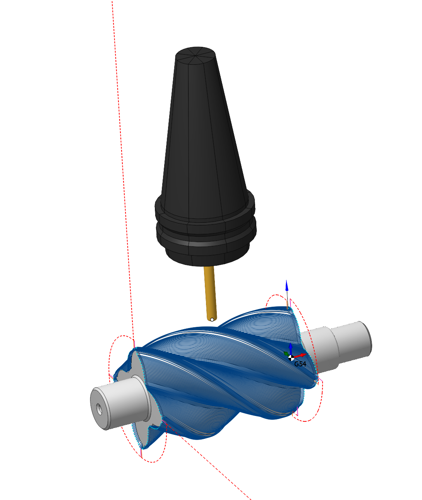

## Anwendungsbereich:

Die Operation erfordert mindestens eine kontinuierlich steuerbare Drehachse. Sie eignet sich beispielsweise für Nockenwellen, Kurbelwellen, Schneckenwellen, Schaufeln und dekorative Bauteile. Die vierte Drehachse wird gemeinsam mit den Linearachsen bewegt. Eine vorhandene fünfte Achse bleibt normalerweise fest, kann in bestimmten Fällen jedoch ebenfalls verwendet werden. Für die Bearbeitung einzelner Flächen wählen Sie diese in der Auftragszuweisung aus. Bei leerer Auftragszuweisung wird das gesamte Bauteil bearbeitet.

### Auftragszuweisung:

**Faces (Flächen).** Wählt die Flächen aus, anhand derer die Bahn berechnet wird.

**Spiral curve (Spiralkurve).** Bezugskurve zur Bestimmung des Spiralwinkels für die entsprechende Winkelstrategie.

**Properties (Eigenschaften).** Öffnet die Elementeigenschaften, beispielsweise zur Eingabe eines Aufmaßes. Auch durch Doppelklick auf einen Listeneintrag erreichbar.

**Delete (Löschen).** Entfernt ein Element aus der Liste.

**Restrictions (Begrenzungen).** Definiert nicht zu bearbeitende Bereiche. [Details](101231.md)

### Strategie.

#### Bearbeitungsbereich.

Ermöglicht zusätzliche Anpassungen des in der Auftragszuweisung festgelegten Bereichs.

Weitere Informationen anzeigen

**Surface only.** Bearbeitet ausschließlich die ausgewählten Flächen.

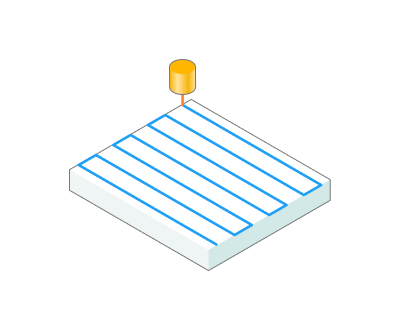

**With edges.** Berücksichtigt zusätzlich die Umfahrung der Kanten ausgewählter Flächen.

**With restriction model.** Berücksichtigt Bearbeitungsflächen, Kantenumfahrungen und Flächen des Begrenzungsmodells.

**Rotary axis (Drehachse).** Bezugsachse für die Werkzeugausrichtung. Ihre Lage kann im Eigenschafteninspektor, interaktiv über den Pfeil oder über die Auswahlliste festgelegt werden.

**Along X**, **Along Y** und **Along Z** richten die Drehachse entlang der jeweiligen Koordinatenachse aus.

**Direction (Richtung).** Bei **Custom(WCS)** wird der Richtungsvektor über X, Y und Z definiert. Geben Sie die Richtungskosinus bezüglich der Koordinatenachsen an.

**Origin (Ursprung).** Bezugspunkt für die Positionsangaben entlang der ausgewählten Drehachse.

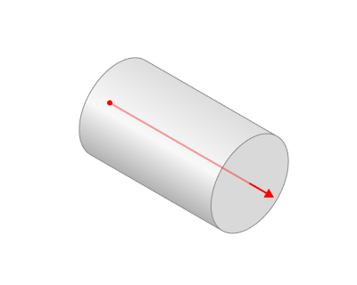

**Base CS (Bezugskoordinatensystem).** Wählt das globale oder lokale Werkstückkoordinatensystem.

**Min. axial position.** Kleinste Position relativ zum Ursprung entlang der Drehachse. Standardmäßig aus dem Rohteil ermittelt.

**Max. axial position.** Größte Position relativ zum Ursprung entlang der Drehachse. Standardmäßig aus dem Rohteil ermittelt.

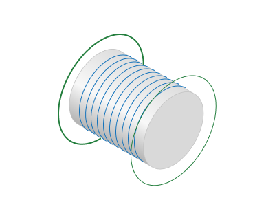

**Angular domain (Winkelbereich).** Bearbeitungssektor zwischen **Start Angle** und **Finish Angle**. Seine Grenzen können grafisch gezogen oder über die eingeblendeten Maße exakt eingegeben werden.

**Full circle (Vollkreis).**

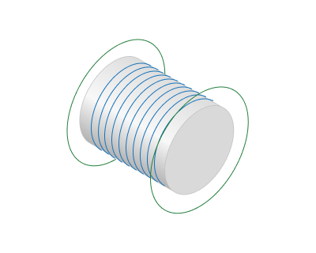

**0...90.**

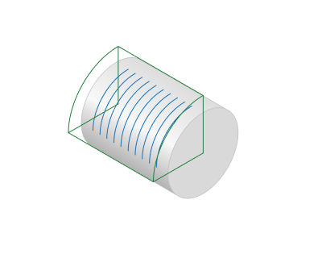

**Start angle.** Anfangswinkel des Sektors.

**Finish angle.** Endwinkel des Sektors.

**Machining from inside (Von innen bearbeiten).** Ermöglicht die Projektion der Bahn auf innere Bauteilflächen. Die Einstellungen entsprechen dem Bereich **Job zone** der 5D-Flächenbearbeitung. [Details](10135.md)

#### Bahnform.

Legt die Form der Werkzeugbahnen fest.

Weitere Informationen anzeigen

Folgende Formen stehen zur Verfügung:

**Linear.** Erzeugt Schnittlinien der Bearbeitungsflächen mit Ebenen durch die Drehachse.

**Circular (Kreisförmig).** Erzeugt Schnittlinien mit Ebenen senkrecht zur Drehachse.

**Spiral (Schraubenförmig).** Erzeugt eine durchgehende Schraubenlinie.

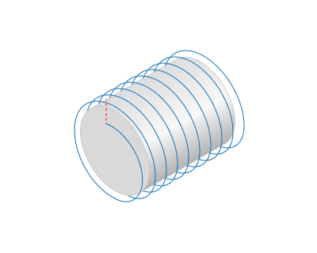

**Step (Bahnabstand).** Zustellung entlang der Drehachse.

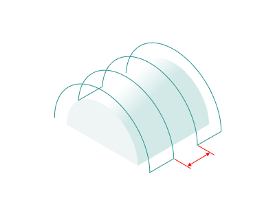

**Axial direction (Axiale Richtung).** Bestimmt je nach Bahnform die Bewegungsrichtung oder die Reihenfolge der Durchgänge. Bei einer Schraubenlinie mit Steigung gleich dem Bearbeitungsschritt beeinflusst sie die Windungsrichtung.

**Forward (Vorwärts).** Ordnet die Bahnen in Richtung des Drehachsenvektors an.

**Backward (Rückwärts).** Ordnet die Bahnen entgegen dem Drehachsenvektor an.

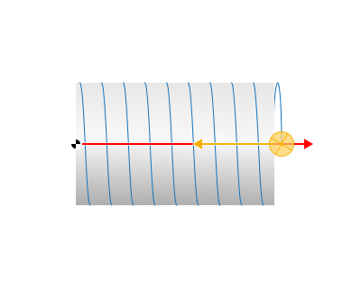

**Spiral step (Spiralsteigung).** Legt die Steigung der Schraubenbahn fest. Positive und negative Werte bestimmen die jeweilige Windungsrichtung.

**Same as the Basic Step.** Erzeugt eine einzelne durchgehende Schraubenlinie.

**mm, %Diameter, Angle.** Gibt die Steigung als Längenwert, Prozentsatz des Werkzeugdurchmessers oder Steigungswinkel in Grad vor. Weicht die Spiralsteigung vom Bearbeitungsschritt ab, werden mehrere Schraubenbahnen im Abstand des Bearbeitungsschritts erzeugt.

**Angle by curve.** Ermittelt den Steigungswinkel automatisch aus der Kurve der Auftragszuweisung.

**Use flexible axis (Flexible Achse verwenden).** Bestimmt die örtliche Bezugsachse in jedem Querschnitt aus dem Mittelwert der Krümmungsmittelpunkte. Dies erzeugt einen kontinuierlicheren Bahnverlauf und passt die Werkzeugausrichtung an das Bauteil an. Geeignet beispielsweise für asymmetrische Bauteile wie Kurbelwellen.

 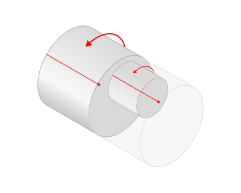

#### Werkzeugausrichtung.

Steuert die Werkzeugachse.

Weitere Informationen anzeigen

**By Normal (Nach Normale).** Richtet die Werkzeugachse an jedem Bahnpunkt in der Ebene senkrecht zur Drehachse nach der Flächennormalen aus.

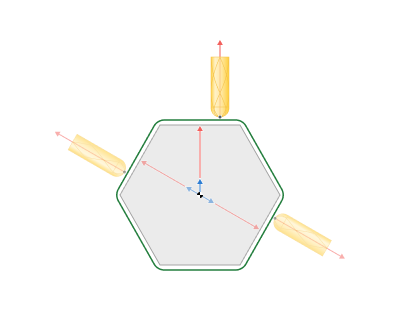

**Lead angle (Vorlaufwinkel).** Zusätzlicher positiver oder negativer Neigungswinkel in Bewegungsrichtung zur Verbesserung der Schnittbedingungen am Kontaktpunkt.

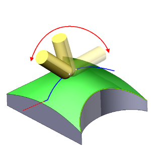

**Side angle (Seitenwinkel).** Neigung der Werkzeugachse relativ zur Bezugsdrehachse in der Ebene senkrecht zur Bewegungsrichtung.

**Normal blend distance (Normalenglättungsabstand).** Steuert die Glättung des Normalenverlaufs. Verfügbar bei aktiviertem **Use new calculation method**. [Details](100125.md)

**To axis (Zur Achse).** Die Werkzeugachse schneidet an jedem Bahnpunkt die Drehachse und ist damit unabhängig von der Flächennormalen.

**Offset (Versatz).** Verschiebt den Ausrichtungspunkt gegenüber der Drehachse, beispielsweise zur Verbesserung der Schnittbedingungen. Möglich sind positive oder negative Längenwerte bzw. Prozentwerte des Werkzeugdurchmessers.

**Side angle (Seitenwinkel).** Neigung der Werkzeugachse relativ zur Bezugsdrehachse in der Ebene senkrecht zur Bewegungsrichtung.

#### Fräsart.

Legt die Fräsrichtung für die Bahnberechnung fest. Diese Einstellung steht in den meisten Operationen außer der Kurvenbearbeitung zur Verfügung.

Weitere Informationen anzeigen

**Both (Beide Richtungen).** Kehrt die Umlaufrichtung um die Drehachse bei jedem Durchgang um und verkürzt dadurch Leerwege und Bearbeitungszeit.

**Follow (Gleichlauf).** Stimmt die Bewegung um die Drehachse auf die Werkzeugdrehrichtung ab, sodass Gleichlauf entsteht.

**Counter (Gegenlauf).** Stimmt die Bewegung um die Drehachse auf die Werkzeugdrehrichtung ab, sodass Gegenlauf entsteht.

**CW.** Bewegung um die Drehachse im Uhrzeigersinn, betrachtet aus positiver Achsrichtung; unabhängig von der Werkzeugdrehrichtung.

**CCW.** Bewegung um die Drehachse gegen den Uhrzeigersinn, betrachtet aus positiver Achsrichtung; unabhängig von der Werkzeugdrehrichtung.

#### Sortierung.

Steuert die Reihenfolge der Bearbeitungsbahnen.

Weitere Informationen anzeigen

**By layers (Nach Ebenen).** Bearbeitet zunächst die erste Ebene aller Profile, anschließend die nächste Ebene.

**By strings (Nach Profilen).** Bearbeitet zunächst alle Ebenen des ersten Profils, danach alle Ebenen des nächsten.

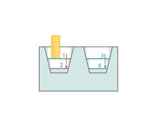

**Idling minimization (Leerwege minimieren).** Wählt den nächsten Durchgang so, dass die Verbindung möglichst kurz ist. Ohne diese Option gilt eine feste Reihenfolge entsprechend Bearbeitungsrichtung und Bahnform.

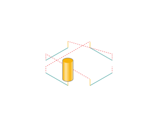 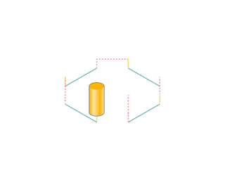

#### Durchgänge.

Einstellungen für Schrupp- und Schlichtdurchgänge.

Weitere Informationen anzeigen

**Rough passes (Schruppdurchgänge).** Aktiviert zusätzliche Schruppbahnen. Geben Sie das gesamte zu bearbeitende Aufmaß an.

**Step (Zustellung).** Bei Angabe einer Anzahl werden entsprechend viele zusätzliche Bahnen erzeugt. Bei einer Längen- oder Prozentangabe wird die Anzahl aus Gesamtaufmaß und Zustellung berechnet.

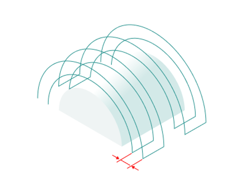

**Passes order (Durchgangsreihenfolge).** Steuert bei additiver Bearbeitung die Reihenfolge der Bahnen.

**Inside to outside (Von innen nach außen).** Beginnt mit den inneren und endet mit den äußeren Bahnkurven.

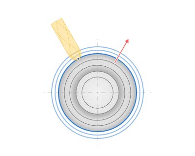

**Outside to inside (Von außen nach innen).** Beginnt mit den äußeren und endet mit den inneren Bahnkurven.

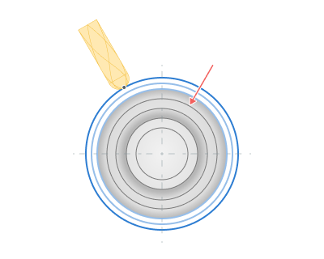

**Finish pass (Schlichtdurchgang).** Verwendet die Kontur der Auftragszuweisung als Schlichtbahn. Im angegebenen Abstand wird eine zusätzliche Schruppbahn erzeugt. Bei aktivierten Schruppdurchgängen liegt die letzte Schruppbahn in diesem Abstand.

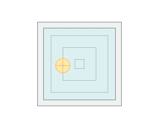 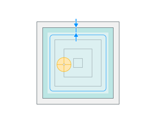

### Parameter:

Diese Registerkarte enthält die grundlegenden Einstellungen für Bauteil, Rohteil, Spannmittel und weitere Elemente, die die Werkzeugbahn beeinflussen. [Details](100112.md)

### Verbindungen und An-/Abfahrbewegungen:

Auf der Registerkarte **Links/Leads** werden die Verbindungsbewegungen festgelegt: Anfahren von der Werkzeugwechselposition, Einfahren zum Beginn der Arbeitsbahn, Abfahren nach dem letzten Arbeitsgang, Verbindungen zwischen den Bahnen und Rückkehr zur Werkzeugwechselposition. Einstellbar sind die Reihenfolge der Achsbewegungen, der Bahnverlauf und die Abstände.

Weitere Informationen anzeigen

**Parametergruppen:**

**Approach/Return (Anfahren/Rückkehr).** Steuert die Bewegung von der Werkzeugwechselposition zum Beginn der Werkzeugbahn und zurück. [Details](100116.md).

**Safe motions (Sichere Bewegungen).** Legt die Art der Sicherheitsfläche und ihren Abstand zum Rohteil fest. Die Fläche dient für Verbindungen zwischen bearbeiteten Flächen oder Werkzeugbahnen sowie für die erste Phase des Anfahrens bzw. der Rückkehr. [Details](100117.md).

**Advanced links settings (Erweiterte Verbindungseinstellungen).** Steuert die Bahnerzeugung insbesondere bei 5-Achsen-Operationen unter Berücksichtigung günstiger Drehachsbewegungen. [Details](100118.md).

**Links (Verbindungen).** Legt die Regeln für Ein- und Ausfahrverbindungen sowie Verbindungen zwischen Arbeitsbewegungen fest. [Details](100131.md).

**Leads (An-/Abfahrbewegungen).** Ergänzt zusätzliche Ein- und Ausfahrbewegungen an den Arbeitsbahnen mit den dafür vorgesehenen Vorschüben. [Details](100135.md).

**Distances (Abstände).** Abstände für das Umschalten der Vorschubart. [Details](100138.md).

### Vorschübe und Drehzahlen:

Legt Spindeldrehzahl, Eilgang und Vorschübe für die verschiedenen Bahnabschnitte fest. Die Drehzahl kann direkt in Umdrehungen pro Minute oder über die Schnittgeschwindigkeit vorgegeben werden. Der vorgegebene Wert wird unterstrichen; der andere wird anhand des Werkzeugdurchmessers berechnet. [Details](100142.md)

### Transformationen:

Koordinatentransformationen des berechneten Werkzeugwegs. [Details](10168.md).

### Bauteil:

Geometrische Elemente zur Prüfung auf unerwünschte Einschnitte. [Details](330.md)

### Rohteil:

Modell des zu bearbeitenden Materials. [Details](738.md)

### Spannmittel:

Hier werden Spannmittel wie Spannfutter, Greifer und Spannpratzen sowie weitere Sperrbereiche angegeben. [Details](10283.md)
