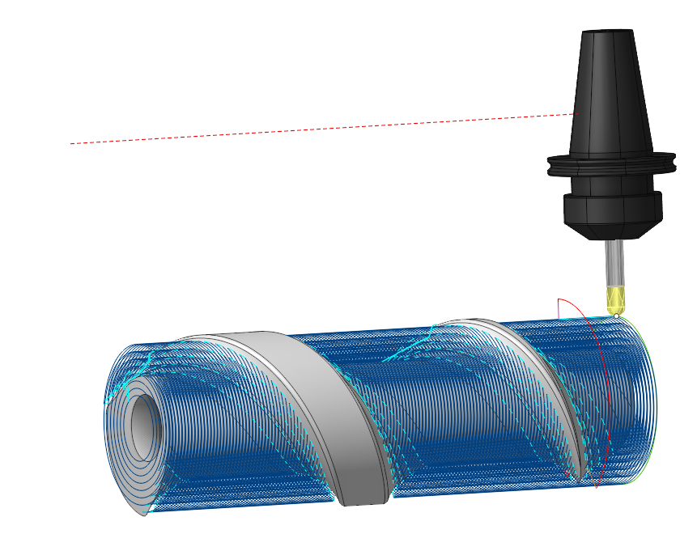
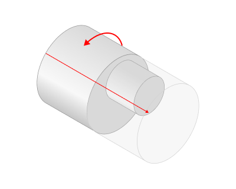
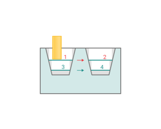
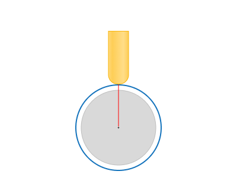
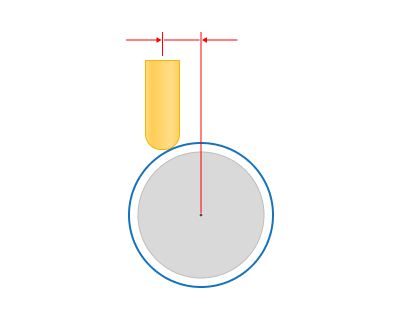
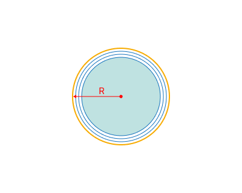

# Sgrossatura rotativa

## Ambito di applicazione:

Rotary Roughing (sgrossatura rotativa) è un'operazione di sgrossatura continua a quattro assi che asporta il materiale del grezzo strato per strato. È simile all'operazione [<strong>Roughing Waterline</strong>](736.md), con la differenza che gli strati di lavorazione non sono piani, ma cilindri con l'asse allineato al Rotary Axis (asse di rotazione).

### Assegnazione del lavoro:

<strong>Spiral curve.</strong> (curva della spirale) La curva necessaria per indicare l'angolo della spirale per la strategia <strong><strong>Side angle</strong>.</strong>

<strong>Top Level.</strong> (livello superiore) Specifica il livello superiore tramite elementi del modello. Questo livello definisce il raggio massimo del modello in cui avviene la lavorazione. [Dettagli](10153.md)

<strong>Bottom Level.</strong> (livello inferiore) Specifica il livello inferiore tramite elementi del modello. Questo livello definisce il raggio minimo del modello in cui avviene la lavorazione. [Dettagli](10153.md)

<strong>Properties.</strong> (proprietà) Visualizza le proprietà di un elemento. È possibile aggiungere il sovrametallo. Questo menu può essere richiamato anche facendo doppio clic su un elemento dell'elenco.

<strong>Delete.</strong> (elimina) Rimuove un elemento dall'elenco.

<strong>Restrictions.</strong> (restrizioni) Consente di escludere le aree che non devono essere lavorate. [Dettagli](101231.md)

### Strategia.

#### Zona di lavoro.

Consente di modificare ulteriormente l'area di lavoro selezionata inizialmente nella scheda <strong>Job Assignment</strong>.

Fare clic qui per espandere..

<strong>Rotary axis.</strong> (asse di rotazione) Il sistema orienta il vettore dell'asse utensile a partire dal <strong>Rotary Axis</strong> designato. La posizione dell'asse di rotazione può essere definita nell'ispettore delle proprietà. È possibile regolare l'asse di rotazione in modo interattivo tramite la freccia oppure selezionarlo dal menu a discesa.

Se la modalità è impostata su <strong>WCS X (GlobalCS X)</strong>, <strong>WCS Y (GlobalCS Y)</strong> o <strong>WCS Z (GlobalCS Z)</strong>, l'asse di rotazione viene orientato lungo l'asse corrispondente del sistema di coordinate.

<strong>Direction.</strong> (direzione) Se la modalità è <strong>WCS (GlobalCS) (0,0,0)</strong>, il vettore dell'asse deve essere definito manualmente nei campi <strong>X,Y,Z</strong> del gruppo della direzione personalizzata. Specificare i coseni direttori rispetto a ciascun asse.

<strong>Origin.</strong> (origine) Il campo <strong>Origin</strong> definisce il punto che funge da origine delle coordinate per l'asse di rotazione scelto.

<strong>Base CS.</strong> (SC di base) Il sistema di coordinate di base (Base CS) commuta il sistema di coordinate tra quello globale e quello locale del pezzo.

Alcuni parametri funzionano in modo analogo all'operazione <strong>Rotary finishing</strong> <strong>.</strong> [Dettagli](10136.md)

#### Forma della traiettoria.

Il formato di uscita della traiettoria.

Fare clic qui per espandere..

La traiettoria può avere una delle forme seguenti:

<strong>Linear.</strong> (lineare) Selezionando questa opzione, le passate di lavoro si formano come linee di intersezione tra le superfici lavorate e i piani passanti per il <strong>Rotary Axis</strong>..

<strong>Circular.</strong> (circolare) Selezionando questa opzione, le passate di lavoro si formano come linee di intersezione tra le superfici lavorate e i piani perpendicolari al <strong>Rotary Axis.</strong>

<strong>Spiral.</strong> (spirale) Attivando questa opzione, il percorso utensile assume la forma di un'unica elica continua. Questo schema è particolarmente adatto alla lavorazione di pezzi come viti e giranti.

<strong>Step.</strong> (passo) È la distanza tra le passate dell'utensile lungo l'asse di rotazione.

<strong>Axial direction.</strong> (direzione assiale) A seconda dell'impostazione del parametro <strong>Trajectory Form</strong>, definisce la direzione delle passate stesse oppure la sequenza di più passate. Nel caso di una spirale il cui passo coincide con lo <strong>Step</strong> di lavorazione, questo parametro influisce sul senso di avvolgimento della spirale.

<strong>Forward.</strong> (avanti) Le passate dell'utensile sono ordinate nella direzione del vettore del <strong>Rotary</strong> Axis.

<strong>Backward.</strong> (indietro) Le passate dell'utensile sono ordinate nella direzione <strong>opposta</strong> al vettore del <strong>Rotary</strong> Axis.

<strong>Spiral step.</strong> (passo della spirale) Definisce i parametri del percorso utensile <strong>Spiral</strong><strong>.</strong> Il valore del passo della spirale può essere positivo o negativo. Il segno definisce il senso di avvolgimento.

<strong>Same as the Basic Step.</strong> (uguale al passo di base) Il percorso utensile è un'unica elica.

<strong>mm, %Diameter, Angle.</strong> (mm, % del diametro, angolo) È possibile impostare un valore arbitrario come quantità assoluta, come percentuale del diametro dell'utensile oppure come angolo di avvolgimento della spirale in gradi. Quando il passo della spirale non coincide con lo <strong>Step</strong> di lavorazione, si ottiene una sequenza di percorsi a spirale distanziati dello <strong>Step</strong> di lavorazione.

<strong>Angle by curve.</strong> (angolo da curva) Determina automaticamente l'angolo dell'elica in base alla curva indicata in <strong>Job assignment.</strong>

<strong>Use flexible axis.</strong> (usa asse flessibile) Attivando l'opzione, il sistema determina automaticamente in ogni sezione l'asse attorno al quale si formano le corse di lavoro, come media dei centri di curvatura della sezione. Si ottiene così una traiettoria coerente, che mantiene la continuità e corregge l'orientamento dell'asse utensile rispetto al pezzo. L'opzione è adatta a pezzi asimmetrici come gli alberi a gomiti

 

#### Tipo di fresatura.

Può essere assegnato in quasi tutte le operazioni, tranne quelle di lavorazione delle curve. Consente all'utente di controllare il tipo di fresatura richiesto (concorde o discorde) durante il calcolo del percorso utensile.

I parametri di <strong>Milling Type</strong> sono gli stessi dell'operazione <strong>Waterline Roughing</strong> <strong>operation</strong>. [Dettagli.](736.md)

#### Punto di contatto dell'utensile.

Il punto di contatto dell'utensile (Tool Contact Point, TCP) è una posizione specifica sull'utensile da taglio che definisce il punto principale di interazione tra l'utensile e la superficie del pezzo o le entità geometriche durante le operazioni di lavorazione.

I parametri di questo gruppo sono gli stessi dell'operazione <strong>5D Surfacing operation</strong>. [Dettagli.](10135.md)

#### Ordinamento.

Controlla la sequenza delle passate del percorso utensile durante la lavorazione delle superfici.

Fare clic qui per espandere..

<strong>By layers.</strong> (per strati) Viene lavorato prima il primo strato di tutti i profili, quindi lo strato successivo.

<strong>By strings.</strong> (per profili) Vengono lavorati prima tutti i livelli del primo profilo, quindi tutti i livelli del profilo successivo.

#### Offset.

Fare clic qui per espandere..

<strong>Se attivato:</strong> il punto verso cui è orientato l'utensile può essere spostato rispetto al <strong>Rotary Axis</strong> del valore specificato, per migliorare le condizioni di taglio. L'offset può essere definito come valore assoluto o come percentuale del diametro dell'utensile e può essere positivo o negativo.

<strong>Se disattivato:</strong> l'offset è disabilitato: l'orientamento dell'utensile è allineato al Rotary Axis.

 

#### Livelli di lavorazione:

Definisce l'intervallo di lavorazione lungo l'asse dell'utensile.

Fare clic qui per espandere..

<strong>Depth Step.</strong> (passo in profondità) Materiale asportato in una passata lungo l'asse dell'utensile tra il livello superiore (<strong>Top</strong>) e quello inferiore (<strong>Bottom levels</strong>). Se il passo è definito come numero di passate, il sistema esegue il numero di passate di sgrossatura specificato. Se il passo è definito come distanza o come percentuale del diametro dell'utensile, il sistema calcola il numero di passate dividendo il sovrametallo per il <strong>Depth Step</strong> di sgrossatura.

<strong>Uniform Step.</strong> (passo uniforme) Attivando l'opzione, il sistema distribuisce le passate in profondità in modo da ottenere una profondità di taglio uniforme entro l'asportazione di materiale consentita.

<strong>Top level.</strong> (livello superiore) Il raggio al quale viene eseguita la prima passata. Per impostazione predefinita è il livello più alto del pezzo lavorato.

<strong>Bottom level.</strong> (livello inferiore) Il raggio al quale viene eseguita l'ultima passata. Trascinare il cilindro con il mouse e utilizzare 'Smart snap' per allinearlo a un elemento e impostare il livello inferiore di lavorazione desiderato. Se il testo nel campo è di colore verde, il livello viene calcolato automaticamente come fondo del pezzo, del grezzo e delle attrezzature. Per tornare alla modalità automatica, è sufficiente cancellare il campo e premere 'Invio'.

### Parametri:

Questa scheda contiene i parametri principali per il controllo del pezzo, del grezzo, delle attrezzature di bloccaggio e di altri elementi, che consentono di modificare la traiettoria. [Dettagli](100112.md)

### Collegamenti/Attacchi:

Nella scheda Links/Leads si definiscono i parametri dei movimenti rapidi. Questi movimenti comprendono l'avvicinamento dell'utensile dalla posizione di cambio utensile, l'attacco all'inizio della corsa di lavoro, la retrazione dopo l'ultimo movimento di taglio, i collegamenti tra le passate di lavoro e il ritorno al punto di cambio utensile. È possibile configurare la sequenza dei movimenti lungo le coordinate, la traiettoria di questi movimenti e l'entità degli spostamenti.

Fare clic qui per espandere..

<strong>Comprende:</strong>

<strong>Approach/Return.</strong> (avvicinamento/ritorno) Questo gruppo di parametri gestisce i movimenti dell'utensile dalla posizione di cambio utensile all'inizio dei percorsi di attacco e viceversa. [Dettagli](100116.md).

<strong>Links.</strong> (collegamenti) Definisce le regole che governano i collegamenti di entrata/uscita e i collegamenti tra i movimenti di lavoro. [Dettagli](100130.md).

<strong>Leads.</strong> (attacchi) Consente di aggiungere ai movimenti di lavoro ulteriori attacchi e retrazioni eseguiti con il relativo avanzamento. [Dettagli](100136.md).

<strong>Safe motions.</strong> (movimenti di sicurezza) Definisce il tipo di <strong>Safety Surface</strong> (superficie di sicurezza) e la sua distanza dal grezzo. Questa superficie agevola i collegamenti tra le superfici lavorate o tra i percorsi utensile, e la prima fase dell'avvicinamento o del ritorno avviene verso di essa. [Dettagli](100117.md).

<strong>Advanced links settings.</strong> (impostazioni avanzate dei collegamenti) Questo gruppo di parametri specifica le caratteristiche della formazione della traiettoria soprattutto per le operazioni a cinque assi, tenendo conto dei movimenti ottimali degli assi rotativi. [Dettagli](100118.md).

<strong>Distances.</strong> (distanze) Distanze utilizzate nelle regole dei collegamenti (Links) [Dettagli](100140.md).

### Avanzamenti/Velocità:

In questa finestra di dialogo l'utente può definire la velocità di rotazione del mandrino, la velocità dei movimenti rapidi e i valori di avanzamento per le diverse parti del percorso utensile. La velocità di rotazione del mandrino può essere definita come numero di giri al minuto oppure come velocità di taglio. Il valore determinante viene sottolineato. Il secondo valore viene ricalcolato in base al valore determinante, tenendo conto del diametro dell'utensile. [Dettagli](100142.md)

### Trasformazioni:

Insieme di parametri dell'operazione che consentono di eseguire trasformazioni di coordinate sul percorso utensile calcolato nell'ambito dell'operazione. [Dettagli](10168.md).

### Pezzo:

Il pezzo (Part) è un gruppo di elementi geometrici che definisce lo spazio in cui controllare le intaccature. [Dettagli](330.md)

### Grezzo:

Il modello del grezzo (Workpiece) di un'operazione definisce il materiale da lavorare. [Dettagli](738.md)

### Attrezzature:

Come attrezzature (Fixtures) si specificano di solito i dispositivi di bloccaggio, come mandrini autocentranti, griffe, staffe, ecc., e le aree di esclusione di qualsiasi altra natura. [Dettagli](10283.md)
