# モーフ加工

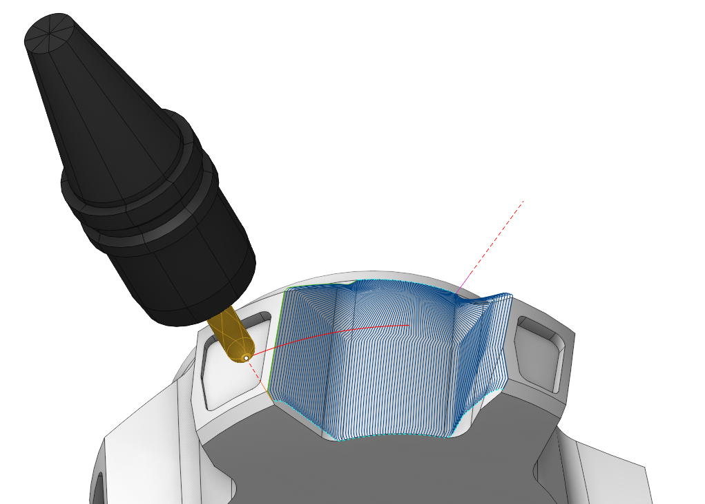

## 適用分野：

指定したステップで配置された一連のライン状のツールパスを生成し、各パスは1番目のカーブから2番目のカーブへと滑らかに遷移する形状で作成されます。

### ジョブ割り当て：

<strong>加工サーフェス。</strong> 加工領域を制限するために使用します。モーフでは、工具がこれらのサーフェスと接触する部分にだけパスを生成します。ジョブ割り当てで指定した2本のカーブの間に直接生成するのではなく、<strong>1番目のカーブ</strong>と<strong>2番目のカーブ</strong>に最も近い、工具と<strong>加工サーフェス</strong>の2本の接触曲線の間に生成します。

<strong>1番目のカーブ</strong> ツールパスを生成する2本の線のうち、開始側となる曲線です。

<strong>2番目のカーブ</strong> ツールパスを生成する2本の線のうち、終了側となる曲線です。

同期線は、閉じた輪郭を加工する場合など、困難なケースでのモーフィング品質を向上させるために使用します。<strong>同期線</strong>は、<strong>1番目のカーブ</strong>と<strong>2番目のカーブ</strong>上の対応する2点を指定します。<strong>同期</strong><strong>線</strong>として、エッジ、3Dカーブ、2D カーブなど、あらゆる種類の曲線を使用できます。また、同期線の開始点と終了点は、 必ずしも<strong>1番目のカーブ</strong>と<strong>2番目のカーブ</strong> 上に正確に一致している必要はありません。2D図形タブで同期線を描くことができます。

<strong>チルトカーブ</strong> <strong>5軸変換</strong><strong>を</strong>通過カーブに設定した際に、工具軸ベクトルが向かう曲線です。

<strong>プロパティ</strong> 要素のプロパティを表示します。ストックを追加することも可能です。リスト内の項目をダブルクリックすることでも、このメニューを表示できます。

<strong>削除</strong> リストから項目を削除します。

<strong>制限</strong> 加工してはならない領域を制限することができます。[詳細を見る](101231.md)

### 加工設定：

#### 加工設定：

これらのパラメータは、目的のツールパスを生成するために使用します。

詳細を表示

<strong>ツールパスの方向</strong>

<strong>平行。</strong> <strong>1番目のカーブ</strong>と<strong>2番目のカーブ</strong>に平行なツールパスを生成します。このツールパスは<strong>直角</strong>ツールパスに基づいて計算されます。そのため、結果が適切でない場合は、<strong>直角</strong>に切り替えることで、考えられる原因を確認できます。

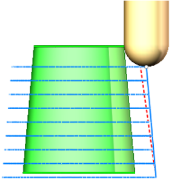

<strong>直角</strong> <strong>1番目のカーブ</strong>と<strong>2番目のカーブ</strong>の対応する点を結ぶことで、ツールパスを生成します。

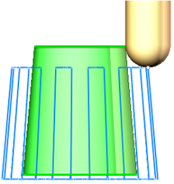

<strong>らせん</strong> 生成されるツールパスは、<strong>1番目のカーブ</strong>と<strong>2番目のカーブ</strong>の間でモーフィングする1つの滑らかならせんになります。このツールパスは <strong>直角</strong>ツールパスに基づいて計算されます。結果が適切でない場合は、<strong>直角</strong>に切り替えることで、考えられる原因を確認できます。

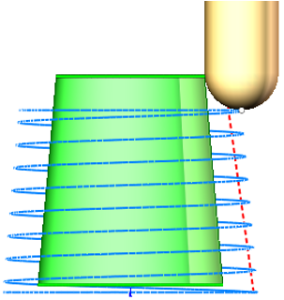

<strong>ステップ</strong> 許容される最大切削幅です。 ツールパスの特性上、ステップは位置ごとに変化しますが、この値を超えることはありません。

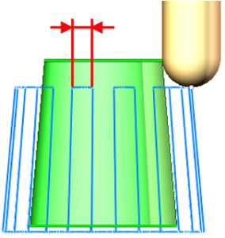

<strong>工具制限。</strong> 工具と<strong>加工サーフェス</strong>との関係を考慮して、ツールパスのカーブを生成する方法を設定します。

詳細を表示

<strong>接触</strong> システムは、工具が<strong>加工面</strong>に接触する位置に工具パスを生成します。その際、指定した<strong>1番目のカーブ</strong> および <strong>2番目のカーブ</strong>に最も近い2つの接触曲線（<strong>加工面</strong>と工具の接触点からなるカーブ）の間でパスが生成されます。<strong>1番目のカーブ</strong> および <strong>2番目のカーブ</strong> が <strong>加工面</strong>の境界エッジである場合は、このオプションを使用します。

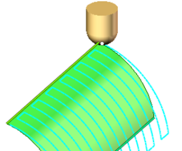

<strong>中心</strong> ツールパスは、<strong>加工面</strong>の領域内で、 <strong>1番目のカーブ</strong> と <strong>2番目のカーブ</strong> 上の工具中心の動作線の間に形成されます。 その際、現在の工具姿勢で 食い込みが起こらないように制御されます。

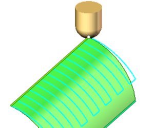

<strong>内側</strong> 加工領域の境界を <strong>1番目のカーブ</strong> と <strong>2番目のカーブ</strong> から工具半径分だけ内側にシフトします。

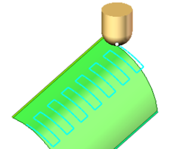

<strong>外側</strong> 加工範囲の境界を <strong>1番目のカーブ</strong> と <strong>2番目のカーブ</strong> から工具半径分だけ外側にシフトします。

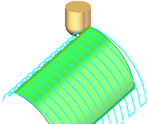

#### ミーリングタイプ：

この機能により、ツールパスの計算プロセス中に、必要なフライス加工タイプ（ダウンカットまたはアップカット）を設定できます。

ミーリングタイプのパラメータは <strong>ウォータライン荒加工オペレーション</strong>と同様です。[詳細を見る](736.md)

#### 並べ替え

サーフェス加工中のツールパスの順序を設定します。

<strong>開始点</strong> このオプションを有効にすると、サーフェス加工における加工パスの開始点を示す座標を入力できます。

#### 内側から加工

このパラメータにより、部品の内部サーフェスを加工することができます（ツールパスを部品の内部サーフェスに投影します）。このパラメータグループは <strong>5Dサーフェシングオペレーションと同様に機能します。ジョブゾーンの内容に記載されています。</strong>[詳細を見る](10135.md)

#### 工具軸の向き：

加工中の工具軸の向きを制御します。

詳細を表示

詳細を表示

<strong>固定</strong> 工具の向きはツールパス全体を通して固定され、インスペクターの<strong>セットアップ</strong>タブで設定された機械回転軸の初期位置によって決定されます。

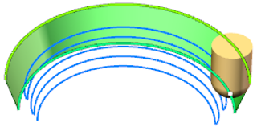

<strong>カーブに垂直</strong> <strong>1番目のカーブ</strong>と<strong>2番目のカーブ</strong>の対応する点を結んで形成される曲面の法線方向に工具が配置されます。さらに、<strong>リーン角度</strong>を適用して、この方向から工具を傾けることも可能です。

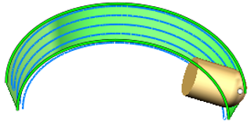

<strong>サーフェスに垂直</strong> <strong>加工面</strong>の法線方向に工具が配置されます。この 機能の動作は、部品の3Dモデルにおける要素の種類や精度に依存します 。使用は自己責任で行ってください。

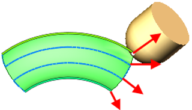

<strong>回転軸へ</strong> 基本となる工具軸の向きは、工具中心点を、その点が回転軸上に投影された位置からを差し引くことで算出されます。工具軸と回転軸の間の<strong>サイド角度</strong> は、自動的に計算することも、直接指定することもできます。

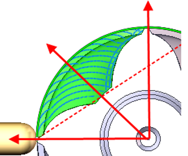

<strong>リーン角度1</strong> <strong>1番目のカーブ</strong>付近で、法線方向から<strong>2番目のカーブ</strong>方向へ工具を傾ける角度です。

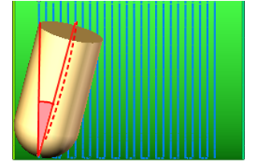

<strong>リーン角度2</strong> <strong>2番目のカーブ</strong>付近で、法線方向から<strong>1番目のカーブ</strong>方向へ工具を傾ける角度です。

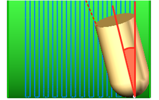

<strong>反対側の前面</strong> CAMシステムが、意図した側とは反対側からサーフェスを加工しようとする場合、またはツールパスがまったく生成されない場合は、このオプションを有効にしてください。

<strong>回転軸</strong> このオプションが有効な場合、工具方向ベクトルの1つの成分を固定し、工具軸と指定した軸に対する垂線（または <strong>工具の向き</strong>が<strong>ツールパスに垂直</strong> に設定されている場合は、その軸自体）との間の <strong>サイド角度</strong> を一定に保ちます。このグループのパラメータは、<strong>5Dサーフェシングオペレーション</strong>と同じです。[詳細を見る](10135.md)

<strong>サイド角度</strong> 回転軸として指定した軸に対する工具軸の傾斜角度を指定します。サイド角度のパラメータは、<strong>5Dサーフェシングオペレーション</strong>と同じです。[詳細を見る](10135.md)

#### 5軸変換：

5軸加工機でオペレーションを実行する際の工具の位置を制御できます。 [詳細を見る](10141.md)

工具位置のパラメータは、 <strong>5Dサーフェシングオペレーション</strong>と同じです。[詳細を見る](10135.md)

#### 回転角度の制限：

このオプションを有効にし、かつ <strong>5軸変換</strong> オプションが有効な場合、各軸に対する工具の角度位置の制限値を指定します。<strong>回転角度の制限</strong>のパラメータは、 <strong>5Dサーフェシングオペレーションと同じです。</strong>[詳細を見る](10135.md)

#### トリム

加工対象外のサーフェスを スキップすることができます 。<strong>トリム</strong> のパラメータは、<strong>ウォータライン荒加工オペレーション</strong>と同じです。[詳細を見る](736.md)

### パラメータ:

このタブには、部品、ワーク、治具、およびその他の軌跡に影響を与える要素を制御するための主要なパラメータが含まれており、ツールパスを変更できます。 [詳細を見る](100112.md)

### リンク／リード

リンク／リードタブでは、早送り動作のパラメータを定義します。これらの移動には、工具交換位置からのアプローチ、切削パス開始点までの位置決め、最終切削後の退避動作、各パス間の移行移動、そして工具交換位置への復帰が含まれます。座標軸ごとの動作順序、各移動の軌跡、および移動量を設定できます。

詳細を表示

<strong>次の項目で構成されます。</strong>

<strong>アプローチ／リターン</strong> このパラメータグループは、工具交換位置から切込み開始パスへの工具の移動、および戻りの動作を設定します。[詳細を見る](100116.md)

<strong>リンク</strong> 進入／退出リンクおよび加工パス間のリンクに関するルールを設定します。[詳細を見る](100130.md)

<strong>リード</strong> 移動動作に対して、送り速度を使用して追加の突き込みおよび退避を追加できます。 [詳細を見る](100136.md)

<strong>安全な動作</strong> <strong>安全サーフェス</strong>のタイプとワークから安全サーフェスまでの距離を設定します。加工サーフェスまたはツールパス間の移行を円滑にし、アプローチまたはリターンの最初の段階は、このサーフェスに向かって行われます。[詳細を見る](100117.md)

<strong>高度なリンク設定</strong> このパラメータグループは、主に5軸加工において、回転軸の最適な動きを考慮した軌道形成の特徴を指定します。[詳細を見る](100118.md)

<strong>距離</strong> リンクのルールで使われる距離です。 [詳細を見る](100140.md)

### 送り速度設定

[このダイアログを使用して、主軸回転速度、早送り値、ツールパスの異なる領域の送り値を設定できます。主軸回転速度は、毎分回転数または切削速度 の いずれかで設定できます。設定値には下線が表示されます。もう一方の値は、工具径を考慮し、設定値に基づいて再計算されます。 詳細を見る](100142.md)

### 変換：

[オペレーション内で計算された工具の軌跡に対して座標変換 を 行うための パラメータグループです。 詳細を見る](10168.md)

### パーツ：

パーツは、食い込みをチェックする空間を定義する幾何要素のグループです。[詳細を見る](330.md)

### ワーク：

加工のワークモデルは、加工する素材を定義します。[詳細を見る](738.md)

### 治具：

[治具 には通常 、チャック、グリップ、クランプなどの固定補助具と、その他の種類の制限領域を指定します 。 詳細を見る](10283.md)
