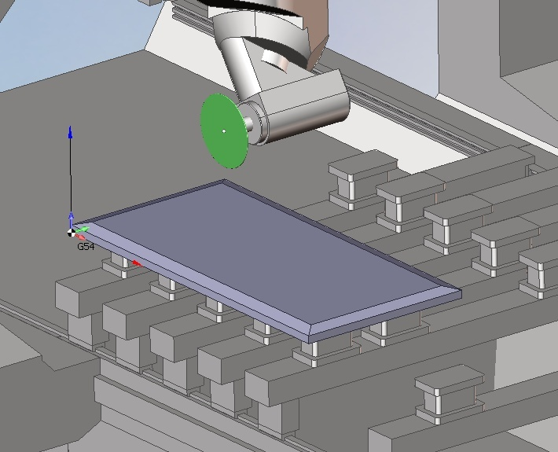
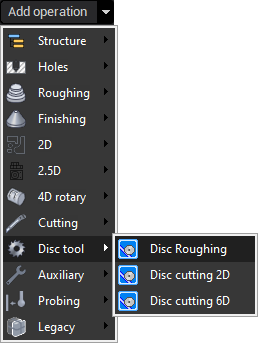
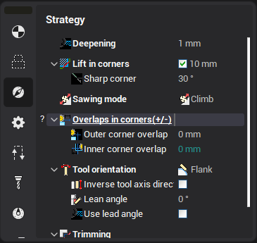
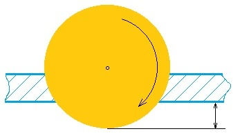

# のこ切断オペレーション

このオペレーションは、5軸ミーリング機械または主軸を備えたロボットで、丸のこによる切断を行うためのものです。「5D輪郭加工」オペレーションを基に、ディスク工具の正しいアプローチと退避に必要な変更を加えています。プログラミングの入力データにはソリッドを使用します。.dxfなどから取得した曲線の加工には対応していません。

使用方法：

1. のこ切断オペレーションを作成します。

2. 他のオペレーションと同じ方法で、必要な工具寸法と速度を設定します。

3. ジョブ割り当てを定義するには、ソリッドのエッジを選択して「Edge/Curve on surface」を押します。選択したエッジがジョブリストに追加され、隣接するサーフェスの1つが緑色でハイライト表示されます。この面が切断によって形成されます。もう一方の隣接面を作成するには、エッジをもう一度クリックし、表示された2つのボタンのパネルで「change the side」を押します。

4. 「[5D輪郭加工](10129.md)」とは異なり、のこ切断オペレーションにはオーバーラップを定義する追加パラメータがあります。

 

YouTubeのオペレーション例：

[http://www.youtube.com/watch?v=op5vH1P-V3s](http://www.youtube.com/watch?v=op5vH1P-V3s)
