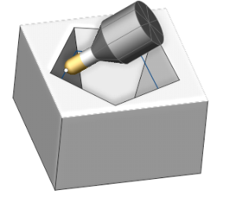
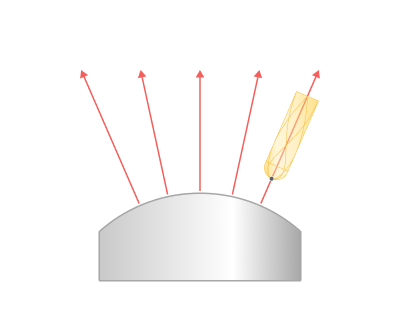
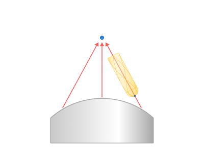
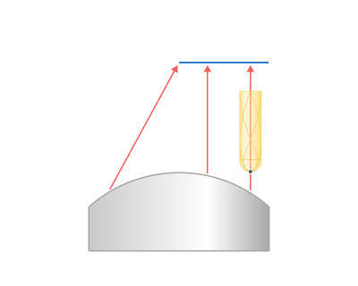
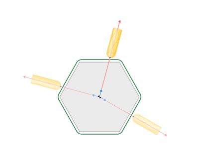

# Werkzeugbahnen in 5-Achsen-Bahnen umwandeln

Diese Funktion wandelt 3-Achsen-Bahnen beispielsweise bei [Scallop](10118.md), [Morph](10138.md) und Geodesic in 5-Achsen-Bahnen um. Dadurch können Kollisionen vermieden und kürzere Werkzeuge eingesetzt werden. Die Umwandlung ist für Kugelfräser vorgesehen.

Für die Werkzeugausrichtung stehen folgende Möglichkeiten zur Verfügung:

**Normal to surface (Normal zur Fläche).**

Das Werkzeug wird normal zu den Bearbeitungsflächen ausgerichtet. Zusätzliche Vorlauf- und seitliche Neigungswinkel (**Lead/Lean**) neigen es in oder quer zur Schnittrichtung.

**Flank (Werkzeugflanke).**

Das Werkzeug berührt die Fläche mit seinem Umfang, bei Zylinderfräsern mit dem zylindrischen Bereich. Zusätzliche **Lead**- und **Lean**-Winkel sind möglich. Diese Strategie eignet sich zum Flankenfräsen.

**Through point (Durch Punkt).**

Die Werkzeugachse wird auf den angegebenen Punkt ausgerichtet.

**Through curve (Durch Kurve).**

Die Werkzeugachse wird auf den nächstgelegenen Punkt der angegebenen **Tilt curve** ausgerichtet. Zusätzlich können **Lead**-Winkel vorgegeben werden.

**To rotary axis (Zur Drehachse).**

Die Werkzeugachse zeigt wie bei der Rotationsbearbeitung zur Drehachse. Zusätzlich können ein Seitenwinkel zur Drehachse und **Lean**-Winkel angegeben werden.

**Perpendicular to toolpath (Senkrecht zur Werkzeugbahn).**

Die Werkzeugachse steht senkrecht zur Bahn und zur Drehachse. Zusätzlich können ein Seitenwinkel zur Drehachse und **Blend distance** eingestellt werden.

**4-Achsen-Bearbeitung mit Rotary axis.**

Durch Festhalten einer Richtungskomponente der Werkzeugachse (X, Y oder Z) kann eine 5-Achsen-Bahn in eine 4-Achsen-Bahn umgewandelt werden.

**Limit Rotation angles (Drehwinkel begrenzen).**

**Limit around axis (Um eine Achse begrenzen).**

.png)

Begrenzt die Werkzeugausrichtung in der XY-, XZ- oder YZ-Ebene auf den Bereich zwischen zwei Winkeln.

**Conical limit (Kegelförmige Begrenzung).**

.png)

Begrenzt die Werkzeugausrichtung relativ zu einer Achse auf den Winkelbereich zwischen zwei Kegeln.
