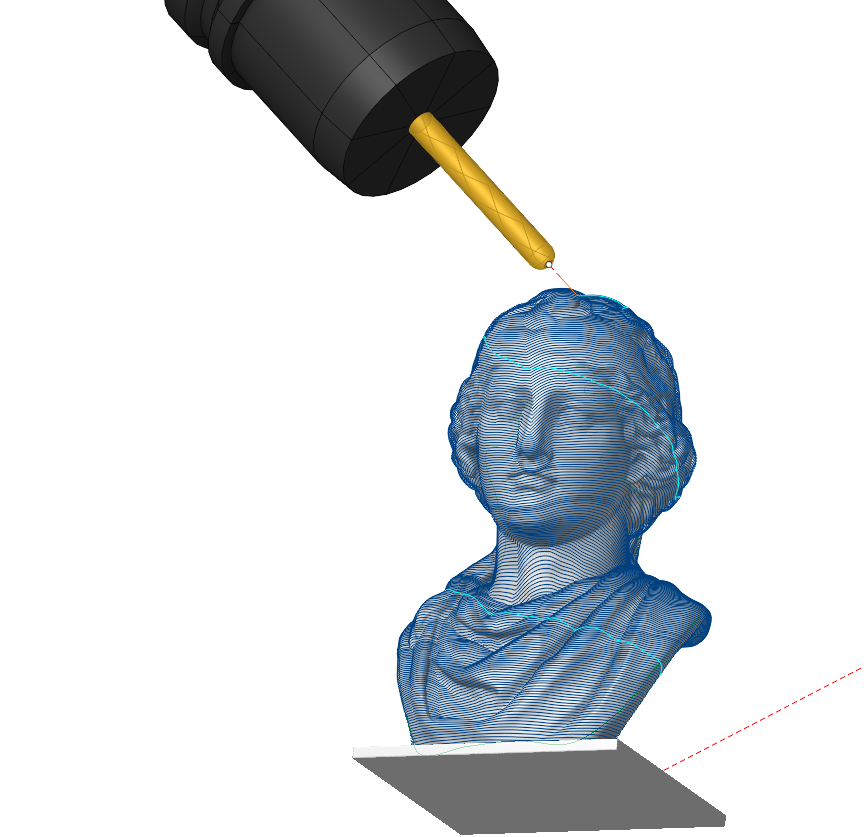
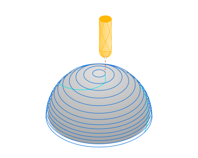
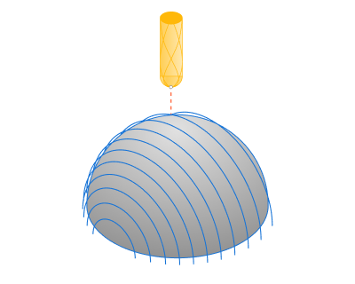
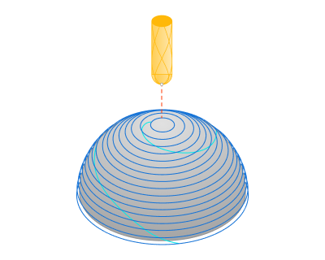
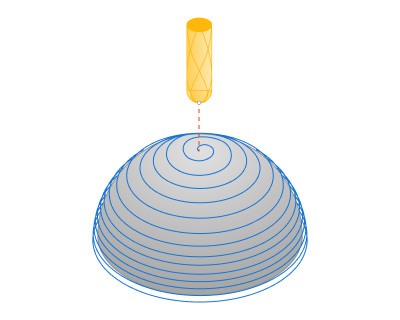
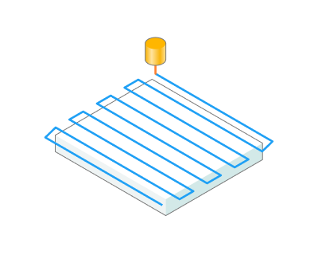
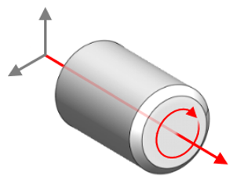
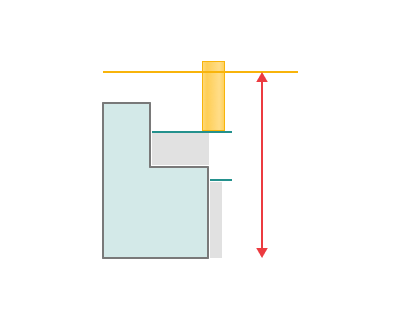
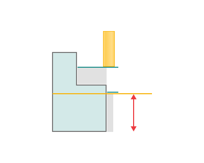
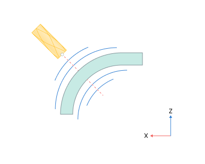

# 5D su mesh

## Ambito di applicazione:

Un'operazione di finitura a 5 assi versatile, con un potente insieme di strategie, di modalità di orientamento dell'asse utensile e con la prevenzione automatica delle collisioni dell'utensile e del portautensile. Ideale per la finitura di forme complesse come sculture o modelli STL ottenuti da scansione. Facile da usare. L'operazione consente di lavorare modelli mesh in modo analogo alle strategie [Scallop](10118.md), [3D Helical](10119.md) e Waterline dell'operazione [5D Surfacing](10135.md). L'operazione consente di generare percorsi utensile di lavorazione su macchine a 5 assi e su robot. L'operazione supporta modelli di superfici e modelli mesh triangolari. È possibile utilizzare frese sferiche, frese coniche con estremità sferica e frese a lecca-lecca (lollipop).

Per iniziare la lavorazione è sufficiente creare l'operazione e premere Run. L'operazione genera un percorso a cresta costante (Scallop) sull'intero pezzo, a partire dal livello inferiore. L'utensile rimane in orientamento verticale a meno che non si verifichi una collisione con il pezzo; in tal caso viene inclinato lateralmente.

<strong>Flusso di lavoro:</strong>

1. Definire la <strong>Strategy</strong> (strategia) del percorso utensile. La strategia predefinita è Scallop, perché consente di lavorare l'intero pezzo con un passo laterale costante.
2. Scegliere l'<strong>orientamento dell'asse utensile</strong>. L'opzione predefinita è <strong>Fixed</strong> (fisso), perché insieme alla prevenzione automatica delle collisioni non richiede alcuna impostazione aggiuntiva e produce un percorso utensile regolare e prevedibile.
3. Definire la strategia di <strong>prevenzione delle collisioni</strong>. Quella predefinita è <strong>Side Tilting</strong> (inclinazione laterale), poiché funziona bene con i percorsi Scallop, Helical e Waterline.
4. Facoltativamente, definire la zona di lavoro
5. Generare il percorso utensile

### Assegnazione del lavoro:

<strong>Machining Surfaces.</strong> (superfici da lavorare) Selezionare varie superfici del pezzo come oggetto della lavorazione. Il sistema calcola il percorso utensile in base alle superfici scelte.

<strong><strong>Tilt Curve.</strong></strong> (curva di inclinazione) È la curva verso cui punta il vettore dell'asse utensile quando per <strong><strong>Tool Orientation</strong></strong> (orientamento dell'utensile) si imposta <strong><strong>Through Curve.</strong></strong> (attraverso la curva)

<strong>Job Zone.</strong> (zona di lavoro) Utilizzare la <strong>Job Zone</strong> per rifilare le passate al di fuori delle aree di contenimento 2D specificate. È possibile selezionare la normale all'area della <strong>Job Zone</strong>. [Dettagli](10151.md).

<strong>Restrict Zone.</strong> (zona di esclusione) Oltre alle <strong>Job Zones</strong>, nel sistema è possibile utilizzare la geometria delle <strong>Restrict Zones</strong>, definita da curve e spigoli, per specificare le aree del grezzo che non devono essere lavorate nell'operazione corrente. [Dettagli](10152.md)

<strong>Start Curves.</strong> (curve di partenza) Utilizzando una curva chiusa, ad esempio una spline, è possibile selezionare una porzione del modello da lavorare. È possibile specificare il lato di lavorazione e configurare i vettori che definiscono l'orientamento dell'asse utensile.

<strong>Properties.</strong> (proprietà) Visualizza le proprietà di un elemento. È possibile aggiungere un sovrametallo. Questo menu si può richiamare anche facendo doppio clic su un elemento dell'elenco.

<strong>Delete.</strong> (elimina) Rimuove un elemento dall'elenco.

<strong>Restrictions.</strong> (restrizioni) Consente di delimitare le aree che non devono essere lavorate. [Dettagli](101231.md)

### Strategia:

#### Strategie:

Questo parametro consente all'utente di ottenere il percorso utensile richiesto:

Fare clic qui per espandere..

<strong><strong>Waterline</strong>.</strong> (Z costante) Il sistema genera le passate dell'utensile come linee di sezione della <strong><strong>Machining Surface</strong></strong> con piani orizzontali (perpendicolari all'asse utensile), in modo analogo alla strategia dell'operazione <strong>Waterline Finishing</strong> [Dettagli.](841.md)

<strong>Plane</strong>. (piano) Il sistema genera le passate dell'utensile come linee di sezione della <strong>Machining Surface</strong> con piani verticali (paralleli all'asse utensile), in modo analogo alla strategia dell'operazione <strong>Plane Finishing.</strong> [Dettagli.](713.md)

<strong>Scallop</strong>. (cresta costante) Il percorso utensile Scallop parte dalle curve che giacciono sulle superfici del pezzo e viene generato offsettando ripetutamente tali curve verso l'interno finché le curve non collassano. Il sistema genera il percorso utensile come nell'operazione <strong>Scallop finishing</strong>. [Dettagli.](10118.md)

<strong>Helical</strong>. (elicoidale) La strategia genera passate elicoidali continue come nell'operazione <strong>3D Helical</strong>. [Dettagli.](10119.md)

<strong>Step</strong>. (passo) La larghezza di taglio massima consentita.

<strong>XY Angle.</strong> (angolo XY) È l'angolo di rotazione dei piani di sezione attorno all'asse utensile.

#### Start From (inizio da):

Questo gruppo di parametri compare quando è attiva la strategia <strong>Scallop</strong> e determina la costruzione delle curve iniziali del percorso utensile.

Fare clic qui per espandere..

<strong>Bottom</strong>. (fondo) Il percorso utensile inizia al <strong>Bottom Level</strong> (livello inferiore) di lavorazione all'interno della <strong>Job Assignment.</strong>

<strong>Job Boundary.</strong> (contorno di lavoro) Il percorso utensile inizia dalle curve della <strong>Job Zone.</strong>

Gli altri parametri di questo gruppo sono gli stessi dell'operazione <strong>Scallop Finishing.</strong> [Dettagli.](10118.md)

#### Smooth Radius (raggio di raccordo):

Questo parametro compare quando è attiva la strategia <strong>Helical</strong> e consente di raccordare gli spigoli interni del percorso utensile con un raggio specificato.

Fare clic qui per espandere..

.png) .png)

#### Job zone (zona di lavoro):

Consente di modificare ulteriormente l'area di lavoro selezionata inizialmente nella scheda <strong>Job assignment</strong>.

Fare clic qui per espandere..

<strong>Restrict Job Zone:</strong> (delimitazione della zona di lavoro)

<strong>With Edges.</strong> (con spigoli) Quando questo parametro è attivato, il sistema lavora sia le superfici specificate nella <strong>Job Assignment</strong> sia i relativi spigoli di contorno.

<strong>Surface Only.</strong> (solo superficie) Quando questo parametro è attivato, il sistema lavora esclusivamente le superfici specificate nella <strong>Job Assignment</strong>, escludendo i relativi spigoli di contorno.

<strong>Rotary Axis.</strong> (asse rotativo) Specifica l'origine e la direzione di riferimento per i parametri di questo gruppo. Il <strong>Rotary Axis</strong> è definito dalla sua <strong>Origin</strong> (origine) e dalla sua <strong>Direction</strong> (direzione). I parametri desiderati dell'asse rotativo si possono impostare facilmente sia nell'inspector sia con il mouse nella vista grafica.

<strong>WCS X (Global CS X).</strong> Il <strong>Rotary Axis</strong> è l'asse X del sistema di coordinate specificato.

<strong>WCS Y (Global CS Y).</strong> Il <strong>Rotary Axis</strong> è l'asse Y del sistema di coordinate specificato.

<strong>WCS Z (Global CS Z).</strong> Il <strong>Rotary Axis</strong> è l'asse Z del sistema di coordinate specificato.

<strong>WCS (0,0,1) (Global CS (0,0,1)).</strong> Il vettore del <strong>Rotary Axis</strong> viene definito mediante i coseni direttori rispetto a ciascun asse.

<strong>Direction</strong>. (direzione) Specificare i coseni direttori rispetto a ciascun asse.

<strong>Origin</strong>. (origine) Specificare le coordinate dell'origine di riferimento per i parametri di questo gruppo.

<strong>Base CS</strong>. (SC di base) Specificare il sistema di coordinate con cui configurare la posizione e l'orientamento iniziali del <strong>Rotation Axis</strong>.

<strong>Tool axis.</strong> (asse utensile) Il vettore del <strong>Rotary Axis</strong> è l'asse utensile.

<strong><strong>Top level.</strong></strong> (livello superiore) La distanza massima dall'<strong>Origin</strong> alla quale avvengono le passate dell'utensile. Il livello al quale viene eseguita l'ultima passata. Per impostazione predefinita è il livello più alto del pezzo lavorato.

<strong>mm</strong>. Specificare nel campo di testo dell'inspector la quota desiderata dall'<strong>Origin</strong> al <strong>Top Level</strong>. È anche possibile trascinare il piano con il mouse, oppure trascinare il cerchio centrale del piano e utilizzare 'Smart snap' per allinearlo a un elemento, oppure fare clic sulla quota nella vista grafica.

<strong>Auto</strong>. Il sistema determina il <strong>Top Level</strong> in base ai punti più alti delle aree indicate nella <strong>Job Assignment</strong>.

<strong>Bottom Level.</strong> (livello inferiore) La distanza minima dall'<strong>Origin</strong> alla quale avvengono le passate dell'utensile.

<strong>mm</strong>. Specificare nel campo di testo dell'inspector la quota desiderata dall'<strong>Origin</strong> al <strong>Bottom Level</strong>. È anche possibile trascinare il piano con il mouse, oppure trascinare il cerchio centrale del piano e utilizzare 'Smart snap' per allinearlo a un elemento, oppure fare clic sulla quota nella vista grafica.

<strong>Auto</strong>. Il sistema determina il <strong>Bottom Level</strong> in base ai punti più bassi delle aree indicate nella <strong>Job Assignment</strong>.

<strong>Machining Side.</strong> (lato di lavorazione) Identifica il lato della superficie consentito per la lavorazione. [Dettagli.](724.md)

<strong>Front</strong>. (anteriore) L'utensile può lavorare solo dal lato corrispondente alla direzione positiva del vettore normale alla superficie.

.png)

<strong>Back</strong>. (posteriore) L'utensile può lavorare solo dal lato opposto al vettore normale alla superficie.

.png)

<strong>Both</strong>. (entrambi) L'utensile può lavorare da entrambi i lati della superficie.

<strong>By Default</strong>. (predefinito) Utilizza il metodo di lavorazione impostato come predefinito nel sistema.

#### Milling Type (tipo di fresatura):

Può essere assegnato in quasi tutte le operazioni, eccetto le operazioni di lavorazione di curve. Consente all'utente di controllare il tipo di fresatura richiesto (concorde o discorde) durante il calcolo del percorso utensile.

I parametri di <strong>Milling Type</strong> sono gli stessi dell'<strong>operazione</strong> <strong>Waterline Roughing</strong>. [Dettagli.](736.md)

#### Sorting (ordinamento).

Controlla la sequenza delle passate del percorso utensile durante la lavorazione delle superfici.

Fare clic qui per espandere..

<strong>Machining Direction.</strong> (direzione di lavorazione) Controlla la direzione di movimento dell'utensile lungo le curve del percorso utensile. I parametri di questa funzione sono gli stessi dell'operazione <strong>Scallop Finishing</strong>. [Dettagli](10118.md).

<strong>Start from.</strong> (inizio da) Specifica il livello di partenza del movimento dell'utensile. I parametri di questa funzione sono gli stessi dell'operazione <strong>3D Helical</strong>. [Dettagli.](10119.md)

<strong>Change Direction.</strong> (inverti direzione) Consente di modificare l'ordine di esecuzione delle passate: dal basso verso l'alto oppure dall'alto verso il basso.

#### Tool Orientation (orientamento dell'utensile):

Controlla l'orientamento dell'asse utensile. I parametri principali di questa funzione sono gli stessi dell'operazione <strong>5D Surfacing</strong>. [Dettagli.](10135.md)

Fare clic qui per espandere..

<strong>Singularity avoidance angle.</strong> (angolo di prevenzione della singolarità) Con questa opzione l'utensile si discosta costantemente dall'asse fisso dell'angolo specificato, anche in assenza di collisioni. In questo modo si evita la "singolarità" della tavola rotante.

#### Avoid Collisions (prevenzione delle collisioni):

Insieme alla funzione <strong>Check Holder</strong> (controllo del portautensile), questa funzione rileva i tratti del percorso utensile in cui il portautensile collide con il pezzo e modifica tali tratti secondo la strategia specificata. [Dettagli](11211.md)

#### Limit Rotation Angles (limitazione degli angoli di rotazione):

Questa opzione specifica i valori limite della posizione angolare dell'utensile rispetto agli assi. I parametri di <strong>Limit Rotation Angles</strong> sono gli stessi dell'operazione <strong>5D Surfacing.</strong> [Dettagli.](10135.md)

#### Trimming (rifilatura):

Consente di escludere le superfici non destinate alla lavorazione e di estendere il percorso utensile. I parametri di <strong>Trimming</strong> sono gli stessi dell'operazione <strong>Waterline Roughing</strong>. [Dettagli.](736.md)

### Parametri:

Questa scheda contiene i parametri principali per il controllo del pezzo, del grezzo, delle attrezzature di bloccaggio e di altri elementi, che consentono di modificare il percorso utensile. [Dettagli](100112.md)

### Collegamenti/Attacchi:

Nella scheda Links/Leads si definiscono i parametri dei movimenti rapidi. Questi movimenti comprendono l'avvicinamento dell'utensile dalla posizione di cambio utensile, l'attacco all'inizio della corsa di lavoro, la retrazione dopo l'ultimo movimento di taglio, i collegamenti tra le passate di lavoro e il ritorno al punto di cambio utensile. È possibile configurare la sequenza dei movimenti lungo le coordinate, la traiettoria di questi movimenti e l'entità degli spostamenti.

Fare clic qui per espandere..

<strong>Comprende:</strong>

<strong>Approach/Return.</strong> (avvicinamento/ritorno) Questo gruppo di parametri gestisce i movimenti dell'utensile dalla posizione di cambio utensile all'inizio dei percorsi di attacco e viceversa. [Dettagli](100116.md).

<strong>Links.</strong> (collegamenti) Definisce le regole che governano i collegamenti di entrata/uscita e i collegamenti tra i movimenti di lavoro. [Dettagli](100130.md).

<strong>Leads.</strong> (attacchi) Consente di aggiungere ai movimenti di lavoro ulteriori attacchi e retrazioni eseguiti con il relativo avanzamento. [Dettagli](100136.md).

<strong>Safe motions.</strong> (movimenti di sicurezza) Definisce il tipo di <strong>Safety Surface</strong> (superficie di sicurezza) e la sua distanza dal grezzo. Questa superficie agevola i collegamenti tra le superfici lavorate o tra i percorsi utensile, e la prima fase dell'avvicinamento o del ritorno avviene verso di essa. [Dettagli](100117.md).

<strong>Advanced links settings.</strong> (impostazioni avanzate dei collegamenti) Questo gruppo di parametri specifica le caratteristiche della formazione della traiettoria soprattutto per le operazioni a cinque assi, tenendo conto dei movimenti ottimali degli assi rotativi. [Dettagli](100118.md).

<strong>Distances.</strong> (distanze) Distanze utilizzate nelle regole dei collegamenti (Links) [Dettagli](100140.md).

### Avanzamenti/Velocità:

In questa finestra di dialogo l'utente può definire la velocità di rotazione del mandrino, la velocità dei movimenti rapidi e i valori di avanzamento per le diverse parti del percorso utensile. La velocità di rotazione del mandrino può essere definita come numero di giri al minuto oppure come velocità di taglio. Il valore determinante viene sottolineato. Il secondo valore viene ricalcolato in base al valore determinante, tenendo conto del diametro dell'utensile. [Dettagli](100142.md)

### Trasformazioni:

Insieme di parametri dell'operazione che consentono di eseguire trasformazioni di coordinate sul percorso utensile calcolato nell'ambito dell'operazione. [Dettagli](10168.md)

### Pezzo:

Il pezzo (Part) è un gruppo di elementi geometrici che definisce lo spazio in cui controllare le intaccature. [Dettagli](330.md)

### Grezzo:

Il modello del grezzo (Workpiece) di un'operazione definisce il materiale da lavorare. [Dettagli](738.md)

### Attrezzature:

Come attrezzature (Fixtures) si specificano di solito i dispositivi di bloccaggio, come mandrini autocentranti, griffe, staffe, ecc., e le aree di esclusione di qualsiasi altra natura. [Dettagli](10283.md)
