# 5Dメッシュ加工

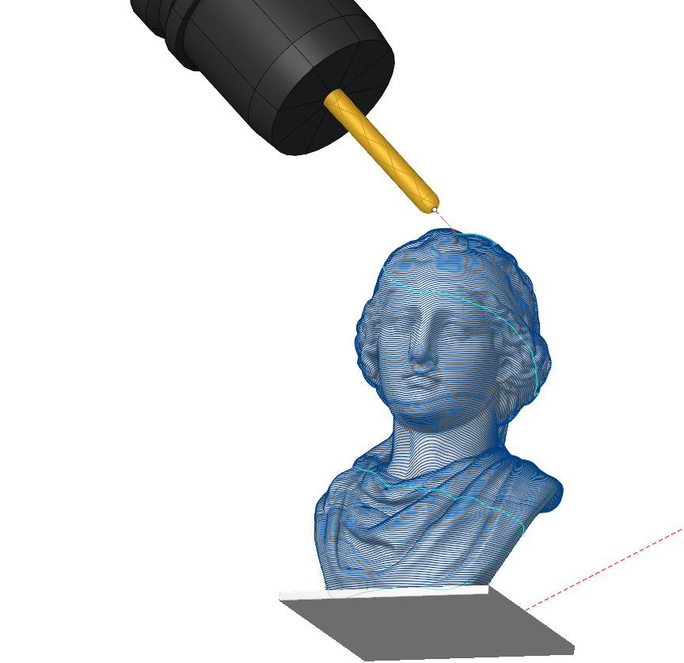

## 適用分野：

豊富な加工方法、工具軸方向モード、および工具とホルダーの自動衝突回避機能を備えた汎用性の高い5軸仕上げ加工です。彫刻やスキャンしたSTLモデルのような複雑な形状の仕上げに最適で、簡単に使用できます。 このオペレーションでは、 [スキャロップ仕上げ](https://confluence.encycam.com/display/SC1/.Scallop+finishing+operation+v19.1)、 [ヘリカル加工](https://confluence.encycam.com/display/SC1/.Helical+operation+v19.1)、 [5Dサーフェシング](https://confluence.encycam.com/display/SC1/.5d+surfacing+operation+v19.1)のウォーターライン方法と同様の方法でメッシュモデルを加工できます。5軸加工機およびロボット用の加工ツールパスを生成できます。また、サーフェスモデルと三角メッシュモデルに対応しています。ボールエンドミル、テーパーボールエンドミル、およびロリポップミルを使用できます。

加工を開始するには、オペレーションを作成して実行を押すだけです。この操作により、最下層から開始してパーツ全体にスキャロップパターンが生成されます。部品との干渉がない限り、工具は垂直方向を維持し、干渉が発生する場合は側方へ傾斜します。

<strong>ワークフロー：</strong>

1. ツールパス<strong>加工設定</strong>を設定します。デフォルトのストラテジはスキャロップで、一定したステップでパーツ全体を加工できます。
2. <strong>工具軸方向</strong>を選択します。デフォルトのオプションは<strong>固定</strong>で、自動衝突回避機能と組み合わせることで、追加設定を必要とせず、滑らかで予測可能なツールパスを生成できます。
3. <strong>衝突回避</strong>方法を設定します。デフォルトは <strong>サイドチルト</strong>で、スキャロップ、ヘリカル、ウォータラインパターンで効果的に機能します。
4. 必要に応じて、加工領域を設定します。
5. ツールパスを生成します。

## ジョブ割り当て：

<strong>加工面</strong> 部品の各種サーフェスを加工対象として選択します。システムは、選択したサーフェスに基づいて軌道を計算します。

<strong>チルト曲線</strong> <strong>工具姿勢</strong> を <strong>曲線通過</strong>に設定した場合に、工具軸ベクトルが向かう対象となるカーブです。

<strong>ジョブゾーン ジョブゾーン</strong> を使用して、指定された2Dの制限領域の外側のパスをトリムします。 <strong>ジョブゾーン</strong> に対しての法線方向を選択できます。 [詳細を見る](10151.md)

<strong>制限領域</strong> <strong>ジョブゾーン</strong> に加えて、カーブやエッジから作成した <strong>制限領域</strong> の要素を使用して、現在のオペレーションで加工を避けるワーク領域を指定できます。 [詳細を見る](10152.md)

<strong>開始カーブ</strong> スプラインなどの閉じたカーブを使用して、加工モデルの領域を選択できます。加工する側を指定し、工具軸方向を定義するベクトルを設定できます。

<strong>プロパティ</strong> 要素のプロパティを表示します。ストックを追加することも可能です。リスト内の項目をダブルクリックすることでも、このメニューを表示できます。

<strong>削除</strong> リストから項目を削除します。

<strong>制限</strong> 加工してはならない領域を制限することができます。[詳細を見る](101231.md)

## 加工設定：

### 加工設定：

これらのパラメータにより、目的のツールパスを生成するために使用します。

拡大

<strong>ウォータライン 加工面</strong> を水平面（工具軸に垂直な平面）で断面化し、その断面線に沿ってツールパスを生成します。これは <strong>ウォータライン 仕上げオペレーション</strong> と同様です。 [詳細を見る](https://confluence.encycam.com/display/SC1/.Waterline+finishing+operation+v19)

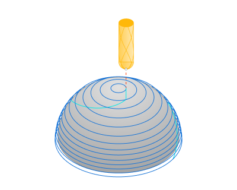

<strong>平面</strong> <strong>加工面</strong> を垂直平面 (工具軸に平行な平面)で断面化し、その断面線に沿ってツールパスを生成します。これは<strong>平面仕上げオペレーション</strong>と同様です。[詳細を見る](https://confluence.encycam.com/display/SC1/.Plane+finishing+operation+v19)

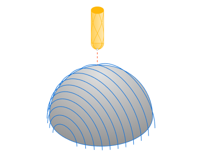

<strong>スキャロップ</strong> スキャロップツールパスは、部品サーフェス上のカーブから開始し、それらのカーブが消滅するまで内側へ繰り返しオフセットすることで生成されます。システムは <strong>スキャロップ仕上げオペレーション</strong>と同様にツールパスを生成します。[詳細を見る](https://confluence.encycam.com/display/SC1/.Scallop+finishing+operation+v19.1)

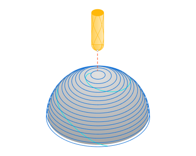

<strong>ヘリカル</strong> <strong>3Dヘリカルオペレーション</strong>と同様にツールパスを生成します。[詳細を見る](https://confluence.encycam.com/display/SC1/.Helical+operation+v19.1)

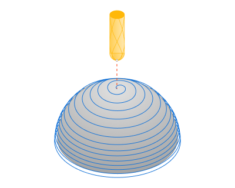

<strong>ステップ</strong> 許容される最大切削幅です。

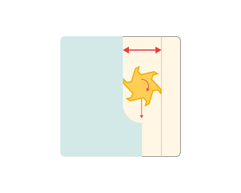

<strong>XY角度</strong> 工具軸まわりの断面平面の回転角度です。

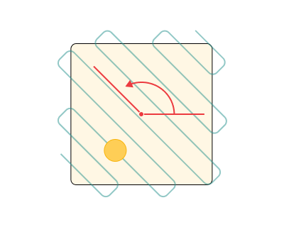

### 開始：

このパラメータグループは、<strong>スキャロップ</strong>が有効な場合に表示され、最初のツールパス曲線の生成方法を設定します。

拡大

<strong>底面</strong> ツールパスは、 <strong>ジョブ割り当て</strong> 内で設定された加工の<strong>底面</strong> から開始します。

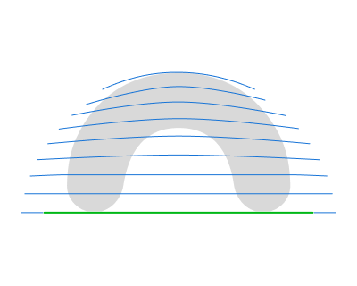

<strong>ジョブ境界</strong> ツールパスは<strong>ジョブゾーン</strong>の曲線から始まります。

他のグループのパラメータは、 <strong>スキャロップ仕上げオペレーション</strong>と同様です。 [詳細を見る](https://confluence.encycam.com/display/SC1/.Scallop+finishing+operation+v19.1)

### 半径の円滑化：

このパラメータは<strong>ヘリカル</strong> 方法が有効な場合に表示され、 指定した半径を使用してツールパスの内側コーナーを滑らかにします。

拡大

 

### ジョブゾーン：

<strong>ジョブ割り当て</strong>タブで最初に選択した加工領域の追加修正が可能 です。

拡大

<strong>加工領域を制限</strong>

<strong>エッジ付き</strong> このパラメータを有効にすると、 <strong>ジョブ割り当て</strong> で指定したサーフェスとその境界エッジの両方を加工します。

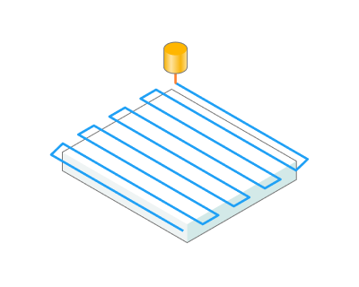

<strong>サーフェスのみ</strong> このパラメータを有効にすると、 ジョブ割り当て で指定したサーフェスのみを処理し、境界エッジは除外します。

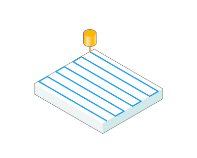

<strong>回転軸</strong> このグループのパラメーターを設定するための基準となる原点と方向を指定します。 <strong>回転軸</strong>は<strong>原点</strong>と<strong>方向</strong>によって定義されます。回転軸のパラメータは、インスペクターまたはグラフィックビュー上でマウスを使用して簡単に設定できます。

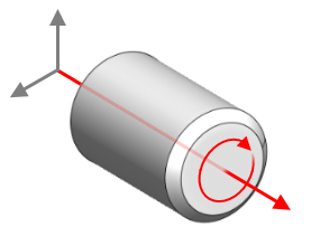

<strong>WCS X（グローバル座標系 X）</strong>指定した座標系のX軸を<strong>回転軸</strong>とします。

<strong>WCS Y（グローバル<strong>座標系</strong> Y）</strong>指定した座標系のY軸を<strong>回転軸</strong>とします。

<strong>WCS Z（グローバル<strong>座標系</strong> Z）</strong>指定した座標系のZ軸を<strong>回転軸</strong>とします。

<strong>WCS（0,0,1）（グローバル<strong>座標系</strong>（0,0,1））</strong> <strong>回転軸</strong>のベクトルを、各軸に対する方向余弦に基づいて定義します。

<strong>方向</strong> 各軸に対する方向余弦 を指定します。

<strong>原点</strong> このグループのパラメーターを設定する基準となる原点座標を指定します。

<strong>基準<strong>座標系</strong> <strong>回転軸</strong>の初期位置および向きを設定するための座標系を指定します。

<strong>工具軸</strong> <strong>回転軸</strong>のベクトルを工具軸として使用します。

<strong>上部高さ</strong> ツールパスが生成される<strong>原点</strong>からの最大の高さです。最終パスを実行する高さです。デフォルトでは、加工する部品の最上部の高さに設定されています。

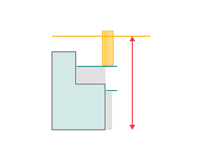

<strong>mm</strong> インスペクターのテキストフィールドで、 <strong>原点</strong>から<strong>上部高さ</strong>までの寸法を指定します。また、マウスで平面をドラッグしたり、平面中央の円をドラッグして『スマートスナップ』機能を使ってフィーチャーに合わせたり、グラフィックビュー上の寸法をクリックして指定したりすることもできます。

<strong>自動</strong> <strong>ジョブ割り当て</strong>で指定した領域の最も高い点から<strong>上部高さ</strong>を決定します。

<strong>底部高さ</strong> ツールパスが生成される <strong>原点</strong> からの最小距離（最も低い高さ）です。

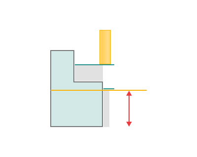

<strong>mm</strong> インスペクターのテキストフィールドに、 <strong>原点</strong>から<strong>底部高さ</strong>までの寸法を入力します。また、マウスで平面をドラッグしたり、平面中央の円をドラッグして『スマートスナップ』機能を使ってフィーチャーに合わせたり、グラフィックビュー上の寸法をクリックして指定したりすることもできます。

<strong>自動</strong> <strong>ジョブ割り当て</strong>で指定した領域の最も低い点から<strong>底部高さ</strong>を決定します。

<strong>加工側</strong> 加工可能なサーフェスの側を指定します。[詳細を見る](724.md)

<strong>前</strong> サーフェスの法線ベクトルが正方向を向く側からのみ加工できます。

<strong>後</strong> サーフェスの法線ベクトルと反対側からのみ加工できます。

<strong>両方</strong> サーフェスの両側から加工できます。

<strong>デフォルト</strong> システムでデフォルトとして設定されている加工方法を使用します。

### ミーリングタイプ：

曲線加工オペレーションを除き、ほとんどすべてのオペレーションで設定可能です。これにより、ツールパスの計算プロセス中に、必要なフライス加工タイプ（ダウンカットまたはアップカット）を設定できます。

ミーリングタイプのパラメータは <strong>ウォータライン荒加工オペレーション</strong>と同様です。[詳細を見る](https://confluence.encycam.com/display/SC1/.Waterline+roughing+operation+v19)

### 並べ替え

サーフェス加工中におけるツールパスの順序を設定します 。

拡大

<strong>加工方向</strong> ツールパス曲線上の工具の動作方向を制御します。このパラメータは、<strong>スキャロップ仕上げオペレーション</strong>と同様です。[詳細を見る](https://confluence.encycam.com/display/SC1/.Scallop+finishing+operation+v19.1)

<strong>開始</strong> 工具動作の開始高さを指定します。このパラメータは、 <strong>3Dヘリカルオペレーション</strong>と同様です。[詳細を見る](https://confluence.encycam.com/display/SC1/.Helical+operation+v19.1)

<strong>方向変更</strong> パスの実行順序を、下から上、または上から下に変更できます。

### 工具の向き

工具軸の向きを制御します。基本的なパラメータは、 <strong>5Dサーフェシングオペレーション</strong>と同様です。[詳細を見る](https://confluence.encycam.com/display/SC1/.5d+surfacing+operation+v19.1)

拡大

<strong>特異点回避角度</strong> このオプションを使用すると、衝突がない場合でも、工具を固定軸から常に指定した角度だけ傾けます。これにより、回転テーブルの「特異点」を回避します。

### 衝突回避：

<strong>チェックホルダー</strong> 機能により、工具ホルダーが部品と衝突するツールパス区間を検出し、指定した方法に従ってその区間を修正します。[詳細を見る](https://confluence.encycam.com/display/SC1/.Check+Holder+%28Avoid+collisions%29+v19)

### 回転角度制限：

軸に対する工具の角度位置の限界値を指定します。<strong>回転角度制限</strong>のパラメータは、 <strong>5Dサーフェシングオペレーションと同様です。</strong>[詳細を見る](https://confluence.encycam.com/display/SC1/.5d+surfacing+operation+v19.1)

### トリミング

加工対象ではないサーフェスをスキップしたり、 ツールパスを延長したりできます。 トリムミング パラメータは、<strong>ウォータライン荒加工オペレーション</strong>と同様です。[詳細を見る](https://confluence.encycam.com/display/SC1/.Waterline+roughing+operation+v19)

## パラメータ:

このタブには、部品、ワーク、治具、およびその他の軌跡に影響を与える要素を制御するための主要なパラメータが含まれており、ツールパスを変更できます。 [詳細を見る](100112.md)

## リンク／リード

リンク／リードタブでは、早送り動作のパラメータを設定します。これらの移動には、工具交換位置からのアプローチ、切削パス開始点までの位置決め、最終切削後の退避動作、各パス間の移行移動、および工具交換位置への復帰が含まれます。座標軸ごとの動作順序、各移動の軌跡、および移動量を設定できます。

拡大

<strong>次の項目で構成されます。</strong>

<strong>アプローチ／リターン</strong> このパラメータグループは、工具交換位置から切込み開始パスへの工具の移動、および戻りの動作を管理します。[詳細を見る](https://confluence.encycam.com/pages/viewpage.action?pageId=131904799)

<strong>リンク</strong> 進入／退出リンクおよび加工パス間のリンクに関するルールを設定します。[詳細を見る](https://confluence.encycam.com/pages/viewpage.action?pageId=137006979)

<strong>リード</strong> 移動動作に対して、送り速度を使用して追加の突き込みおよび退避を追加できます。 [詳細を見る](https://confluence.encycam.com/display/SC1/.Leads+for+5-axis+operation+v19.1)

<strong>安全な動作</strong> <strong>安全サーフェス</strong>のタイプとワークから安全サーフェスまでの距離を設定します。加工サーフェスまたはツールパス間の移行を円滑にし、アプローチまたはリターンの最初の段階は、このサーフェスに向かって行われます。[詳細を見る](100117.md)

<strong>高度なリンク設定</strong> このパラメータグループは、主に5軸加工において、回転軸の最適な動きを考慮した軌道形成の特徴を指定します。[詳細を見る](100118.md)

<strong>距離</strong> リンクのルールで使われる距離です。 [詳細を見る](https://confluence.encycam.com/pages/viewpage.action?pageId=137012802)

## 送り速度設定

このダイアログを使用して、主軸回転速度、早送り値、ツールパスの異なる領域の送り値を設定できます。主軸回転速度は、毎分回転数または切削速度のいずれかで設定できます。設定値には下線が表示されます。もう一方の値は、工具径を考慮し、設定値に基づいて再計算されます。[詳細を見る](https://confluence.encycam.com/pages/viewpage.action?pageId=155781547)

## 変換：

オペレーション内で計算された工具の軌跡に対して座標変換を行うためのパラメータグループです。 [詳細を見る](10168.md)

## パーツ：

パーツは、干渉をチェックする空間を定義する幾何要素のグループです。[詳細を見る](330.md)

## ワーク：

加工のワークモデルは、加工する素材を定義します。[詳細を見る](738.md)

## 治具：

治具には通常、チャック、グリップ、クランプなどの固定補助具と、その他の種類の制限領域を指定します。 [詳細を見る](10283.md)
