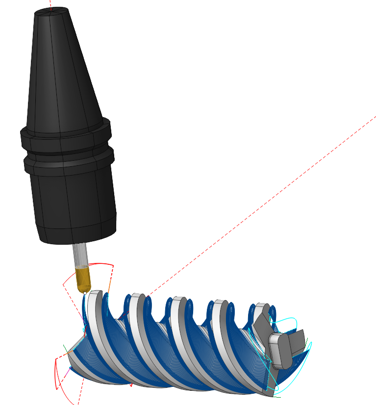
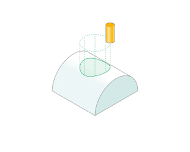

# Operazione di finitura a Z costante rotativa

## Ambito di applicazione:

Questa operazione si basa sull'operazione <strong>5D surfacing</strong> ed è preconfigurata per la lavorazione rotativa di modelli come una vite o un corpo di rotazione. È disponibile per le configurazioni a <strong>4x</strong> e <strong>5x</strong> assi, ma blocca molte strategie di lavorazione a cinque assi, gli angoli di inclinazione dell'utensile, le funzioni di evitamento delle singolarità e la deviazione degli assi. È preimpostata solo con la strategia <strong>Around Rotaty Axis</strong> e l'orientamento utensile <strong>Tool Orientation</strong> è impostato solo su <strong>To Rotary Axis</strong>. Il sistema genera quindi le passate dell'utensile come sezioni della <strong>Machining Surface</strong> (superficie di lavorazione) con un <strong>Step</strong> (passo) specificato, utilizzando cilindri il cui asse è specificato come <strong>Rotary Axis</strong> (asse rotante). L'operazione elabora l'intero modello quando <strong>Job Assignment</strong> (assegnazione del lavoro) è vuoto.

### Assegnazione del lavoro:

<strong>Machining Surfaces.</strong> Selezionare varie superfici del pezzo come compito di lavoro. Il sistema calcolerà il percorso utensile in base alle superfici scelte.

<strong>Surfaces for Projection.</strong> Sono le superfici da lavorare sulle quali viene trasferito il percorso utensile quando si attiva l'opzione <strong>Project Toolpath onto the Part</strong> nella scheda <strong>Strategy</strong>.

<strong>Job Zone.</strong> Utilizzare la <strong>Job Zone</strong> (zona di lavoro) per rifilare le passate al di fuori delle aree di contenimento 2D specificate. È possibile selezionare la normale all'area della <strong>Job Zone</strong>. [Dettagli](10151.md).

<strong>Restrict Zone.</strong> Oltre alle <strong>Job Zones</strong>, nel sistema è possibile usare la geometria delle <strong>Restrict Zones</strong> (zone vietate), costituita da curve e spigoli, per specificare le aree del pezzo da escludere dalla lavorazione nell'operazione corrente. [Dettagli](10152.md)

<strong>Properties.</strong> Visualizza le proprietà di un elemento. È possibile aggiungere il sovrametallo. Questo menu può essere richiamato anche facendo doppio clic su una voce dell'elenco.

<strong>Delete.</strong> Rimuove una voce dall'elenco.

<strong>Restrictions.</strong> Consente di limitare le aree che non devono essere lavorate. [Dettagli](101231.md)

### Strategia:

#### Step (passo):

La larghezza di taglio massima consentita.

Fare clic qui per espandere..

#### Adaptive Step (passo adattivo):

Fare clic qui per espandere..

<strong>Se attivato:</strong> questo parametro regola le distanze tra le passate dell'utensile in base ai raggi di curvatura della superficie e dell'utensile, per mantenere un'altezza della cresta uniforme dopo la lavorazione della superficie. [Dettagli](113.md).

<strong>Se disattivato:</strong> è la distanza verticale fissa tra passate consecutive dell'utensile

 

#### Milling Type (tipo di fresatura):

Può essere assegnato in quasi tutte le operazioni, ad eccezione delle operazioni di lavorazione di curve. Consente all'utente di controllare il tipo di fresatura richiesto (concorde o discorde) durante il calcolo del percorso utensile.

I parametri di <strong>Milling Type</strong> sono gli stessi dell'<strong>operazione</strong> <strong>Waterline Roughing</strong>. [Dettagli](736.md)

#### Sorting (ordinamento):

Controlla la sequenza delle passate del percorso utensile durante la lavorazione della superficie. I parametri di questo gruppo sono gli stessi dell'<strong>operazione 5D Surfacing</strong>. [Dettagli.](10135.md)

#### Rotary Axis (asse rotante).

È l'asse dei cilindri di sezione utilizzati per costruire le linee del percorso utensile.

Fare clic qui per espandere..

#### Job zone (zona di lavoro):

Abilita un'ulteriore modifica dell'area di lavoro inizialmente selezionata nella scheda <strong>Job assignment</strong>.

Fare clic qui per espandere..

<strong>R min</strong>. Il raggio minore rispetto al <strong>Rotary Axis</strong>, nel quale avvengono le passate dell'utensile.

<strong>R max</strong>. Il raggio maggiore rispetto al <strong>Rotary Axis</strong>, nel quale avvengono le passate dell'utensile.

#### Corners smoothing (raccordatura degli spigoli):

Quando la direzione dell'utensile cambia bruscamente, il controllo della fresatrice decelera prima di iniziare la curva e poi accelera di nuovo. Ciò può causare vibrazioni e un'elevata usura dell'utensile e della fresatrice. Il problema può essere risolto se il percorso utensile presenta pochissime interruzioni o nessuna. Per questo motivo nel sistema è presente la funzione di raccordatura del percorso utensile con un raggio definito per la lavorazione degli spigoli interni o esterni del modello. I parametri di questo gruppo sono gli stessi dell'<strong>operazione 5D Surfacing</strong>. [Dettagli](736.md)

#### Roughing Passes (passate di sgrossatura).

Il percorso utensile viene spostato nel piano di una quantità pari allo spessore delle <strong>Roughing passes</strong>. Al contorno vengono aggiunte passate supplementari del valore specificato nei parametri, con il numero di passi indicato. I parametri di questo gruppo sono gli stessi dell'<strong>operazione 5D Surfacing</strong>. [Dettagli](10135.md)

#### Project Toolpath onto the Part (proietta il percorso utensile sul pezzo):

Impostando la casella, il sistema genera i percorsi utensile per la lavorazione delle superfici identificate come <strong>Surfaces for Projection</strong> in <strong>Job Assignment</strong>, proiettando il percorso derivato dalla <strong>Machining Surface</strong> sulle <strong>Surfaces for Projection.</strong>

Fare clic qui per espandere..

In questo caso, identificare come <strong>Machining Surfaces</strong> le superfici di geometria ausiliaria, ottenibili con costruzioni aggiuntive nel modulo CAD, anziché le superfici del pezzo che richiedono la fresatura diretta. Disporre tali superfici in modo che la proiezione del percorso utensile da esse risulti semplice. Dichiarare le superfici da fresare come <strong>Surfaces for Projection</strong>.

#### Trimming (rifilatura):

Consente di saltare le superfici non destinate alla lavorazione e di estendere il percorso utensile. I parametri di questo gruppo sono gli stessi dell'<strong>operazione 5D Surfacing</strong>. [Dettagli](10135.md)

### Parametri:

Questa scheda contiene i parametri principali per il controllo di pezzo, grezzo, attrezzatura e altri elementi, che consentono di modificare il percorso utensile. [Dettagli](100112.md)

### Collegamenti/Attacchi:

Nella scheda Links/Leads si definiscono i parametri dei movimenti rapidi. Tali movimenti comprendono l'avvicinamento dell'utensile dalla posizione di cambio utensile, l'attacco all'inizio della corsa di lavoro, la retrazione dopo l'ultimo movimento di taglio, le transizioni tra le passate di lavoro e il ritorno al punto di cambio utensile. È possibile configurare la sequenza dei movimenti lungo le coordinate, la traiettoria di tali movimenti e l'entità degli spostamenti.

Fare clic qui per espandere..

<strong>Comprende:</strong>

<strong>Approach/Return.</strong> Questo gruppo di parametri gestisce i movimenti dell'utensile dalla posizione di cambio utensile all'inizio dei percorsi di attacco, e viceversa. [Dettagli](100116.md).

<strong>Links.</strong> Definisce le regole che governano i collegamenti di ingresso/uscita e i collegamenti tra i movimenti di lavoro. [Dettagli](100130.md).

<strong>Leads.</strong> Consente di aggiungere attacco e uscita supplementari ai movimenti di lavoro utilizzando il loro avanzamento. [Dettagli](100136.md).

<strong>Safe motions.</strong> Definisce il tipo di <strong>Safety Surface</strong> (superficie di sicurezza) e la distanza da essa al grezzo. Questa superficie facilita le transizioni tra le superfici lavorate o tra i percorsi utensile, e verso di essa avviene la prima fase di avvicinamento o di ritorno. [Dettagli](100117.md).

<strong>Advanced links settings.</strong> Questo gruppo di parametri specifica le caratteristiche di formazione del percorso utensile, principalmente per operazioni a cinque assi, tenendo conto dei movimenti ottimali degli assi rotanti. [Dettagli](100118.md).

<strong>Distances.</strong> Distanze utilizzate nelle regole dei collegamenti (Links). [Dettagli](100140.md).

### Avanzamenti/Velocità:

Con questa finestra di dialogo l'utente può definire la velocità di rotazione del mandrino, la velocità dei movimenti rapidi e i valori di avanzamento per le diverse zone del percorso utensile. La velocità di rotazione del mandrino può essere definita come giri al minuto oppure come velocità di taglio. Il valore che definisce sarà sottolineato. L'altro valore viene ricalcolato rispetto a quello definito, tenendo conto del diametro dell'utensile. [Dettagli](100142.md)

### Trasformazioni:

Insieme di parametri dell'operazione che consente di eseguire la conversione delle coordinate per il percorso utensile calcolato nell'ambito dell'operazione. [Dettagli](10168.md).

### Pezzo:

Il pezzo (Part) è un gruppo di elementi geometrici che definisce lo spazio in cui verificare le intaccature. [Dettagli](330.md)

### Grezzo:

Il modello di grezzo di un'operazione definisce il materiale da lavorare. [Dettagli](738.md)

### Attrezzature:

Come attrezzature (Fixtures) si specificano di norma gli ausili di bloccaggio quali mandrini, ganasce, staffe e simili, nonché le aree di restrizione di qualsiasi altra natura. [Dettagli](10283.md)
