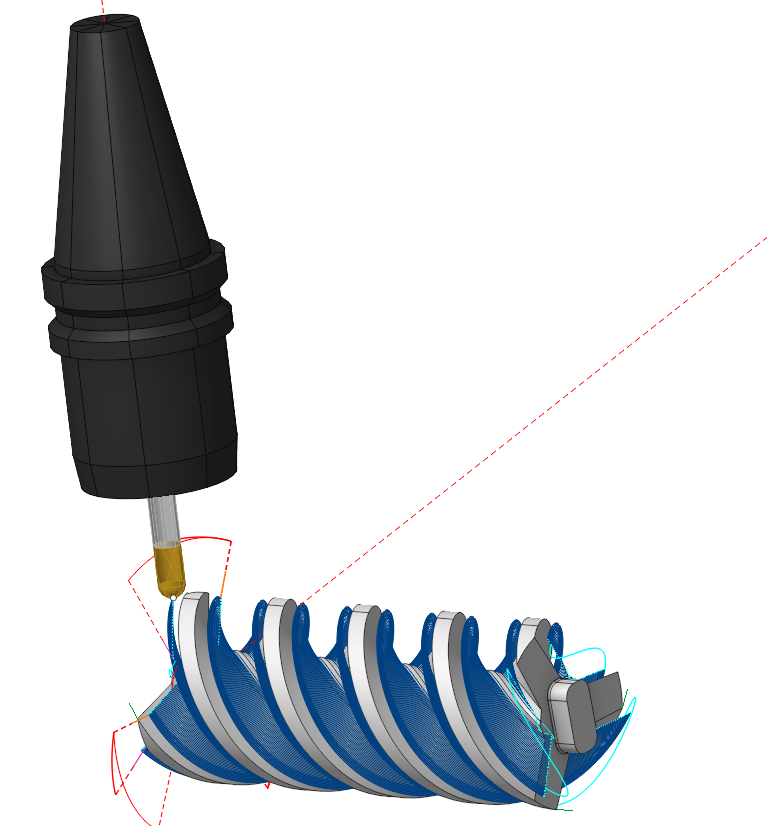
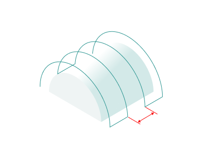
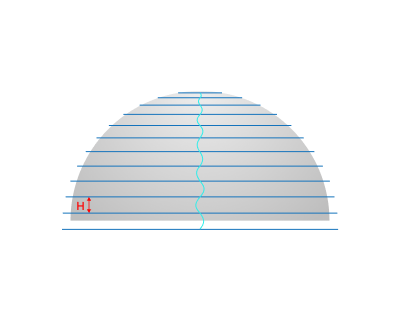
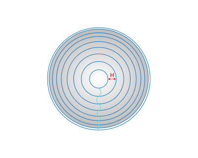
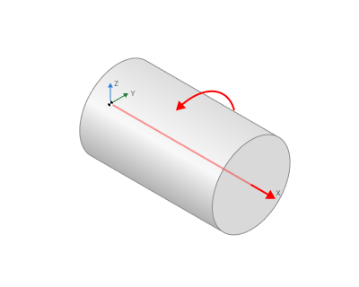
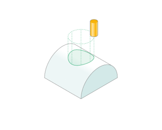

# ロータリーウォータライン加工

## 適用分野：

このオペレーションは <strong>5Dサーフェシング</strong>オペレーションに基づいており、スクリューや回転体のようなモデルの回転加工用にあらかじめ設定されています。<strong>4軸</strong> および<strong>5軸</strong> 構成で使用できますが、 多くの5軸加工方法、工具傾斜角、特異点回避機能、および軸偏差機能は使用できません。 また、加工方法は<strong>回転軸周り</strong>方法のみ、<strong>工具の向き</strong>は<strong>回転軸へ</strong>のみ、あらかじめ設定されています。そのため、システムは、<strong>回転軸</strong>として指定された軸を持つ円筒を用いて、指定された<strong>ステップ</strong>ごとに、<strong>加工面</strong>の断面としてツールパスを生成します。<strong>ジョブ割り当て</strong>が空の場合、オペレーションはモデル全体を加工します。

## ジョブ割り当て：

<strong>加工面</strong> 部品のさまざまなサーフェスを加工対象として選択します。システムは、選択されたサーフェスに基づいて軌道を計算します。

<strong>投影サーフェス</strong> 加工対象のサーフェスであり、 <strong>加工設定</strong>タブの<strong>ツールパスをパーツに投影</strong>オプションを有効にした際に、ツールパスが移動するサーフェスです。

<strong>ジョブゾーン</strong> （加工領域） <strong>ジョブゾーン</strong> を使用して、指定された2D制限領域の外側のパスをトリムします。 <strong>ジョブゾーン</strong>に対する法線を選択できます。 [詳細を見る](10151.md)

<strong>制限領域</strong> システム内の<strong>ジョブゾーン</strong> に加えて、カーブやエッジから作成した <strong>制限領域</strong> の要素を使用して、現在のオペレーションで加工を避けるワーク領域を指定できます。 [詳細を見る](10152.md)

<strong>プロパティ</strong> 要素のプロパティを表示します。ストックを追加することも可能です。リスト内の項目をダブルクリックすることでも、このメニューを表示できます。

<strong>削除</strong> リストから項目を削除します。

<strong>制限</strong> 加工してはならない領域を制限することができます。[詳細を見る](101231.md)

## 加工設定：

### ステップ：

切削の最大許容幅 を設定します。

拡大

### アダプティブステップ

拡大

<strong>有効:</strong> このパラメータは、サーフェス加工後のスキャロップ高さを均一に保つため、サーフェスおよび工具の曲率半径に応じてツールパス間の距離を調整します。 [詳細を見る](113.md)

<strong>無効:</strong> これは、連続するツールパス間の一定の垂直距離です。

 

### ミーリングタイプ：

曲線加工オペレーションを除き、ほぼすべての加工で設定可能です。この設定により、ツールパスの計算プロセス中に、必要なフライス加工タイプ（ダウンカットまたはアップカット）を設定できます。

ミーリングタイプのパラメータは<strong>ウォータライン荒加工オペレーション</strong>と同様です。 [詳細を見る](736.md)

### 並べ替え

面加工中のツールパス順序を設定します。このグループのパラメータは、 <strong>5Dサーフェシングオペレーション</strong>と同様です。[詳細を見る](10135.md)

### 回転軸

これは、 ツール パス線を構築するために使用する断面円筒の軸です。

拡大

### ジョブゾーン：

<strong>ジョブ割り当て</strong>タブで最初に選択したジョブゾーンの追加修正が可能です。

拡大

<strong>最小半径</strong> ツール パスが発生する<strong>回転軸</strong>からの最小半径

<strong>最大半径</strong> ツールパスが発生する<strong>回転軸</strong>からの最大半径

### コーナーの円滑化

工具方向が急変する場合、フライス制御は回転開始前に減速し、その後再び加速します。この動作により、振動が発生しやすくなり、工具およびフライス盤の摩耗が増大する可能性があります。ツールパスの途切れを極力減らすことで、この問題は解決できます。このため、システムにはモデルの内側や外側のコーナーを加工する際に、指定された半径を用いてツールパスを滑らかにする機能があります。このグループのパラメータは、 <strong>5Dサーフェシングオペレーション</strong>と同様です。 [詳細を見る](736.md)

### 荒加工パス

ツールパスは、<strong>荒加工パス</strong> の厚さ分だけ平面方向にオフセットします。追加パスは、指定したステップ数のパラメータで指定された値だけ輪郭に追加されます。このグループのパラメータは、 <strong>5Dサーフェシングオペレーション</strong>と同様です。[詳細を見る](10135.md)

### ツールパスをパーツに投影

このオプションを有効にすると 、<strong>加工面</strong>から導出されたパスを<strong>投影サーフェス</strong>にマッピングすることで、 <strong>ジョブ割り当て</strong> で <strong>投影サーフェス</strong> として指定し たサーフェスを加工するためのツールパスを生成します。

拡大

この場合、直接加工するパーツ面ではなく、CADモジュールで追加作成した補助形状面を<strong>加工面</strong>として指定します。 補助形状面は、そこからツールパスを容易に投影できるように配置します。 フライス加工面は、<strong>投影サーフェス</strong>として指定します。

### トリミング

加工対象でない サーフェス をスキップしたり、ツールパスを延長したりできます。このパラメータグループは、 <strong>5Dサーフェシングオペレーション</strong>と同様です。[詳細を見る](10135.md)

## パラメータ:

このタブには、部品、ワーク、治具、およびその他の軌跡に影響を与える要素を制御するための主要なパラメータが含まれており、ツールパスを変更できます。 [詳細を見る](100112.md)

## リンク／リード

リンク／リードタブでは、早送り動作のパラメータを設定します。これらの移動には、工具交換位置からのアプローチ、切削パス開始点までの位置決め、最終切削後の退避動作、各パス間の移行移動、および工具交換位置への復帰が含まれます。座標軸ごとの動作順序、各移動の軌跡、および移動量を設定できます。

拡大

<strong>次の項目で構成されます。</strong>

<strong>アプローチ／リターン</strong> このパラメータグループでは、工具交換位置から切込み開始パスへの工具の移動、および戻りの動作を管理します。[詳細を見る](https://confluence.encycam.com/pages/viewpage.action?pageId=131904799)

<strong>リンク</strong> 進入／退出リンクおよび加工パス間のリンクに関するルールを設定します。[詳細を見る](https://confluence.encycam.com/pages/viewpage.action?pageId=137006979)

<strong>リード</strong> 移動動作に対して、送り速度を使用して追加の突き込みおよび退避を追加できます。 [詳細を見る](https://confluence.encycam.com/display/SC1/.Leads+for+5-axis+operation+v19)

<strong>安全動作</strong> <strong>安全サーフェス</strong>のタイプとワークから安全サーフェスまでの距離を設定します。加工面またはツールパス間の移行を円滑にし、アプローチまたはリターンの最初の段階は、この面に向かって行われます。[詳細を見る](100117.md)

<strong>高度なリンク設定</strong> このパラメータグループは、主に5軸加工において、回転軸の最適な動きを考慮した軌道形成の特徴を指定します。[詳細を見る](100118.md)

<strong>距離</strong> リンクのルールで使われる距離です。 [詳細を見る](https://confluence.encycam.com/pages/viewpage.action?pageId=137012802)

## 送り速度設定

このダイアログを使用して、主軸回転速度、早送り値、ツールパスの異なる領域の送り値を設定できます。主軸回転速度は、毎分回転数または切削速度のいずれかで設定できます。設定値には下線が表示されます。もう一方の値は、工具径を考慮し、設定値に基づいて再計算されます。[詳細を見る](100142.md)

## 変換：

オペレーション内で計算された工具の軌跡に対して座標変換を行うための工程のパラメータグループです。 [詳細を見る](10168.md)

## パーツ：

パーツは、干渉をチェックする空間を定義する幾何要素のグループです。[詳細を見る](330.md)

## ワーク：

加工のワークモデルは、加工する素材を定義します。[詳細を見る](738.md)

## 治具：

治具には通常、チャック、グリップ、クランプなどの固定補助具と、その他の種類の制限領域を指定します。[詳細を見る](10283.md)

<strong>詳細を見る</strong>:

[5Dサーフェシング加工](10135.md)

[5軸加工](10125.md)

[4軸、5軸 Mill 加工オペレーション](10124.md)
