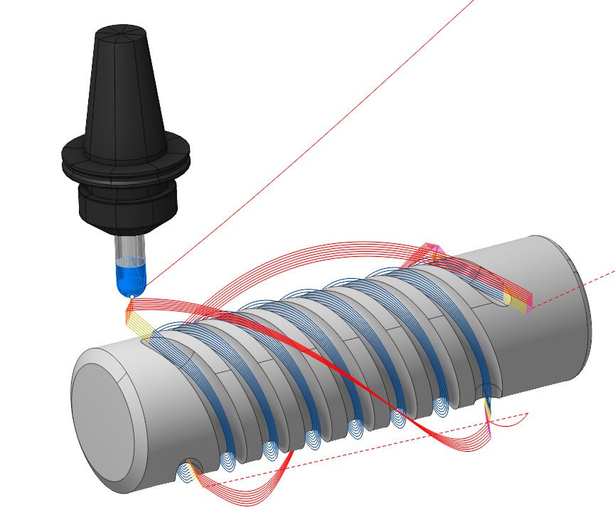
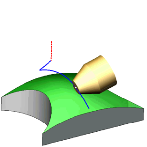

# 4D輪郭

## 適用分野:

このオペレーションは、明確な回転軸をもつサーフェス、または軸方向へ延たサーフェス上の空間曲線を加工するための連続ツールパスを生成します。選択した曲線に沿った単一のツールパスの作成だけでなく、選択したサーフェスのさまざまな 等 パラメトリックラインに沿った複数のパスの生成や、選択した曲線に沿った多段加工にも対応しています。このオペレーションは [6D輪郭加工](10129.md)オペレーションをベースにしており、回転加工用にあらかじめ設定されています。<strong>4軸</strong>および<strong>5軸</strong>構成で使用できます。 工具 方向 はデフォルトで<strong>回転軸へ</strong>に設定されています。また、<strong>点へ、</strong>および<strong>カーブへ</strong>といった 工具 方向 設定に加え、<strong>高度な軸制限制御、リーン角度、サイド角度、</strong>の各オプションは使用できません。安全サーフェスは<strong>円筒</strong>に設定されています。

<strong>ジョブ割り当て</strong>で指定した曲線について、各点における 工具 方向 ベクトルを変更できます（ただし<strong>回転軸</strong>に対して垂直な平面内のみ）。また、曲線に沿った工具移動方向の変更、加工する側の変更、工具半径補正の設定、 点ごとの工具方向 ベクトルの補間方法の選択、およびストックを設定することができます 。

## ジョブ割り当て:

<strong>サーフェス上のエッジ/カーブ ジョブ割り当て</strong>は、パーツのエッジまたは任意の曲線によって構成されます。曲線上の各点におけるベクトルは、現在の 工具 方向 によって決定されます。工具接触点は、曲線のプロパティおよび選択された 工具 方向 設定に基づき、指定した曲線に沿って移動します。このグループのパラメータは、<strong>5軸輪郭加工（曲面上） / カーブパラメータ</strong>と同様です。 [詳細を見る](https://confluence.encycam.com/pages/viewpage.action?pageId=137035070)

<strong>5D カーブ</strong> システムは、任意の曲線をパーツ表面へ投影した形状として、5軸ツールパスを生成します。この場合、工具接触点は常にサーフェスに接した状態で移動します。加工パスは、ストックまたは高さ設定によって曲線からオフセットできます。工具軸はサーフェスに対して垂直に配置されます<strong>。</strong>このグループのパラメータは、<strong>5軸輪郭加工（曲面上） / カーブパラメータ</strong>と同様です。 [詳細を見る](https://confluence.encycam.com/pages/viewpage.action?pageId=137035070)

<strong>ドライブフェイス</strong> 等 パラメトリックラインに沿った加工パスを生成するために使用できます。サーフェスの 等 パラメトリック曲線は、そのサーフェスの生成方法に依存しており、サーフェスのトポロジーを反映します。この方法は、さまざまなフィレット加工に非常に適しています。このグループのパラメータは、<strong>5軸輪郭加工（曲面上） / カーブパラメータ</strong>と同様です。 [詳細を見る](https://confluence.encycam.com/pages/viewpage.action?pageId=146905126)

<strong>プロパティ</strong> 要素のプロパティを表示します。ストックを追加することも可能です。リスト内の項目をダブルクリックすることでも、このメニューを表示できます。

<strong>削除</strong> リストから項目を削除します。

<strong>制限</strong> 加工してはならない領域を制限することができます。 [詳細を見る](101231.md)

## 加工設定:

### 工具接触点

工具接触点 (TCP) は、加工中に工具とワークのサーフェス、または幾何要素との主な接触位置を定義する、切削工具上の特定の位置です。

このグループのパラメータは、<strong>5Dサーフェシング</strong>オペレーションと同様です。 [詳細を見る](10135.md)

### 工具の向き:

加工中の工具軸の向きを制御します。この機能の主要パラメータは、<strong>5Dサーフェシング</strong>オペレーションと同じです。 [詳細を見る](10135.md)

拡大

<strong>傾斜形状工具</strong> ツールパスの移動中に、工具の加工側が加工面に接触するよう工具を傾けます。

### 回転角度制限:

このオプションは、「側面」 工具 方向 設定が有効な場合に表示され、軸に対する工具の角度位置の制限値を設定します。このグループのパラメータは、<strong>5Dサーフェシング</strong>オペレーションと同じです。<strong>[詳細を見る](10135.md)</strong>

### Zステップ:

指定した曲線に対して、追加の加工パスを作成できます。パスはサーフェスの法線方向にオフセットされます。<strong>側面</strong> 工具 方向 が選択している場合は、オフセット方向を指定できます。このグループのパラメータは、<strong>6D輪郭加工</strong>と同じです。 [詳細を見る](10129.md)

### コーナーの円滑化:

工具方向が急変する場合、フライス制御は回転開始前に減速し、その後再び加速します。 この動作により、振動が発生しやすくなり、工具およびフライス盤の摩耗が増大する可能性があります。ツールパスの途切れを極力減らすことで、この問題は解決できます。 このため、システムにはモデルの 内側や外側のコーナー を 加工する際に、指定された半径を用いてツールパスを滑らかにする機能があります。この機能の主要パラメータは、<strong>2D輪郭加工</strong>と同じです。 [詳細を見る](404.md)

### 連続した軸シフト:

<strong>側面</strong> 工具 方向 設定を使用している場合、指定した曲線を基準とする工具の軸方向のオフセット量を、パスに沿って滑らかに変化させることができるツールパスを作成できます。 このグループのパラメータは、<strong>6D輪郭加工</strong>と同じです。 [詳細を見る](10129.md)

### 並べ替え:

サーフェス加工中のツールパスの順序を設定します 。

拡大

<strong>ツールパス結合モード</strong> パーツ上の異なる輪郭を多段加工する際の、加工パス実行順序を設定します。この機能の主要パラメータは、<strong>2D輪郭加工</strong>と同じです。 [詳細を見る](404.md)

<strong>空送り動作最小化</strong> 空送り動作を最小化するように加工順序を並べ替えます。この機能の主要パラメータは、<strong>2D輪郭加工</strong>と同じです。 [詳細を見る](404.md)

<strong>ミーリングタイプ</strong> 曲線加工オペレーションを除き、ほぼすべてのオペレーションで設定可能です。これにより、ツールパス計算時に必要な加工方式（ダウンカット／アップカット）を制御できます。<strong>ミーリングタイプ</strong>パラメータは、<strong>ウォータライン荒加工オペレーション</strong>と同じです。 [詳細を見る](736.md)

### ツールパスをオフセット付きのパーツに投影:

パーツのサーフェスを基準としたツールパスの生成方法を設定します。この機能のパラメータは、<strong>2D輪郭加工</strong>の<strong>加工設定</strong>タブ内にある<strong>変換</strong>項目と同じです。 [詳細を見る](404.md)

### トリミング:

加工対象ではないサーフェスをスキップしたり、ツールパスを延長したりできます。 <strong>トリム</strong> のパラメータは、 <strong>ウォータライン荒加工</strong> と同じです。 [詳細を見る](736.md)

## パラメータ:

このタブには、部品、ワーク、治具、およびその他の軌跡に影響を与える要素を制御するための主要なパラメータが含まれており、ツールパスを変更できます。 [詳細を見る](100112.md)

## リンク/リード:

リンク／リードタブでは、早送り動作のパラメータを設定します。これらの移動には、工具交換位置からの工具アプローチ、パス開始までの進入、最終切削後の退避、加工パス間の移動、および工具交換位置への復帰が含まれます。座標軸ごとの動作順序、各移動の軌跡、および移動量を設定できます。

拡大

<strong>次の項目で構成されます。</strong>

<strong>アプローチ/リターン</strong> このパラメータグループは、工具交換位置から切込み開始パスへの工具の移動、および戻りの動作を管理します。[詳細を見る](100116.md)

<strong>安全動作</strong> 安全サーフェスタイプとワークから安全サーフェスまでの距離を設定します。このサーフェスは、加工サーフェスまたはツールパス間の移行を円滑にし、アプローチまたはリターンの最初の段階は、この面に向かって行われます。 [詳細を見る](100117.md)

<strong>高度なリンク設定</strong> このパラメータグループは、主に5軸加工において、回転軸の最適な動きを考慮した軌道形成の特徴を指定します。 [詳細を見る](100118.md)

<strong>リンク</strong> 進入／退出リンクおよび加工動作間のリンクに関するルールを設定します。 [詳細を見る](100131.md)

<strong>リード</strong> 移動動作に対して、送り速度を使用して追加の突き込みおよび退避を追加できます。 [詳細を見る](100135.md)

<strong>距離</strong> リンクのルールで使用される距離です。 [詳細を見る](100138.md)

## 送り速度設定:

このダイアログを使用して、主軸回転速度、早送り値、ツールパスの異なる領域の送り値を設定できます。主軸回転速度は、毎分回転数または切削速度のいずれかで設定できます。設定値には下線が表示されます。もう一方の値は、工具径を考慮し、設定値に基づいて再計算されます。 [詳細を見る](100142.md)

## 変換:

オペレーション内で計算された工具の軌跡に対して座標変換を行うための工程のパラメータグループです。 [詳細を見る](10168.md)

## パーツ:

パーツは、干渉をチェックする空間を定義する幾何要素のグループです。 [詳細を見る](330.md)

## ワーク:

加工のワークモデルは、加工する素材を定義します。 [詳細を見る](738.md)

## 治具:

治具には通常、チャック、グリップ、クランプなどの固定補助具と、その他の種類の制限領域を指定します。 [詳細を見る](10283.md)

<strong>詳細を見る</strong>:

[5D輪郭と6D輪郭操作](10129.md)

[5軸加工](10125.md)

[4軸、5軸 Mill 加工オペレーション](10124.md)

[ドライブフェイスのパラメータ](https://confluence.encycam.com/pages/viewpage.action?pageId=146905126)

[カーブパラメータ](https://confluence.encycam.com/pages/viewpage.action?pageId=137035070)

[工具の側面によるルールドサーフェスの5軸加工](https://confluence.encycam.com/pages/viewpage.action?pageId=128547903)
