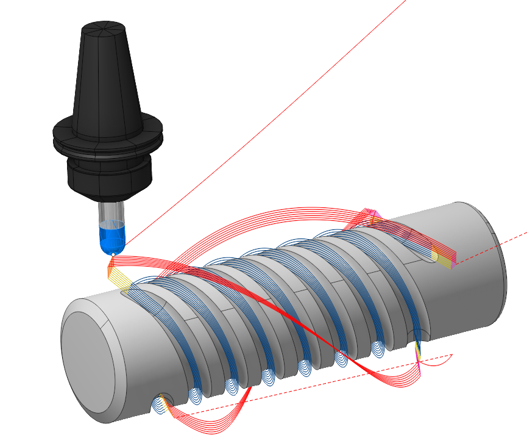
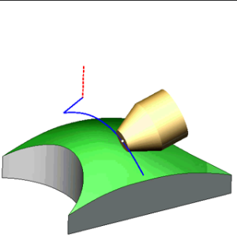

# Contorno 4D

## Área de aplicação:

A operação gera percursos da ferramenta contínuos para a usinagem de curvas espaciais em superfícies com um eixo de rotação bem definido ou alongadas ao longo de um eixo. Ela permite criar tanto percursos únicos ao longo das curvas selecionadas quanto várias passadas ao longo de diferentes linhas isoparamétricas da superfície escolhida, além de facilitar a usinagem em vários níveis ao longo das curvas selecionadas. A operação é baseada na operação [Contorno 6D](10129.md), é pré-configurada para usinagem rotativa e está disponível para as configurações <strong>4x</strong> e <strong>5x</strong>. A orientação da ferramenta é definida por padrão como <strong>To Rotary axis</strong>. As estratégias de orientação da ferramenta <strong>Through point</strong> e <strong>Through curve</strong>, assim como as opções <strong>Advanced axes limits control</strong>, <strong>Lean angles, Side angles</strong>, estão bloqueadas. A superfície de segurança é definida como <strong>Cylinder</strong>.

Para as curvas especificadas na <strong>Job Assignment</strong>, é possível modificar os vetores de orientação da ferramenta em cada ponto (mas somente no plano perpendicular ao <strong>Rotary Axis</strong>), alterar o sentido do movimento da ferramenta ao longo da curva, alterar o lado de usinagem, compensar o raio da ferramenta, selecionar o método de interpolação da variação do vetor de orientação da ferramenta de ponto a ponto e definir o sobremetal.

### Definição da tarefa:

<strong>Edge/Curve on Surface.</strong> A <strong>definição da tarefa</strong> é formada pelas arestas da peça ou por quaisquer curvas. A orientação atual da ferramenta determina os vetores nos pontos da curva. O ponto de contato da ferramenta se moverá ao longo da curva especificada de acordo com as propriedades da curva e a estratégia de orientação da ferramenta escolhida. Os parâmetros deste grupo são os mesmos do recurso <strong>fresamento de 5 eixos do perfil na superfície / parâmetros das curvas</strong>. [Detalhes](10131.md).

<strong>5D Curve.</strong> O sistema gera o percurso da ferramenta de 5 eixos como a projeção de curvas arbitrárias na superfície da peça. Nesse caso, o ponto de contato da ferramenta se move em contato com a superfície. As passadas podem ser deslocadas em relação à curva pelo sobremetal ou pelos níveis. O eixo da ferramenta fica perpendicular à superfície. Os parâmetros deste grupo são os mesmos do recurso <strong>fresamento de 5 eixos do perfil na superfície / parâmetros das curvas</strong>. [Detalhes](10131.md).

<strong>Drive Faces</strong>. Podem ser usadas para criar passadas de trabalho ao longo de linhas isoparamétricas. As curvas isoparamétricas das superfícies dependem da forma como elas foram criadas e refletem a topologia da superfície. Diferentes concordâncias podem ser muito bem usinadas dessa forma. Os parâmetros deste grupo são os mesmos do recurso fresamento de 5 eixos ao longo das curvas isoparamétricas / parâmetros das Drive Faces. [Detalhes.](10130.md)

<strong>Properties.</strong> Exibe as propriedades de um elemento. É possível adicionar sobremetal. Esse menu também pode ser aberto com um clique duplo em um item da lista.

<strong>Delete.</strong> Remove um item da lista.

<strong>Restrictions.</strong> Permite definir as regiões que não devem ser usinadas. [Detalhes](101231.md)

### Estratégia:

#### Ponto de contato da ferramenta.

O ponto de contato da ferramenta (TCP) é uma posição específica da ferramenta de corte que define o ponto principal de interação entre a ferramenta e a superfície do bruto ou os elementos geométricos durante as operações de usinagem.

Os parâmetros deste grupo são os mesmos da <strong>operação de usinagem de superfícies 5D</strong>. [Detalhes.](10135.md)

#### Orientação da ferramenta:

Controla a orientação do eixo da ferramenta. Os principais parâmetros desta função são os mesmos da <strong>operação de usinagem de superfícies 5D</strong>. [Detalhes.](10135.md)

Clique aqui para expandir...

<strong>Incline Shape Tool.</strong> Inclina a ferramenta para que seu lado de trabalho toque a superfície usinada durante o deslocamento ao longo do percurso da ferramenta.

#### Limite dos ângulos de rotação:

Esta opção aparece quando a estratégia de orientação da ferramenta <strong>Flank</strong> está ativa e especifica os valores-limite da posição angular da ferramenta em relação aos eixos. Os parâmetros deste grupo são os mesmos da <strong>operação de usinagem de superfícies 5D. [Detalhes.](10135.md)</strong>

#### Passadas:

É possível criar passadas de trabalho adicionais em relação às curvas especificadas. As passadas são deslocadas na direção normal à superfície. Se a orientação da ferramenta <strong>Flank</strong> estiver selecionada, é possível escolher a direção dos deslocamentos. Os parâmetros deste grupo são os mesmos da <strong>operação de contorno</strong> <strong>6D</strong>. [Detalhes.](10129.md)

#### Suavização de cantos:

Quando há uma mudança brusca na direção da ferramenta, o comando da fresadora desacelera antes de iniciar a curva e depois acelera novamente. Isso pode causar vibrações e desgaste elevado da ferramenta e da máquina. O problema pode ser resolvido se o percurso da ferramenta tiver poucas quebras ou nenhuma. Por isso, o sistema oferece a função de suavização do percurso da ferramenta com o raio definido para a usinagem de cantos internos ou externos do modelo. Os principais parâmetros desta função são os mesmos da <strong>operação de contorno 2D</strong>. [Detalhes.](404.md)

#### Deslocamento axial contínuo:

Com a estratégia de orientação da ferramenta <strong>Flank</strong> em uso, é possível criar um percurso da ferramenta com variações suaves do deslocamento axial da ferramenta ao longo do percurso em relação à curva especificada. Os parâmetros deste grupo são os mesmos da <strong>operação de contorno</strong> <strong>6D</strong>. [Detalhes.](10129.md)

#### Ordenação:

Controla a sequência das passadas do percurso da ferramenta durante a usinagem da superfície.

Clique aqui para expandir...

<strong>Toolpath uniting mode.</strong> Controla a ordem de execução das passadas na usinagem com várias passadas de diferentes perfis da peça. Os parâmetros deste recurso são os mesmos da <strong>operação de contorno 2D</strong>. [Detalhes.](404.md)

<strong>Idling minimization.</strong> A ordem de usinagem dos perfis é ordenada para minimizar os movimentos em vazio. Os parâmetros deste recurso são os mesmos da <strong>operação de contorno 2D</strong>. [Detalhes.](404.md) [.](10129.md)

<strong>Milling type.</strong> Pode ser atribuído em quase todas as operações, exceto nas operações de usinagem de curvas. Permite controlar o tipo de fresamento necessário (concordante ou discordante) durante o cálculo do percurso da ferramenta. Os parâmetros de <strong>Milling Type</strong> são os mesmos da <strong>operação de desbaste por linhas de nível</strong>. [Detalhes.](736.md)

#### Projetar o percurso da ferramenta na peça com offset:

Determina o método de criação do percurso da ferramenta em relação à superfície da peça. Os parâmetros deste recurso são os mesmos da aba <strong>Startegy</strong>, no item <strong>Transformations</strong> da <strong>operação de contorno 2D</strong>. [Detalhes](404.md)

#### Recorte:

Permite ignorar as superfícies que não devem ser usinadas e estender o percurso da ferramenta. Os parâmetros de <strong>Trimming</strong> são os mesmos da <strong>operação de desbaste por linhas de nível</strong>. [Detalhes](736.md)

### Parâmetros:

Esta aba contém os principais parâmetros de controle da peça, do bruto, dos dispositivos de fixação e de outros elementos que permitem modificar o percurso da ferramenta. [Detalhes](100112.md)

### Ligações e entradas/saídas:

Na aba Links/Leads, são definidos os parâmetros dos movimentos rápidos: aproximação a partir da posição de troca da ferramenta, entrada no início do movimento de trabalho, saída após o último corte, transições entre passadas e retorno ao ponto de troca. É possível configurar a sequência dos movimentos ao longo das coordenadas, seus percursos e as distâncias dos deslocamentos.

Clique aqui para expandir...

<strong>Componentes:</strong>

<strong>Approach/Return.</strong> Controla os movimentos da ferramenta entre a posição de troca e o início do percurso de entrada, nos dois sentidos. [Detalhes](100116.md).

<strong>Safe motions.</strong> Define o tipo de superfície de segurança e sua distância ao bruto. Essa superfície permite as transições entre superfícies ou percursos usinados; a primeira etapa da aproximação ou do retorno é realizada em direção a ela. [Detalhes](100117.md).

<strong>Advanced links settings.</strong> Define as características de formação do percurso, principalmente para operações de cinco eixos, considerando os movimentos ideais dos eixos rotativos. [Detalhes](100118.md).

<strong>Links.</strong> Define as regras das ligações de entrada e saída e das ligações entre movimentos de trabalho. [Detalhes](100132.md).

<strong>Leads.</strong> Acrescenta movimentos de entrada e saída aos movimentos de trabalho, usando os avanços correspondentes. [Detalhes](101147.md).

<strong>Distances.</strong> Distâncias necessárias para a troca de avanços [Detalhes](100138.md).

### Avanços e velocidades:

Esta janela permite definir a rotação do fuso, o avanço rápido e os avanços dos diferentes trechos do percurso da ferramenta. A rotação do fuso pode ser definida em rotações por minuto ou pela velocidade de corte. O valor de referência fica sublinhado; o outro valor é recalculado a partir dele, considerando o diâmetro da ferramenta. [Detalhes](100142.md)

### Transformações:

Conjunto de parâmetros da operação que permite transformar as coordenadas do percurso da ferramenta calculado na operação. [Detalhes](10168.md)

### Peça:

A peça é um grupo de elementos geométricos que define a região a ser verificada quanto a cortes indevidos. [Detalhes](330.md)

### Bruto:

O modelo do bruto de uma operação define o material a ser usinado. [Detalhes](738.md)

### Dispositivos de fixação:

Os dispositivos de fixação normalmente incluem mandris, garras, grampos e outros elementos de fixação, além de áreas de restrição de qualquer natureza. [Detalhes](10283.md)
