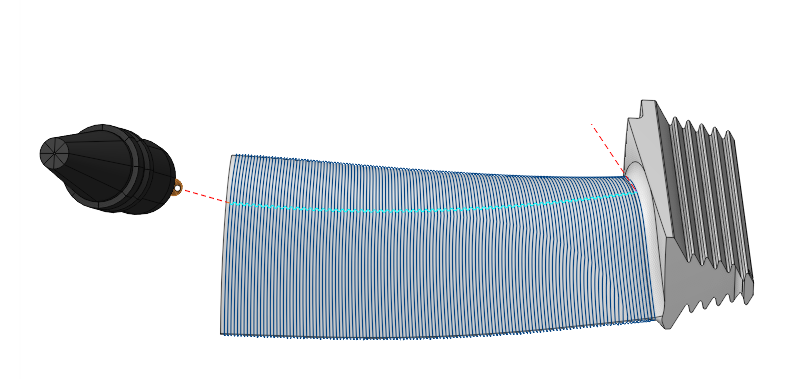

# Finitura superfici 4D

## Ambito di applicazione:

Questa operazione di finitura è destinata alle configurazioni <strong>4x</strong> e <strong>5x</strong> e adatta le [<strong>operazioni 5D Surfacing</strong>](10135.md) alla lavorazione rotativa di superfici complesse con un asse di rotazione ben definito o di superfici estese lungo l'asse. Non supporta le strategie di orientamento dell'utensile <strong>Through Point</strong>, <strong>Through Curve</strong> e <strong>Perpendicular to Toolpath</strong>. In questa operazione sono bloccate le funzioni degli angoli di inclinazione, di aggiramento delle singolarità e di deviazione dell'asse. La superficie di sicurezza è impostata come <strong>Cylinder</strong> (cilindro).

### Assegnazione del lavoro:

<strong>Machining Surfaces.</strong> (superfici da lavorare) Selezionare come compito di lavoro varie superfici del pezzo. Il sistema calcola il percorso utensile in base alle superfici scelte.

<strong>First Curve.</strong> (prima curva) Per la strategia <strong>Parallel to Curve</strong> questo elemento specifica le curve per il calcolo delle passate parallele. Nella strategia <strong>Morphing Between Two Curves</strong> specifica inoltre la <strong>First Curve</strong> <strong>.</strong> È possibile selezionare una o più curve o spigoli, non necessariamente collegati.

<strong>Second Curve.</strong> (seconda curva) Il sistema la utilizza nella strategia <strong>Morphing Between Two Curves</strong>. Specifica la <strong>Second Curve</strong><strong>.</strong> È possibile selezionare una o più curve o spigoli, non necessariamente collegati.

<strong>Tilt Curve.</strong> (curva di inclinazione) È la curva verso cui punta il vettore dell'asse utensile quando come <strong>Tool Orientation</strong> (orientamento dell'utensile) si imposta <strong>Through Curve.</strong>

<strong>First Surface.</strong> (prima superficie) Questo elemento funge da <strong>First Surface</strong> nella strategia <strong>Morph Between Two Surfaces</strong> e serve al processo di morphing per creare le linee del percorso utensile.

<strong>Second Surface.</strong> (seconda superficie) Questo elemento funge da <strong>Second Surface</strong> nella strategia <strong>Morph Between Two Surfaces</strong> e serve al processo di morphing per creare le linee del percorso utensile.

<strong>Surfaces for projection.</strong> (superfici per la proiezione) Sono le superfici da lavorare su cui viene trasferito il percorso utensile quando si attiva l'opzione <strong>Project Toolpath onto the Part</strong> nella scheda <strong>Strategy</strong>.

<strong>Job Zone.</strong> (zona di lavoro) Utilizzare la zona di lavoro per rifilare le passate al di fuori delle aree di contenimento 2D specificate. Il piano dell'area di contenimento è definito dall'orientamento iniziale dell'utensile. [Dettagli](10151.md).

<strong>Restrict Zone.</strong> (zona di esclusione) Oltre alle <strong>Job Zones</strong>, nel sistema è possibile utilizzare la geometria delle <strong>Restrict Zones</strong>, costituita da curve e spigoli, per specificare le aree del grezzo che non devono essere lavorate nell'operazione corrente. [Dettagli](10152.md)

<strong>Properties.</strong> (proprietà) Visualizza le proprietà di un elemento. È possibile aggiungere il sovrametallo. Questo menu si può richiamare anche facendo doppio clic su un elemento dell'elenco.

<strong>Delete.</strong> (elimina) Rimuove un elemento dall'elenco.

<strong>Restrictions.</strong> (restrizioni) Consente di delimitare le aree che non devono essere lavorate. [Dettagli](101231.md)

### Strategia:

#### Strategia:

Questo parametro consente all'utente di ottenere il percorso utensile richiesto. I parametri di questo gruppo sono gli stessi dell'<strong>operazione 5D Surfacing</strong>. [Dettagli.](10135.md)

#### Tipo di fresatura:

Si può assegnare in quasi tutte le operazioni, eccetto quelle di lavorazione di curve. Consente all'utente di controllare il tipo di fresatura richiesto (concorde o discorde) durante il calcolo del percorso utensile.

I parametri di <strong>Milling Type</strong> (tipo di fresatura) sono gli stessi dell'<strong>operazione</strong> <strong>Waterline Roughing</strong>. [Dettagli.](736.md)

#### Ordinamento:

Controlla la sequenza delle passate del percorso utensile durante la lavorazione delle superfici. I parametri di questo gruppo sono gli stessi dell'<strong>operazione 5D Surfacing</strong>. [Dettagli.](10135.md)

#### Punto di contatto dell'utensile.

Il Tool Contact Point (TCP, punto di contatto dell'utensile) è un punto specifico dell'utensile da taglio che definisce il punto principale di interazione tra l'utensile e la superficie del pezzo o le entità geometriche durante le operazioni di lavorazione.

I parametri di questo gruppo sono gli stessi dell'<strong>operazione 5D Surfacing</strong>. [Dettagli.](10135.md)

#### Orientamento dell'utensile:

Controlla l'orientamento dell'asse utensile. Questa operazione prevede soltanto le strategie di orientamento dell'utensile <strong>Normal to Surface</strong>, <strong>Fixed</strong>, <strong>Flank</strong> e <strong>To Rotary Axis</strong>. Blocca opzioni come <strong>Lean Angle</strong> e <strong>Vertical Clearance Angle</strong>. Gli altri parametri di queste strategie sono gli stessi dell'<strong>operazione 5D Surfacing</strong>. [Dettagli.](10135.md)

#### Limitazione degli angoli di rotazione:

Quando il flag è attivato, specifica i valori limite della posizione angolare dell'utensile rispetto all'asse specificato. I parametri di questo gruppo sono gli stessi dell'<strong>operazione 5D Surfacing</strong>. [Dettagli.](10135.md)

#### Zona di lavoro:

Consente un'ulteriore modifica dell'area di lavoro selezionata inizialmente nella scheda <strong>Job assignment</strong>. I parametri di questo gruppo sono gli stessi dell'<strong>operazione 5D Surfacing</strong>. [Dettagli.](10135.md)

#### Raccordo degli spigoli:

Quando la direzione dell'utensile cambia bruscamente, il controllo della fresatrice decelera prima di iniziare la svolta e poi accelera di nuovo. Ciò può causare vibrazioni e un'elevata usura dell'utensile e della fresatrice. Il problema può essere risolto se il percorso utensile presenta pochissime discontinuità o nessuna. Per questo motivo il sistema dispone della funzione di raccordo del percorso utensile, che utilizza un raggio definito per la lavorazione degli spigoli interni o esterni del modello. I parametri di questo gruppo sono gli stessi dell'<strong>operazione 5D Surfacing</strong>. [Dettagli.](10135.md)

#### Passate di sgrossatura:

Il percorso utensile viene traslato (offset) nel piano dello spessore <strong>Roughing passes</strong>. Al contorno vengono aggiunte passate supplementari del valore specificato nei parametri, con il numero di passi indicato. I parametri di questo gruppo sono gli stessi dell'<strong>operazione 5D Surfacing</strong>. [Dettagli.](10135.md)

#### Proiezione del percorso utensile sul pezzo:

Attivando il flag, il sistema genera i percorsi utensile per la lavorazione delle superfici definite come <strong>Surfaces for Projection</strong> nella scheda <strong>Job Assignment</strong>, proiettando il percorso ottenuto dalla <strong>Machining Surface</strong> sulle <strong>Surfaces for Projection.</strong> I parametri di questo gruppo sono gli stessi dell'<strong>operazione 5D Surfacing</strong>. [Dettagli.](10135.md)

#### Rifilatura:

Consente di saltare le superfici non destinate alla lavorazione e di estendere il percorso utensile. I parametri di questo gruppo sono gli stessi dell'<strong>operazione 5D Surfacing</strong>. [Dettagli.](10135.md)

### Parametri:

Questa scheda contiene i parametri principali per il controllo del pezzo, del grezzo, delle attrezzature di bloccaggio e di altri elementi, che consentono di modificare il percorso utensile. [Dettagli](100112.md)

### Collegamenti/Attacchi:

Nella scheda Links/Leads si definiscono i parametri dei movimenti rapidi. Questi movimenti comprendono l'avvicinamento dell'utensile dalla posizione di cambio utensile, l'attacco all'inizio della corsa di lavoro, la retrazione dopo l'ultimo movimento di taglio, i collegamenti tra le passate di lavoro e il ritorno al punto di cambio utensile. È possibile configurare la sequenza dei movimenti lungo le coordinate, la traiettoria di questi movimenti e l'entità degli spostamenti.

Fare clic qui per espandere..

<strong>Comprende:</strong>

<strong>Approach/Return.</strong> (avvicinamento/ritorno) Questo gruppo di parametri gestisce i movimenti dell'utensile dalla posizione di cambio utensile all'inizio dei percorsi di attacco, e viceversa. [Dettagli](100116.md).

<strong>Links.</strong> (collegamenti) Definisce le regole che governano i collegamenti di entrata/uscita e i collegamenti tra i movimenti di lavoro. [Dettagli](100130.md).

<strong>Leads.</strong> (attacchi) Consente di aggiungere ai movimenti di lavoro attacchi e uscite supplementari eseguiti con il relativo avanzamento. [Dettagli](100136.md).

<strong>Safe motions.</strong> (movimenti di sicurezza) Definisce il tipo di <strong>Safety Surface</strong> (superficie di sicurezza) e la sua distanza dal grezzo. Questa superficie facilita le transizioni tra le superfici lavorate o tra i percorsi utensile, e la prima fase dell'avvicinamento o del ritorno avviene verso di essa. [Dettagli](100117.md).

<strong>Advanced links settings.</strong> (impostazioni avanzate dei collegamenti) Questo gruppo di parametri specifica le caratteristiche di formazione della traiettoria, principalmente per le operazioni a cinque assi, tenendo conto dei movimenti ottimali degli assi rotativi. [Dettagli](100118.md).

<strong>Distances.</strong> (distanze) Distanze utilizzate nelle regole dei collegamenti (Links) [Dettagli](100140.md).

### Avanzamenti/Velocità:

In questa finestra di dialogo l'utente può definire la velocità di rotazione del mandrino, la velocità dei movimenti rapidi e i valori di avanzamento per le diverse parti del percorso utensile. La velocità di rotazione del mandrino può essere definita come numero di giri al minuto oppure come velocità di taglio. Il valore determinante viene sottolineato. Il secondo valore viene ricalcolato in base al valore determinante, tenendo conto del diametro dell'utensile. [Dettagli](100142.md)

### Trasformazioni:

Insieme di parametri dell'operazione che consentono di eseguire trasformazioni di coordinate sul percorso utensile calcolato nell'ambito dell'operazione. [Dettagli](10168.md).

### Pezzo:

Il pezzo (Part) è un gruppo di elementi geometrici che definisce lo spazio in cui controllare le intaccature. [Dettagli](330.md)

### Grezzo:

Il modello del grezzo (Workpiece) di un'operazione definisce il materiale da lavorare. [Dettagli](738.md)

### Attrezzature:

Come attrezzature (Fixtures) si specificano di solito i dispositivi di bloccaggio, come mandrini autocentranti, griffe, staffe, ecc., e le aree di esclusione di qualsiasi altra natura. [Dettagli](10283.md)
