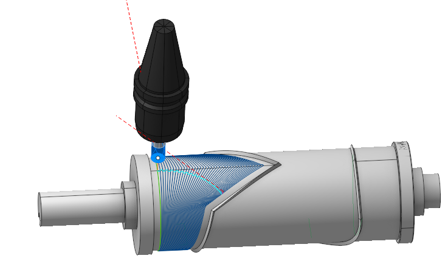

# 4D-Morph

## Anwendungsbereich:

Diese Schlichtoperation steht in 4X- und 5X-Konfigurationen zur Verfügung. Sie passt die [Morph-Operation](10138.md) an die Rotationsbearbeitung komplexer Flächen mit ausgeprägter Drehachse oder Längsrichtung an. Die Standardausrichtung ist **To Rotary axis**; zusätzlich steht **Fixed** zur Verfügung. Andere Ausrichtungsstrategien sind gesperrt, und die Winkelanpassung ist eingeschränkt. Die Sicherheitsfläche ist als Zylinder voreingestellt. Zur Vermeidung von Halterkollisionen steht ausschließlich **Trim toolpath** zur Verfügung.

### Auftragszuweisung:

**Machining Surfaces (Bearbeitungsflächen).** Begrenzt die Bearbeitung auf Bereiche, in denen das Werkzeug die ausgewählten Flächen berührt. Die Morph-Bahnen entstehen zwischen den beiden Werkzeugkontaktkurven auf diesen Flächen, die den als **First Curve** und **Second Curve** angegebenen Kurven am nächsten liegen.

**First Curve (Erste Kurve).** Anfangskurve des Bereichs, zwischen dessen beiden Grenzen die Bahnen erzeugt werden.

**Second Curve (Zweite Kurve).** Endkurve dieses Bereichs.

**Sync Lines (Synchronisationslinien)** verbessern die Zuordnung bei komplexer Geometrie, insbesondere bei geschlossenen Konturen. Jede Linie legt zwei einander zugeordnete Punkte auf erster und zweiter Kurve fest. Verwendet werden können Kanten, 3D-Kurven und 2D-Geometriekurven. Ihre Endpunkte müssen nicht exakt auf den beiden Bezugskurven liegen. Synchronisationslinien können im 2D-Geometriemodus gezeichnet werden.

**Properties (Eigenschaften).** Öffnet die Elementeigenschaften, beispielsweise zur Eingabe eines Aufmaßes. Auch durch Doppelklick auf einen Listeneintrag erreichbar.

**Delete (Löschen).** Entfernt ein Element aus der Liste.

**Restrictions (Begrenzungen).** Definiert nicht zu bearbeitende Bereiche. [Details](101231.md)

### Strategie:

#### Strategie:

Bestimmt die Werkzeugbahn. Die Parameter entsprechen denen der Morph-Operation. [Details](10138.md)

#### Fräsart:

Legt Gleich- oder Gegenlauf für die Bahnberechnung fest. Die Parameter entsprechen denen beim Wasserlinien-Schruppen. [Details](736.md)

#### Sortierung:

Steuert die Reihenfolge der Bearbeitungsbahnen.

**Start Point (Startpunkt).** Ermöglicht bei Aktivierung die Eingabe der Koordinaten des Startpunkts der Arbeitsbahnen.

#### Werkzeugachsenausrichtung:

Steuert die Werkzeugachse während der Bearbeitung. Verfügbar sind **To Rotary axis**, mit eingeschränkter Winkeleinstellung über **Side Angle**, sowie **Fixed**. Die übrigen Parameter entsprechen denen der 5D-Flächenbearbeitung. [Details](10135.md)

#### Begrenzung:

Ermöglicht das Auslassen nicht zu bearbeitender Flächen. Die Parameter entsprechen denen beim Wasserlinien-Schruppen. [Details](736.md)

### Parameter:

Diese Registerkarte enthält die grundlegenden Einstellungen für Bauteil, Rohteil, Spannmittel und weitere Elemente, die die Werkzeugbahn beeinflussen. [Details](100112.md)

### Verbindungen und An-/Abfahrbewegungen:

Auf der Registerkarte **Links/Leads** werden die Verbindungsbewegungen festgelegt: Anfahren von der Werkzeugwechselposition, Einfahren zum Beginn der Arbeitsbahn, Abfahren nach dem letzten Arbeitsgang, Verbindungen zwischen den Bahnen und Rückkehr zur Werkzeugwechselposition. Einstellbar sind die Reihenfolge der Achsbewegungen, der Bahnverlauf und die Abstände.

Weitere Informationen anzeigen

**Parametergruppen:**

**Approach/Return (Anfahren/Rückkehr).** Steuert die Bewegung von der Werkzeugwechselposition zum Beginn der Werkzeugbahn und zurück. [Details](100116.md).

**Links (Verbindungen).** Legt die Regeln für Ein- und Ausfahrverbindungen sowie Verbindungen zwischen Arbeitsbewegungen fest. [Details](100130.md).

**Leads (An-/Abfahrbewegungen).** Ergänzt zusätzliche Ein- und Ausfahrbewegungen an den Arbeitsbahnen mit den dafür vorgesehenen Vorschüben. [Details](100136.md).

**Safe motions (Sichere Bewegungen).** Legt die Art der Sicherheitsfläche und ihren Abstand zum Rohteil fest. Die Fläche dient für Verbindungen zwischen bearbeiteten Flächen oder Werkzeugbahnen sowie für die erste Phase des Anfahrens bzw. der Rückkehr. [Details](100117.md).

**Advanced links settings (Erweiterte Verbindungseinstellungen).** Steuert die Bahnerzeugung insbesondere bei 5-Achsen-Operationen unter Berücksichtigung günstiger Drehachsbewegungen. [Details](100118.md).

**Distances (Abstände).** Abstände für die Verbindungsregeln. [Details](100140.md).

### Vorschübe und Drehzahlen:

Legt Spindeldrehzahl, Eilgang und Vorschübe für die verschiedenen Bahnabschnitte fest. Die Drehzahl kann direkt in Umdrehungen pro Minute oder über die Schnittgeschwindigkeit vorgegeben werden. Der vorgegebene Wert wird unterstrichen; der andere wird anhand des Werkzeugdurchmessers berechnet. [Details](100142.md)

### Transformationen:

Koordinatentransformationen des berechneten Werkzeugwegs. [Details](10168.md).

### Bauteil:

Geometrische Elemente zur Prüfung auf unerwünschte Einschnitte. [Details](330.md)

### Rohteil:

Modell des zu bearbeitenden Materials. [Details](738.md)

### Spannmittel:

Hier werden Spannmittel wie Spannfutter, Greifer und Spannpratzen sowie weitere Sperrbereiche angegeben. [Details](10283.md)
