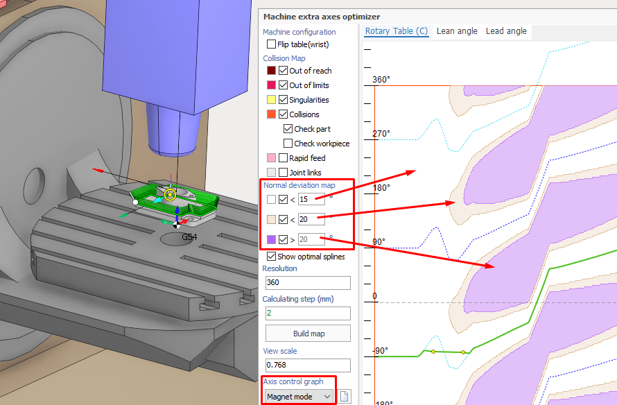
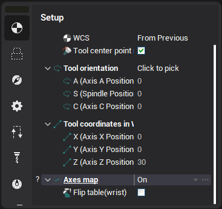
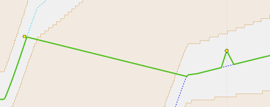

# Achsenplan für 5-Achsen-Maschinen

Der Achsenplan optimiert Werkzeugbahnen für 5-Achsen-Maschinen ähnlich wie die [Optimierung zusätzlicher Roboterachsen](10266.md). Die Funktion ist standardmäßig deaktiviert. Aktivieren Sie sie unter **Axes map** auf der Inspektorregisterkarte **Setup**. Die Schaltfläche mit den drei Punkten rechts öffnet das Optimierungsfenster. Verfügbar sind ein C-Achsen-Plan sowie Pläne für Vorlauf- und seitliche Neigungswinkel.

## C-Achsen-Plan

Die Drehachse, die um die Werkzeug-Z-Achse dreht, wird häufig als C-Achse bezeichnet; die ergänzende Drehachse ist meist A oder B. Eine 5-Achsen-Bahn gibt die Werkzeugausrichtung an jedem Punkt vor. Das System ermittelt dafür passende Drehachsstellungen. Dabei können jedoch Kollisionen oder abrupte Drehachsbewegungen in Singularitätsbereichen entstehen. Mit dem Spline im Achsenplan kann der Verlauf einer Drehachse direkt vorgegeben werden. Die zweite Achse wird automatisch so bestimmt, dass die Abweichung von der gewünschten Werkzeugnormalen möglichst klein bleibt. Die allgemeinen Bedienelemente sind unter [Roboterachsenplan](10266.md) beschrieben; hier werden die Besonderheiten der C-Achsen-Bearbeitung erläutert.

### Abweichungskarte

Die Farbkarte zeigt für jede Bahnposition auf der horizontalen Achse und jeden möglichen C-Achswert auf der vertikalen Achse die kleinste erreichbare Abweichung von der vorgegebenen Werkzeugnormalen. Gleiche Farben kennzeichnen denselben Abweichungsbereich. Diese Bereiche werden links unter **Normal deviation map** eingestellt. Zusätzlich können Kollisionsbereiche angezeigt werden.

### Optimale Splines

Die nicht bearbeitbaren gepunkteten Splines zeigen optimale C-Achswerte für jede Bahnposition. Mehrere Lösungen sind möglich: Sie unterscheiden sich um 360° oder gehören zu unterschiedlichen Stellungen von **Flip table**. Ihre Sichtbarkeit wird über das Kontrollkästchen unter dem Bereich für die Normalenabweichung gesteuert.

### Spline-Bearbeitungsmodi

Drei Bearbeitungsmodi stehen zur Verfügung. Die ersten beiden entsprechen dem Roboterachsenplan. In allen Modi wird der Verlauf durch benutzerdefinierte Stützpunkte bestimmt. Doppelklicken Sie zum Erstellen eines Punkts und ziehen Sie ihn zum Verschieben.

1. **Spline mode.** Glatte Kurve durch die vorgegebenen Stützpunkte.
2. **Polyline mode.** Geradlinige Verbindung der Stützpunkte.
3. **Magnet mode.** Ein Algorithmus verbindet die Stützpunkte so, dass der Verlauf möglichst nahe an den optimalen Splines liegt. Für zwei aufeinanderfolgende Punkte gilt:

- Liegen die Punkte näher beieinander als an den optimalen Splines, werden sie direkt verbunden.
- Liegen sie nahe am selben optimalen Spline, werden sie glatt an diesen angebunden. Dazwischen folgt die Bahn dem optimalen Spline. Ein sehr naher Punkt bestimmt lediglich, welcher optimale Spline in seiner Umgebung verwendet wird.
- Liegen die Punkte nahe an unterschiedlichen optimalen Splines, sucht der Algorithmus deren nächstgelegene Stellen und verbindet sie geradlinig. Die Stützpunkte werden anschließend mit den zugehörigen Stellen ihres jeweiligen Splines verbunden. Das folgende Beispiel zeigt diesen Fall. 

## Plan für Vorlauf- und seitlichen Neigungswinkel

**Lead** beschreibt die Neigung entlang der Bahn, **Lean** die seitliche Neigung in der dazu senkrechten Ebene. Auf den entsprechenden Registerkarten können diese Winkel entlang der Operationsbahn gesteuert werden. Die Bedienung entspricht der [Optimierung zusätzlicher Roboterachsen](10266.md).
