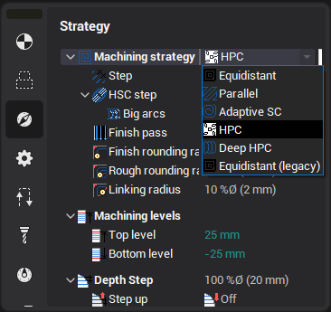
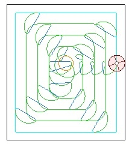
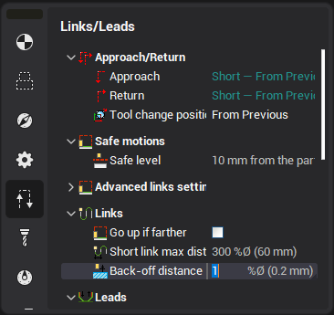
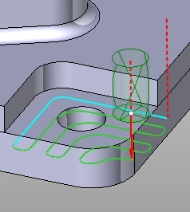
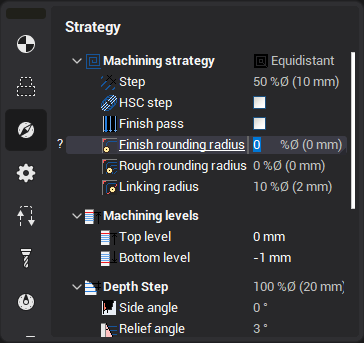
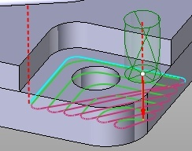
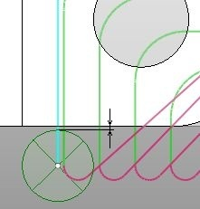
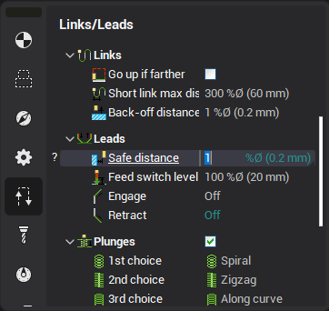
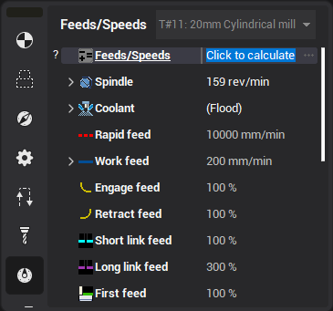

# Hochleistungsfräsen (HPC)

Die HPC-Strategie dient zum effizienten Materialabtrag in offenen und geschlossenen Taschen.

Sie steht in folgenden Operationen zur Verfügung:

- [Wasserlinien-Schruppen](736.md)
- [Taschenfräsen](256.md)
- [2,5D-Taschenfräsen](768.md)
- [Flache Bereiche schlichten](759.md)

Wählen Sie die Strategie in der Liste der Bearbeitungsstrategien aus:

Die folgenden Einstellungen sind bei ausgewählter HPC-Strategie verfügbar.

Neue Trochoidenbögen

Gegenüber der vorherigen Programmversion wurden die Werkzeugbahnen um bis zu 20 % verkürzt.

Die neuen Trochoidenbögen vermeiden Werkzeugüberlastungen ohne zusätzliche Vorschubreduzierung.

Dadurch verläuft die Bearbeitung gleichmäßiger.

Werkzeugfreifahrabstand

Bei der Verbindung zum nächsten Startpunkt eines Trochoidenbogens kann das Werkzeug über die bereits bearbeitete Oberfläche angehoben werden.

Verrundete Verbindungen im Zickzackmodus

 

**Finish rounding radius**, **Rough rounding radius** und **Linking radius** legen die Verrundung der Verbindungen fest.

Verbindungen auf derselben Z-Ebene

Bei Gleich- und Gegenlaufbearbeitung bewegt sich das Werkzeug direkt zur nächsten Bahn, ohne auf die Sicherheitsebene zurückzufahren. Für Eilgangbewegungen über bereits bearbeiteten Flächen gilt **Tool back-off distance**. **Idle radius** glättet die Leerbewegungen.

Sicherheitsabstand

 

Der Sicherheitsabstand wird beim Absenken von der Sicherheitsfläche und beim Anheben zu ihr berücksichtigt.

Die vertikale Bewegung erfolgt mit diesem Abstand zum Rohteil. Daher müssen An- und Rückfahrbewegungen nicht zusätzlich aktiviert werden, um Eilgangkollisionen auszuschließen.

Wird beim Schruppen eine Vorbohrung zum Einfahren verwendet, muss ihr Durchmesser mindestens dem doppelten Fräserdurchmesser entsprechen. Kleinere Vorbohrungen werden hierfür nicht erkannt.

Verbindungen mit erhöhtem Vorschub

Für Verbindungen wird je nach Länge **Next feed** oder **Return feed** verwendet. Ist die Verbindung kürzer als **Short link**, gilt **Next feed**, andernfalls **Return feed**. **Return feed** beträgt standardmäßig 300 % des Arbeitsvorschubs und ist für Bewegungen ohne Materialkontakt vorgesehen. Wird während einer solchen Bewegung in der Simulation Material abgetragen, wird sie als Fehler markiert.
