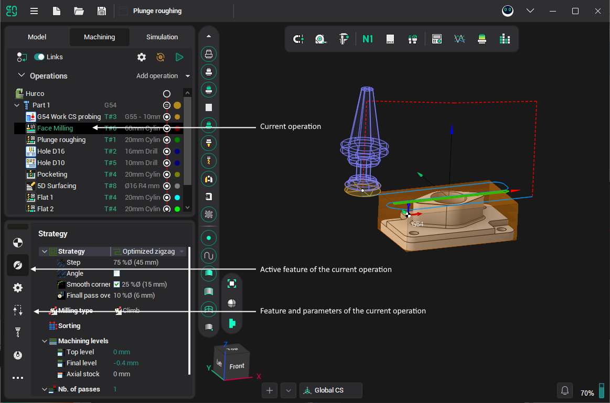

# Operationen einrichten

Die Parameter einer Operation bestimmen, welche Geometrie auf welche Weise bearbeitet wird. Wenn Sie im Operationsbaum einen Parameterknoten auswählen, werden im unteren Bereich der Registerkarte die Werkzeuge zum Festlegen und Bearbeiten seiner Eigenschaften angezeigt.

