# Bearbeitungszonen

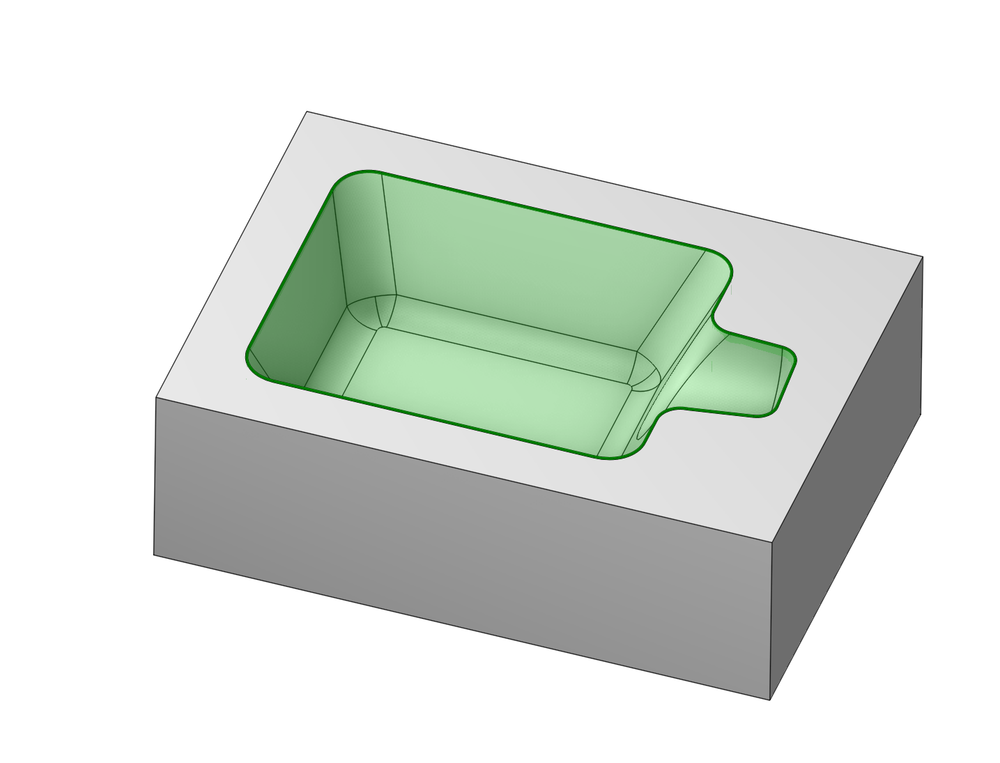

## Anwendungsbereich:

Bearbeitungszonen legen fest, welche Bereiche von Bauteil und Rohteil durch Schrupp- und Schlichtfräsoperationen bearbeitet werden sollen. Sie können geschlossen oder offen sein. Offene Bearbeitungszonen ermöglichen die Definition offener Bearbeitungsbereiche direkt anhand der Elemente des 3D-Ausgangsmodells.

### Mit Bearbeitungszonen arbeiten

**Geschlossene Bearbeitungszonen verwenden**

Als Ausgangsgeometrie können geschlossene Ketten aus Kurven, Kanten und vertikalen Wänden verwendet werden. Für geschlossene Bearbeitungszonen empfiehlt sich folgender Ablauf:

- Wählen Sie im Grafikfenster die Geometrieelemente der Bearbeitungszone aus. Besonders einfach ist die Verwendung von Kanten des 3D-Modells. Eine zusammenhängende Kette tangentialer Kanten lässt sich durch Doppelklicken auf eine ihrer Kanten auswählen.

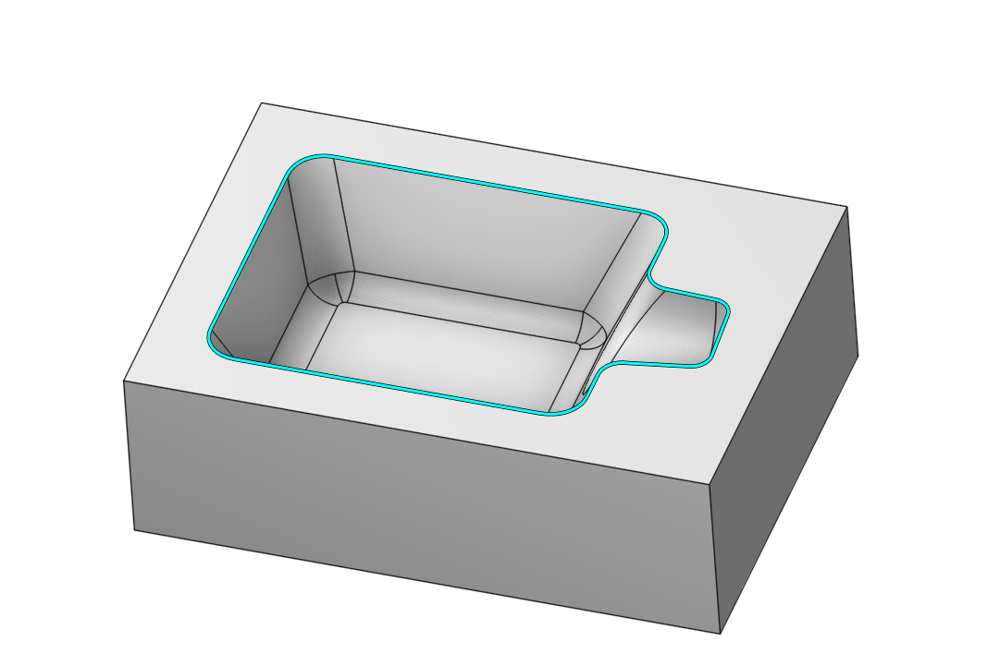

- Klicken Sie im Panel **Job Assignment** auf **Job Zone** (Bearbeitungszone).

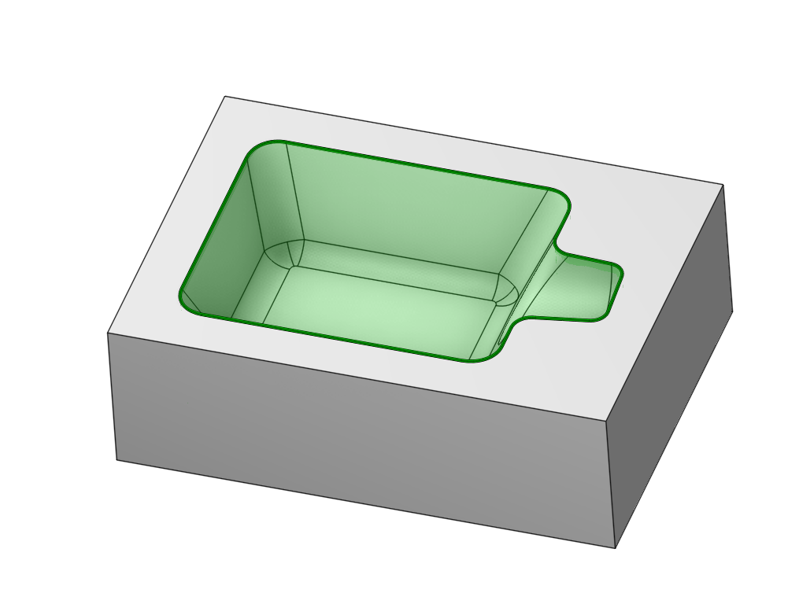

- Berechnen Sie den Werkzeugweg. Er soll innerhalb der Grenzen der **Job Zone** liegen.

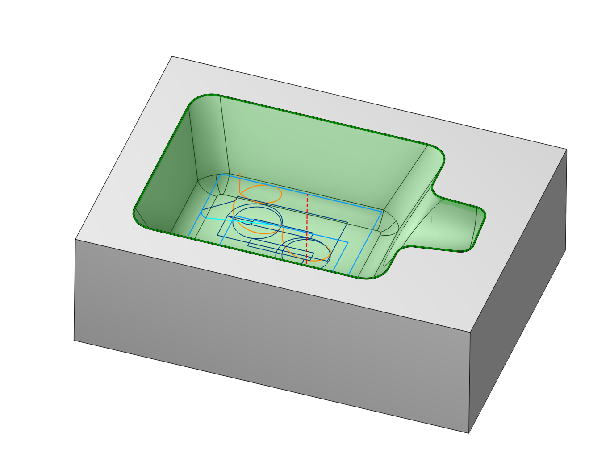

**Offene Bearbeitungszonen verwenden**

Eine offene Bearbeitungszone definiert einen durch ein oder mehrere Elemente begrenzten Halbraum. Als Ausgangsgeometrie eignen sich einzelne Kurven, 3D-Kanten und vertikale Wände sowie zusammenhängende Elementketten.

Die folgenden Beispiele zeigen den Einsatz offener Bearbeitungszonen.

**Offene Bearbeitungszonen beim Schruppen**

Im Beispiel wird der Arbeitsbereich durch Kurven so begrenzt, dass die mittlere Tasche nicht bearbeitet wird und die Bearbeitung innerhalb des Bauteilprofils bleibt.

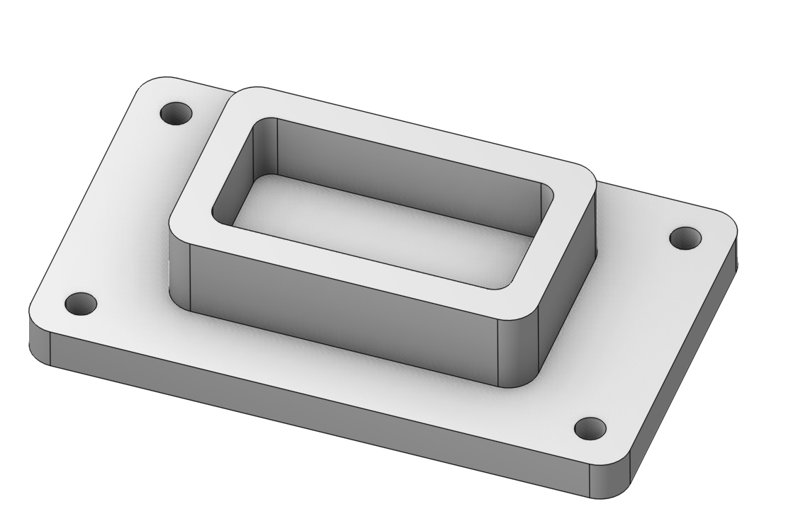

Wählen Sie dazu zwei Kanten als Bearbeitungszonen aus.

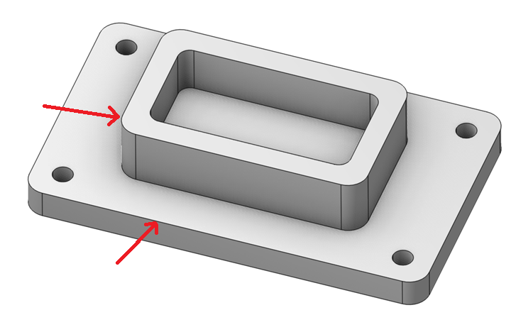 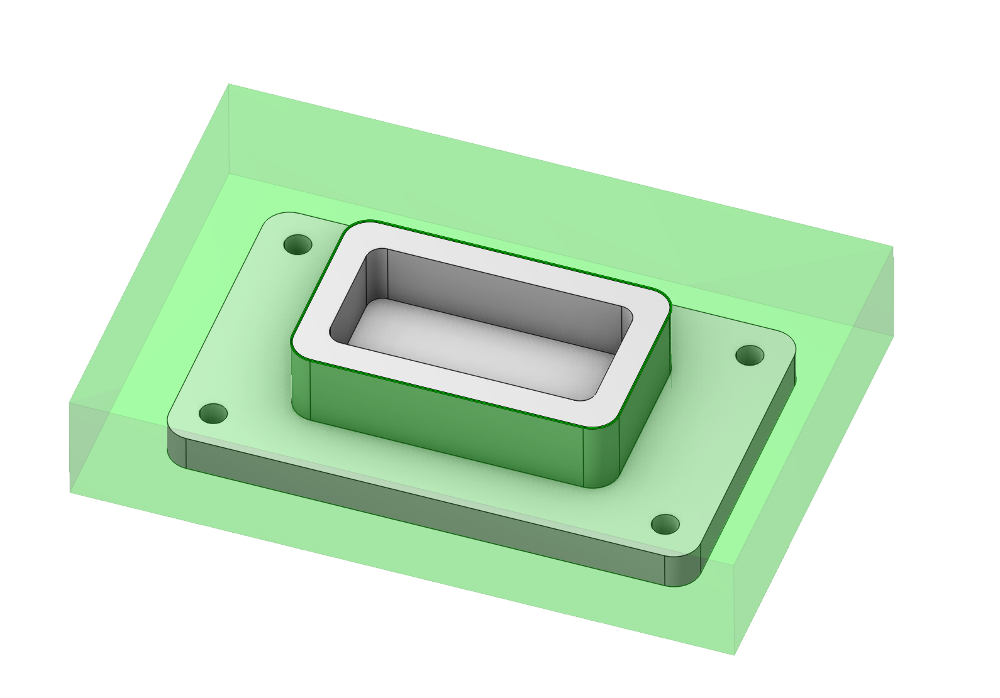 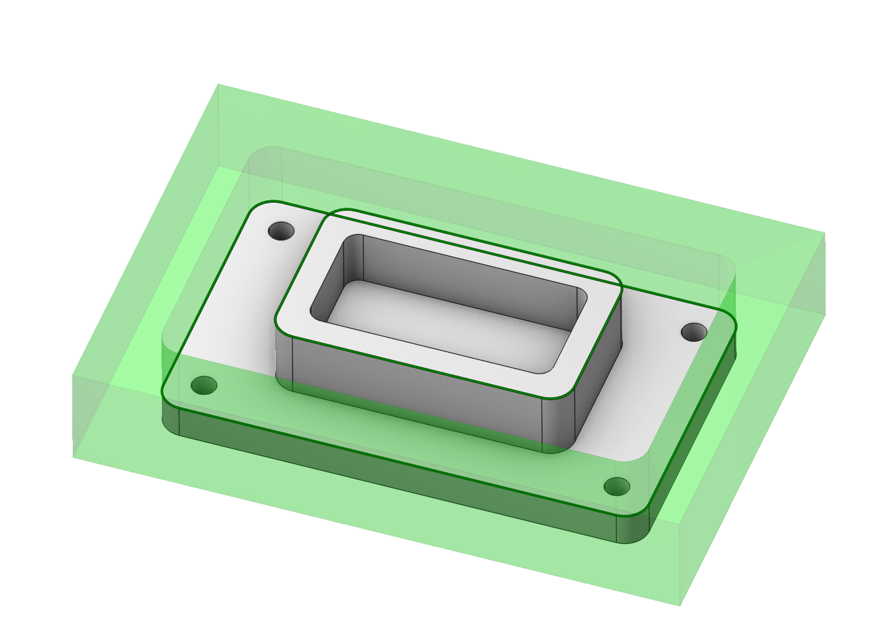

Eine der Zonen ist entgegengesetzt ausgerichtet und muss umgekehrt werden. Suchen Sie diese Zone in der Auftragszuweisung, doppelklicken Sie darauf und ändern Sie ihre Richtung.

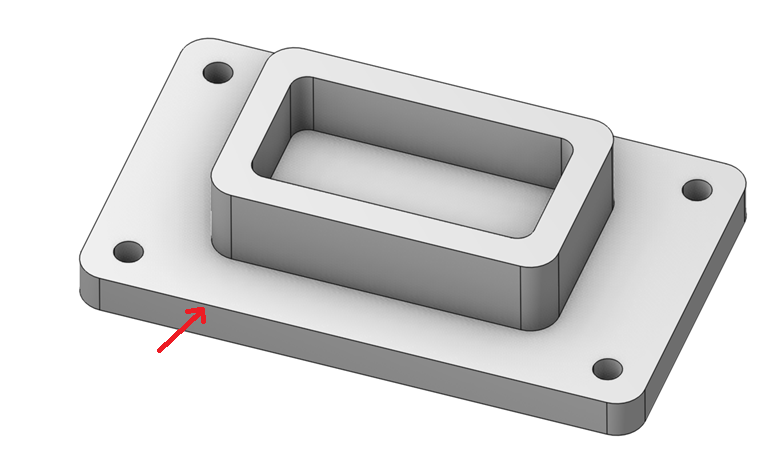 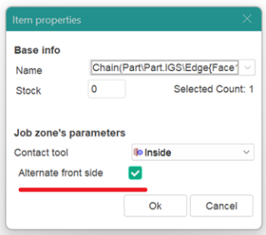

Das Ergebnis entspricht nun der Aufgabe. Dieses Vorgehen kann auf die Auftragszuweisung anderer Bauteile übertragen werden.

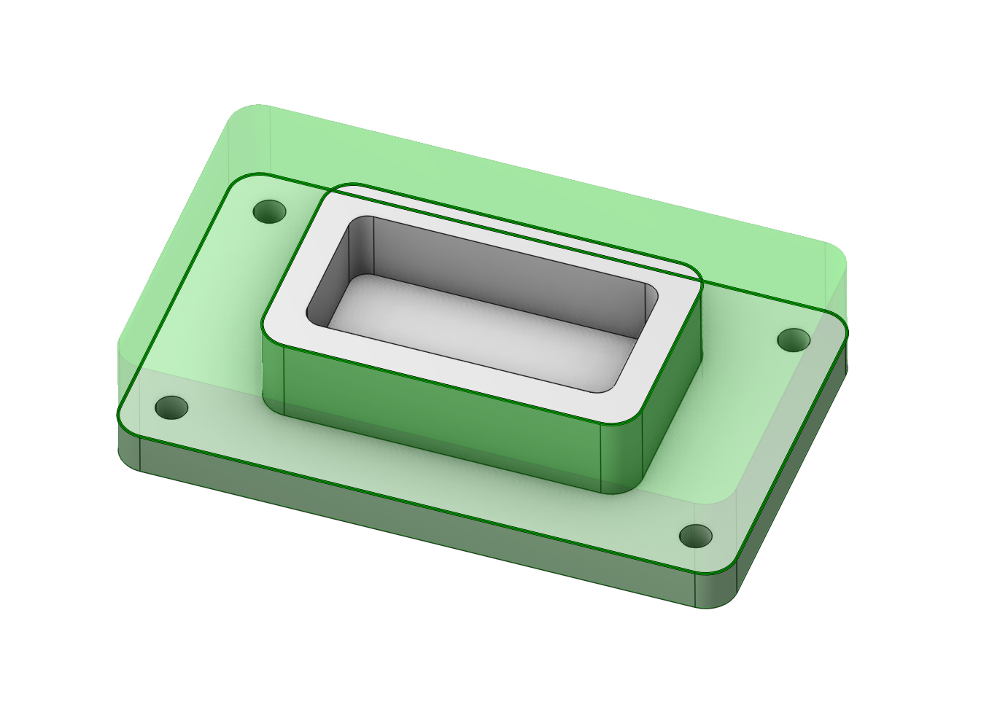 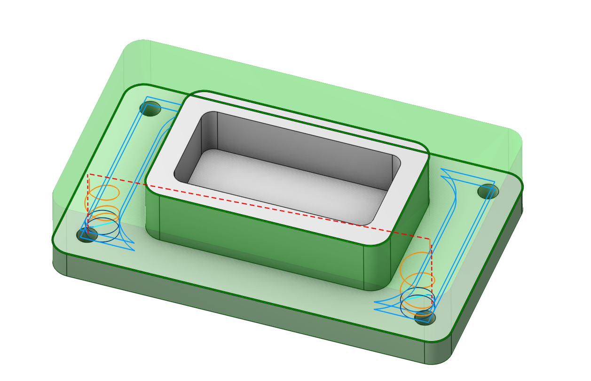

**Offene Bearbeitungszonen beim Schlichten**

Die folgende Abbildung zeigt eine Form mit drei offenen Freiformtaschen. Eine der kleinen Taschen soll mit **Finishing plane** (Ebenenschlichten) bearbeitet werden.

Wählen Sie die Kantenkette um die Tasche aus und fügen Sie sie der Auftragszuweisung als **Job Zone** hinzu.

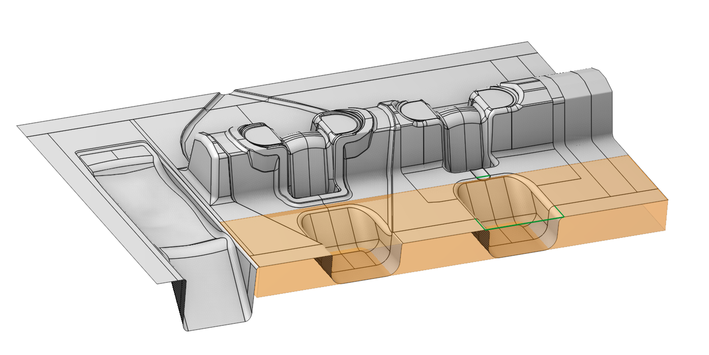

Berechnen Sie anschließend den Werkzeugweg. Das Ergebnis ist unten dargestellt.

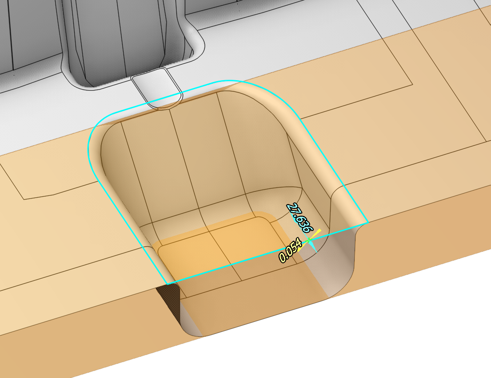 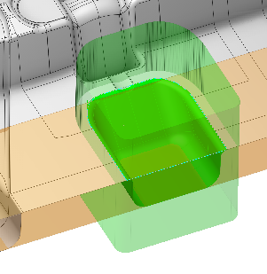 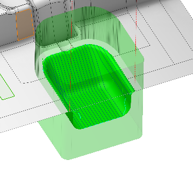
