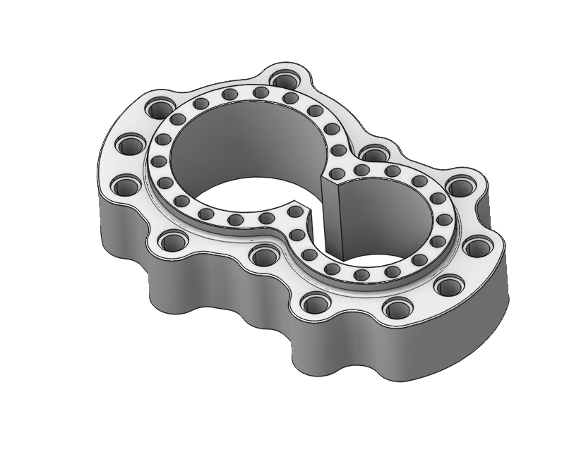
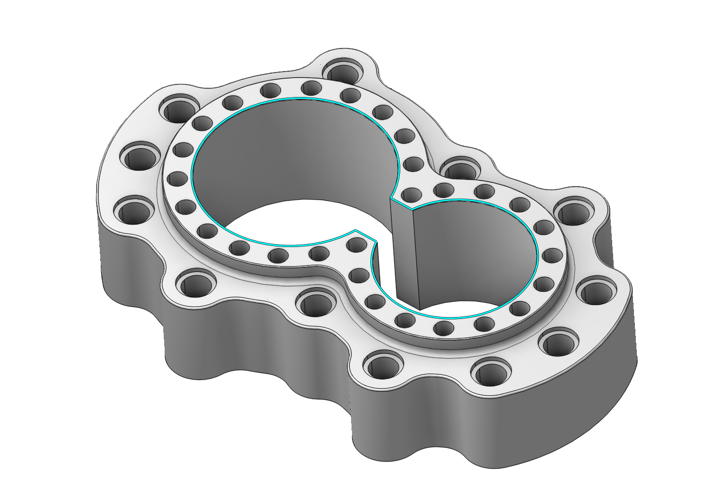
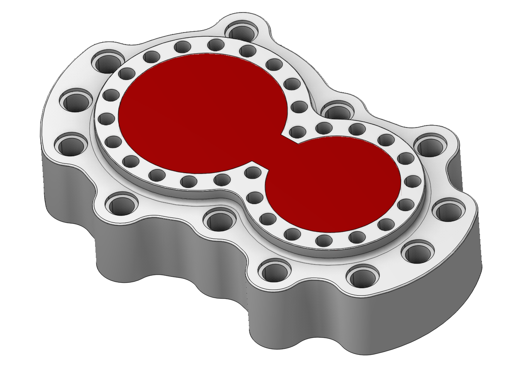
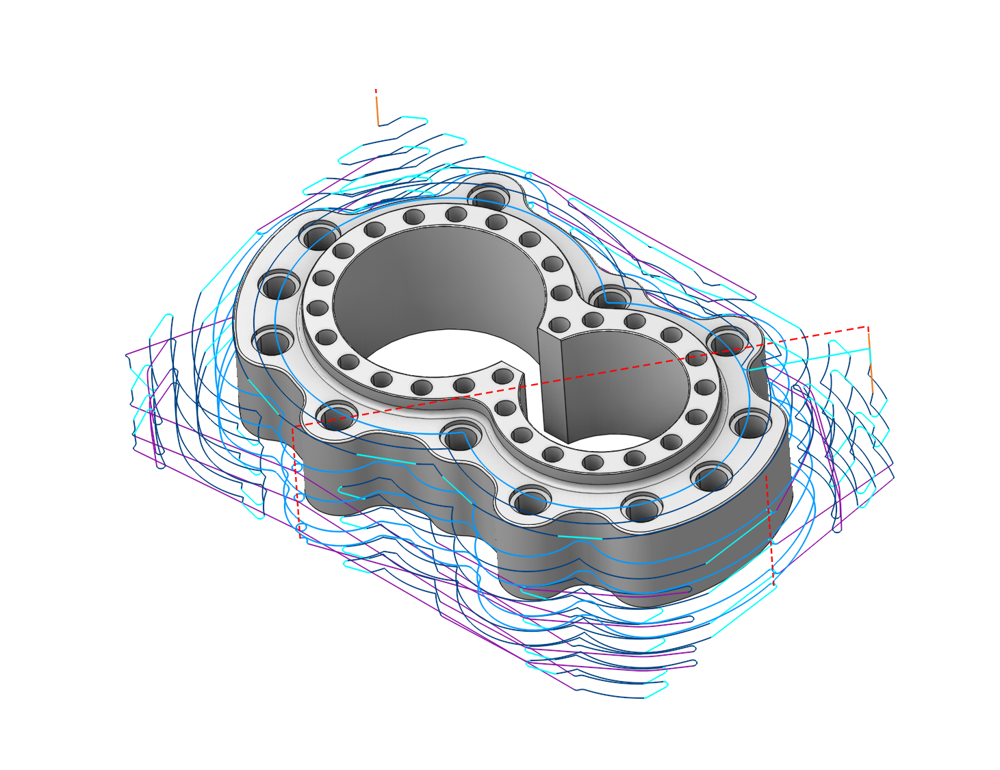

# Zone di esclusione

 

## Ambito di applicazione:

Oltre alle zone di lavoro (Job Zones) del sistema CAM, è possibile usare le zone di esclusione (Restrict Zones) per specificare le aree del grezzo che non devono essere lavorate nell'operazione corrente. A differenza di una zona di lavoro, una zona di esclusione è sempre chiusa. Come geometria di origine per le zone di esclusione si possono usare qualsiasi curva, spigoli 3D, nonché pareti verticali e catene collegate.

### Lavorare con le zone di esclusione.

Nell'immagine seguente si vede un pezzo con una finestra. Si sgrosserà l'esterno di questo pezzo. Per ottenere questo risultato occorre aggiungere una zona di esclusione che copra la finestra interna.

Per prima cosa si seleziona la catena di spigoli attorno alla finestra.

Quindi si aggiunge una nuova zona di esclusione (Restrict Zone) nell'assegnazione del lavoro (Job Assignment) dell'operazione di sgrossatura.

Dopo aver generato il percorso utensile si ottiene l'immagine seguente. Come si può vedere, la finestra interna è rimasta non lavorata.

