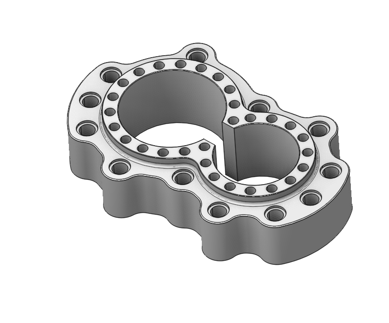
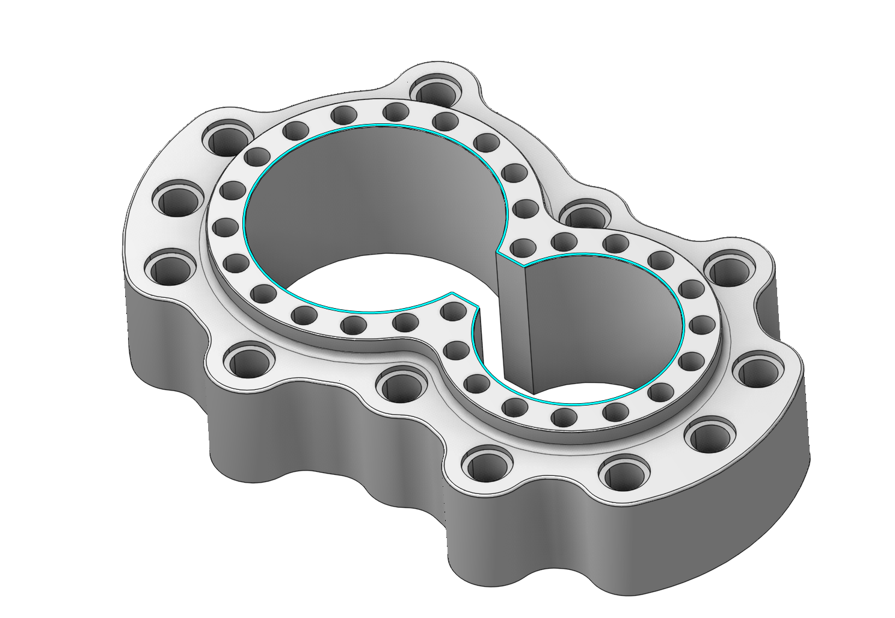
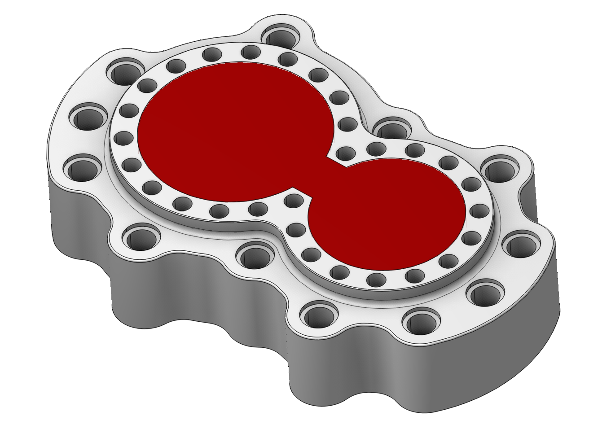
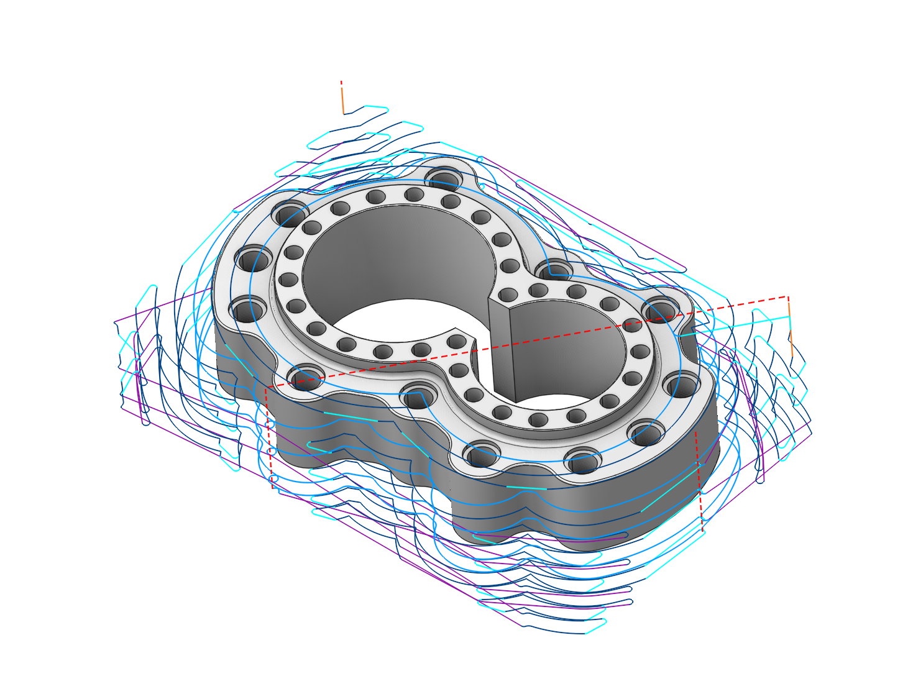

# 制限領域

 

## 適用分野：

CAMシステムのジョブゾーンに加えて、制限領域を使用して、現在のオペレーションで加工する必要のないワークエリアを指定することができます。 ジョブゾーンとは異なり、制限領域は常に閉じています。制限領域の形状源として、曲線、3Dエッジ、垂直壁、接続されたチェインなど、あらゆる形状を使用することができます。

### 制限領域の作業

下の画像では、ウィンドウを持つ部品が確認できます。この部分の外側を荒加工します。この作業を行うには、内部のウィンドウを覆う制限領域を追加する必要があります。

まず、ウィンドウの周囲に連なるエッジを選択します。

その後、<strong>荒加工</strong>の<strong>ジョブ割り当て</strong>に新しい<strong>制限領域</strong>を追加します。

ツールパスが生成されると、下図のようになります。ご覧のように、内側の窓は加工されずに残されています。

