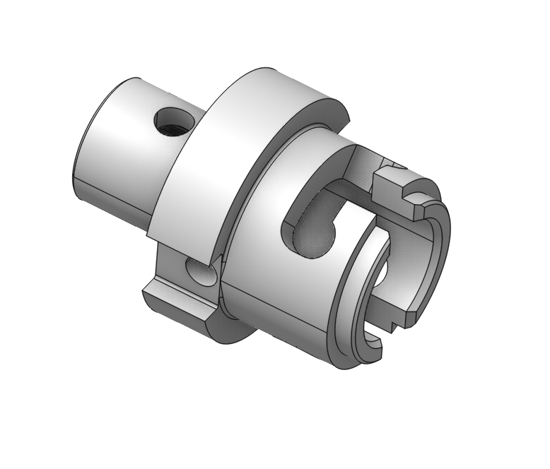
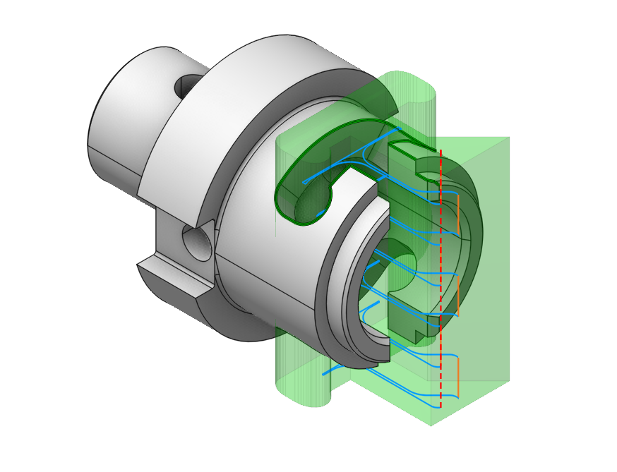
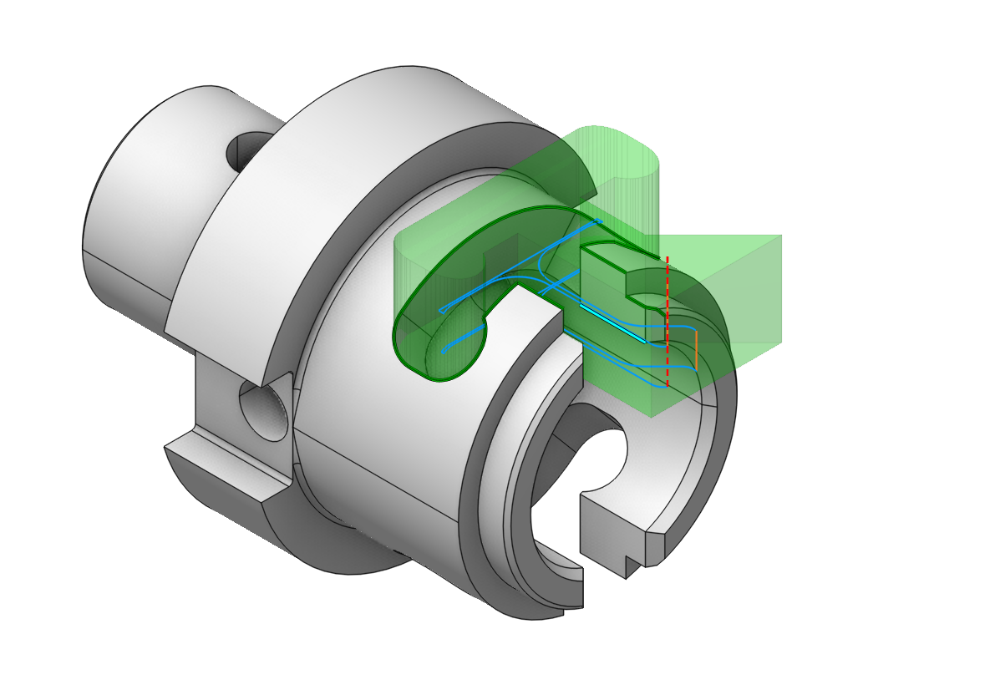
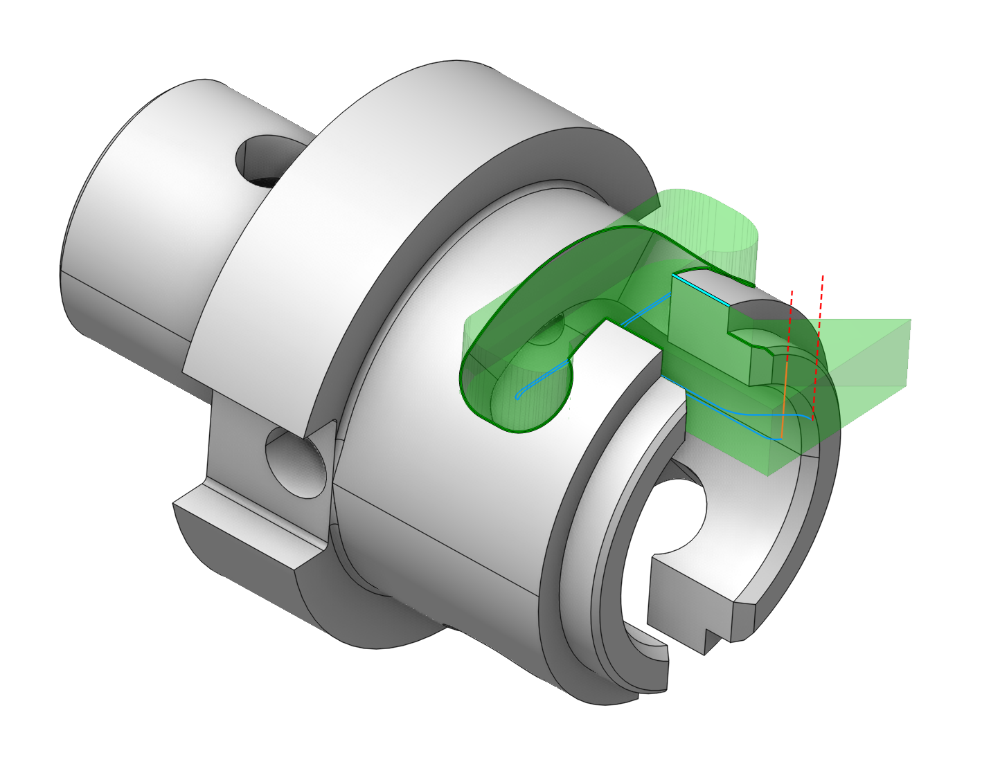

# 上部と底部高さ

 

## 適用分野：

角柱部品や複合旋盤加工部品の加工では、加工フィーチャの幾何学的位置に基づいて、オペレーションの<strong>上部高さ</strong>および<strong>底部高さ</strong>パラメータを定義することが一般的な作業です。この作業を最も簡単に行う方法は、<strong>ジョブ割り当て</strong>の対応する項目を使用することです。

<strong>上部高さ</strong>および<strong>底部高さ</strong>の参照ジオメトリとしては、グループを含む任意の3Dモデル要素に対して<strong>ジョブ割り当て</strong>の項目を使用できます。実際のレベル値は、そのジオメトリエンティティのバウンディングボックスから計算されます。さらに、項目のプロパティダイアログでは、プラスまたはマイナスの取り代を設定することも可能です。

### ジョブゾーンでの作業

下の画像は、ターンフライス加工された部品です。前部のオープンスロットを加工します。

閉じていないジョブゾーンを使用すると、XY平面内に加工領域を作成できます。下図のように、この場合はツールパスをZ方向で制限する必要があります。そのため、上部高さおよび底部高さの両方の高さを調整する必要があります。

この作業を実行するために、スロットの側面を底部高さアイテムとしてジョブ割り当てに追加します。

生成されたツールパスは下図のようになります。

ツールパスを上側から制限するために、スロットの外径を<strong>上部高さ</strong>項目として<strong>ジョブ割り当て</strong>に追加します。

