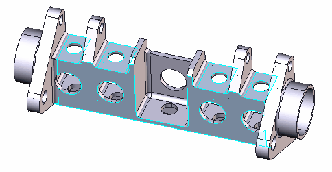
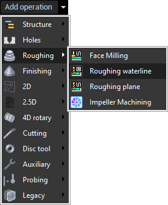
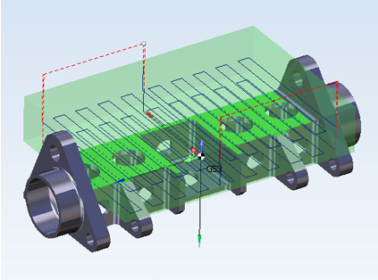

# Criação de operações para recursos selecionados

A criação de tecnologia para uma peça prismática que consiste em muitas formas simples é um processo demorado. Para simplificar essa tarefa, o sistema CAM oferece a possibilidade de criar operações para a geometria selecionada. Isso é muito simples. Primeiro, você seleciona o que deseja usinar na visualização gráfica e, em seguida, cria a operação que usinará a geometria selecionada. Com base no tipo de operação criada, o sistema CAM reconhece automaticamente na geometria selecionada os recursos de usinagem, como bolsões e furos, e os coloca no **Job Assignment** da operação recém-criada. Depois disso, o sistema CAM posiciona os eixos da máquina-ferramenta para alinhar o eixo da ferramenta acionada com a direção Z do sistema de coordenadas local dos recursos. Em seguida, ele seleciona a ferramenta e os parâmetros mais adequados da operação com base nos atributos dos recursos usinados.

Por exemplo, se você clicar duas vezes em um furo na peça, o sistema CAM o mede automaticamente e destaca todos os furos com o mesmo diâmetro. Agora, se você criar uma operação de usinagem de furos, o sistema CAM colocará automaticamente todos os furos selecionados no **Job Assignment** da operação criada e definirá o diâmetro da broca igual ao diâmetro dos furos. Se você criar uma `3d Hole machining operation` e os furos selecionados estiverem em planos diferentes, o sistema CAM criará não uma, mas várias operações de usinagem de furos, de acordo com o número de planos em que os furos estão posicionados.

Exemplo de criação rápida de uma operação de usinagem de bolsões:

Usinaremos a peça ilustrada abaixo em uma fresadora 3+2. Primeiro, queremos fazer o desbaste dos bolsões abertos. Basta escolher as faces inferiores dos bolsões a serem usinados na tela e selecionar a operação **Roughing waterline operation** na lista suspensa **Create operation**.

O sistema CAM cria automaticamente duas operações de desbaste com os bolsões na definição da tarefa. O percurso da ferramenta gerado pode ser visto na figura abaixo:

