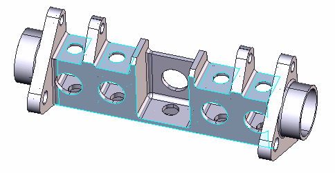
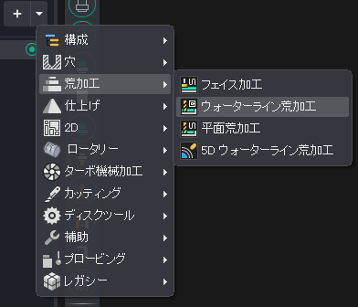
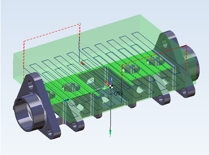

# 選択したフィーチャーに対するオペレーションの作成

多くの単純形状から構成されるプリズマティック部品の加工工程を作成するには、多くの時間がかかります。この作業を簡略化するため、CAMシステムには、選択した形状に対して加工オペレーションを作成する機能が用意されています。

操作は非常にわかりやすく、簡単に行えます。

まず、グラフィックビューで加工したい対象を選択し、次に選択した形状を加工する工程オペレーションを作成します。

作成した加工タイプに基づき、CAMシステムは選択した形状内のポケットや穴などの加工特徴を自動的に認識し、先ほど作成した工程の `ジョブ割り当て` に登録します。

その後、CAMシステムは、回転工具（ライブ工具）の軸がフィーチャーのローカル座標系のZ方向と一致するようにマシン工具の軸を配置します。続いて、加工フィーチャーの属性に基づいて、最適な工具と加工パラメータを選択します。

例えば、部品上の穴をダブルクリックすると、CAMシステムは自動的にその穴を測定し、同じ直径を持つすべての穴をハイライト表示します。ここで、穴加工オペレーションを作成すると、CAMシステムは選択されているすべての穴を、作成したオペレーションの `ジョブ割り当て`に自動的に登録し、ドリル径を穴の直径と同じ値に設定します。

`3D穴加工オペレーション`を作成し、選択した穴が異なる平面上に配置されている場合、CAMシステムは1つの穴加工オペレーションではなく、穴が配置されている平面の数に応じて複数の加工オペレーションを作成します。

ポケット加工オペレーションを短時間で作成する手順の例：

下図に示す部品を、割出フライス盤（3+2軸フライス盤）で加工します。

最初に、ポケットの荒取り加工を行います。画面上で加工するポケットの底面を選択し、 `オペレーション追加`のドロップダウンリストから `ウォータライン荒加工` を選択します。

CAMシステムは、ポケットがジョブ割り当てに設定された2つの荒加工オペレーションを自動的に作成します。

生成されたツールパスは、下の図で確認できます。

