# 基準サーフェス

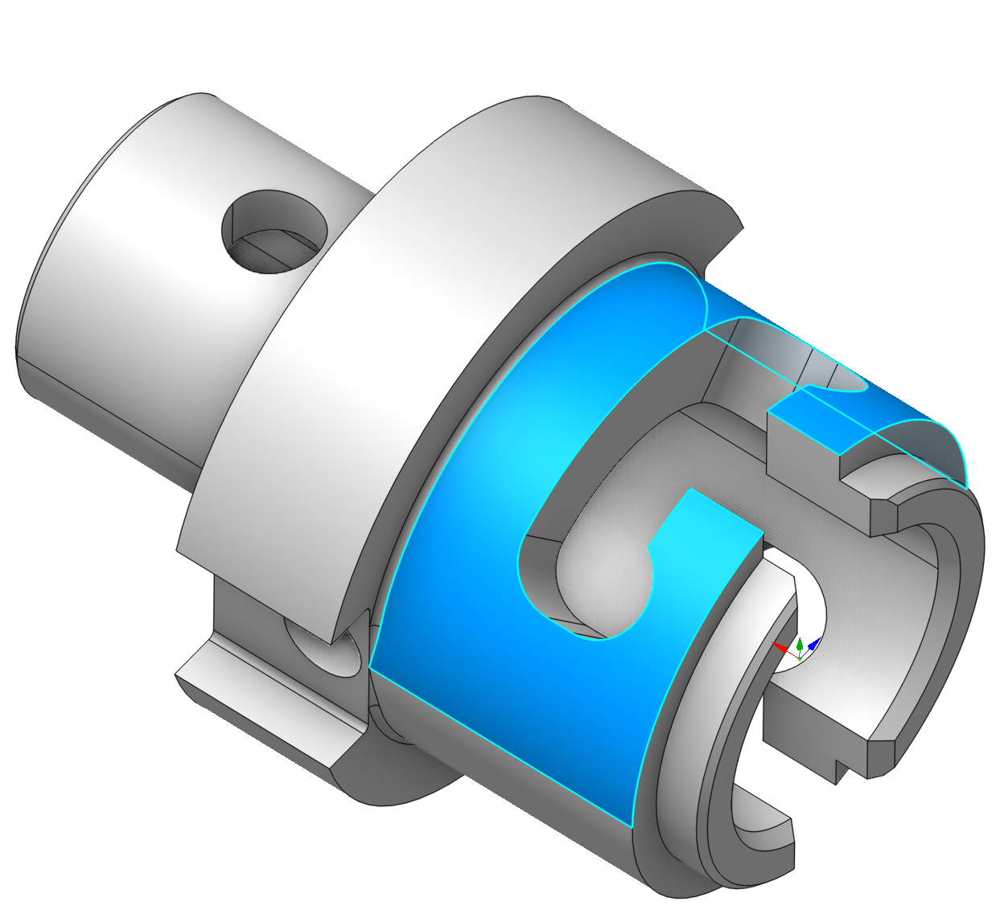 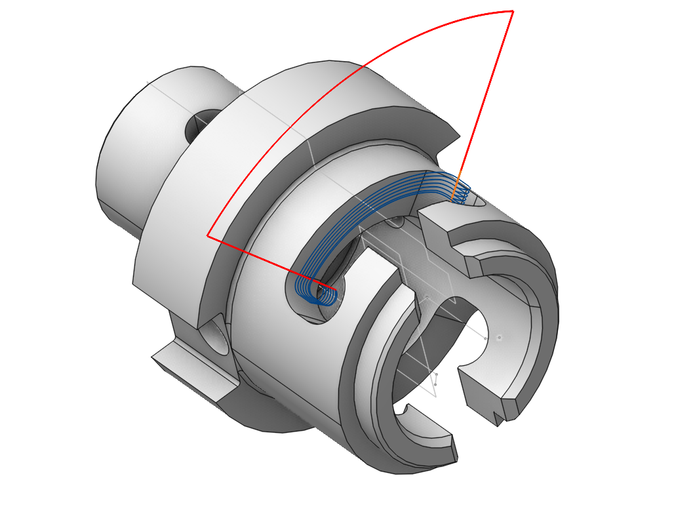

## 適用分野：

`2D輪郭加工`, `2Dポケット加工`, `彫刻`, `エリアクラッディング` の各オペレーションは、基準サーフェス上にツールパスを生成することが可能です。基準サーフェスとしては、平面、円筒面、および回転サーフェスを使用できます。基準サーフェスは、ポケット加工または彫刻オペレーションの`ジョブ割り当て`で指定します。既存の3Dモデルのサーフェスを基準サーフェスとして使用することも可能です。その場合、基準サーフェスに接続されたサーフェスを、ポケットおよびボスとしてジョブ割り当て項目に追加することもできます。この機能は文字彫刻に非常に有効です。

## 基準サーフェスのプロパティダイアログボックス：

<strong>プロパティ</strong>ダイアログボックスで以下の基準サーフェスパラメータを設定します。

### 項目タイプ：

<strong>なし</strong> 基準サーフェスパラメータを設定しません。

<strong>平面</strong> <strong>中心</strong>点を通り、 <strong>軸方向</strong>フィールドで定義された座標軸に垂直な平面として基準サーフェスを設定します。グラフィックフィールドで3Dモデル上の平面を選択することで、基準平面として指定することができます。システムはパラメータを自動的に計算します。

<strong>円筒、半径</strong> <strong>軸方向</strong>パラメータで決定された軸を持ち、 <strong>中心</strong> 点を通り、ダイアログボックスで指定された半径を持つ円柱として基準サーフェスを設定します。グラフィックフィールドで3Dモデルの円筒面を選択することで、基準円筒として指定することができます。システムはパラメータを自動的に計算します。

<strong>回転</strong> 基準サーフェスとしてユーザー定義の回転サーフェスを選択します。

### 位置

<strong>軸</strong> 基準サーフェスの位置を定義する軸（`平面`に対する直交ベクトル、または`円柱`の軸）を選択します。

<strong>軸方向</strong> <strong>カスタム</strong>軸を使用する場合は、その軸を定義する座標軸に沿った単位ベクトルの成分を入力します。

<strong>中心(Pc)</strong> 基準サーフェスの原点を定義する点です。

### パラメータ

<strong>別の正面</strong> この機能は、サーフェスの加工面を反対側（裏側）に変更します。

<strong>カーブ投影方法</strong> 基準サーフェスへの曲線のマッピング方法を指定します。

<strong>近似</strong> 曲線は、その位置と範囲に基づいて、最も近いサーフェスに直接マッピングされます。

<strong>UVドメインへマップ</strong> 曲線の投影はサーフェスのUVマップによって決定されます。

<strong>カーブ変換</strong> UV座標を変更して投影曲線を変更します。

<strong>最小X</strong> 基準<strong>平面</strong>に対するマッピングの初期U座標を調整します。

<strong>最大X</strong> 基準<strong>平面</strong>に対するマッピングの終端U座標を調整します。

<strong>最小Y</strong> 基準<strong>平面</strong>に対するマッピングの初期V座標を調整します。

<strong>最大Y</strong> 基準<strong>平面</strong>に対するマッピングの終端V座標を調整します。

<strong>最小H</strong> ベース円筒の始動位置を調整します。

<strong>最大H</strong> ベース円筒の終了位置を調整します。

<strong>最小A</strong> ベース円筒の初期角度を調整します。

<strong>最大A</strong> ベース円筒の最終角度を調整します。

<strong>回転角</strong> マップの中心を軸に曲線を回転させます。

<strong>比率を保持</strong> 変換中に曲線要素間の比率を維持します。

### 基準サーフェスでの作業

例として、C軸と円筒補間を利用してこのポケットを 複合旋盤で 加工してみます。

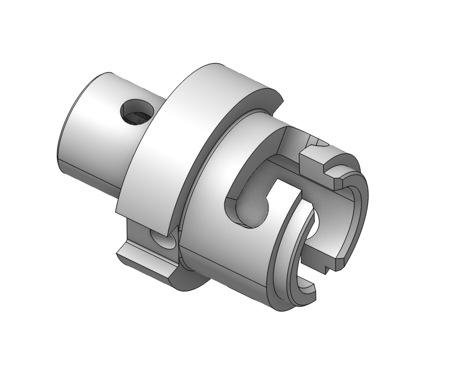

ここでは2D輪郭オペレーションを使用します。 モデル上のエッジを選択し、ツールパスを計算します。しかし、このツールパスでは不十分な結果であることが分かります。

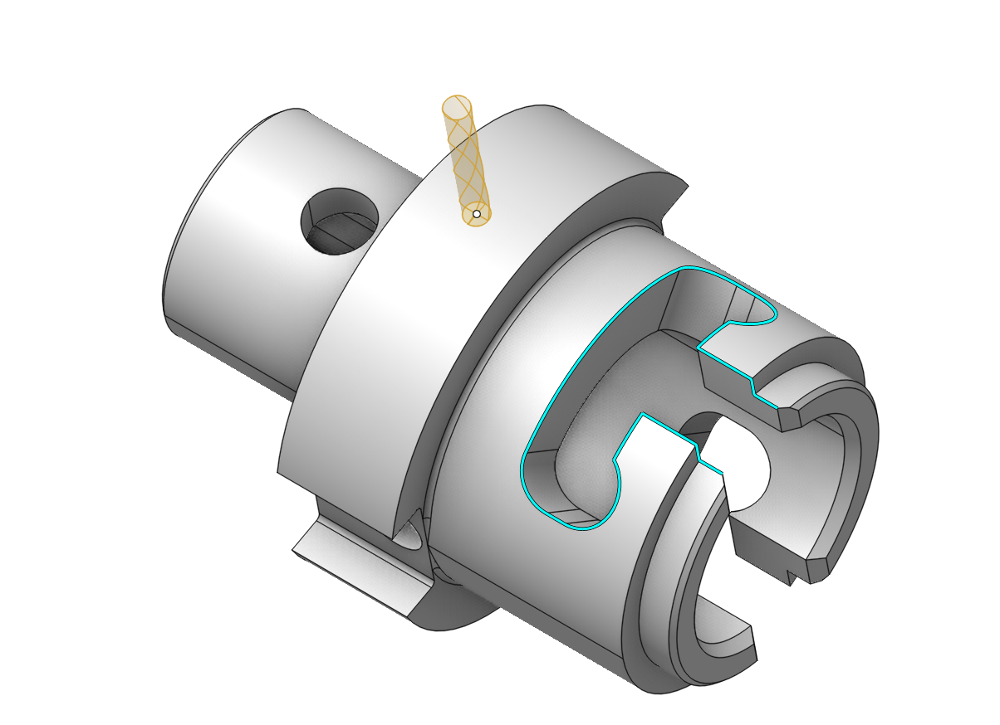 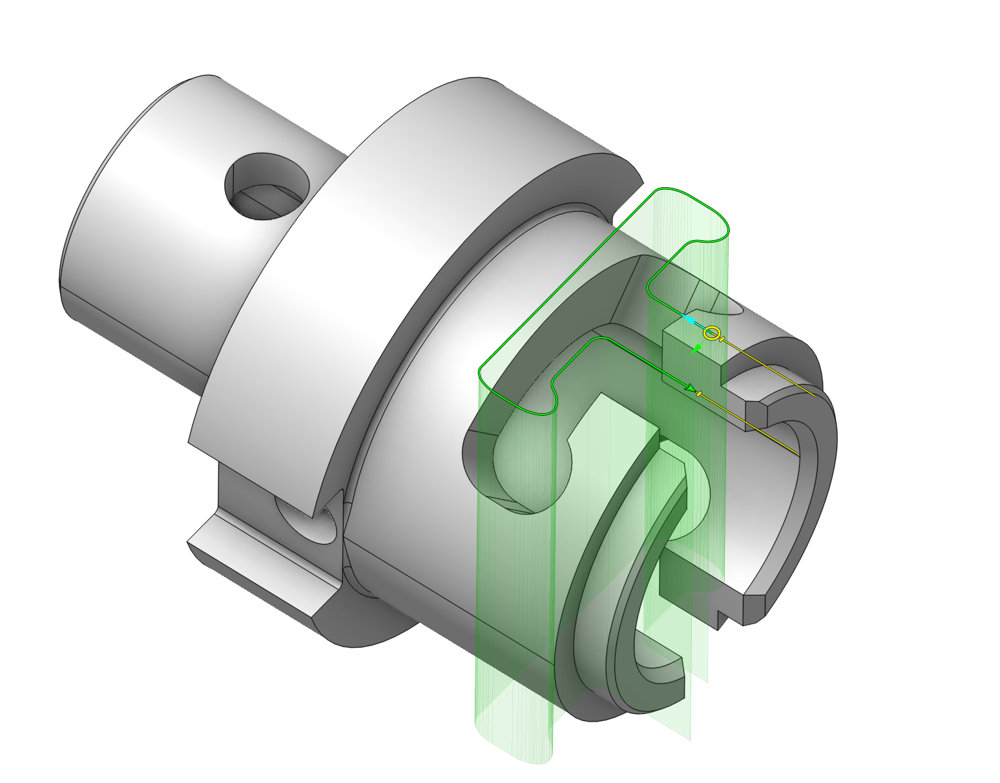 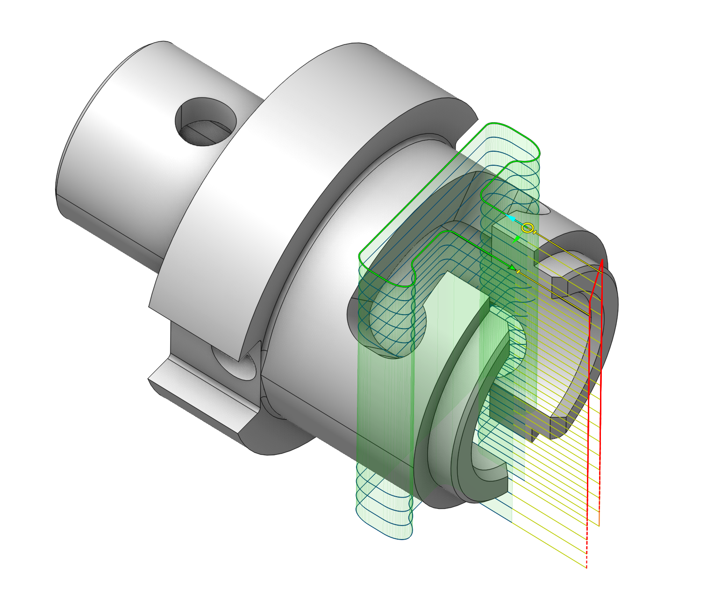

ジョブ割り当てで、基準サーフェスウィンドウを開きます。

部品の円筒面をダブルクリックします。底面の半径は自動的に決定されます。

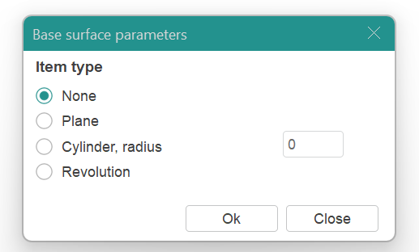

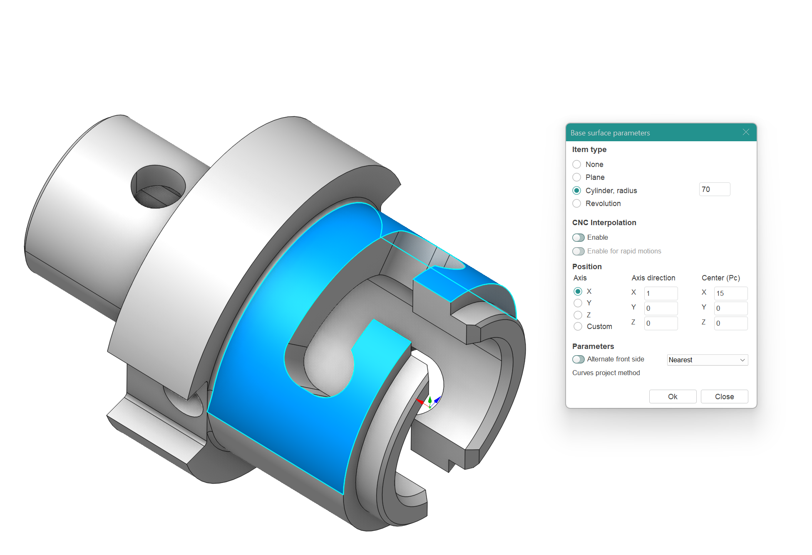

輪郭を削除し、再度割り当てます。すると、 次のような結果が得られます。 次に、加工レベルを設定する必要があります。

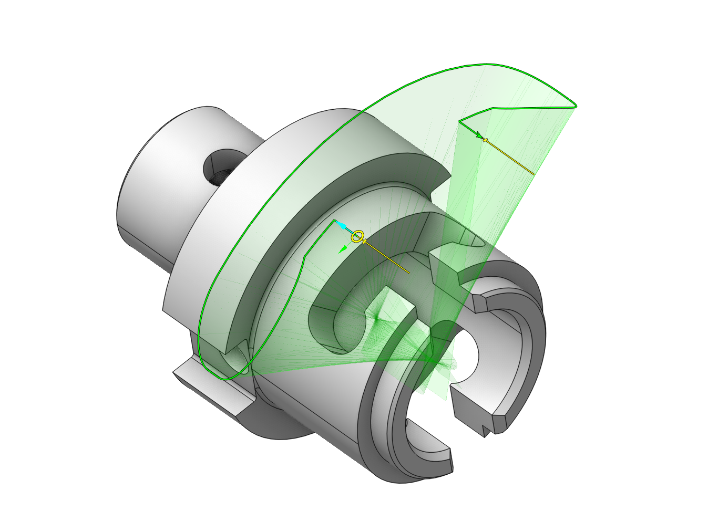

加工方法タブでこの基準サーフェスを選択し、<strong>底部高さ</strong>を0に、<strong>上部高さ</strong>を10に、<strong>切込み深さ</strong> を5 mmに設定し、ツールパスを計算します。

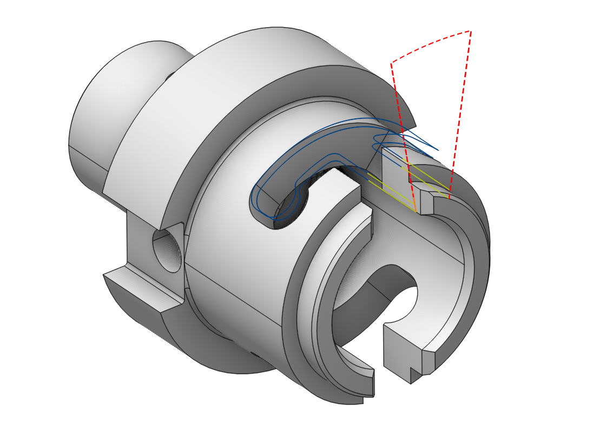

底面高さが、基準サーフェス上に設定されていることが確認できます。 ポケットを切削するには、 <strong>底部高さ</strong> を-10mmに変更します。

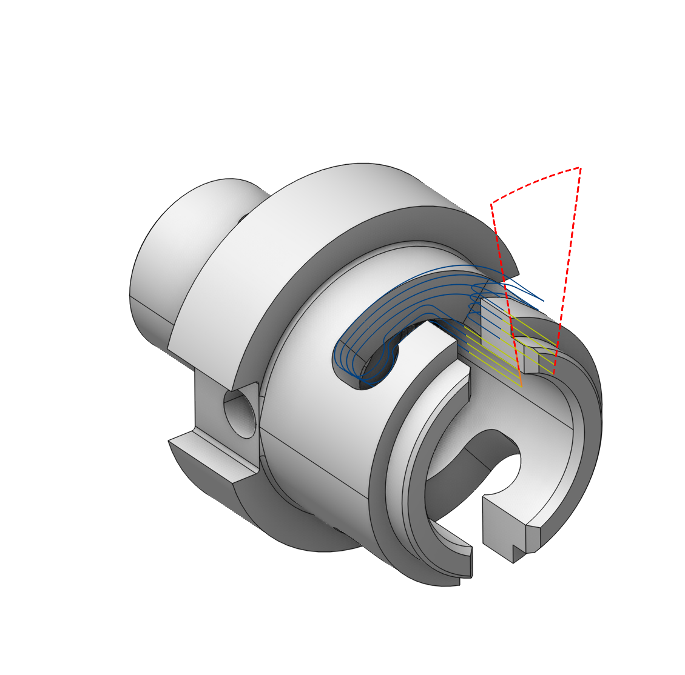

ただし、この時点ではCLData出力には円筒補間のコマンドがありません。

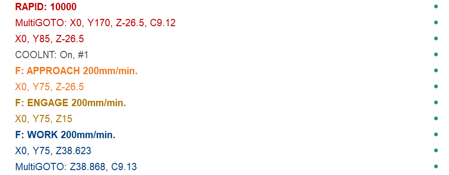

これを有効にするには、基準サーフェスタブに移動し、該当するオプションを有効にする必要があります。(マシン構成の<strong>制御機パラメータ</strong> - <strong>回転変換</strong>で円筒補間サポートのチェックボックスが有効であることが重要です。[詳細を見る](1021.md))

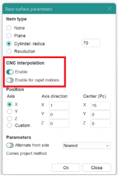 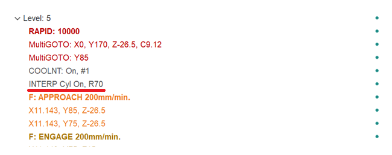

その後、対応するコマンドがCLDataに表示され、ポストプロセッサーで処理できるようになります。 円筒補間については次のセクション [詳細を見る](10082.md)で詳しく説明されています。
