# Superficie di base

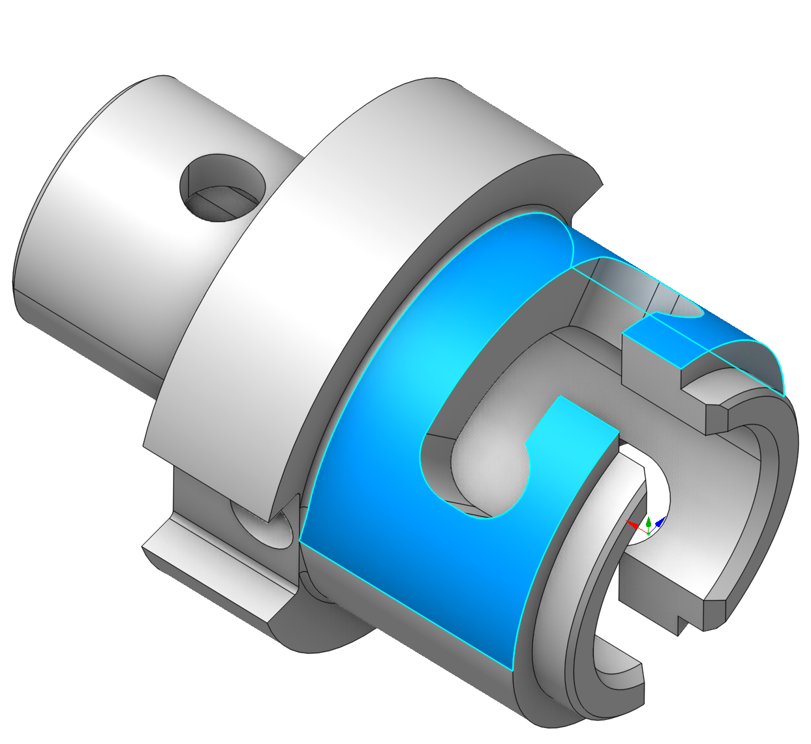 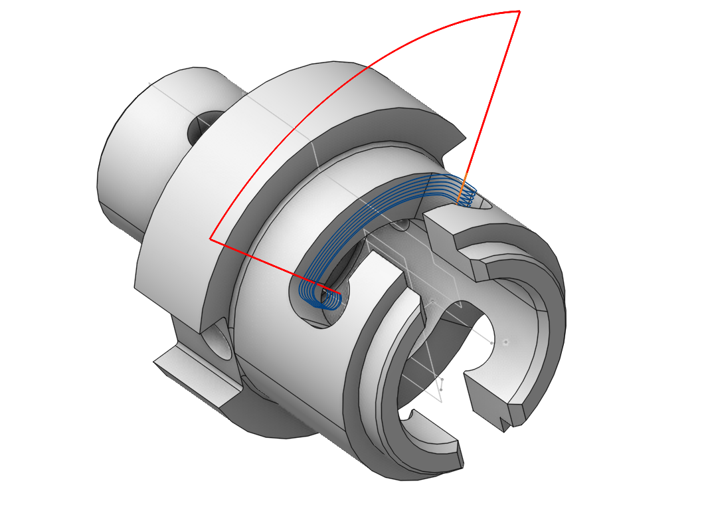

## Ambito di applicazione:

È possibile creare operazioni 2D Contouring, 2D Pocketing, Engraving e Area Cladding che generano il percorso utensile su una superficie di base. Come superficie di base si possono utilizzare piani, cilindri e superfici di rivoluzione. La superficie di base viene specificata nell'assegnazione del lavoro (Job assignment) di un'operazione di svuotamento tasche/incisione. È possibile utilizzare come superficie di base superfici esistenti del modello 3D. In tal caso è anche possibile aggiungere come elementi dell'assegnazione del lavoro le superfici collegate alla superficie di base, come tasche e isole. Questa funzionalità è molto utile per l'incisione di lettere.

### Finestra di dialogo delle proprietà della superficie di base:

Configurare i seguenti parametri della superficie di base nella finestra di dialogo <strong>Properties</strong> (proprietà):

<strong id="item-type">Item type:</strong> (tipo di elemento)

<strong>None</strong> (nessuno). Lascia non configurati i parametri della superficie di base.

<strong>Plane</strong> (piano). Imposta come superficie di base un piano passante per il punto <strong>Center</strong> e perpendicolare all'asse coordinato definito nei campi <strong>Axis Directions</strong>. È possibile designare come piano di base un piano del modello 3D selezionandolo nell'area grafica. Il sistema ne calcolerà automaticamente i parametri.

<strong>Cylinder, radius</strong> (cilindro, raggio). Imposta come superficie di base un cilindro con l'asse determinato dai parametri <strong>Axis Directions</strong>, passante per il punto <strong>Center</strong> e con il raggio specificato nella finestra di dialogo. È possibile designare come cilindro di base una superficie cilindrica del modello 3D selezionandola nell'area grafica. Il sistema ne calcolerà automaticamente i parametri.

<strong>Revolution</strong> (rivoluzione). Seleziona come superficie di base una superficie di rivoluzione definita dall'utente.

<strong id="position">Position.</strong> (posizione)

<strong>Axis</strong> (asse). Selezionare l'asse che definisce la posizione della superficie di base (il vettore ortogonale al <strong>Plane</strong> o l'asse del <strong>Cylinder</strong>).

<strong>Axis Direction</strong> (direzione dell'asse). Se si utilizza un asse <strong>Custom</strong> (personalizzato), inserire le componenti del versore lungo gli assi coordinati che definiscono l'asse.

<strong>Center (Pc)</strong> (centro). Il punto che definisce l'origine della superficie di base.

<strong id="parameters">Parameters.</strong> (parametri)

<strong>Alternate Front Side</strong> (inverti lato anteriore). Questa funzione cambia il lato lavorato della superficie portandolo sul lato posteriore.

<strong>Curves Project Method</strong> (metodo di proiezione delle curve). Specifica il metodo di mappatura della curva sulla superficie di base.

<strong>Nearest</strong> (più vicina). La curva viene mappata direttamente sulla superficie più vicina in base alla sua posizione ed estensione.

<strong>Map to UV domain.</strong> (mappa nel dominio UV) La proiezione della curva è determinata dalla mappa UV della superficie.

<strong>Curves Transformation.</strong> (trasformazione delle curve) Modificare le coordinate UV per cambiare la curva proiettata.

<strong>Xmin</strong>. Regolare la coordinata U iniziale della mappa per il <strong>Plane</strong> di base.

<strong>Xmax</strong>. Regolare la coordinata U finale della mappa per il <strong>Plane</strong> di base.

<strong>Ymin</strong>. Regolare la coordinata V iniziale della mappa per il <strong>Plane</strong> di base.

<strong>Ymax</strong>. Regolare la coordinata V finale della mappa per il <strong>Plane</strong> di base.

<strong>Hmin</strong>. Regolare la posizione iniziale del <strong>Cylinder</strong> di base.

<strong>Hmax</strong>. Regolare la posizione finale del <strong>Cylinder</strong> di base.

<strong>Amin</strong>. Regolare l'angolo iniziale del settore del <strong>Cylinder</strong> di base.

<strong>Amax</strong>. Regolare l'angolo finale del settore del <strong>Cylinder</strong> di base.

<strong>Rotation Angle</strong> (angolo di rotazione). Ruotare la curva attorno al centro della mappa.

<strong>Preserve ratio</strong> (mantieni proporzioni). Mantenere le proporzioni tra gli elementi della curva durante le trasformazioni.

### Utilizzo della superficie di base.

A titolo di esempio, si cercherà di lavorare questa tasca su un tornio-fresa utilizzando l'asse C e l'interpolazione cilindrica.

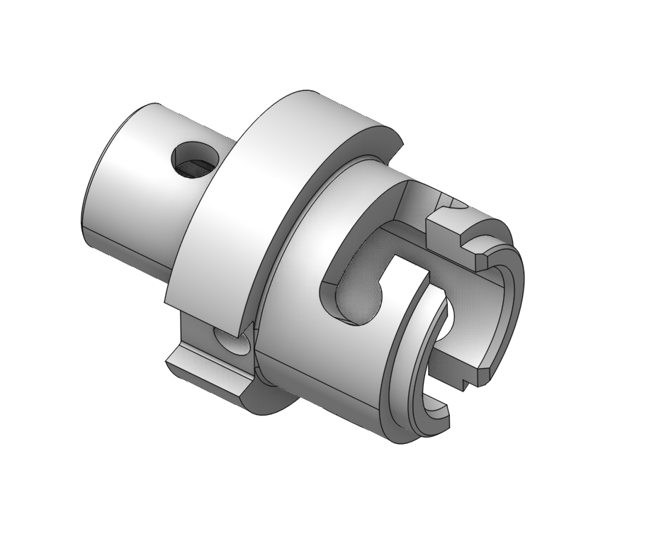

Si utilizza l'operazione 2D contour. Selezionare gli spigoli sul modello e calcolare il percorso utensile. Si può notare che questo percorso utensile non è soddisfacente.

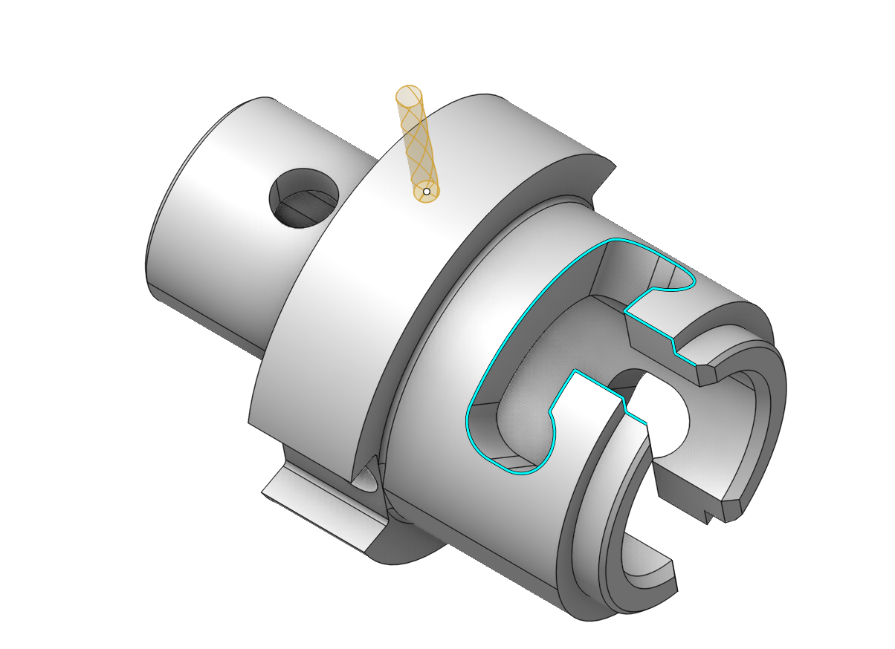 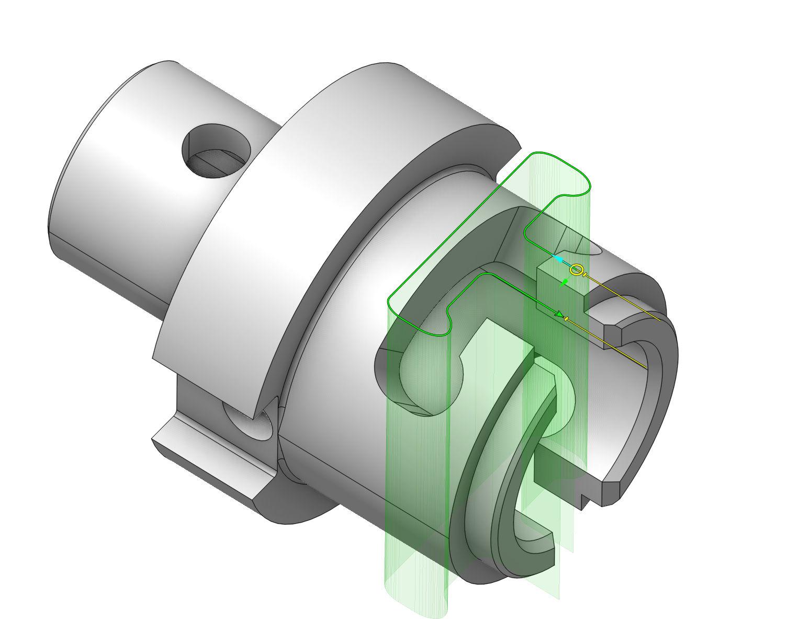 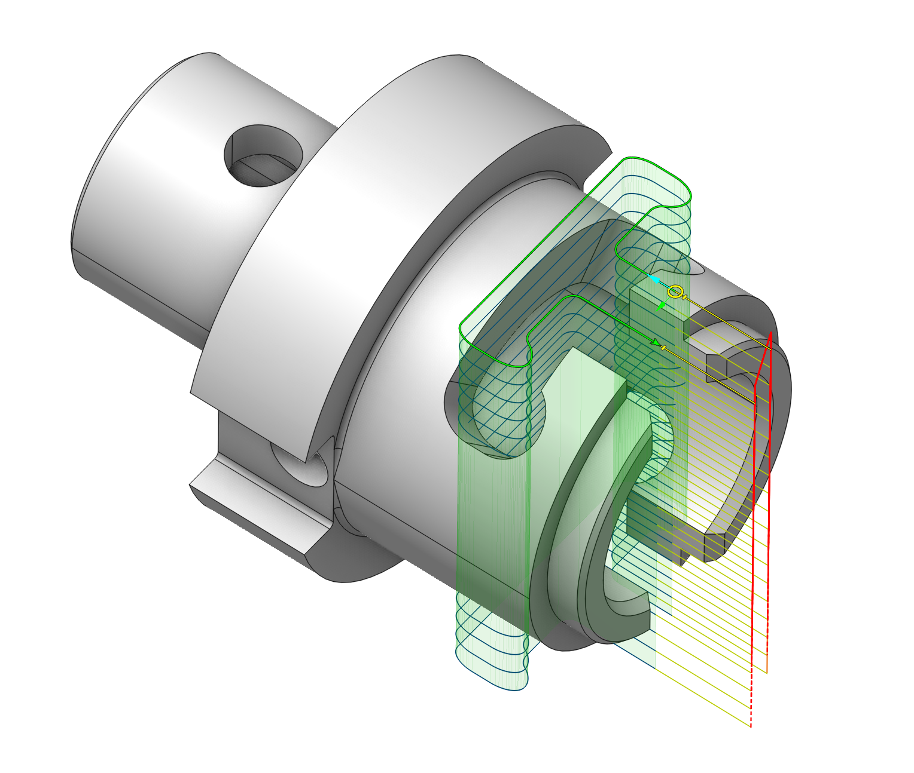

Nell'assegnazione del lavoro, richiamare la finestra della superficie di base.

Fare doppio clic sulla superficie cilindrica del pezzo. Il raggio della superficie di base verrà determinato automaticamente nella finestra.

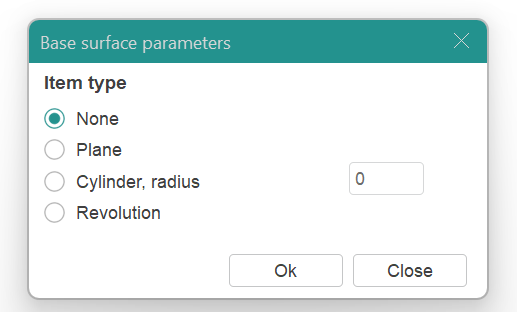

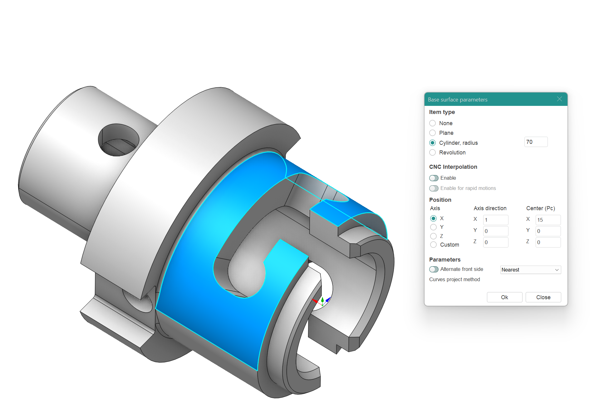

Eliminare il contorno e assegnarlo di nuovo. Si ottiene il risultato seguente. Ora occorre impostare i livelli di lavorazione.

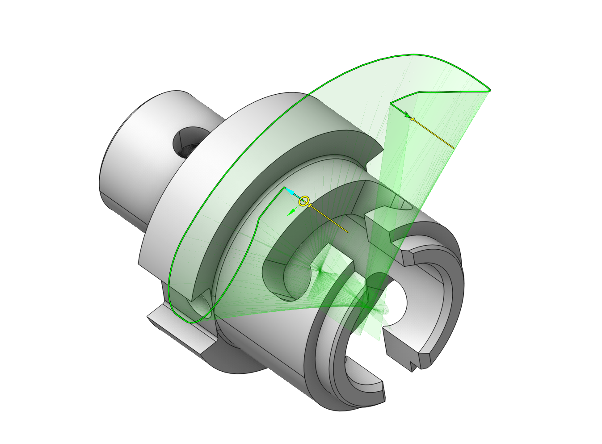

Nella scheda Strategy, con questa superficie di base selezionata, specificare 0 come <strong>bottom level</strong> (livello inferiore) e impostare il <strong>top level</strong> (livello superiore) a 10. Impostare il <strong>Depth of cut</strong> (profondità di taglio) a 5 mm. Calcolare il percorso utensile.

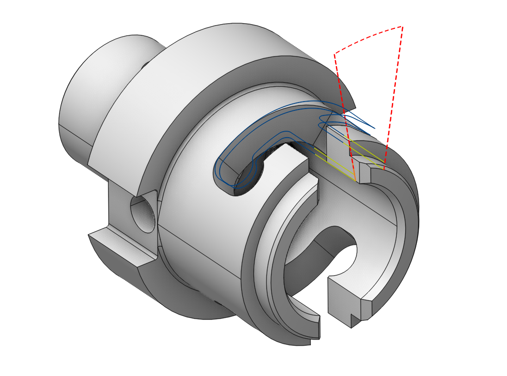

Si può notare che ora il livello inferiore si trova sulla superficie di base. Per lavorare la tasca, si può modificare il <strong>bottom level</strong> a -10 mm.

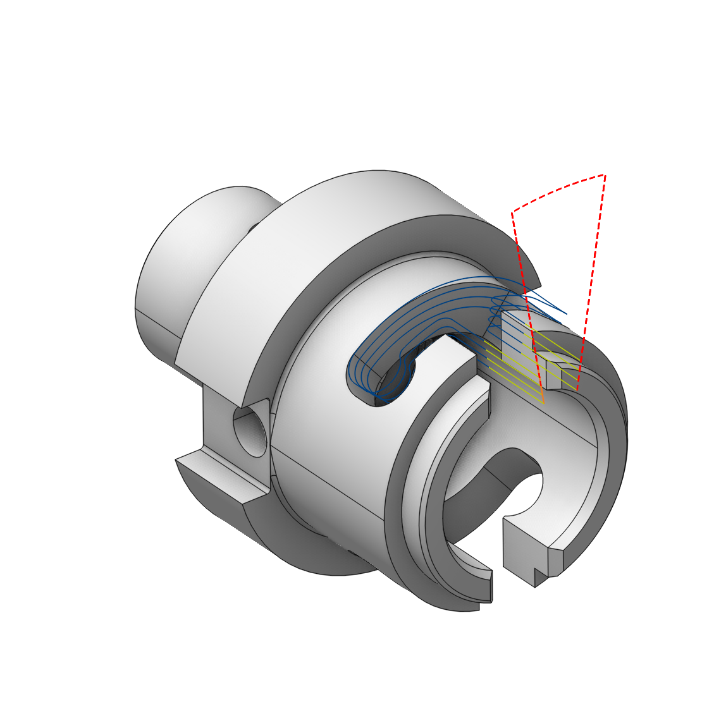

Tuttavia, nell'uscita CLData mancano i comandi per l'interpolazione cilindrica.

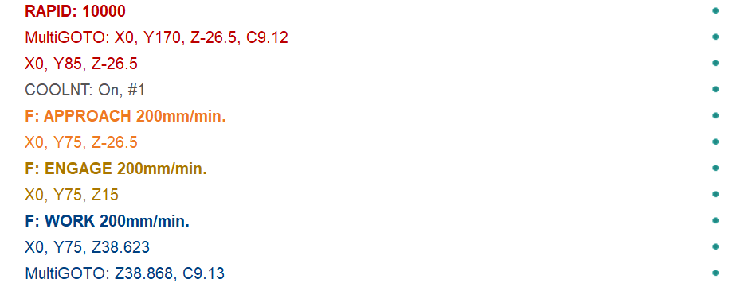

Per abilitarla, passare alla scheda della superficie di base e attivare le opzioni corrispondenti. (È importante che anche la casella di controllo del supporto dell'interpolazione cilindrica sia attivata nella configurazione della macchina, in <strong>Control Parameters</strong> - <strong>Rotary Transformations</strong>. [Dettagli](1021.md))

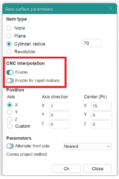 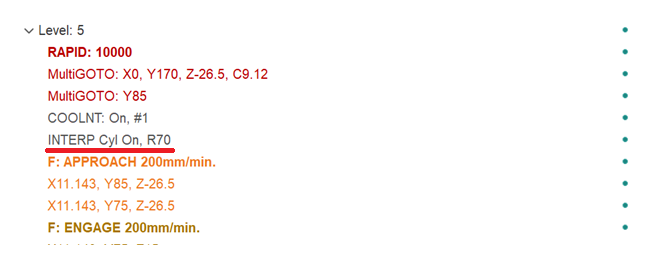

Dopodiché i comandi corrispondenti compariranno nel CLData e potranno essere elaborati nel postprocessore. Per maggiori informazioni sull'interpolazione cilindrica, consultare la sezione seguente [Dettagli](10082.md).
