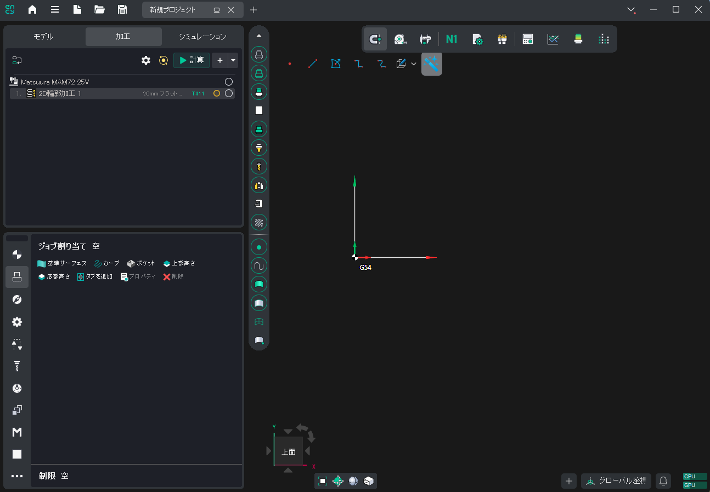
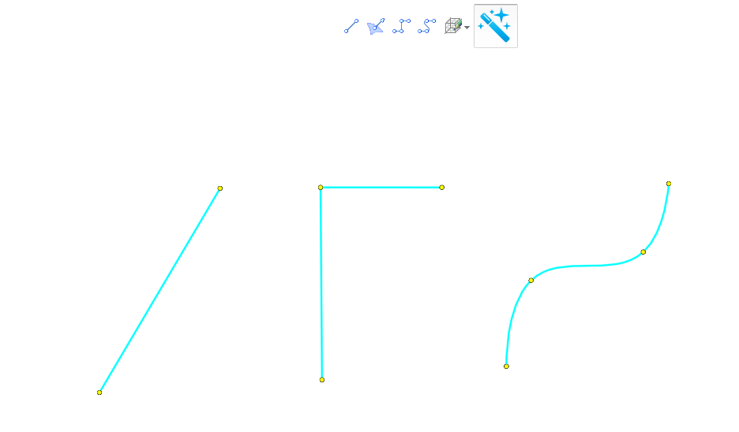
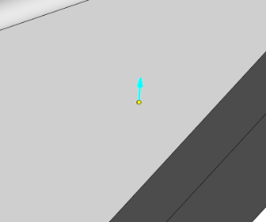
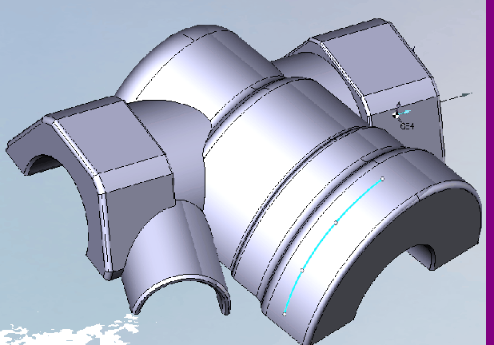
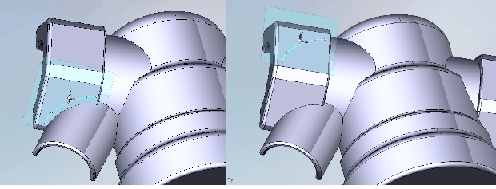

# スプライン曲線の作図

この機能は実験的なもので、現在も開発中です。

加工モードが有効なときに表示される、ライブ曲線描画ツールバーがグラフィックウィンドウに追加されています。

これにより、次の補助曲線を描画できます。

- 直線
- ポリゴン
- スプライン

画面上に表示されているオブジェクトのサーフェス上に直接描画できます。これらの曲線のノードは、マウスのクリック操作だけでドラッグ、削除、追加が可能です。

描画モードには、次の3種類があります。

1. フリー 点は以下のルールに従って選択されます。
  1. カーソルの下にスナップ対象となるオブジェクトがなく、かつそれが最初の点である場合、その点のZ座標は未定義になります。
  2. カーソルの下にスナップ対象となるオブジェクトがなく、かつそれが最初の点ではない場合、その点のZ座標は直前の点と同じになります。（平面上に描画します）
  3. カーソルの下のサーフェスにスナップする場合、サーフェス上の最も近い点が選択されます。
2. サーフェス上 点はサーフェスからのみ選択されます。 
3. 平面上 点は平面上からのみ選択されます。 描画したすべての曲線はこの平面に関連付けられており、平面を移動または回転すると、その変換に合わせて曲線も移動または回転します。
