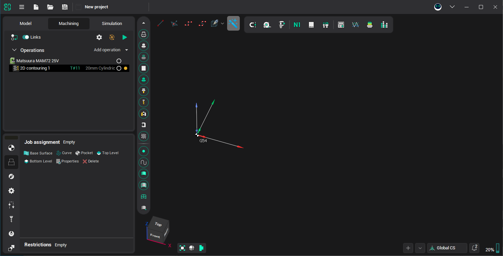
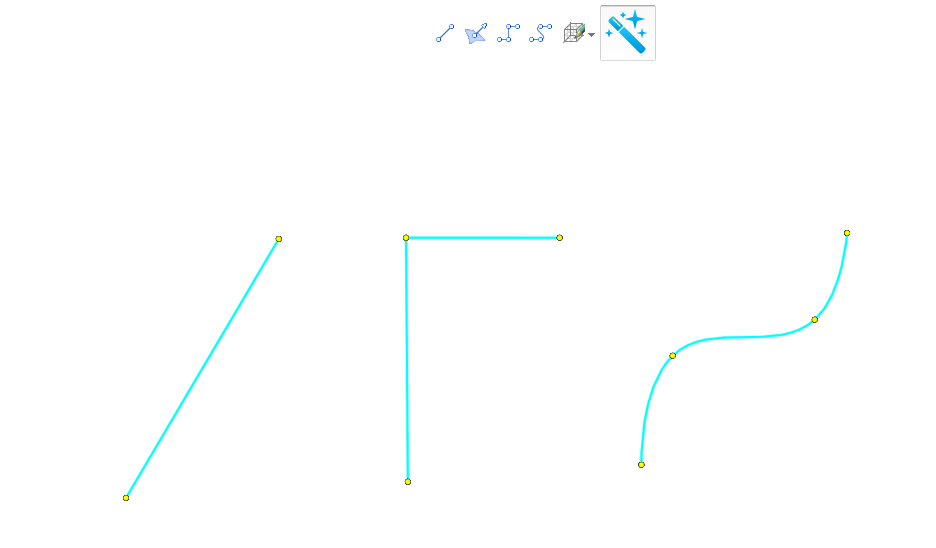
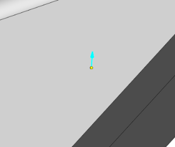
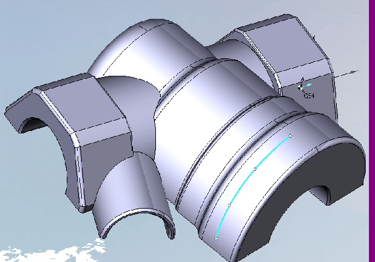
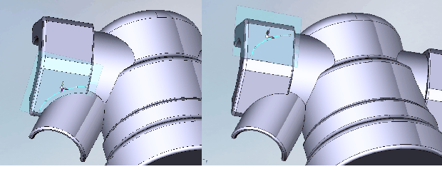

# Disegno di curve spline

Questa funzionalità è sperimentale ed è ancora in fase di sviluppo. Alla finestra grafica è stata aggiunta una barra degli strumenti per il disegno diretto di curve, visibile quando è attiva la modalità Technology (tecnologia).

Consente di disegnare curve ausiliarie:

- linee rette
- poligoni
- spline.

Le curve vengono disegnate direttamente sulle superfici degli oggetti visibili sullo schermo. I nodi di queste curve possono essere trascinati, eliminati e aggiunti con un semplice clic del mouse.

Sono disponibili 3 modalità di disegno:

1. Libera. I punti vengono selezionati secondo la regola seguente:
  1. Se sotto il cursore non è presente alcun oggetto di aggancio ed è il 1° punto, il punto avrà la coordinata Z indefinita.
  2. Se sotto il cursore non è presente alcun oggetto di aggancio e non è il 1° punto, il punto avrà la stessa Z del punto precedente (il disegno avviene su un piano);
  3. Se il cursore si aggancia a una superficie, viene selezionato il punto più vicino di tale superficie.
2. Su superficie. I punti vengono selezionati solo sulla superficie; 
3. Su piano. I punti vengono selezionati solo sul piano. Tutte le curve disegnate sono collegate a questo piano e vengono trasformate insieme a esso (traslazione o rotazione del piano).
