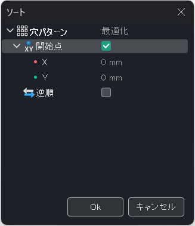
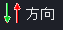
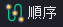
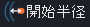
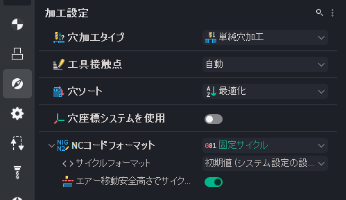

# Ordinamento dei fori

## Ambito di applicazione:

La finestra di ordinamento dei fori consente di selezionare uno dei tipi di ordinamento e di ordinare l'elenco dei fori mediante alcuni parametri.

### Schemi di ordinamento

Il sistema dispone di quattro schemi di ordinamento dei fori: <strong>Rectangular</strong> (rettangolare), <strong>Circular (Rings)</strong> (circolare ad anelli), <strong>Circular (Sectors)</strong> (circolare a settori), <strong>Optimal</strong> (ottimale).

### Rectangular (rettangolare)

Lo schema <strong>Rectangular</strong> consente di ordinare i fori per righe XY. Questo tipo di ordinamento ha i seguenti parametri:

-  — posizione iniziale per il calcolo delle righe
-  — angolo di rotazione delle righe
-  — distanza tra le righe
-  — direzione di calcolo dei percorsi utensile di foratura (valori disponibili: <strong>Top-down</strong> (dall'alto verso il basso), <strong>Bottom-up</strong> (dal basso verso l'alto))
-  — ordine di spostamento tra le righe (valori disponibili: <strong>One way</strong> (in un solo senso), <strong>ZigZag</strong> (a zig-zag), <strong>Optimal</strong> (ottimale))
-  — inversione dell'ordine nella direzione opposta

Se <strong>Start point</strong> (punto iniziale) non è selezionato, il sistema seleziona il primo foro dei percorsi utensile di foratura.

### Circular (Rings) (circolare ad anelli)

Lo schema <strong>Circular (Rings)</strong> consente di ordinare i fori lungo anelli disposti attorno a un centro specificato. Questo tipo di ordinamento ha i seguenti parametri:

-  — centro per il calcolo degli anelli
-  — angolo che definisce la posizione iniziale
-  — distanza tra il centro e il primo anello
-  — distanza tra gli anelli
-  — direzione di calcolo dei percorsi utensile di foratura (valori disponibili: <strong>Clockwise</strong> (in senso orario), <strong>Counter-clockwise</strong> (in senso antiorario))
-  — direzione di calcolo dei percorsi utensile di foratura (valori disponibili: <strong>Outside to inside</strong> (dall'esterno verso l'interno), <strong>Inside to outside</strong> (dall'interno verso l'esterno))
-  — ordine di spostamento tra gli anelli (valori disponibili: <strong>One way</strong>, <strong>ZigZag</strong>, <strong>Optimal</strong>)

### Circular (Sectors) (circolare a settori)

Lo schema <strong>Circular (Sectors)</strong> consente di ordinare i fori utilizzando settori di un cerchio. Questo tipo di ordinamento ha i seguenti parametri:

-  — centro per il calcolo dei settori
-  — angolo che definisce la posizione iniziale
-  — distanza tra i settori (sono disponibili due modalità di inserimento: <strong>Count</strong> (numero) e <strong>Degrees</strong> (gradi))
-  — direzione di calcolo dei percorsi utensile di foratura (valori disponibili: <strong>Clockwise</strong>, <strong>Counter-clockwise</strong>)
-  — direzione di calcolo dei percorsi utensile di foratura (valori disponibili: <strong>Outside to inside</strong>, <strong>Inside to outside</strong>)
-  — ordine di spostamento tra i settori (valori disponibili: <strong>One way</strong>, <strong>ZigZag</strong>, <strong>Optimal</strong>)

### Optimal (ottimale)

Lo schema <strong>Optimal</strong> è analogo all'opzione <strong>Optimal</strong> della scheda <strong>Strategy</strong> (strategia), salvo per le impostazioni configurabili.

Questo tipo di ordinamento ha i seguenti parametri:

-  — foro iniziale per il calcolo dei percorsi utensile di foratura ottimali
-  — inversione dei percorsi utensile di foratura nella direzione opposta

Se <strong>Start point</strong> (punto iniziale) non è selezionato, il sistema seleziona il primo foro dei percorsi utensile di foratura.
