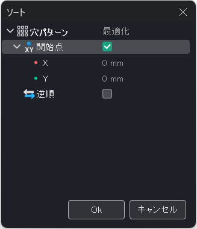
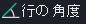
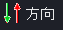
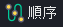
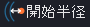
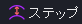
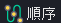
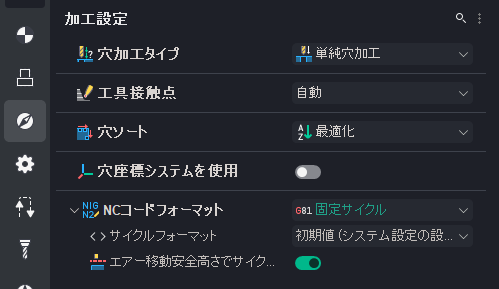
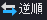

# 穴のソート

穴ソート（並べ替え）ウィンドウでは、いくつかのパラメータを使用して並べ替えのタイプを選択し、穴のリストを並べ替えることができます。

システムには穴の並べ替えパターンが4種類あります。`長方形`、 `円形(リング)`、 `円形(セクター)`、 `最適化`

`長方形`</strong>パターンではXY行に沿って穴を並べ替えることができます。この種類のソートには以下のパラメータがあります。

-  - 計算行の開始位置
-  - 行の回転角度
-  - 行間距離
-  - 穴加工経路計算の方向 (利用可能な値：`上から下`, `下から上`)
-  - 行間の移動順序（利用可能な値：`一方向`, `ジグザグ`, `最適化` )
-  - 逆方向への変更指示 `開始点`のチェックを外すと、システムは穴加工経路の最初の穴を選択します。

<strong>`円形(リング)`</strong>パターンでは、指定した中心から配置されたリングに沿って穴を並べることができます。この種類のソートには、以下のパラメータがあります。

-  - 計算リングの中心
-  - 開始位置を設定する角度
-  - 中心と最初のリング間の距離
-  - リング間距離
-  - 穴加工経路計算の方向 (利用可能な値：`時計回り`、 `反時計回り`)
-  - 穴加工経路計算の方向 (利用可能な値：`外側から内側`,、`内側から外側`)
-  - リング間の移動順序（利用可能な値：`一方向` 、`ジグザグ`</strong>、`最適化` )

<strong>`円(セクター)`</strong> パターン では、円のセクターを用いて穴をソートできます。 この種類のソートには、以下のパラメータがあります:

-  - 計算セクターの中心
-  - 開始位置を設定する角度
-  - セクター間の距離（2つの入力モードがあります：`個数``角度`)
-  - 穴加工経路計算の方向 (利用可能な値:)`時計回り`, `反時計回り`)
-  - 穴加工経路計算の方向 (利用可能な値:)`外側から内側`, `内側から外側`)
-  - セクター間の移動順序（利用可能な値：`一方向`</strong>、`ジグザグ` 、`最適化` )

`最適化`パターンは、`加工設定`内の`最適化`と似ていますが、設定可能なオプションが異なります。

この種類のソートには、以下のパラメータがあります。

-  - 最適 穴加工経路計算の開始穴
-  - 穴加工経路 を逆方向に変更

`開始点`のチェックを外すと、システムは穴加工経路の最初の穴を自動的に選択します。
