# Auftragszuweisung für 2,5D-Bearbeitungsoperationen

Für NC-Programme zur 2D-/2,5D-Bearbeitung ebener Bereiche, Taschen und Erhebungen ist ein vollständiges 3D-Modell nicht immer erforderlich. Eine räumliche Darstellung der Tiefen ist dennoch hilfreich. Das CAM-System baut solche Modelle aus 2D-Konturen auf und zeigt das entstehende Volumen automatisch an.

Das Volumenmodell besteht aus ebenen, durch Konturen begrenzten Bereichen auf unterschiedlichen Höhen und den dazwischenliegenden Wänden. Auch offene Konturen und Punkte können verwendet werden.

Beim Modellaufbau aus ebenen Konturen gibt es zwei grundlegende Elementtypen: **Cover** fügt Material von unten bis zur angegebenen Ebene hinzu, **Hole** entfernt Material von oben bis zu dieser Ebene. Bei Cover liegt die Seitenwand somit unterhalb, bei Hole oberhalb der Elementebene. Zusätzlich kann eine **Base level** definiert werden. Unterhalb dieser Basisebene wird ein nach unten unbegrenzt ausgedehnter Körper angenommen, aus dem mit Hole-Elementen Material entfernt werden kann.

Alle Ebenen werden als absolute Z-Koordinaten im aktuellen [Koordinatensystem](753.md) angegeben.

Zur Veranschaulichung kann der Aufbau mit Sandformen verglichen werden. Die Basisebene entspricht der Sandoberfläche. Die Konturen bestimmen den Querschnitt der Formen, beispielsweise wie unten dargestellt.

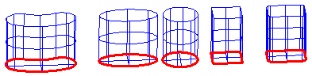

Mit diesen Formen können Vertiefungen ausgestochen oder durch Auffüllen Erhebungen aufgebaut werden. Der geschlossene Boden einer Form bestimmt die Elementebene. Die offene Seite setzt sich bei Cover nach unten und bei Hole nach oben unbegrenzt fort.

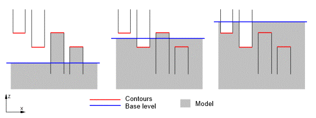

Ein Hole-Element im leeren Raum entfernt kein Material. Ebenso fügt ein Cover-Element innerhalb eines bereits gefüllten Körpers nichts hinzu. Oberhalb der Sandoberfläche können Cover-Elemente Erhebungen aufbauen; Hole-Elemente entfernen nur tatsächlich vorhandenes Material.

Die Reihenfolge ist entscheidend: Für eine abgestufte Erhebung muss zuerst Material aufgebaut und anschließend die Vertiefung ausgespart werden. Wird zuerst im leeren Raum eine Vertiefung definiert und erst danach Material hinzugefügt, entsteht ein anderes Ergebnis.

Die folgenden Beispiele zeigen diese unterschiedlichen Ergebnisse.

Links wird zuerst Hole und danach Cover ausgeführt; rechts zuerst Cover und danach Hole.

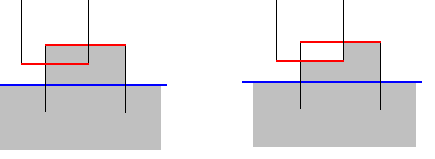

Im ersten Fall erreicht die Vertiefung das vorhandene Material nicht und hat daher keine Wirkung. Im zweiten Fall wird zunächst die Erhebung erzeugt und anschließend ein Teil davon entfernt.

Standardmäßig liegt die Basisebene unbegrenzt weit unterhalb der Nullebene. Meist ist keine eigene Basisebene erforderlich: Eine äußere Kontur als Cover erzeugt den Grundkörper, innerhalb dessen weitere Elemente wirken. Die Darstellung wird nach unten durch **Bottom level** auf der Parameterseite der Operation begrenzt. Darunterliegende Modellbereiche beeinflussen die Bearbeitung nicht.

Die folgende Abbildung zeigt ein Beispiel.

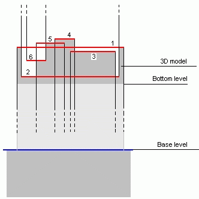

Die Nummern kennzeichnen die Konstruktionsreihenfolge:

1. Cover für die äußere Modellkontur erstellen.
2. Eine Vertiefung mit Hole ausnehmen.
3. Innerhalb dieser Vertiefung ein Cover erstellen.
4. Ein Cover oberhalb der ersten Erhebung erstellen.
5. Ein weiteres Cover erzeugen, das das Element aus Schritt 4 schneidet.
6. Mit Hole eine Vertiefung im zuletzt erzeugten Bereich ausnehmen.

Die Elementeigenschaften werden durch Doppelklick auf einen Eintrag oder über dessen Kontextmenü geöffnet:

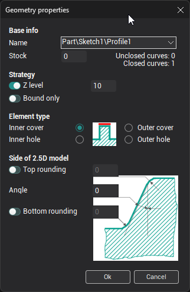

Hier kann auch die Wandform festgelegt werden. Der Winkel bestimmt die Wandneigung in Grad. Zusätzlich sind obere und untere Verrundungen möglich.

Die folgenden Beispiele erläutern den Modellaufbau.

| Vorgehensweise | Abbildung |
|---|---|
| Erstellen Sie im 2D-Geometriemodus zwei sich überschneidende rechteckige Konturen. Wählen Sie unter **Machining** die Operation **2.5D area pocketing** und fügen Sie beide Konturen im Fenster **Model** hinzu. Die dargestellten Bedienelemente bestimmen den Modellaufbau. Setzen Sie beide Konturen auf **Cover** mit Ebene 0. Ohne ausdrückliche Ebenenangabe gilt die größte Z-Koordinate der jeweiligen Kontur. Legen Sie **Bottom level** in den Operationsparametern auf −20 fest. Eine eigene Basisebene ist für dieses Beispiel nicht erforderlich. | 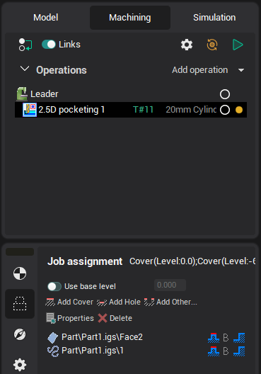 |
| Aktivieren Sie **Preview** und . Die Reihenfolge lautet: 1. Kontur 1, Cover, Ebene 0; 2. Kontur 2, Cover, Ebene 0. Beide Erhebungen reichen bis Z = 0, die dargestellte Unterkante liegt bei −20. | 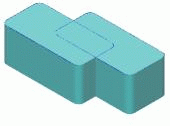 |
| Ändern Sie für Kontur 1 **Level** auf 10. Die Folge lautet: 1. Kontur 1, Cover, Ebene 10; 2. Kontur 2, Cover, Ebene 0. | 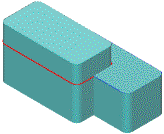 |
| Eine Kontur kann mehrfach verwendet werden: 1. Kontur 1, Cover, Ebene 10; 2. Kontur 2, Hole, Ebene 0; 3. Kontur 2, Cover, Ebene 0. | 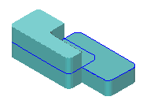 |
| Fügen Sie Kontur 3 hinzu und verwenden Sie folgende Reihenfolge: 1. Kontur 3, Cover, Ebene 5; 2. Kontur 1, Hole, Ebene 0; 3. Kontur 2, Hole, Ebene −10. Zuerst wird Material bis Ebene 5 aufgebaut, anschließend werden die beiden Vertiefungen erzeugt. | 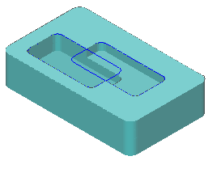 |

Beispiele zur Verwendung der Basisebene.

Die Basisebene entspricht im Sandformenvergleich der vorhandenen Sandoberfläche. Unterhalb davon ist Material vorhanden, aus dem Vertiefungen ausgespart werden können.

Beispiel mit Basisebene:

| Vorgehensweise | Ergebnis |
|---|---|
| Aktivieren Sie **Base level**  und setzen Sie sie auf 0. Verwenden Sie folgende Elemente: 1. Kontur 3, Hole, Ebene −10; 2. Kontur 1, Cover, Ebene 0; 3. Kontur 2, Hole, Ebene −5. | 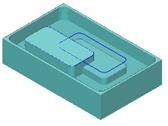 |

Modellaufbau mit **Outside**.

Bisher wirkten Cover- und Hole-Elemente innerhalb der Kontur (**Inside**). **Outside** kehrt den wirksamen Bereich des [Werkzeugs](37.md) bzw. der Form um. Die folgenden Abbildungen zeigen dieselbe Kontur mit Inside links und Outside rechts.

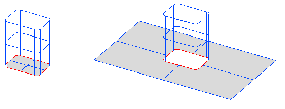

Links: Inside. Rechts: Outside.

Formen zum Ausnehmen von Vertiefungen.

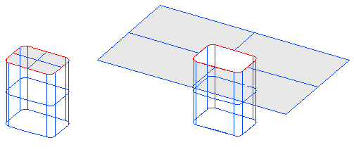

Links: Inside. Rechts: Outside.

Formen zum Aufbauen von Erhebungen.

Die folgenden Beispiele zeigen die Wirkung des Moduswechsels.

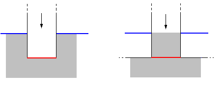

Links entfernt Hole Material innerhalb der Kontur, rechts außerhalb der Kontur.

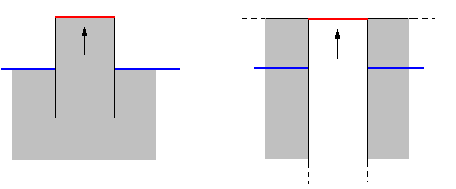

Beim Cover-Element wird links Material innerhalb und rechts außerhalb der Kontur aufgebaut.

Beispiel für **Outside**:

1. Erstellen Sie folgende Elementliste:

| Element | Typ | Ebene | Bereich |
|---|---|---|---|
| 1. Kontur 1 | Cover | 0 | Inside |
| 2. Kontur 1 | Cover | −5 | Outside |

Das Ergebnis entspricht der folgenden Abbildung. Neben geschlossenen Konturen können auch Punkte und offene Konturen zum Modellaufbau verwendet werden.

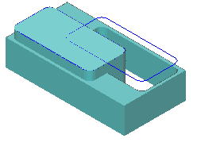

1. Erstellen Sie im 2D-Geometriemodus eine geschlossene Kontur, eine offene Kontur und einen Punkt wie in der Abbildung:

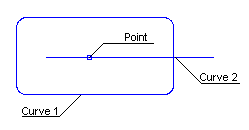

1. Legen Sie folgende Elementliste an:

| Element | Typ | Ebene | Zusätzliches Aufmaß |
|---|---|---|---|
| 1. Kontur 1 | Cover | 0 | |
| 2. Punkt 1 | Hole | −20 | 8 |
| 3. Kontur 2 | Hole | −5 | 3 |

Das Ergebnis entspricht der folgenden Abbildung:

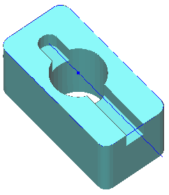

Weitere Beispiele für den Modellaufbau zur 2,5D-Bearbeitung:

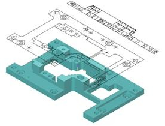

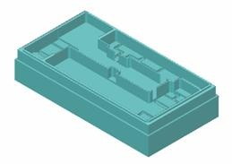
