# 2.5D加工のジョブ割り当て

平面領域、ポケット、カバーなどで構成される2D/2.5D加工用のCNCプログラムを作成する場合、必ずしも3Dモデルを作成するのが最適とは限りません。一方で、形状の深さを視覚的に確認できると便利です。CADシステムでは、2D輪郭を使用してこのようなモデルを作成し、作成と同時に体積モデルとして自動的に表示できます。

`体積モデル` は、異なる高さに配置された2D輪郭、閉じた輪郭によって囲まれた領域、およびそれらの間の壁面から形成されます。視覚モデルを作成する際には、開いた（閉じていない）輪郭や点も使用できます。詳細は以下を参照してください。

3Dモデルは、異なる高さに配置された2D（平面）輪郭から作成されます。このような領域を追加する方法は、次の2種類があります。

「カバー」は、最下部から領域高さまで素材を「追加」します。

「穴」は最上部から領域高さまで素材を「除去」します。

つまり、「カバー」の場合の「側面壁」がその領域高さより下に存在し、「穴」の場合は領域高さより上に存在します。

モデルを作成する際には、基準高さを定義することもできます。基準高さより下の空間は、下方向に無限の深さを持つボディとして扱われ、そこに「穴」を配置することでモデルを作成することができます。

すべての高さ値は、現在の[座標系](753.md)における絶対Z座標で定義されます。

例として、砂を使って形状を作成する場合を考えてみます。基準高さは砂の表面の高さに相当し、造形用の道具は輪郭によって底面形状が定義された容器に相当します。輪郭には、下図に示すように、さまざまな形状を使用できます。

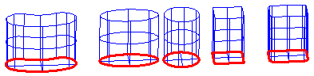

これらの型を使用して、穴を押し出したり、形に砂を詰めてひっくり返すことでカバーを作ることもできます。容器の底（閉じている側）が開始点となり、開いた側は無限に伸びます（カバーの場合は下方向へ、穴の場合は上方向へ無限に伸びます）。

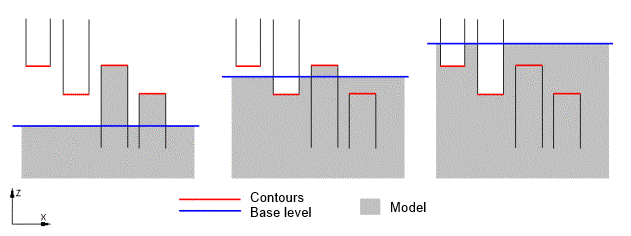

当然ながら、穴形状が何もない空間内にある場合（または他の構造物がない状態で基準高さの上にある場合）、何も押し出すことはできません。同様に、カバー形状が材料の内部にある場合（または穴がない状態で基準高さより下にある場合）は、何も埋めることができません。一方で、砂の表面の高さより上にあるカバー形状は常にカバーを形成し、穴形状は、そこに砂が存在する場合は、常に砂を押し出して穴を形成します。

砂で形を作る際は、作成の順序が重要です。例えば、段差のあるカバーを作成する場合は、まず一体型のカバーを作成し、その後で段差部分を押し出す必要があります。もし先に何もない空間で段差を押し出し、その後にカバーを作成しても正しい結果にはなりません。

上の例は、2つの異なる結果を示しています。

左 – 先に穴を作成、その後カバーを作成 右 – 先にカバーを作成、その後穴を作成

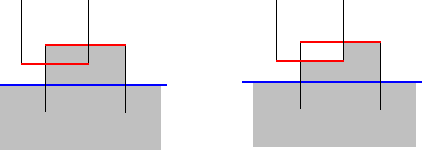

最初のケースでは、穴が「砂」の高さに達しておらず、押し出す対象がなかったため、後で作成されたカバーには何も影響しませんでした。

2つ目のケースでは、先にカバーが作成され、その後、穴によってカバーの「一部」が押し出されました。

デフォルトでは、基準高さはシステムのゼロ平面の無限に下方に位置しています。ほとんどのモデルは基準高さなしで作成可能です。例えば、モデルの外周に対して必要な高さでカバーを作成すれば、その後のモデル構築はそのカバーの内部で行われます。描画時には、オペレーションの `下面` (`パラメータ` ページで定義)で指定された高さより下に3Dモデルは表示されません。その高さより下にあるモデルの部分は、加工オペレーションに影響を与えません。

このようなモデルの例は下の図に示されています。

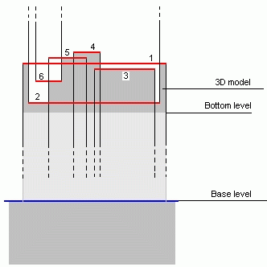

数字は操作の実行順序を示しています。

1. モデルの外形輪郭にカバーを作成
2. 穴を押し出す
3. その穴の内側にカバーを作成
4. 最初のカバーの高さよりも高いカバーを作成
5. 4で作成されたカバーと交差する別のカバーを作成
6. 最後に作成したカバーに穴を押し出す

項目のパラメータは、プロパティウィンドウで変更できます。このウィンドウは、項目をダブルクリックするか、ポップアップメニューから開くことができます。

ダイアログは下図の通りです。

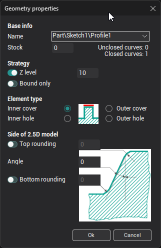

このウィンドウでは、壁の形状も設定できます。角度では壁面の傾斜を度単位で指定します。また、上下のフィレットも設定できます。

視覚モデルを作成するいくつかの方法を練習してみましょう。

| 2D作図 "モードで、互いに交差する長方形の輪郭を作成します。 加工タブに切り替え、「2.5Dポケット加工」を選択します。 「モデル」ウィンドウを開き、2つの輪郭をその操作の加工リストに追加します。視覚モデルの作成は、右側に表示されているパネル上のコマンドとパラメータを使用して行います。前述のとおり、どの輪郭もカバーまたは穴として使用できます。多くの場合、基準高さを使用する必要はありません。外側の輪郭でモデル本体を形成し、ポケット（穴）やカバーを追加または削除することで視覚モデルを作成できます。 最初の輪郭を有効にし、タイプを「カバー」に設定し、輪郭高さを「0」に設定します。輪郭高さを指定していない場合、当該輪郭の最大Z座標が高さとして使用されます。 2つ目の輪郭を有効にし、1つ目の輪郭と同じパラメータを設定します。モデルの底面高さは、"パラメータ "ウィンドウの "底面高さ "パラメータによって定義されます。 値を「-20」に設定します。 | 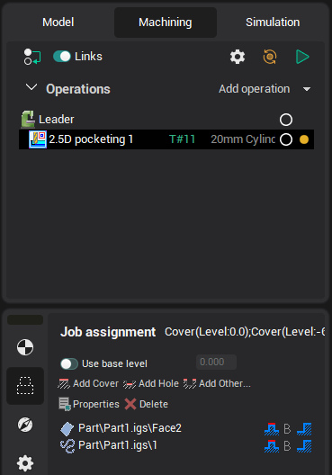 |
|---|---|
| プレビューボックスにチェックを入れ、 ボタンを押してください。図のようなモデルが表示されます。 パラメータとその条件は、以下のように表すことができます。 1.輪郭 1 カバー 高さ 0 2.輪郭 2 カバー 高さ 0 これで1つのバリエーションが作成されました。両方の輪郭をカバーとして使用し、モデルを作成しました。どちらの輪郭も高さ0に配置され、モデルの底面は-20の位置にあります。 | 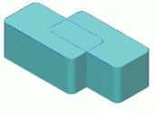 |
| 次のステップ-最初の輪郭を選択し、"高さ "フィールドで値を10に設定します。その結果、輪郭は高さ10上に配置されます。それに応じて、視覚モデルも変化します。 1.輪郭 1 カバー 高さ 10 2.輪郭 2 カバー 高さ 0 | 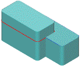 |
| 同じ輪郭を何度も使うことができます。 1.輪郭 1 カバー 高さ 10 2.輪郭 2 穴 高さ 0 3.輪郭 2 カバー 高さ 0 結果は図のようになります。 | 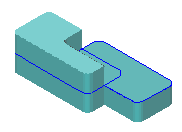 |
| リストに番号3の輪郭を追加します。 1.輪郭 3 カバー 高さ 5 2.輪郭 1 穴 高さ 0 3.輪郭 2 穴 高さ -10 この場合、輪郭3がカバーを 高さ 5まで引き上げ、次に輪郭2が穴を 高さ 0まで押し出し、最後に輪郭1が穴を 高さ -10まで押し出します。 | 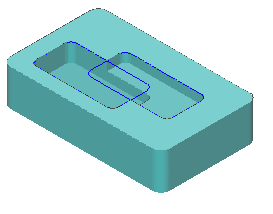 |

`基準 高さ`の使用例をいくつか示します。

前述では、`基準 高さ`は、さまざまな形状を作成するための基準となる砂の表面に例えることができます。つまり、その高さを基準として、いつでも穴を押し出すことができます。

`基準 高さ`の使用例

| 基準高さモードを起動 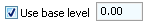 基準高さを0に設定します。 次のパラメータで輪郭のリストを作成します。 1.輪郭 3 穴 高さ -10 2.輪郭 1 カバー 高さ 0 3.輪郭 2 穴 高さ -5 結果は、示した図と同様になります。 | 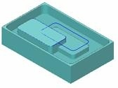 |
|---|---|

`外側`パラメータを使用したモデル例

これまで、 `内側`パラメータを使用して穴を押し出したり、カバーを引き抜いたりする操作を扱ってきました。

次に、`外側`パラメータの使用方法について説明します。

再び砂で形状を作る場合に例えると、輪郭を砂で加工するための型として考えた場合、`外側`パラメータを選択すると、[工具](37.md)の加工領域が反転します。

下の図は、同じ輪郭を使用して `内側`(左) と `外側`(右) モードで作成される形状の違いを示しています。

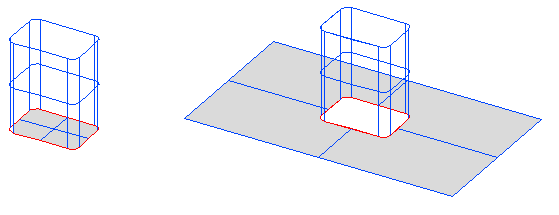

内側 外側

穴を押し出すための形状

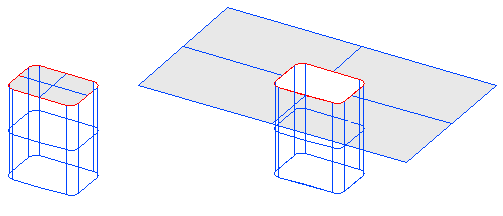

内側 外側

カバーを引き上げるための形状

モードを切り替えたときに何が起こるか確認してください。

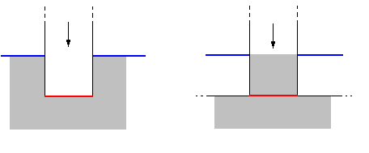

左の図は、`内側`に設定した輪郭によって穴を押し出しています。右の図は、 `外側`に設定した輪郭によって穴を押し出している例です。

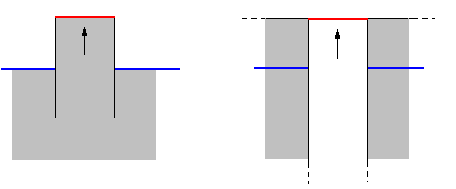

この図にでは、カバーの引き上げが示されています。左は`内側`パラメータ、右は`外側`パラメータです。

`外側`パラメータの使用例を以下に示します。

以下のようにパラメータを設定して、輪郭のリストを作成します。

| 1. 輪郭 1 | カバー | 高さ 0 |   |
|---|---|---|---|
| 2. 輪郭 1 | カバー | 高さ -5 | 外側 |

結果は、下図と同様になります。モデルの作成には、閉じた輪郭だけでなく、点や開いた（閉じていない）輪郭も使用できます。

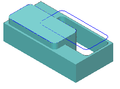

2D図形で、下の図のように、1つの閉じた輪郭、1つの閉じていない輪郭、および1つの点を作成します。

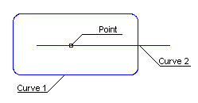

以下のようにパラメータを設定して、輪郭のリストを作成します。

| 1. 輪郭 1 | カバー | 高さ 0 |   |
|---|---|---|---|
| 2. 点 1 | 穴 | 高さ -20 | 追加ストック 8 |
| 3. 輪郭 2 | 穴 | 高さ -5 | 追加ストック 3 |

結果は、下図と同様になります。

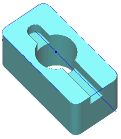

2.5D加工のためのモデル作図の例

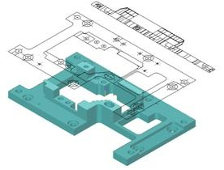

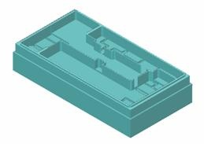
