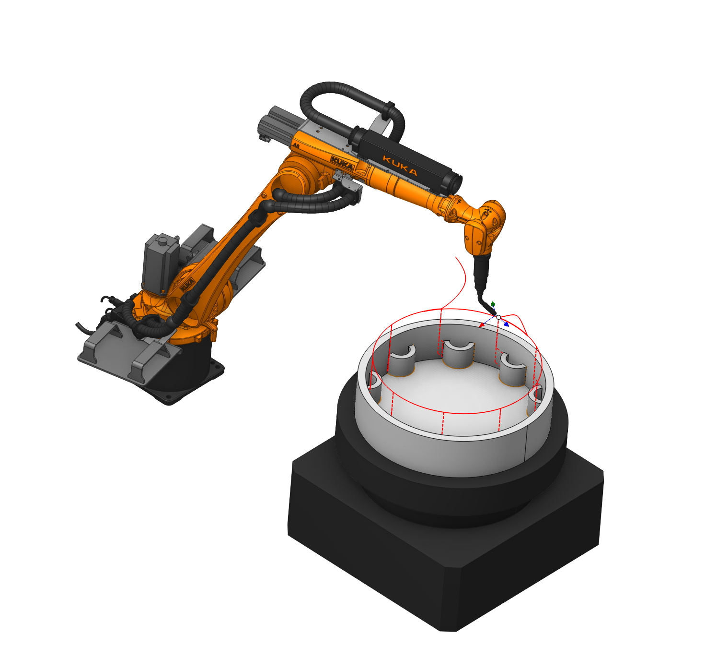
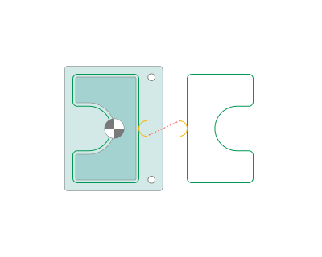
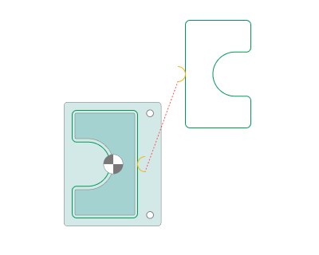
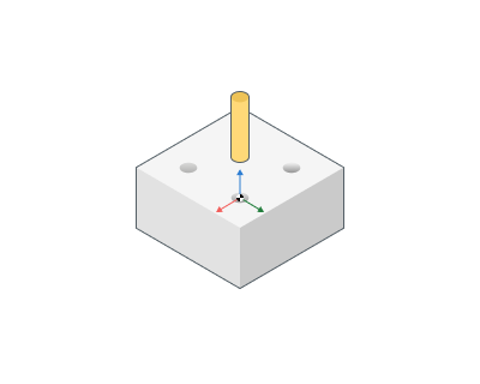
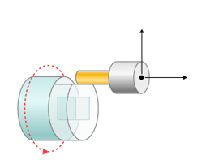
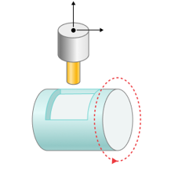

# 変換

## 適用分野：

オペレーション内で計算したツールパスの座標を変換するためのパラメータグループです。

## メイン設定：

### パーツをコピー

コピー元となるパーツの出力方法です。

詳細を表示

<strong>コピー方法</strong> 部品のコピーの処理コードを出力する方法

<strong>実際のコピーを使用</strong> 拡張されたコードの活用

<strong>サブルーチン使用</strong> サブルーチンを利用して処理を実行

<strong>デフォルト</strong> 実際のコピーを使用

### 軸でツールパスを複製

<strong>ツールパスの乗算</strong>機能は、繰り返し出現するモデル断片の加工に役立ちます。繰り返し加工する部品の1つだけを定義し、同じ要素の量と方向を指定するだけで済みます。<strong>装置の物理軸に対応</strong>しています。

詳細を表示

<strong>加工順序</strong>

<strong>順次。</strong> ツールパスのコピーを円周上に順番に配置します。コピー数と角度ステップは、対応するフィールドで指定します。

<strong>増分ステップ</strong> 指定された軸における軸方向のステップ量（単位指定）

<strong>増分数</strong> ブロックの繰り返し回数

<strong>最大間隔</strong> ツールパスの繰り返しコピーを円形に配置し、コピー回数と角度ステップは、対応する欄で指定します。各要素は互いに距離を置いて配置されます。

<strong>手動</strong> ツールパスの繰り返しコピーを円形に配置し、各要素のコピー回数と角度はユーザーが設定します。

<strong>ステップ</strong> ブロックの繰り返し回数（独自角度指定付き）

<strong>角度1...N</strong> 特定の ブロックの繰り返しの角度

<strong>サブルーチンとして形式化</strong> サブプログラムとしての繰り返しブロックを設計します。フィールドに名前を設定することもできます。もし<strong>サブルーチンとして形式化</strong> が無効であれば、何度も繰り返されるブロックは再計算された座標でCLDataに挿入されます。

### 配列を増やす

<strong>ツールパスの乗算</strong>機能は、繰り返し出現するモデル断片の加工に役立ちます。繰り返し部品の1つだけに加工を定義し、同じ要素の量と方向だけを決定することができます。<strong>乗算方式に対応</strong>しています。

詳細を表示

<strong>なし</strong> 乗算方式を使用しません。

<strong>2次元配列</strong> 2次元配列を形成します。

.png)

<strong>2次元配列（手動）</strong>要素を任意の配置で配列化することを可能にします。

_manually.png)

<strong>円形配列</strong> 円周上に配置された配列。順次加工されます。

.png)

<strong>円形配列 (最大間隔)</strong> 円周上に配置された要素の配列です。アルゴリズムは、現在位置から最大距離にある次の処理要素を見つけることを目的にします。

_most_distant.png)

<strong>円形配列 <strong>(手動)</strong></strong> 円周上に配置された要素の配列です。各要素に特定の角度を設定できます。

_manually.png)

<strong>水平配列</strong> 軌跡は工具軸に沿ってコピーされます。

.png)

<strong>軸対称。</strong> 軸に対して対称となるミラーコピーを作成できます。

<strong>点対称</strong> 点からの相対的なミラーコピーの作成を可能にします。

 

<strong>基本座標系</strong> 変換を行う基準となる座標系を定義します。設定可能な値は工具座標系、ワーク座標系、グローバル座標系、または以前に作成したその他の図形座標系です。また、この座標系に対する 追加の平行移動および回転 は、パラメータの追加変換（変形移動の追加）グループ 内で定義できます。

<strong>追加変換</strong> 軸に沿って追加のオフセットを入力できます。

### ロータリー変換

3軸ミーリングで、マシンが対応している場合に、1つの直線軸方向の工具移動をワークの回転運動に変換できます。

詳細を表示

<strong>極座標</strong> 極座標 補間とは、シンプルな3軸ミーリング加工において、直線軸を回転軸に変換する機能です。通常、この機能は回転工具（ドライブミル）を備えた旋盤で必要とされますが、場合によっては他の種類の機械でも使用されます。一般的な旋盤は、2つの直線軸（通常はX軸とZ軸）と、主軸回転（通常はC軸）で構成されています。<strong>[詳細を見る](10083.md)</strong>

<strong>ロータリー軸。</strong> 直線軸を置き換える回転軸です。通常は主軸や回転テーブルを指定します。

<strong>径方向座標</strong> 部品軸に対して垂直な直線軸

<strong>軸方向座標</strong> 部品の回転軸と一致する直線軸

<strong>負の半径座標。</strong> <strong>有効な場合：</strong>半径座標は正の符号で出力

<strong>無効の場合:</strong> 半径座標は負の符号で出力

<strong>CNC補間。</strong> <strong>有効な場合：</strong>ツールパスは、半径軸とロータリー軸を使用してCAMシステムによって補間されます。

<strong>無効の場合：</strong>特別なCNCコマンドは、CNC制御の補間を有効/無効にするために使用されます。

<strong>早送り動作</strong> 早送り動作に対する出力（G0,G1）の方法

<strong>高速送り</strong> 補間ブロック内の高速移動を直線動作（G1）で出力

<strong>早送り。</strong> 補間ブロック内の早送り動作を、位置決め（G0）で出力します。

<strong>高速送り</strong> 「早送り=高速送り」の場合に出力される送り値

<strong>C=0 から開始 <strong>有効な場合：</strong></strong>補間を開始する前に、回転軸をゼロ位置に設定します。

<strong>無効の場合：</strong>補間処理を開始する前に、回転軸を「最適位置」に設定します。注：2023年までに実装された一部のポストプロセッサでは、このオプションに対応していません。ポストプロセッサーの提供元にお問い合わせいただくか、「ゼロ位置」をご利用ください。

<strong>トレランス</strong> 変換後の軌跡が理想形状からどれだけ逸脱しているかをミリメートル（インチ）単位で指定します。

<strong>円筒形</strong> 円筒補間は、展開曲線をプログラムすることで円筒の側面を加工することができます。展開された曲線は [X, Y, Z]座標 でプログラムされますが、円筒加工は [X, C, Z]座標 で実行されます。つまり、円筒補間は[X,Y,Z] => [X,C,Z]の変換を行います。<strong>[詳細を見る](10082.md)</strong>

<strong>一部のパラメータは 極座標補間と類似しています。</strong>

<strong>円筒補間を行うには、加工領域タブで基準サーフェスを円筒に指定し、補間を有効にする必要があります。</strong>

<strong>オフ</strong> ロータリー変換を出力しません。

