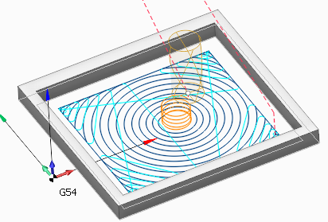
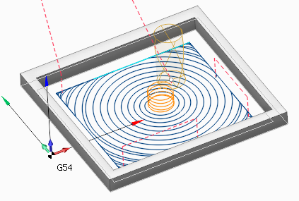
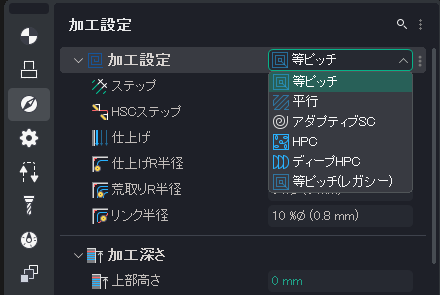

# アダプティブ

この方法は、高送り速度、最大切込み深さ（刃長まで）、および比較的狭い切削幅（工具径の5%～30%）を使用して、大量の材料を効率的に除去するために使用されます。このような加工条件が可能なのは、指定した工具の切削関与角（切削幅またはステップによって定義）が、この加工方法によって設定値を超えないように制御されるためです。

材料はらせん状に除去されます。ツールパスには鋭角なコーナーがありません。ツールパスの滑らかさは、荒加工のコーナーR（丸め半径）、仕上げR、およびリンクRの専用パラメータによって精密に制御されます。リンク動作は、リンク動作は、発熱の蓄積を抑えるためのわずかなZ方向のクリアランスを設け、可能な限り加工平面内で行われます。

工具は、いわゆる『ロールイン技法』を用いて材料に切り込みます。これにより工具寿命が延長されます。ダウンカット、およびダウンカットとアップカットを組み合わせた混合加工の両方を使用できます。混合加工では、アップカット時の切削幅と送り速度を、ダウンカット時とは別に設定できます。

 

この方法は、以下のオペレーションで使用できます。

- [ウォーターライン荒加工](736.md)
- [ポケット加工](256.md)
- [2.5Dポケット加工](https://confluence.encycam.com/pages/viewpage.action?pageId=142639336)
- [平坦面仕上げ](759.md)

この方法は、加工設定のドロップダウンから該当オプションを選択することで有効になります。

