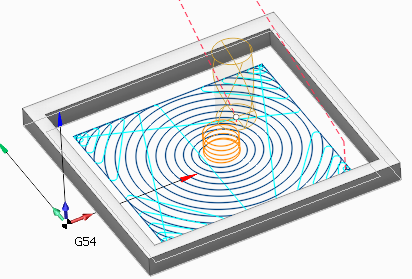
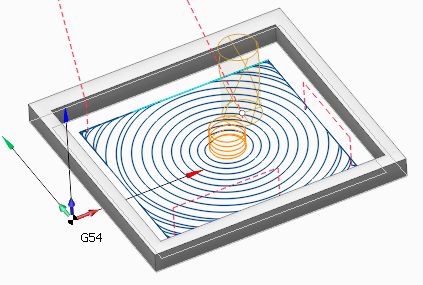
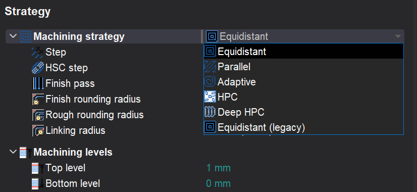

# Usinagem adaptativa

A estratégia é usada para remover com eficiência grandes volumes de material com avanços altos, profundidades de corte máximas (até o comprimento das arestas cortantes) e larguras de corte relativamente pequenas (de 5% a 30% do diâmetro da ferramenta). Esses parâmetros são possíveis porque a estratégia garante que o ângulo de engajamento da ferramenta especificado (definido como largura de corte, ou passo) nunca seja excedido.

O material é removido em forma de espiral. Não há cantos vivos no percurso da ferramenta. A suavidade do percurso é controlada com precisão por parâmetros específicos: o raio de arredondamento de desbaste, o raio de acabamento e o raio de ligação. As ligações são feitas preferencialmente no plano de trabalho, com uma pequena folga adicional em Z, o que ajuda a reduzir o acúmulo de calor. A ferramenta entra no material com a chamada técnica 'Roll-In', que prolonga sua vida útil. Estão disponíveis o fresamento concordante e o misto (concordante e discordante). No fresamento misto, a largura de corte e o avanço das passadas discordantes podem ser definidos separadamente das passadas concordantes.

 

A estratégia está disponível nas seguintes operações:

- [Desbaste por linhas de nível](736.md)
- [Abertura de cavidades](256.md)
- [Abertura de cavidades 2.5D](768.md)
- [Superfícies horizontais](759.md)

A estratégia pode ser ativada selecionando a opção correspondente na lista suspensa Machining strategy:

