# ポケット加工方法

ポケット加工方法は、オープンポケットおよびポケット内の材料除去用に設計されています。

この方法は以下のオペレーションで使用できます。

- [ウォーターライン荒加工](736.md)
- [ポケット加工](256.md)
- [2.5Dポケット](https://confluence.encycam.com/pages/viewpage.action?pageId=142639336)
- [平坦面仕上げ](759.md)

加工設定ドロップダウンリストには、 6種類の加工設定を選択できます。

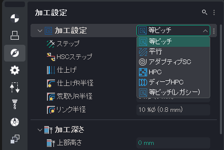

方法は6つあります。一部の項目はオプションであり、追加ライセンスが必要です。これほど多くの方法は、長年の開発の成果です。各方法にはそれぞれメリットとデメリットがあるため、いずれもシステムから削除することはできません。

| <strong>加工方法</strong> |   |   |
|---|---|---|
| <strong>等ピッチ（レガシー）</strong>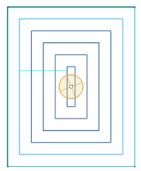 | <strong>メリット</strong> 高速計算 シンプルなツールパス | <strong>デメリット</strong> 切削ステップ（ピッチ）が50%を超える場合、未加工の島（取り残し）が残る可能性がある。 工具負荷や切りくず厚さが不均一になる。 安全平面からのZ軸移動が多くなる。 |
| <strong>等ピッチ</strong> 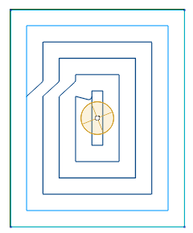 | <strong>メリット</strong> 安全な距離を設定可能、 リンク動作の大部分は、安全平面まで退避することなく実行される。 リンクの円弧（丸め）処理が可能。 | <strong>デメリット</strong> 切削ステップ（ピッチ）が50%を超える場合、未加工の島（取り残し）が残る可能性がある。 工具負荷や切りくず厚さが不均一になる。 |
| <strong>HPC（ハイパフォーマンス切削）</strong> 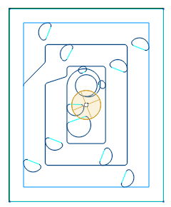 | <strong>メリット</strong> 等ピッチ方法のすべてのメリット 残留する未加工の島（取り残し）を除去するため、特殊な円弧が追加される。 | <strong>デメリット</strong> 工具負荷や切りくず厚さが不均一になる。 特殊な円弧の半径が小さすぎると、送り速度が不均一になる場合がある。 |
| <strong>ディープHPC</strong> 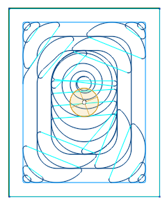 | <strong>メリット</strong> HPC方法のすべてのメリット 工具負荷の均一化 | <strong>デメリット</strong> HPCよりもツールパスが長くなる。 空送りが発生する可能性がある。 計算が不安定な場合があり、工具負荷が許容範囲を超える場合がある。 |
| <strong>アダプティブ</strong> 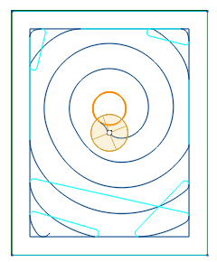 | <strong>メリット</strong> 工具負荷の均一化 オープンポケットに最適なツールパス | <strong>デメリット</strong> 同じパラメータを使用したディープHPCよりもツールパスが長くなる場合がある。特に大きなクローズドポケットでこの傾向が見られる。 |
| <strong>平行</strong> 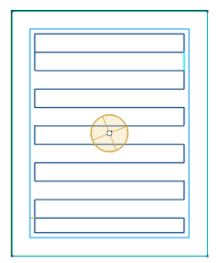 | <strong>メリット</strong> 計算が高速 シンプルなツールパス | <strong>デメリット</strong> 複雑なポケット加工ではZ軸移動が多くなる。 |

## アダプティブ方法の機能

この方法は、高い送り速度、最大切込み深さ（刃長まで）、および比較的狭い切削幅（工具径の5%～30%）を使用して、大量の材料を効率的に除去するために使用されます。指定した工具の切込み角度（切削幅またはステップとして定義）を超えないように制御されるため、このようなパラメータ設定が可能になります。

素材はらせん状に除去されます。ツールパスに鋭角なコーナーはありません。ツールパスの滑らかさは、荒取り加工時の円弧処理R（丸め半径）、仕上げR、およびリンクRの専用パラメータによって精密に制御されます。リンク動作は、熱の蓄積を抑えるために、わずかなZ方向のクリアランスを設け、可能な限り加工平面上で行われます。

工具は、工具寿命を延ばす『ロールイン技法』と呼ばれる方法で材料に切り込みます。ダウンカット、およびダウンカットとアップカットを組み合わせた混合加工の両方を使用できます。混合加工では、アップカットパスの切削幅および送り速度を、ダウンカットパスとは別に設定できます。

## ポケット加工方法の選び方

1. 第1の選択肢は <strong>アダプティブ</strong>方法です。この方法は、デフォルトに設定されていないのは、追加ライセンスが必要なためです。そのため、この方法の購入を強くお勧めします。その他の方法は、アダプティブ方法が利用できない場合、またはアダプティブで不適切なツールパスを生成する場合にのみ試してください。
2. アダプティブが使用できず、かつ工具負荷を一定に保つ必要がある場合は、 <strong>ディープHPC</strong> 方法を試してください。
3. 工具負荷を一定にする必要がなく、切削ステップ（ピッチ）が工具径の50％を超える場合は、 <strong>HPC</strong> 方法を試してください。
4. 工具負荷を一定にする必要がなく、切削ステップ（ピッチ）が50%未満の場合は、 <strong>等ピッチ</strong>方法を試してください。
5. <strong>平行</strong> 方法は、必要に応じて適宜使用してください。
6. 他のすべての加工設定で適切なツールパスが生成されない場合は、 <strong>等ピッチ(レガシー)</strong> を使用してください。

## ツールパスパラメータ

##### バックオフ距離パラメータ

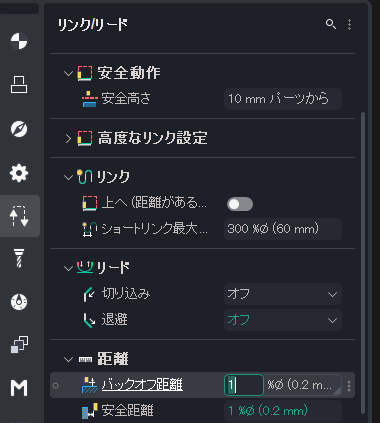

次のトロコイド円弧の開始位置に移動するときに、工具を加工済みサーフェスより上に持ち上げることができます。

##### ジグザグモードでの円弧リンク

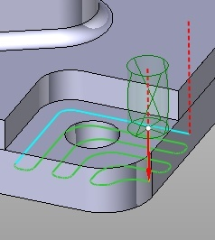 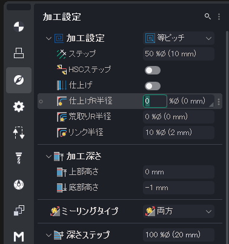

仕上げR半径、荒取りR半径、リンク半径の値は、リンクの円弧（丸め）処理に使用されます。

##### 同じZ深さのリンク

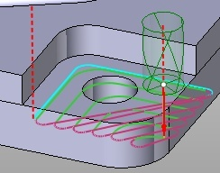

ダウンカットモードおよびアップカットモードでは、工具は安全高さまで退避することなく、直接次のパスに進みます。加工済みサーフェス上で早送り移動を行う場合、工具バックオフ距離が使用されます。また、動きを滑らかにするために「空送りR」も使われます。

##### 安全距離

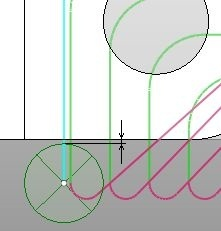 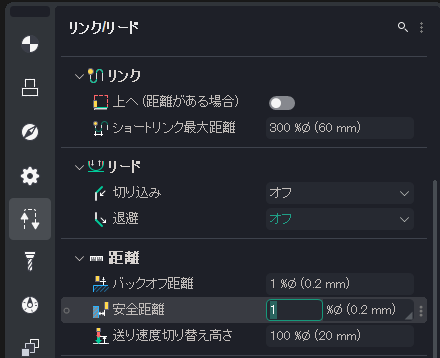

安全距離 は、安全サーフェスから工具を降下させたり、安全サーフェスまで工具を上昇させたりする際に使用します。

垂直方向の動作は、ワークからこの距離を保った位置で行われます。そのため、バージョン10以降では、早送りによる衝突を回避するためにアプローチや退避を有効にする必要はなくなりました。

荒加工の際にあらかじめ開けられた下穴を使用してプランジを行う場合、下穴加工に使用する工具径は、Mill工具径に安全距離の2倍を加えた値以上にする必要があります。この条件を満たさない場合は、 下穴は検出されません 。

##### 早送りリンク

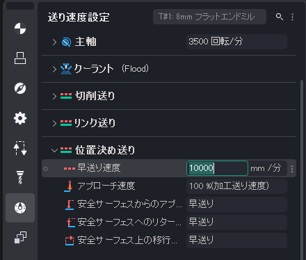

リンク移動は、「次送り速度」または「復帰送り速度」のいずれかを使用して計算できます。リンクの長さが「ショートリンク」の距離より短い場合は「次送り速度」の値が使用され、それ以外の場合は「リターン送り」の値が使用されます。

リターン送りはデフォルトで加工送りの300％に設定されており、これは非切削時の送りとして使用されます。シミュレーション中にリターン送り移動中の切削が検出された場合、その移動にはエラーが表示されます。
