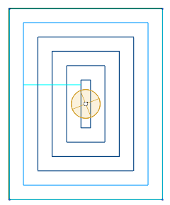
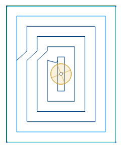
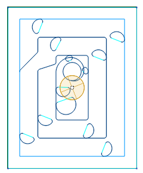
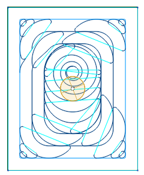
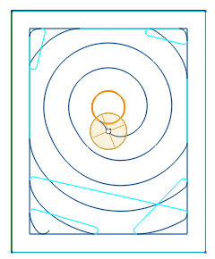
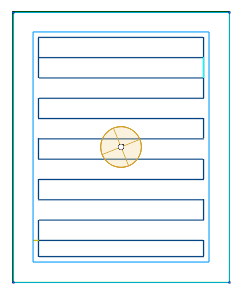
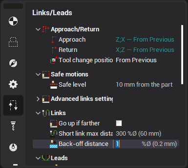
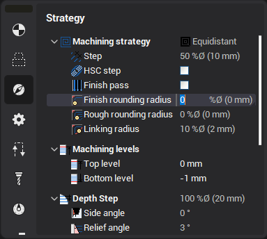
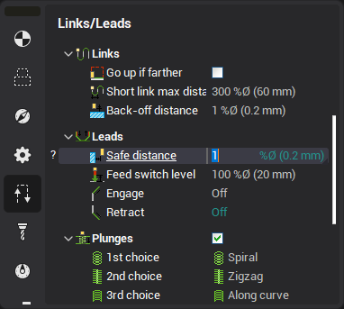
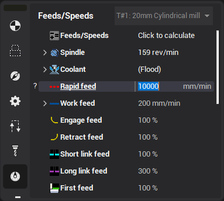

# Taschenfrässtrategien

Die Taschenfrässtrategien dienen zum Materialabtrag in offenen und geschlossenen Taschen.

Diese Strategien stehen in folgenden Operationen zur Verfügung:

- [Wasserlinien-Schruppen](736.md)
- [Taschenfräsen](256.md)
- [2,5D-Taschenfräsen](768.md)
- [Flache Bereiche schlichten](759.md)

Wählen Sie die gewünschte Strategie in der Liste der Bearbeitungsstrategien aus:

Im Folgenden werden sechs Strategien verglichen. Einige sind optional und erfordern eine zusätzliche Lizenz. Die Strategien sind im Laufe der Produktentwicklung entstanden und haben unterschiedliche Stärken und Einschränkungen. Deshalb bleiben auch ältere Varianten verfügbar.

| Strategie | Vorteile | Einschränkungen |
|---|---|---|
| 
<strong>Equidistant (legacy)</strong>

 | Schnelle Berechnung; einfache Werkzeugbahn. | Bei einem Bahnabstand über 50 % können unbearbeitete Inseln verbleiben. Ungleichmäßige Werkzeugbelastung und Spandicke; viele Z-Bewegungen zur und von der Sicherheitsebene. |
| 
<strong>Equidistant</strong>

 | Einstellbarer Sicherheitsabstand; die meisten Verbindungen erfolgen ohne Rückzug auf die Sicherheitsebene; Verbindungen können verrundet werden. | Bei einem Bahnabstand über 50 % können unbearbeitete Inseln verbleiben. Ungleichmäßige Werkzeugbelastung und Spandicke. |
| 
<strong>HPC (High Performance Cutting)</strong>

 | Vorteile der äquidistanten Strategie; zusätzliche Kreisbögen zum Entfernen verbleibender Inseln. | Ungleichmäßige Werkzeugbelastung und Spandicke. Sehr kleine Radien der zusätzlichen Bögen können zu ungleichmäßigem Vorschub führen. |
| 
<strong>Deep HPC</strong>

 | Vorteile von HPC; gleichmäßigere Werkzeugbelastung. | Längere Bahn als bei HPC; mögliche Leerbewegungen. Die Berechnung kann in einzelnen Fällen eine höhere als die vorgegebene Werkzeugbelastung ergeben. |
| 
<strong>Adaptive</strong>

 | Gleichmäßige Werkzeugbelastung; besonders geeignet für offene Taschen. | Bei großen geschlossenen Taschen kann die Bahn länger als bei Deep HPC mit gleichen Parametern sein. |
| 
<strong>Parallel</strong>

 | Schnelle Berechnung; einfache Werkzeugbahn. | Viele Z-Bewegungen bei komplexen Taschen. |

## Merkmale der adaptiven Strategie

Die Strategie entfernt große Materialmengen mit hohen Vorschüben, großen axialen Schnitttiefen bis zur Schneidenlänge und relativ geringer radialer Eingriffsbreite von 5 % bis 30 % des Werkzeugdurchmessers. Der vorgegebene Eingriffswinkel, definiert über Schnittbreite bzw. Zustellung, wird dabei begrenzt.

Der Materialabtrag erfolgt mit spiralförmigen Bahnen ohne scharfe Ecken. Schrupp-, Schlicht- und Verbindungsradien bestimmen die Glätte der Bahn. Verbindungen erfolgen bevorzugt in der Bearbeitungsebene mit einem kleinen zusätzlichen Z-Freifahrabstand, um Wärmeentwicklung zu vermeiden. Einrollende Einfahrbewegungen entlasten das Werkzeug und erhöhen seine Standzeit. Verfügbar sind Gleichlauf sowie gemischte Bearbeitung mit Gleich- und Gegenlauf. Bei gemischter Bearbeitung können Schnittbreite und Vorschub der Gegenlaufbahnen separat festgelegt werden.

## Taschenfrässtrategie auswählen

1. **Adaptive** ist die bevorzugte Strategie. Sie ist wegen der zusätzlich erforderlichen Lizenz nicht standardmäßig ausgewählt. Der Erwerb dieser Option wird empfohlen. Prüfen Sie andere Strategien, wenn Adaptive nicht verfügbar ist oder keine geeignete Bahn erzeugt.
2. Ist Adaptive nicht verfügbar und wird eine gleichmäßige Werkzeugbelastung benötigt, verwenden Sie versuchsweise **Deep HPC**.
3. Ist eine gleichmäßige Belastung nicht erforderlich und liegt der Bahnabstand über 50 % des Werkzeugdurchmessers, eignet sich **HPC**.
4. Bei einem Bahnabstand unter 50 % und ohne besondere Anforderung an die Gleichmäßigkeit der Belastung eignet sich **Equidistant**.
5. **Parallel** kann abhängig von der Bearbeitungsaufgabe eingesetzt werden.
6. Verwenden Sie **Equidistant (legacy)**, wenn die übrigen Strategien keine geeignete Bahn erzeugen.

## Werkzeugbahnparameter

- Werkzeugfreifahrabstand

Bei der Verbindung zum nächsten Startpunkt eines Trochoidenbogens kann das Werkzeug über die bereits bearbeitete Oberfläche angehoben werden.

- Verrundete Verbindungen im Zickzackmodus

 

**Finish rounding radius**, **Rough rounding radius** und **Linking radius** legen die Verrundung der Verbindungen fest.

- Verbindungen auf derselben Z-Ebene

Bei Gleich- und Gegenlaufbearbeitung bewegt sich das Werkzeug direkt zur nächsten Bahn, ohne auf die Sicherheitsebene zurückzufahren. Für Eilgangbewegungen über bereits bearbeiteten Flächen gilt **Tool back-off distance**. **Idle radius** sorgt für einen gleichmäßigen Verlauf der Leerbewegungen.

- Sicherheitsabstand

 

Der Sicherheitsabstand wird beim Absenken von der Sicherheitsfläche und beim Anheben zu ihr berücksichtigt.

Die vertikale Bewegung erfolgt mit diesem Abstand zum Rohteil. Seit Version 10 müssen deshalb An- und Rückfahrbewegungen nicht zusätzlich aktiviert werden, um Kollisionen im Eilgang auszuschließen.

Wird beim Schruppen eine vorgebohrte Bohrung zum Einfahren verwendet, muss der Vorbohrdurchmesser mindestens dem doppelten Fräserdurchmesser entsprechen. Kleinere Bohrungen werden hierfür nicht erkannt.

- Verbindungen mit erhöhtem Vorschub

Für Verbindungen wird je nach Länge der Vorschub **Next feed** oder **Return feed** verwendet. Ist die Verbindung kürzer als **Short link**, gilt **Next feed**, andernfalls **Return feed**. **Return feed** beträgt standardmäßig 300 % des Arbeitsvorschubs und ist für Bewegungen ohne Materialkontakt vorgesehen. Wird bei der Simulation dennoch ein Materialabtrag während einer solchen Bewegung erkannt, wird diese als Fehler markiert.
