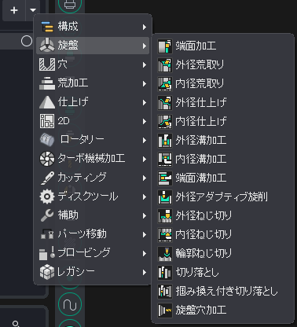

# 旋盤加工の種類

CAMシステムでは、加工プロセスを一連のオペレーションとして構成します。この一連の工程には、さまざまな種類のオペレーションを任意の数だけ含めることができます。各オペレーションは、それぞれ固有の方法でツールパスを生成し、個別のパラメータを設定できます。利用可能なオペレーションの一覧は、[システム構成](261.md)によって定義されます。

すべての旋盤加工オペレーションは、オペレーション一覧の「旋盤」グループにまとめられています。

