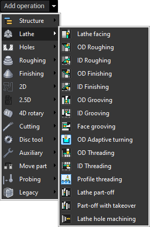

# Tipos de operações de torneamento

O sistema CAM representa o processo de usinagem como uma sequência de operações. A sequência pode conter qualquer número de operações de vários tipos. Cada operação usa seus métodos específicos para formar o percurso da ferramenta e aceita um conjunto individual de parâmetros. A lista de operações disponíveis é definida pela [configuração do sistema](261.md).

Todas as operações de torneamento estão reunidas em um único grupo, "Lathe", na lista de todas as operações.

